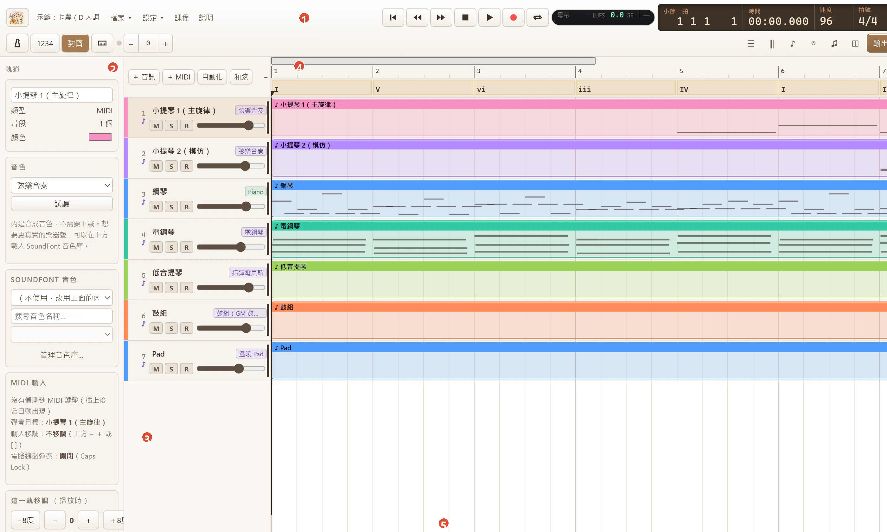
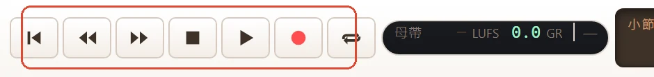

## 為什麼先看地圖

大部分 DAW（數位音訊工作站）的畫面看起來都很像，因為它們都在回答同一個問題：**「聲音現在在哪裡、要送去哪裡？」**。先把這個問題想清楚，後面每一個按鈕都會有位置感，而不是靠背誦。

## 畫面的五個區塊



1. **上方控制列**：檔案（新專案／開啟／儲存／匯入）、播放控制、小節與時間、速度（BPM）與拍號、節拍器與對齊，右邊是各面板的開關和「輸出」。
2. **左邊檢閱器**：目前選取的那條軌——名稱、樂器、插入效果器、Send、移調與和弦。
3. **中間編排區**：時間軸。上面是**尺規**（小節與拍），尺規下方可以打開**和弦軌**，再下面是每一條軌的**片段**（音訊畫波形、MIDI 畫音符）。
4. **下方與浮動面板**：混音台（X）、鋼琴捲簾（P）、母帶會**佔用下方版面**（一次只開一個，會壓縮編排區）；自動伴奏電子琴與效果器視窗才是浮動的，關掉就回來。
5. **下方狀態列**：音訊引擎狀態、輸入電平表、麥克風選擇、錄音延遲補償。

## 聲音走的路

```
麥克風 → 錄音介面 →（數位）DAW 的軌道
  → 插入效果器（修音、EQ、壓縮…）
  → 推桿與聲像 → 送出（Send）到匯流排
  → 母帶處理 → 喇叭／耳機
```

這條路徑上有兩個重要觀念：

- **每一站都會改變聲音**，而且順序有意義：先修音、再 EQ、再壓縮、最後才是殘響。
- **音量是累加的**。四條軌各推一點，主輸出就會爆。後面第 14 堂講壓縮、第 18 堂講混音台時會回來看這件事。

## 這個軟體的三個特色



- **跑在瀏覽器裡**：不用安裝，但也因此要用比較新的 Chrome 或 Edge。
- **聲音不離開你的電腦**：頁面的安全政策禁止連到其他網站，音檔、錄音、專案都只在這台電腦上。
- **專案會自動暫存**在瀏覽器裡；要帶走或備份，用「檔案 → 儲存」下載 `.zyproj`。

## 現在就做

1. 打開軟體，把滑鼠移到上排每一個按鈕上，讀它的說明（停留一秒會出現）。
2. 按 **空白鍵** 播放、再按一次停止。
3. 按 **X** 打開混音台、再按一次關掉；按 **P** 打開鋼琴捲簾。

<div class="daw-tip">
<b>課程用的示範專案</b>：在網址後面加上 <code>?demo=1</code>（例如 <code>/tools/daw/?demo=1</code>）會載入示範曲「卡農（D 大調・弦樂）」：24 小節、96 BPM，和聲與低音取自 Pachelbel 的《Canon in D》（約 1680 年，已進入公有領域），也就是市面上最常拿來練編曲的「卡農進行」D–A–Bm–F#m–G–D–G–A。七條軌分別是小提琴 1（主旋律）、小提琴 2（晚兩小節的模仿聲部）、鋼琴、電鋼琴、低音提琴、鼓與 Pad；旋律節奏與配器都是原創，沒有轉錄任何受保護的編曲或歌詞，可以自由使用。</div>
