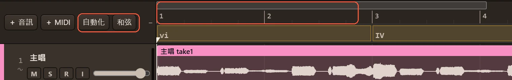

## 為什麼要有分組邏輯

按鈕一多就會找不到。這個軟體的分組規則是：**左邊管「檔案與設定」、中間管「時間與播放」、右邊管「看得見什麼」**。

| 位置 | 內容 | 什麼時候用 |
|---|---|---|
| 左上 | 檔案 ▾、設定 ▾、課程、說明 | 開專案；裝置、MIDI、音色庫、配色都在「設定」裡 |
| 正中 | 回到開頭、倒退、前進、停止、播放、錄音、循環 | 隨時 |
| 中右 | 母帶狀態（LUFS／GR）、小節時間、BPM、拍號 | 播放時看 |
| 右下 | 節拍器、預備拍、對齊、鍵盤彈奏、MIDI 移調 | 錄音前 |
| 最右 | 檢閱器、混音台、鋼琴捲簾、母帶、專輯、輸出 | 切換工作區 |

**為什麼「檔案」要做成一個選單？** 因為新增／開啟／儲存一天只按幾次，卻佔了三個位置；收進選單後，常按的播放與錄音才能放大。

## 面板的設計理由

混音台、鋼琴捲簾、母帶都是**佔用下方區域**的面板，而且一次只開一個。這樣做是因為：混音時你需要看到軌道，編 MIDI 時也需要看到軌道；如果每個都開新視窗，畫面會立刻被蓋滿。

效果器面板則是**浮動視窗**，可以同時開好幾個——因為調 EQ 時通常也想看著壓縮器的衰減量。

## 常用快捷鍵

| 鍵 | 功能 | | 鍵 | 功能 |
|---|---|---|---|---|
| 空白 | 播放／停止 | | X | 混音台 |
| R | 錄音 | | P | 鋼琴捲簾 |
| C | 循環 | | I | 檢閱器 |
| G | 對齊格線 | | A | 自動化 |
| Ctrl+S | 儲存 | | Ctrl+Z | 復原 |
| Ctrl+T | 切開片段 | | Del | 刪除片段 |
| Enter | 回到開頭 |
| Backspace／Delete | 刪除選取的片段 | | Shift+M | 母帶 |

在文字輸入框裡打字時，快捷鍵會自動讓開——不用先按 Esc。

## 原理：為什麼「對齊（Snap）」預設是開的

人耳對**節奏**的容錯比對音高小得多：誤差 10 毫秒就聽得出來，音高差 10 音分卻幾乎沒感覺。所以編輯時預設把片段對到格線，避免手一抖就出現「拖拍」的錯覺。要微調時按住 Shift 拖曳，就會暫時關掉對齊。

## 現在就做

1. 按一次 X、P、I，看每個面板佔的位置與關掉之後的差別。
2. 拖一個片段時按住 Shift，感覺「有對齊」與「沒對齊」的差別。
