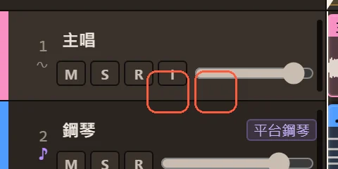

## 錄音前的四件事

1. **選輸入**：左下角狀態列的麥克風選單（或「設定 ▾ → 音訊裝置」）。第一次使用瀏覽器會詢問麥克風權限。
2. **按 R 待命**：告訴軟體要錄進哪一條音訊軌。
3. **按 I 開監聽**：只有開著 I，你才聽得到自己現在的聲音；不開也錄得到，只是聽不到。
4. **戴耳機**：用喇叭監聽會把伴奏再收進麥克風，變成回音。

## 原理：為什麼會有延遲

瀏覽器不是直接控制音效卡，聲音要先經過一個**緩衝區（buffer）**：錄進去的一小段先存起來，累積到一定量才交給程式。緩衝區越大越穩定，但延遲越長。

以 48 kHz 為例：

| 緩衝區 | 單程延遲 |
|---|---|
| 64 samples | 約 1.3 ms |
| 128 samples | 約 2.7 ms |
| 256 samples | 約 5.3 ms |
| 512 samples | 約 10.7 ms |

加上錄音介面本身的轉換延遲，實務上「邊唱邊聽」的總延遲大約 **10–20 ms** 還算舒服；超過 30 ms 就會明顯覺得「聲音慢半拍」。

## 怎麼調

- 錄音時：裝置設定把緩衝區設「**低延遲**」。
- 混音時：改回「平衡」或「穩定」，讓電腦有餘裕跑很多效果器。
- 緩衝區要重新整理頁面才會生效；專案會自動暫存。

## 常見錯誤

- **錄不到聲音**：九成是沒按 R，或麥克風選錯。看狀態列的輸入電平表有沒有跳。
- **喇叭回音**：用喇叭監聽。請戴耳機。
- **爆音**：麥克風增益太大。讓最大聲的地方落在 −12 到 −6 dB 之間。

## 現在就做

錄 8 小節：數 1234（左上「1234」預備拍）、跟著節拍器唱或彈，錄完按空白鍵聽。
