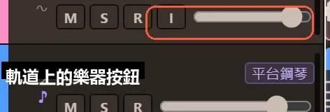
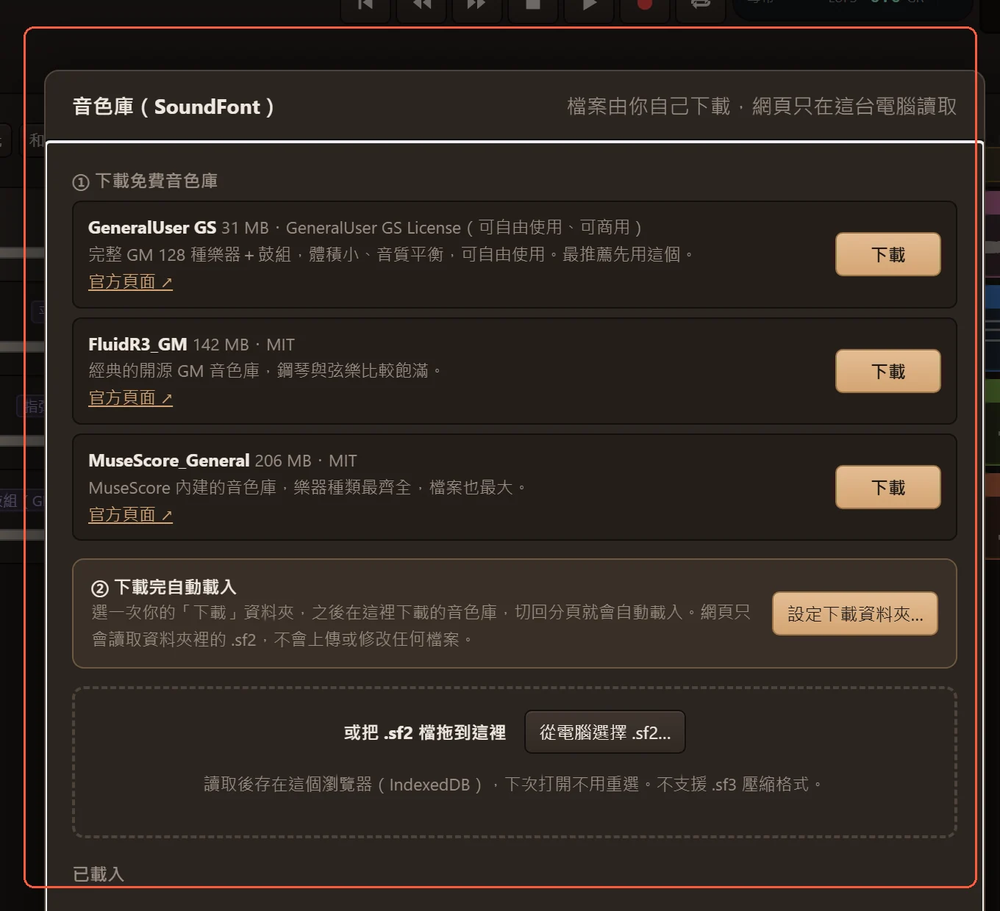

## 兩種音色的來源

**內建音色**：軟體自己用程式「算」出來的合成器音色（鋼琴、弦樂、貝斯、鼓組…）。優點是即開即用、不佔空間。

**SoundFont（.sf2）**：一種取樣音色庫格式，裡面的音是「真的樂器一個音一個音錄下來的」。聽起來更真實，但要自己下載，檔案也比較大（幾十到幾百 MB）。

## 怎麼用 SoundFont

1. 上排「設定 ▾ → 音色庫」→ 依照清單下載幾個免費的 `.sf2`（例如 GeneralUser GS）。
2. 把檔案拖進音色庫視窗，或按「從電腦選擇 .sf2」。
3. 讀進來之後存在這個瀏覽器（IndexedDB），下次打開不用重選。
4. 到 MIDI 軌的檢閱器「音色」選單，就會看到「SoundFont：…」的群組。

> 瀏覽器只讀取你自己下載的檔案，不會從網路抓音色。

## 原理：為什麼取樣音色聽起來比較真

真實樂器的聲音包含大量**不規則的細節**：每一個音的音頭、共鳴、微小的音準差異。合成器是用數學模型逼近這些細節，取樣則是直接播放錄音。

但取樣也有弱點：**同一個音重複播放會一模一樣**（聽起來像機關槍），而且跨音域時是變速播放，越高越短、越低越長。所以專業音源會為每一個音錄好幾個「力度層」與「循環段」。

## 選擇建議

| 需求 | 用什麼 |
|---|---|
| 快速編曲、試和弦 | 內建音色 |
| 鋼琴、弦樂、貝斯這類要「像真的」 | SoundFont |
| 電子、合成、Pad | 內建（合成器就是它的本業） |
| 鼓組 | 內建的 GM 鼓已經夠用；要好一點用 SoundFont 的鼓組 |

## 現在就做

同一段 MIDI 旋律，分別用內建鋼琴與 SoundFont 鋼琴播一次，注意**音頭**（attack）的差異——那是「真假」最明顯的地方。
