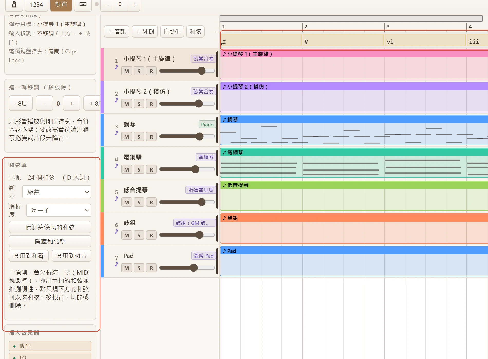

## 為什麼要有和弦軌

混音與編曲時最常問的兩個問題是「**這裡是什麼和弦**」和「**這裡該配什麼音**」。和弦軌把答案畫在時間軸上，所有需要和聲資訊的功能（修音、和聲、自動伴奏）都可以直接引用它。

## 抓和弦

1. 選一條**最能代表和聲**的軌（鋼琴、吉他或貝斯的 MIDI 軌最準；音訊軌也可以，但會比較糊）。
2. 檢閱器 → 和弦軌 → 選解析度（每拍／每半拍／每兩拍／每小節）→「偵測這條軌的和弦」。
3. 程式會分析每個時間格的音高分布，推測調性，再用「換和弦要付代價」的平滑方式把零碎判斷接成一段一段。

## 三種顯示方式

| 顯示 | 長相 | 適合誰 |
|---|---|---|
| 音名 | C、Am、F、G7 | 已經會看和弦記號的人 |
| 級數 | I、vi、IV、V7 | 想看懂「功能和聲」的人 |
| 首調（簡譜） | 1、6m、4、5⁷ | 只熟 C 大調、想快速套用的人 |

三個顯示的是**同一個和弦**。C 大調裡的 Am 就是 vi，也是 6m。

## 編輯

點和弦軌上的方塊會打開選單：改和弦性質（大三、小三、屬七、大七、小七、掛四、減三）、換根音、切成兩半、合併下一個、刪除。點空白處則是在那一小節新增和弦。

## 套用到其他地方

- **套用到和聲**：Harmony 效果器切成「依和弦」，和聲只會落在和弦音上，最不容易唱到不和諧的音。
- **套用到修音**：把人聲修音的主音與音階設成推測出來的調性。

## 原理：為什麼級數比音名好用

同一個進行，C 大調是 `C–Am–F–G`，G 大調是 `G–Em–C–D`——音名完全不同，但**級數都是 `I–vi–IV–V`**。級數描述的是「功能」，所以換調、移調、跟別人溝通時都更清楚。

## 現在就做

用示範專案偵測一次和弦，切到「級數」看看卡農的進行：`I–V–vi–iii–IV–I–IV–V`（D–A–Bm–F#m–G–D–G–A），再把低音跟著哼一次。
