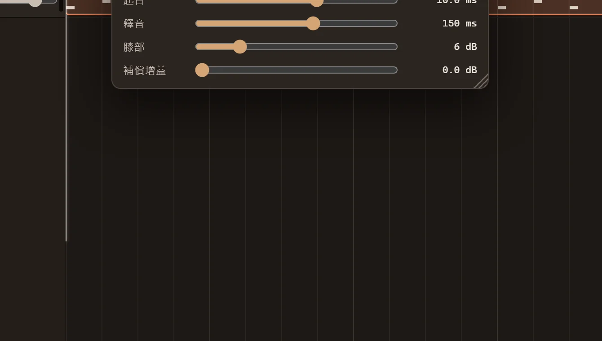

## 壓縮器只做一件事

**把超過門檻的音量壓下來。** 就這麼簡單。所有參數都在描述「壓多少」與「多快」：

| 參數 | 意思 | 常見值 |
|---|---|---|
| 門檻 Threshold | 超過這個音量才開始壓 | −18 dB |
| 比例 Ratio | 超過的部分縮小幾倍 | 3:1～4:1 |
| 起音 Attack | 多快開始壓 | 5–30 ms |
| 釋放 Release | 放開後多快恢復 | 80–250 ms |
| 膝部 Knee | 轉折要多平滑 | 4–8 dB |

## 起音與釋放決定「性格」

- **Attack 快**：鼓的「咔」被壓掉，聲音變軟、變平。
- **Attack 慢**：讓起音先衝過去，只壓住後面的尾巴——鼓會更有打擊感。
- **Release 太快**：聲音會「抽吸」（pumping），像在喘氣。
- **Release 太慢**：該恢復的地方還沒恢復，整體變得死板。

## 原理：壓縮為什麼不是越大聲越好

壓縮把大聲的地方壓小，整體聽起來變「平」。要回到原本的音量，就得靠**補償增益（makeup）**把整體推回去。結果是：**小聲的地方變大聲了**，動態範圍縮小。

這正是「壓縮讓聲音更有力」的來源——但它有代價：**瞬態（attack）會被削掉**。鼓的衝擊、吉他刷弦的清脆、人聲的咬字都住在瞬態裡。壓太多，聲音就變成一團沒有輪廓的糊。

## 為什麼還是爆音

壓縮器不是限幅器。比例 3:1 的意思是「超過 3 dB 只留 1 dB」——**輸出還是會超過門檻**。要讓峰值不超過 0 dBFS，最後還是要靠：

- 把推桿拉低，或
- 母帶的 Limiter（第 20 堂）。

## 現在就做

在鼓組軌上掛壓縮：門檻 −18、比例 3、Attack 20 ms、Release 80 ms，然後把 Attack 改成 1 ms，聽鼓聲從「有力」變成「扁」。
