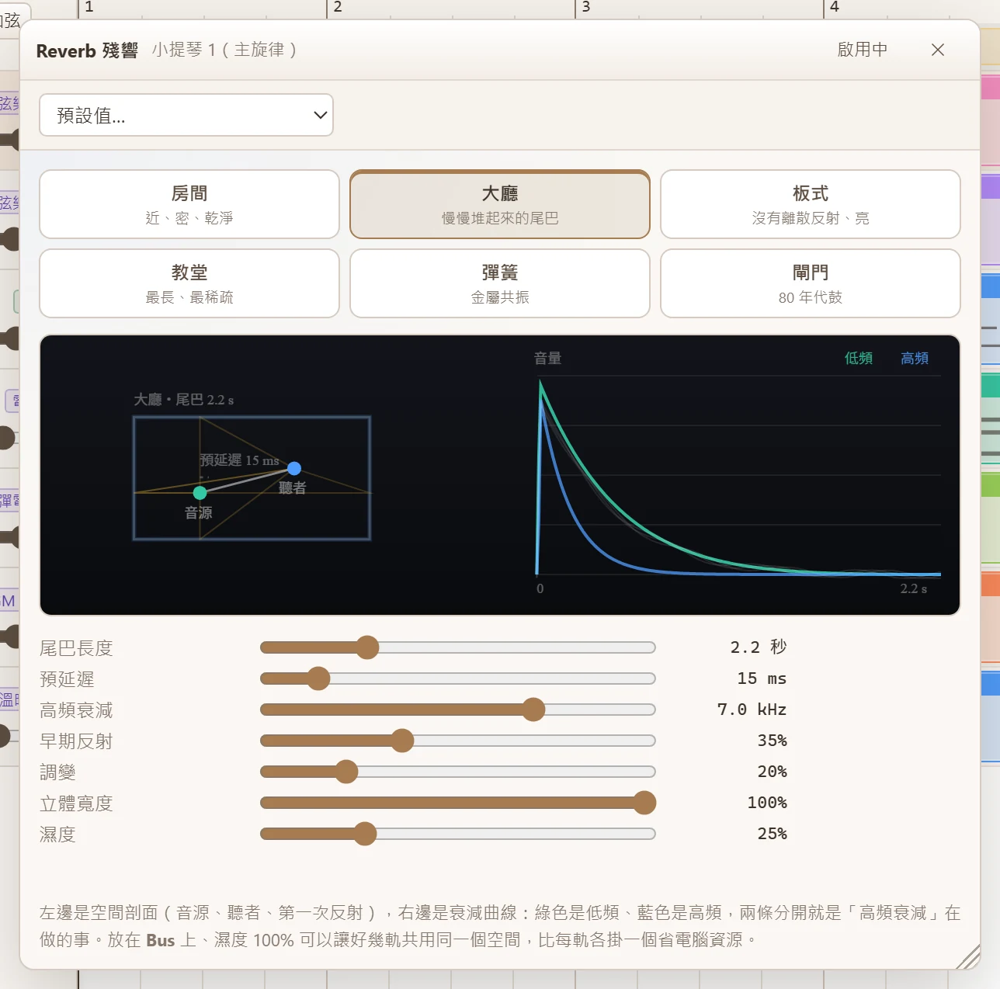

## 三種工具，三種空間

| 工具 | 聽起來 | 主要參數 |
|---|---|---|
| 殘響 Reverb | 在同一個房間裡 | 空間類型、尾巴長度、預延遲、高頻衰減 |
| 延遲 Delay | 一次或多次回音 | 時間（跟著 BPM）、回授、左右彈跳 |
| 立體聲寬度 Width | 聲音變寬 | 方式（Haas／去相關／M-S）、寬度、低頻保持單聲道 |

## 殘響的兩個關鍵數字

- **預延遲（Pre-delay）**：乾聲之後多久才開始有殘響。太短會讓咬字糊掉；人聲常用 20–40 ms。
- **尾巴長度**：短（0.5–1 秒）＝小房間，長（3 秒以上）＝大廳、教堂。**不是越長越好**，尾巴越長，後面的音越容易被前面的殘響蓋住。

## 原理：為什麼要「共用一個空間」

如果每一軌各掛一個殘響，聽起來會像每個樂器在**不同的房間**裡演奏。專業做法是把殘響放在 **Bus**（匯流排）上，讓好幾條軌一起送進去——所有樂器共用同一個空間，聽起來才像「同一場演出」。

## 原理：立體聲寬度與單聲道相容

「變寬」最簡單的做法是讓左右聲道有一點點不同。但要注意：**兩個喇叭同時播放時，如果左右聲音相位相反，中間聽起來會消失**。

這個軟體的寬度效果器是這樣設計的：側向訊號在左右**相反相加**，所以單聲道監聽時寬度會消失、原聲完整保留。在車上音響、手機喇叭（單聲道）聽起來不會出事。

## 常見錯誤

- **殘響加太多**：聽起來很「遠」、很假。人聲乾濕比 15–25% 就很夠。
- **延遲沒有跟拍**：回音落在不該落的地方。把時間設成 1/8、1/4 拍。
- **低頻也變寬**：大鼓與貝斯會失去重心。開「低頻保持單聲道」。

## 現在就做

把人聲送到 Bus A 殘響（送 −14 dB），再把殘響空間從「房間」換成「大廳」，聽同一句歌詞的情緒變化。
