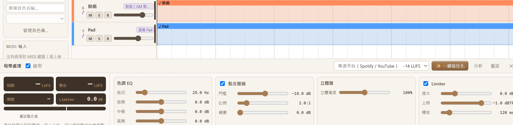

## 母帶在解決什麼

混音完成後，每一首歌的「響度」都不一樣。串流平台會把太大聲的自動轉小，太小聲的轉大——結果**你原本的動態被平台改掉了**。母帶的工作就是：在送到平台之前，把響度與峰值整理到平台要的範圍內。

兩個數字：

- **LUFS（整合響度）**：整首歌「聽起來多大聲」。串流平台常見目標 **−14 LUFS**。
- **True Peak（dBTP）**：真實峰值。超過 0 dBTP 在轉檔時會失真，通常建議 **−1 dBTP** 以下。

上排的母帶狀態列會即時顯示這兩個數字。

## 一鍵最佳化

按母帶視窗的「✨ 一鍵最佳化」：軟體會先分析整首的響度與頻譜，再設定 EQ、黏合壓縮與 Limiter，目標是你選的平台。跑完會顯示「處理前 → 處理後」，不滿意就 Ctrl+Z。

**它是一個起點，不是終點。** 自動化的判斷可能讓某些歌變得比較扁，值得再手動微調。

## 專輯批次

「專輯」是一次處理**很多首已經混好的音檔**：統一響度、加淡入淡出、去掉頭尾靜音、依原本格式輸出。有兩種模式：

- **專輯模式**：最大聲的那首對到目標，其他首保留原本的大小差距（抒情歌仍然比較小聲）——這是實體專輯的作法。
- **每首到目標**：每一首都推到同樣響度，適合串流播放清單。

## 輸出格式

| 格式 | 用途 |
|---|---|
| WAV 24-bit | 送母帶、存檔、最安全 |
| FLAC | 無損壓縮，存檔用 |
| MP3 320k / AAC | 成品、傳給別人 |

輸出前記得：**留一份未壓縮的母帶檔**。

## 現在就做

用示範專案跑一次「一鍵最佳化」，看母帶狀態列的 LUFS 從多少變成 −14；再按「分析」看 True Peak 有沒有超過 −1。
