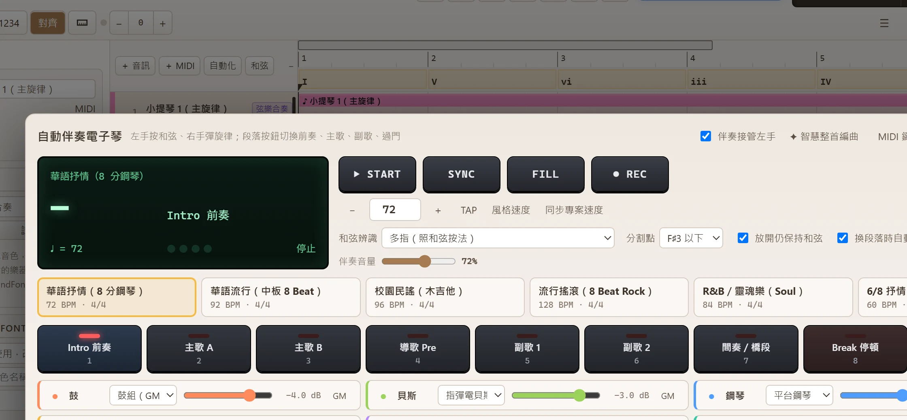

## 為什麼要先懂「段落」

自動伴奏不是「一直彈同一組和弦」。同一首歌裡，主歌通常只有鋼琴與貝斯，副歌才把鼓、弦樂、吉他全部拉進來——**同一個和弦，在不同段落要不一樣的伴奏**。電子琴把這件事寫進「曲風」裡：每個曲風都有 Intro／主歌 A／主歌 B／導歌／副歌 1／副歌 2／橋段／Break／Ending 九個段落，各自規定了小節數、和弦走向、用哪些聲部、用什麼過門。

以內建的「華語抒情（8 分鋼琴）」為例：

| 段落 | 小節 | 有誰在彈 |
|---|---|---|
| 主歌 A | 4 | 鋼琴八分音符分解、貝斯全音符（沒有鼓、沒有弦樂） |
| 主歌 B | 4 | 加上軟鼓與吉他點綴 |
| 導歌 | 4 | 鋼琴改半拍、弦樂漸強、琶音上行 |
| 副歌 1 | 4 | 鼓組全開、弦樂鋪底、吉他刷弦 |
| 副歌 2 | 4 | 鼓更大、加高八度弦樂與十六分琶音 |

## 四個鍵在做什麼

- **START**：從目前段落開始跑；再按一次停止。
- **SYNC**：開啟後，按 START 會等到**下一個小節的第一拍**才進來，不會從半拍開始。
- **FILL**：立刻打一段過門（鼓的過渡過門），通常接在段落最後一小節。
- **REC**：把電子琴正在彈的東西**錄成一條 MIDI 軌**，之後可以編輯、量化、加效果器。

## 原理：為什麼過門都在「換段落的前一小節」

過門（fill）的用途是**預告**——告訴耳朵「下一段要來了」。所以它幾乎不會出現在段落中間，而是落在段落最後一到兩拍，接著新段落第一拍配上重音鈸（crash）。這也是為什麼你自己做伴奏時，只要在段落交界處塞一小段鼓的過渡，整首歌就會突然「像有編曲」。

換段落時還有一個規則：**新段落從下一小節的第一拍才生效**，不是按下去就立刻換。這樣才不會把一小節切成兩半。

## 常見錯誤

- **段落選了但沒聲音**：該段落的聲部全部是「關」的（例如主歌 A 沒有鼓），這是設計，不是壞掉。
- **過門太頻繁**：每兩小節打一次會很吵；一般 4 或 8 小節一次就夠。
- **和弦沒設**：電子琴要讀和弦軌；和弦軌是空的，它只會彈主和弦。

## 現在就做

開一個新專案，和弦軌填 I–V–vi–IV 各兩小節。選「華語抒情」，依序按 Intro → 主歌 A → 副歌 1，注意副歌進來的那一瞬間多了鼓與弦樂，這就是「編曲」最省力的做法。
