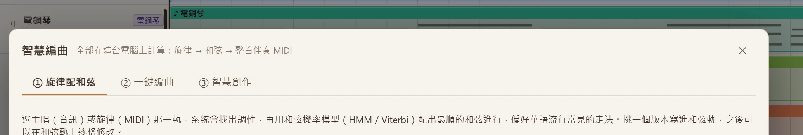
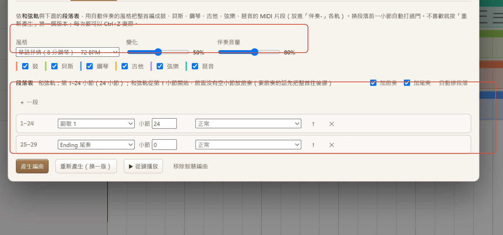

## 面板上的三個分頁

頂列按 **✦ 智慧編曲** 會打開一個面板，裡面是三個步驟，可以分開用：

1. **旋律配和弦**：給一段旋律（音訊或 MIDI），自動推測該配什麼和弦。
2. **一鍵編曲**：已經有和弦軌，直接編成整首伴奏（鼓、貝斯、鋼琴…都寫成 MIDI）。
3. **智慧創作**：連和弦與旋律都從零生出來（下一堂）。

三件事都在**你的電腦上算**，不連伺服器。

## ① 旋律配和弦

選一條旋律軌、決定和弦密度（每小節 1 個或更密）、調性交給「自動判斷」，按分析。

原理是**隱馬可夫模型（HMM）＋ Viterbi**：把每個小節「可能的和弦」當成狀態，用兩個因素評分——這個和弦跟這一小節的旋律音合不合（和弦音越多分越高），以及它跟前後和弦接不接得順（華語流行常見的走向加分）。Viterbi 的工作就是在所有組合裡找出**整首總分最高**的那條路，所以不會出現「每個小節各自最像、接起來卻很怪」的結果。

分析完的結果會寫進和弦軌，可以再手動改。

## ② 一鍵編曲

先確認和弦軌是完整的，然後在面板裡排**段落表**：一列 = 一段，設定幾小節、哪個段落（主歌／副歌…）、強度。選一個曲風，按生成。

它跟電子琴**共用同一套風格資料**，所以聽起來就是電子琴在彈，只是**一次寫成整首**：

- 換段落的前一小節自動打過門，新段落第一拍加強音鈸
- 同一組設定按「變化」換一個種子，會換過門、經過音、和弦轉位（Voicing）與力度起伏
- 種子會存在片段上，之後可以重現同一版

生成會寫進「伴奏-鼓／伴奏-貝斯…」這些軌；舊的智慧編曲片段會被取代，整個動作可以 **Ctrl+Z** 復原。

## 原理：為什麼要「先編成 MIDI」而不是直接播

編成 MIDI 之後，每一顆音符都是可以改的：把某個過門刪掉、把貝斯某一拍換成經過音、把鋼琴的轉位改掉。自動伴奏是**即時演奏**（按了才有），智慧編曲是**先寫好再修**——工作流程不同，用的時候看你要的是「邊彈邊唱」還是「做一首成品」。

## 現在就做

用第 12 堂做的和弦軌，排一段「主歌 8 小節 → 副歌 8 小節 → 尾奏 4 小節」，生成後按播放。接著按「變化」再生成一次，把兩版都留著聽差異——你會發現差別幾乎都在過門與力度，和聲是一樣的。
