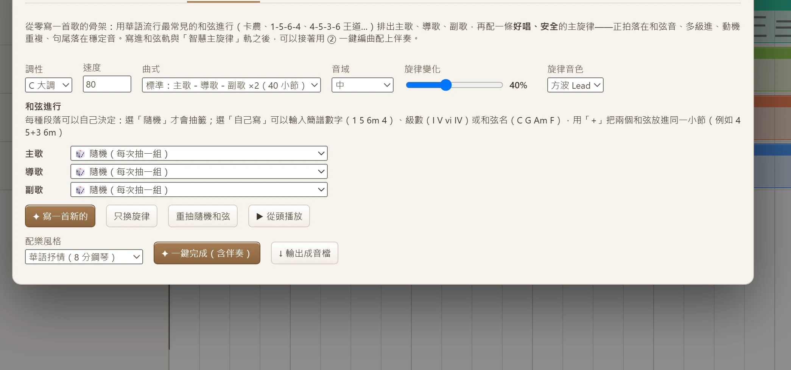
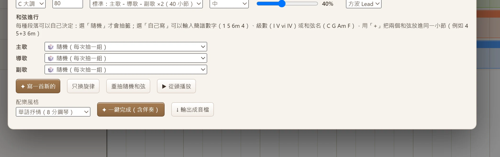

## 它生出什麼

按 **✦ 智慧編曲 → ③ 智慧創作**，選調性、曲風與長度，它會給你：

- 一條**和弦軌**（主歌／導歌／副歌／橋段各一組進行，組成一首的曲式）
- 一條**主旋律 MIDI**（可以直接改、加詞、拿去編曲）

目前**只支援 4/4 拍**——拍號不是 4/4 時它會直接告訴你。

## 和弦從哪裡來

不是亂數，是從一個「華語流行常見進行」的清單挑的，例如：

| 名稱 | 級數 |
|---|---|
| 卡農進行 | I–V–vi–iii–IV–I–IV–V |
| 1-5-6-4 | I–V–vi–IV |
| 1-6-4-5 | I–vi–IV–V |
| 1-3-4-5 | I–iii–IV–V |
| 6-4-1-5 | vi–IV–I–V |

小調的歌用「關係大調」表示（主和弦是 vi），這樣同一套規則可以通用。曲式上：**同一種段落重複時用同一組和弦**（副歌 1 與副歌 2 一致），最後一輪副歌收在主和弦。

## 旋律為什麼「聽起來像歌」

旋律走的是「安全路線」，規則寫得很明確：

- **正拍與長音一定落在和弦音**；弱拍可以用經過音，但要用級進靠近
- 以**五聲音階**為主（4、7 級音少用），避免突然很「西洋」
- **多級進、少跳進**；跳進之後反向級進回來
- 節奏用**一小節的動機重複**（a b a c），第二句重複第一句或依根音模進——好記
- 每一句是**拱形起伏**；主歌音域低，副歌高 3～5 度
- 句尾落在穩定音，整首最後落在主音

## 原理：為什麼「好唱」比「複雜」難

寫一條有變化的旋律不難，難的是**讓人聽一次就記住、張口就能唱**。上面那些規則其實是「限制」——限制音高選擇、限制節奏型、限制音域，把可用材料縮小到耳朵熟悉的範圍。作曲課講的「動機發展」就是這個：先給一個短動機，再用重複與模進讓聽眾抓住它。

## 種子與只換一半

生成用的是種子亂數：同一組設定再按一次會換一版，狀態列會顯示版本號（例如 #537）。**目前不能手動輸入種子重現某一版**——想留住喜歡的那一版，請直接把它存成專案或複製到新軌。想調整時不必全部重來——可以只換旋律、保留和弦，或只換和弦、保留旋律，找到「和弦好聽但旋律不順」時特別有用。

## 現在就做

生成一首 16 小節，聽完之後**只換旋律**三次，比較哪一版最好唱。把最喜歡的那版存檔，接著用第 23 堂的「一鍵編曲」把和弦編成完整伴奏——這就是這套工具從零到成品的完整路線。
