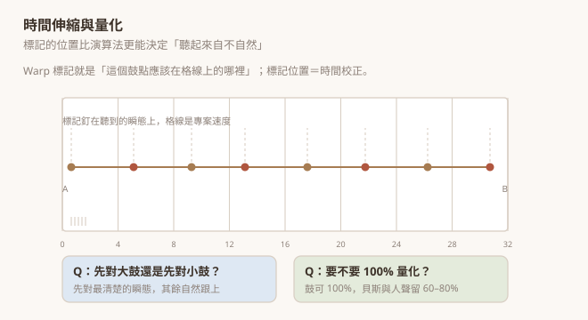

# **第 10 堂：節奏校正：時間彈性變形 (Elastic/Warp) 運用**

## 一、什麼是彈性音訊／時間拉伸？

在數位音訊工作站（DAW）中，**彈性音訊（Elastic Audio）**或稱 **Warp（時間扭曲）**，是一項能夠改變音訊片段播放速度與時間位置的技術，同時**儘可能保持原始音高不變**。這項技術的革命性在於：它打破了傳統 tape 時代「變快＝變高，變慢＝變低」的物理限制，讓製作人可以像處理 MIDI 音符一樣自由調整錄音的時間點。

### 核心原理

彈性音訊的本質是**時間軸的非線性縮放**。DAW 會先在音訊波形中偵測出「過零點（zero-crossing）」或「瞬態（transient）」，並將這些點之間的區域視為獨立區塊。當需要加快或放慢某一部份時，DAW 會短暫地將區塊內的音訊取樣點進行**重取樣（resampling）**以及**窗函數疊加（overlap-add）**處理，讓聽覺上感受不到音高的變化。

實務上，這個過程分為三個步驟：
1. **瞬態偵測**：軟體自動找出波形中的打擊點、子音起始、換氣聲等明顯的時間錨點。
2. **標記建立**：在每個瞬態位置放置 Warp Marker（扭曲標記）。
3. **時間對齊**：使用者拖動這些標記，或者讓 DAW 自動將標記對齊到 Grid（網格）上。

---

## 二、不同演算法的選擇

並非所有音訊都適合用同一種拉伸演算法。DAW（如 Ableton Live、Logic Pro、Pro Tools、Cubase）通常提供多種 **Warp Mode（扭曲模式）** 或 **Elastic Audio 演算法**，針對不同素材類型進行最佳化。

### 多音色模式（Polyphonic / Complex）

適用於**和弦進行、鋼琴、吉他刷弦、弦樂合奏**等同時存在多個頻率成份的音訊。此模式使用**相位聲碼器（Phase Vocoder）**或**頻域拉伸**技術，能夠保留和聲結構，但運算量較大，且極端拉伸（超過 1.5 倍或低於 0.5 倍）時容易產生**金屬迴聲（metallic artifacts）**或「梳狀濾波」聽感。

### 單音色模式（Monophonic / Tones）

適用於**人聲主旋律、單音貝斯線、薩克斯風獨奏**等單一音高的音訊。此模式以**時域重疊相加（Time-Domain Overlap-Add, TD-OLA）**為基礎，對單一頻率的追蹤較精確，變形後的人工感比 Polyphonic 模式輕微。若將一段清唱的人聲從 120 BPM 拉伸到 100 BPM，Monophonic 模式通常能保留較多自然的顫音與抖音細節。

### 打擊模式（Percussive / Beat）

專為**鼓組、打擊樂器、節奏 loop** 而設計。此模式對瞬態（Transient）的保護最強，能夠在拉伸後仍然保持鼓點的打擊感與衝擊力。若錯誤地使用 Polyphonic 模式處理 hi-hat loop，常會聽到「模糊打擊」或「撕裂紙張」的特效聲。

### 節奏紋理模式（Rhythmic / Texture）

介於 Polyphonic 與 Percussive 之間，適合具有節奏性的持續音，如**合成器琶音（arpeggio）、節奏吉他悶音（chunk）、古箏快速輪指**等。此模式會將音訊分割成較小的顆粒（grain），在時間變形時同時保留部份打擊感與部份和聲感。

### Re-pitch 模式

這是唯一會改變音高的模式，模擬傳統 tape 變速。在某些情境下（例如想要故意製造 Chipmunk Effect 或 Dark Vocals），Re-pitch 反而是正確的選擇。

---

## 三、偵測速度與設定 Warp Markers

在進行節奏校正之前，必須讓 DAW 知道原始錄音的**基礎速度（Original Tempo）**。

### 自動偵測

Ableton Live 的 **Warp From Here** 與 **Warp as 1/2 Beat Loop / 4 Beat Loop** 能夠一鍵完成速度偵測與標記建立。Logic Pro 的 **Smart Tempo** 會自動分析錄音並將整個 Project Tempo 對齊錄音。Pro Tools 的 **Elastic Audio** 則在 Clip 屬性面板中提供 **Tempo Detection**。

操作流程如下：
1. 將音訊匯入 DAW。
2. 選取「自動偵測速度」。
3. DAW 會放置 Warp Marker 並調整 Clip 的 BPM 以符合偵測結果。
4. 檢查前幾拍的位置是否正確——通常第一拍（Downbeat）需要手動微調。

### 手動設定標記

當自動偵測不準確（如 rubato 演奏、速度不均的 live band 錄音）時，需要手動放置 Warp Marker：

- **在「聽覺上的正拍」位置設置第一個標記**。對於沒有鼓手的獨奏樂器，以第一拍最強的攻擊點為準。
- **每隔 2 或 4 小節放置一個參考標記**，確保整體時間不會偏移。
- **在有明顯搶拍或拖拍的位置放置額外標記**，進行局部拉動。

### 標記的固定點（Warp from Here）

在 Ableton Live 中，設定一個 Warp Marker 並設為「Warp from Here」之後，該標記左側的區域保持不變，右側區域根據拉伸比例重新計算。這個概念非常重要——它代表標記位置固定不動，右側區域的音訊會依拉伸比例重新分配時間。

---

## 四、將音訊量化至網格（Quantize Audio to Grid）

量化是節奏校正最核心的功能。操作流程如下：

1. 確認 DAW 已經正確放置了 Warp Marker 且 Project Tempo 已設定。
2. 選取目標音訊片段。
3. 執行 Quantize 指令（Ableton：Cmd+U（Mac）／ Ctrl+U（Win）；Logic：Cmd+Q（或 Edit ▸ Quantize）；Pro Tools：Edit ▸ Quantize（或 Cmd/Ctrl+Shift+0））。
4. 設定量化參數：
   - **Grid Size**：選擇最小量化單位（1/4 音符、1/8、1/16、三連音等）。對於流行樂人聲，1/16 通常就足夠；對於鼓組 loop，可以嘗試 1/32 甚至 1/64。
   - **Strength（量化強度）**：0-100%。100% 代表完全對齊網格，建議設定在 70-90% 之間以保留部份自然律動。
   - **Timing Randomization**：有時候可以加入小幅度的隨機偏移（1-5 ms），模擬真人演奏的微觀時間自然感。
5. 播放檢查，特別注意**踩鈸（hi-hat）與小鼓（snare）**的位置最容易出現人工感。

---

## 五、收緊鬆散演奏：瞬態標記微調

在現場錄音中，樂手之間的時間誤差是不可避免的。Warp Markers 提供了一個**非破壞性**的校正手段。

### 步驟一：識別問題段落

以波形放大檢視，尋找以下跡象：
- 貝斯聲與大鼓的 Attack 點沒有對齊在同一時間軸
- 節奏吉他刷弦的掃弦終點落在網格之後
- 主唱的子音發聲點（如「t」、「k」、「p」的爆破音）與網格有明顯錯位

### 步驟二：對齊問題點

Double-click 在 Warp Marker 上，將其拖動至正確的 Grid 位置。對於多軌錄音，建議以**大鼓（Kick）與小鼓（Snare）**作為時間基準，因為這兩者對節奏的影響最大。

### 步驟三：連接標記之間的區域

若移動單一瞬態造成前後聽感出現「跳拍」或「音訊斷裂」，需要在相鄰位置新增額外的 Warp Marker，然後對整段進行緩和拉伸（ramp），讓時間變化更平滑。

---

## 六、對齊原聲樂器與 MIDI／鼓機

現代流行音樂製作中，常會將**原聲樂器錄音（真鼓、吉他、鋼琴）**與 **MIDI 鼓組或鼓機（808、LinnDrum 等）** 混搭。兩者的時間感若不協調，聽起來就會像「樂團跟節拍器打架」。

### 策略一：以鼓機為主，拉伸原聲樂器

如果 MIDI 鼓組是編曲的骨架，那麼應該讓真實樂器的時間向鼓機靠攏。
1. 將 MIDI 鼓組設定為 Project Tempo 的基礎。
2. 對原聲樂器（如真實爵士鼓）啟用 Elastic Audio。
3. 針對每個小節的 Kick 與 Snare 位置，將原聲鼓的瞬態對齊到 MIDI 鼓組對應的 Grid 位置。
4. 注意！不要過度校正踩鈸和 Tom——這些樂器在真實鼓手中存在自然的時間波動，完全對齊會聽起來像鼓機。

### 策略二：保留原聲鼓的動態，MIDI 跟隨

有些製作人偏好保留真鼓的「人類感覺」，然後讓 MIDI 樂器去跟隨真鼓：
1. 先將真鼓 loop 匯入 DAW 並完成 Warp 設定。
2. 開啟 Project Tempo 的 Follow/Master 模式（Logic Pro 的 Smart Tempo Follow、Ableton 的 Set as Master）。
3. 將 MIDI 鼓組的播放模式設為「Follow Project Tempo」，DAW 會自動改變播放速度以對齊真鼓。

---

## 七、常見陷阱與注意事項

### 人工假音（Artifacts）

極端拉伸（超過 200% 或低於 50%）會導致明顯的數位假音：顫抖（wobble）、金屬聲、撕裂聲。解決方案：
- 分割音訊，只對需要校正的段落進行拉伸
- 使用多層重疊（Crossfade）技術平滑過渡
- 考慮重新錄製而不是極端拉伸

### 失去自然律動（Feel）

過度量化會讓每一拍都精準到 0 ms，但這往往讓音樂聽起來像機器演奏的。這就是所謂的 **Quantization Death**。人耳對於毫秒級（約 5–25 ms）的時間偏移非常敏感，完全整齊的節奏反而會產生「僵屍感」。

### 呼吸聲與換氣

人聲的換氣聲（breath）通常不應該對齊網格。若在 Warp Marker 設定時不小心將 breath 標記對齊到正拍，聽起來會像演唱者在「每拍呼吸一次」，非常怪異。

### 相位問題

在多麥克風錄音（如 true drum kit 的 overhead、room 與 close mic）中，對個別音軌單獨進行 Elastic Audio 可能會破壞原始錄音的**相位一致性（phase coherence）**。建議將所有鼓軌分組（Group）後一起進行 Warp 操作，或者使用 DAW 的 Multi-track Warp 功能。

---

## 八、保留 Groove vs 完美量化

這個議題是節奏校正中最需要藝術判斷的地方。以下是一些實務建議：

| 音樂風格 | 建議量化強度 | 備註 |
|---------|-----------|------|
| EDM、Pop | 80-100% | 需要緊湊的節奏 |
| Funk、Soul | 50-70% | 保留律動中的 shuffle 感 |
| Jazz 三重奏 | 0-30% | 保留 swing 與互動感 |
| 古典獨奏 | 不量化 | 以手動調整極明顯錯音為主 |
| 嘻哈人聲 | 60-80% | 人聲可以稍微落後網格（laid-back） |
| 金屬雙大鼓 | 90-100% | 雙大鼓需要極精準的時值 |

保持 **Groove** 的祕訣：不要使用 100% 強度，讓每個音從網格偏移 5-15 ms；而且要故意保持**某些樂器比網格晚一點**（laid-back）或**早一點**（pushing），創造音樂性的張力與釋放。

---

## 九、實戰：人聲節奏校正工作流程

以下是一個完整的 Vocal Timing Correction 實作流程：

### 步驟 1：預備

1. 匯入人聲錄音檔（通常為 44.1kHz / 24-bit WAV）。
2. 設定 Project Tempo（若已知）或讓 DAW 自動偵測。
3. 聆聽整段，圈出明顯節奏有問題的句子。

### 步驟 2：瞬態標記檢視

1. 切換至 Warp / Elastic Audio 檢視模式。
2. 檢視 DAW 自動放置的 Warp Marker。
3. 刪除多餘標記——例如 breath 和尾音 fading 處通常不需要標記。
4. 確保每個字的第一個子音（onset consonant）有對應的標記。

### 步驟 3：分段校正

1. 從歌曲的第一句開始，逐句播放。
2. 若某個字明顯拖拍，將其 Warp Marker 拖至最近的 1/16 網格線上。
3. 若某個字搶拍，將前一個標記向右拉（或將該標記向右拉）。
4. 每次調整後聆聽前後 2 小節的銜接。

### 步驟 4：聆聽整體流暢度

1. 關閉 Warp Marker 顯示，以一般播放模式聆聽整段。
2. 注意是否有不自然的「跳躍感」或「時間壓縮感」。
3. 若某一段感覺過度壓縮，降低該段附近的量化強度或直接 Undo。

### 步驟 5：與背景節奏對齊

1. 同時播放人聲與背景節奏軌（Kick + Snare + Hi-hat）。
2. 特別注意人聲的**重音音節（stressed syllable）**是否與大鼓或小鼓的位置吻合。
3. 對於 laid-back 風格的歌手，允許部分音節比網格晚 10-20 ms。

---

## 十、伸展鼓 Loop 以符合專案速度

鼓 Loop 是 Elastic Audio 應用最常見的場景之一。

### 操作流程

1. 將鼓 Loop 匯入 DAW。
2. 執行自動 Warp 偵測。
3. 確認 Loop 的第一拍（Downbeat）對齊到小節開始位置。
4. 檢查最後一拍是否與網格吻合。若整段 Loop 落在正確的 BPM，通常會自動對齊。
5. 若 Loop 的原始 BPM 與 Project BPM 不同，DAW 會自動計算拉伸比例。
6. 檢視拉伸後的 Loop 是否有**瞬態模糊**——若有，嘗試切換為 Percussive Warp Mode。

### 製作 Half-Time 與 Double-Time 效果

- **Half-Time**：Warp Mode 設為 Percussive，Clip BPM 設為 Project BPM 的兩倍，4 小節的 Loop 會拉成 8 小節。
- **Double-Time**：Clip BPM 設為 Project BPM 的一半，Loop 會縮短為 2 小節。
- 這兩種手法在 Trap、Dubstep、Lo-fi 等風格中廣泛使用。

### 混合不同 BPM 的 Loop

在同一個 Project 中匯入不同 BPM 的鼓 Loop 時，只需要分別對每個 Loop 進行獨立的 Warp 設定即可。DAW 會根據 Clip 的原始 BPM 資訊自動計算拉伸量，確保所有 Loop 與 Project Tempo 同步。這在現代電子音樂製作中是標準做法。

---

## 結語

時間彈性變形（Elastic/Warp）是現代數位音樂製作中最強大的工具之一。它讓我們擁有前所未有的節奏控制力，但同時也對製作人的音樂品味提出了更高的要求。學會**何時使用 Warp、何時不使用 Warp**，以及**量化到什麼程度才是恰到好處**，是區分專業製作人與業餘者的關鍵分水嶺。

請記住：Warp 的最終目標不是讓每一毫秒都對齊網格，而是讓音樂聽起來**自然、動人、有生命力**。工具只是手段，音樂性才是目的。下一堂課，我們將探討如何將這項技術與更進階的編曲技巧結合，創造出更具層次感的聲音作品。