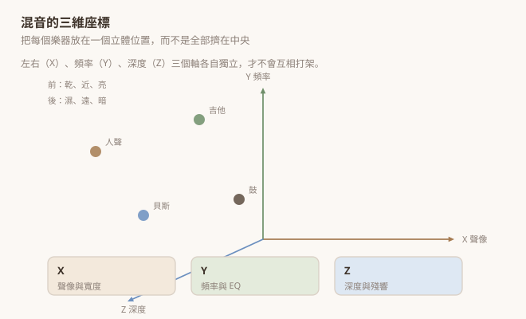
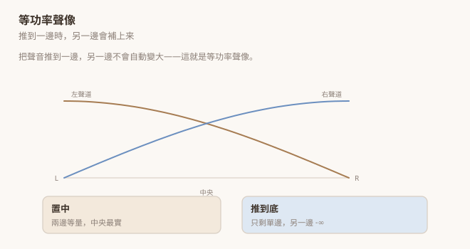
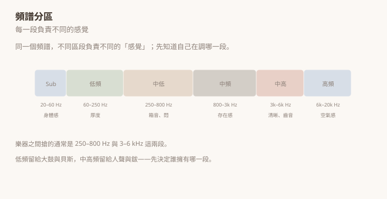
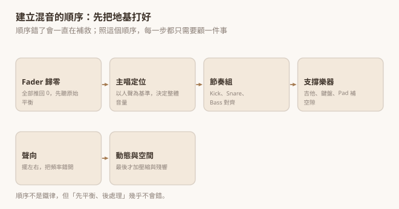

# **第 12 堂：混音空間：音量、聲像與頻率的三維架構**

## 本堂目標：理解混音的立體三維模型

當你製作一首音樂時，每一個音軌都不是孤立存在的。它們共同棲息在一個三維空間之中——這個空間由**音量（Volume）**、**聲像（Panning）** 與**頻率（Frequency）** 三個維度構成。（相位是另一件事：波形有沒有對齊，第 8 堂談過。）優秀的混音，說穿了就是**把每一個聲音元件，放到這個三維空間裡最合適的位置上**。

本堂課將為你建立一套完整的「混音三維模型」思維。你將學會如何透過這三個軸線（X 軸：聲像、Y 軸：頻率、Z 軸：深度）來解構與建構任何混音。

---

## 1. 混音三維模型：總覽

想像一個立體座標系：

| 軸線 | 維度 | 對應參數 | 描述 |
|---|---|---|---|
| **X 軸** | 橫向（左右） | 聲像（Pan） | 聲音在立體聲場中的左右位置 |
| **Y 軸** | 垂直（高低） | 頻率（EQ） | 聲音的頻譜分佈 |
| **Z 軸** | 縱深（前後） | 音量、殘響、延遲、壓縮 | 聲音在聽覺中的遠近距離感 |

**核心觀念**：如果兩個以上的樂器在 X、Y、Z 三個軸線上都「撞在一起」，聽覺就會產生模糊、混濁、甚至打架的現象。反之，若能讓每個聲部在三軸上各有其位，混音就會變得清晰、寬闊、有層次。

---

## 2. X 軸：聲像與立體聲寬度

X 軸處理的是「左右」的定位。這是混音中最直觀但也最容易被濫用的維度。

### 2.1 聲像（Pan）的基礎原則

- **低頻樂器置中**：大鼓（Kick）、貝斯（Bass）通常擺在正中央（Pan = 0）。原因是低頻具有指向性較弱的物理特性，而且聽覺系統習慣將低頻視為穩定的基底。
- **中高頻樂器可偏左或偏右**：節奏吉他、鋼琴、合成器鋪底等可以左右分開擺放，創造寬闊感。
- **主唱置中**：人聲（尤其是主唱）幾乎永遠置中，因為它是聽眾注意力的焦點。
- **小打擊樂器可極左極右**：如沙鈴（Shaker）、鈴鼓、Conga 等，可以大膽地 Pan 到 60%∼100% 左右，增加空間感。

### 2.2 創建立體聲寬度的技巧

- **雙軌錄音（Double Tracking）**：同樣的樂句錄製兩次，分別 Pan L 與 R，效果自然寬闊。
- **Haas 效應（優先效應）**：將同一音軌複製一份，延遲 10∼30ms，並將延遲軌 Pan 到對側。聽覺會以為聲音來自先到的那一側，但同時感覺整體寬度增加了。
- **M/S（Mid/Side）處理**：將立體聲訊號拆分為中間（Mono）與兩側（Side）獨立處理。例如，對 Side 增加高頻可以讓立體聲變得更「空氣感」。

### 2.3 常見 X 軸錯誤

- **把所有樂器都置中**：混音變成一團「單聲道糊狀物」，毫無空間感。
- **極端 Pan 卻無對應補償**：如果左邊的音量明顯大於右邊，立體聲平衡就會傾斜。
- **立體聲影像不穩定**：某個樂器在左，但它的殘響（Reverb）卻在右，聽感上會讓人困惑。

---

## 3. Y 軸：頻率分佈與 EQ 管理

Y 軸處理的是「高低」——也就是每個樂器佔據的頻率範圍。混音中 70% 的清晰度問題，來自 Y 軸的管理不當。

### 3.1 頻譜分區與樂器定位

人耳可聽範圍約為 20Hz∼20kHz，我們可以將它分為幾個關鍵區域：

| 頻段 | 範圍 | 特性 | 常見衝突 |
|---|---|---|---|
| 超低頻（Sub） | 20∼60Hz | 感覺多於聽見，身體共振 | 大鼓與貝斯在此區最容易打架 |
| 低頻（Bass） | 60∼250Hz | 音樂的「厚度」與「力量」 | 貝斯、大鼓、低音鋼琴、男低音 |
| 中低頻（Low-Mid） | 250∼500Hz | 溫暖感，但過多會導致混濁 | 吉他、弦樂、Pad、人聲胸部共鳴 |
| 中頻（Mid） | 500Hz∼2kHz | 樂器的「本體」與清晰度 | 人聲、吉他、鋼琴、銅管 |
| 中高頻（High-Mid） | 2∼6kHz | 攻擊性、存在感、唇齒音 | 人聲唇齒音（Sibilance）、Hi-Hat、Crash |
| 高頻（High） | 6∼20kHz | 空氣感、光澤、細節 | Hi-Hat、Shaker、弦樂泛音 |

### 3.2 EQ 的核心策略：互補式 EQ（Complementary EQ）

當兩個樂器在 Y 軸上發生衝突時，不要兩個都搶同一個頻率。解決方案是：

1. **決定誰「主導」該頻段**。
2. **對主導者做輕微的增益（Boost）**。
3. **對另一方做輕微的衰減（Cut）**。

**實例**：大鼓（Kick）與貝斯（Bass）在 60∼80Hz 打架。

- 做法：讓大鼓主導 60Hz（稍微提升），貝斯主導 80Hz（稍微提升），然後在 60Hz 處對貝斯做 -2dB 的衰減。

**另一個經典案例**：人聲與鋼琴在 2∼4kHz 互相遮掩。

- 做法：人聲在 3kHz 做 +2dB，鋼琴在 3kHz 做 -2dB。人聲瞬間浮出來，且鋼琴聽起來幾乎沒有改變。

### 3.3 高通濾波器（High-Pass Filter）是你的好朋友

許多樂器的低頻內容其實是「不必要的雜訊」。對那些不需要低頻的軌道（例如 Hi-Hat、Shaker、人聲、大部分的吉他），大膽使用高通濾波器將 80∼150Hz 以下的頻率砍掉。

**原則**：如果該樂器在該頻段沒有重要的音樂內容，就把它清掉，留給真正需要低頻的樂器。

### 3.4 常見 Y 軸錯誤

- **低中頻（250∼500Hz）過度堆疊**：這是最常見的「混濁」元兇。多個樂器在此區互相打架，導致整體聽感模糊、缺乏 punch。
- **過度 Boost 高頻**：為了追求「清晰」而狂加高頻，結果是尖銳刺耳、聽感疲勞。
- **忽略頻譜分析工具**：只用耳朵卻不看頻譜分析儀（Spectrum Analyzer），容易忽略人耳容易疲勞的頻段。

---

## 4. Z 軸：深度與距離感

Z 軸處理的是「前後」——也就是聽覺上的距離感。這是最容易被忽略、但也最能讓混音從「平面」變成「立體」的維度。

### 4.1 影響 Z 軸的四個關鍵工具

#### (a) 音量（Volume Fader）

最簡單也最直接的深度控制。**越響亮的聲音聽起來越「近」**。

- 主唱、獨奏樂器 → 音量最大，最前方
- 節奏樂器、和聲 → 音量中等，中排
- 環境音效、Pad → 音量較小，後方

但光靠音量是不夠的——它只能製造「遠近」的其中一個線索。

#### (b) 殘響（Reverb）

殘響是製造深度感的王者。不同大小的殘響參數會讓聽覺產生「這個聲音離我多遠」的判斷：

- **乾／濕比例（Dry/Wet）**：濕聲越多，聲音越「遠」
- **預延遲（Pre-Delay）**：越長的預延遲，聲音聽起來離反射面越遠 → 感覺空間越大
- **衰減時間（Decay Time）**：越長的衰減，空間越大，聲音感覺越遠

**實戰技巧**：當你希望某個樂器「退到後面」，把它的殘響濕聲比例調高、預延遲略長即可。

#### (c) 延遲（Delay）

延遲可以用來創造深度，也可以創造節奏感：

- **短延遲（Slapback Delay，約 30∼120ms）**：50 年代搖滾的經典效果，聽起來像是聲音在空間中反彈了一次。
- **長延遲（Quarter Note / Dotted Eighth）**：與節奏同步的延遲，可以讓聲音產生「在空中迴盪」的深度感。
- **Ping-Pong Delay**：左右交替的延遲，同時製造 X 軸與 Z 軸的立體感。

#### (d) 壓縮（Compression）

壓縮在 Z 軸上的作用是「把聲音往前推」。

- **較快的 Attack 時間**：壓住瞬間的 Transient，強調尾音與 sustain，聲音更平滑 → 感覺退後
- **較慢的 Attack 時間**：保留 Transient 的爆發力，聲音更 punch、更突出 → 感覺更近
- **較多的 Gain Reduction**：將動態壓平，聲音的「遠近變化」減少 → 整體往前

### 4.2 Z 軸的階層範例

一個典型流行搖滾混音的 Z 軸排列（從最遠到最近）：

1. **最遠（Ambient）**：Room Mic、環境殘響、Reverse Cymbal、Pad 的殘響尾音
2. **背景（Background）**：節奏吉他（分左右）、和聲的殘響層、弦樂鋪底
3. **中排（Midground）**：大鼓、貝斯、節奏吉他主體、和聲主體
4. **前排（Foreground）**：主唱、主奏樂器（Solo）、過門音效
5. **最前（Spotlight）**：Breakdown 中的單一樂器、特別強調的特殊音效

### 4.3 常見 Z 軸錯誤

- **所有樂器都用一樣多的殘響**：聽起來像在同一個平面上，沒有深度。
- **殘響與乾聲互搶**：如果殘響的頻率內容與乾聲重疊太多，混濁感加倍。
- **壓縮過度導致「沒有遠近」**：所有聲音都被推到最前面，聽感疲勞。

---

## 5. 三軸互動：空間的立體交織

理解了 X、Y、Z 各軸之後，真正的功力在於**理解它們如何相互作用**。

### 5.1 X + Y 互動：頻率影響立體感

人耳對不同頻率的立體聲定位敏感度不同：

- **高頻（>1kHz）**：方向感強，左右定位清楚
- **低頻（<200Hz）**：方向感弱，幾乎無法定向

因此，如果你想要創造「寬闊感」，將高頻內容（如 Hi-Hat、Shaker、Cymbal）做左右分離是最有效的。而低頻樂器（大鼓、貝斯）即使置中，聽覺也不會有「窄」的感覺。

### 5.2 Y + Z 互動：頻率影響距離感

- **高頻在空氣中衰減較快** → 遠方的聲音聽起來高頻較少
- **低頻可以傳得更遠** → 遠方的聲音聽起來低頻比例較高

這意味著：如果你想要某個樂器聽起來「在遠方」，除了加殘響，也可以衰減其高頻（Low-Pass Filter）。這就是所謂的「**遠距 EQ**」技巧。

### 5.3 X + Z 互動：深度與寬度的平衡

- 當聲音從遠方過來時，立體聲寬度會「變窄」（因為你離聲源遠，左右耳收到的差異變小）。
- 反之，靠近的聲音可以做得更寬。

這在混音中轉化為一個原則：**前方（前景）的樂器可以做更寬的立體聲處理，後方（背景）的樂器應該更窄或置中**——除非你是刻意要營造某種特殊效果。

---

## 6. 創造混音的焦點

在任何一首歌中，聽眾的注意力一次只能集中在少數幾件事上。你的任務是告訴聽眾「現在該聽哪裡」。

### 6.1 單一焦點原則

在每個段落（Verse、Chorus、Bridge）中，只有 **一至兩個** 主要元素應該位於「三軸交會點」：

- **X = 置中**
- **Y = 不被遮擋的頻段**
- **Z = 最前方**

其他所有元素都應該自覺地「讓位」。

### 6.2 實例：副歌的焦點設計

假設副歌的主焦點是主唱和主奏 Synthesizer：

| 元素 | X 軸（Pan） | Y 軸（EQ） | Z 軸（深度） |
|---|---|---|---|
| 主唱 | 置中 | 2∼4kHz 突出 | 音量最大，Compression 中等 |
| 主奏 Synth | 置中 | 1∼2kHz 突出（人聲互補） | 音量次大，Wet Reverb 略多 |
| 節奏吉他（左） | L 70% | 300Hz 衰減，留給人聲 | 音量適中，Reverb 中等 |
| 節奏吉他（右） | R 70% | 同上 | 同上 |
| 貝斯 | 置中 | 80Hz 主導 | 音量適中，壓縮穩定 |
| 大鼓 | 置中 | 60Hz 主導 | 音量適中，Attack 明顯 |
| Hi-Hat | L 80% | 約 800Hz 高通 | 音量小，Reverb 長 |
| 殘響返回 | L/R 100% | 低頻切掉 | 音量最小，最遠 |

---

## 7. 建立混音的實戰流程

以下是一個遵循三維思維的混音建構步驟：

### 步驟 1：平衡音量（先建立 Z 軸基本框架）

- 把所有 Fader 拉到最低
- 先推大鼓，再推貝斯——建立低頻基礎
- 加入主唱——這是音量參考基準
- 逐步加入其他樂器，用音量排列遠近

### 步驟 2：調整聲像（建立 X 軸）

- 低頻樂器置中
- 節奏樂器左右分散
- 確認立體聲平衡（左右音量一致）

### 步驟 3：EQ 整理（建立 Y 軸）

- 對不需要低頻的軌道做高通濾波
- 識別頻率衝突區，做互補式 EQ
- 用頻譜分析儀檢查整體頻譜是否平衡

### 步驟 4：添加空間效果（強化 X 與 Z 軸）

- 為每個樂器選擇合適的殘響類型（Plate、Hall、Room、Spring）
- 使用 Send/Return 而非直接插入殘響，方便統一控制
- 添加 Delay 或 Modulation 效果創造立體感

### 步驟 5：壓縮與動態控制（微調 Z 軸）

- 對節奏組（大鼓、貝斯）做較重的壓縮，穩定其 Z 軸位置
- 對人聲做中等壓縮（3∼6dB GR），保持其在前方
- 對環境音軌做輕壓縮或不壓縮，保持自然深度

### 步驟 6：整體檢查與微調

- 閉上眼睛聽：你能說出每個樂器的 X、Y、Z 位置嗎？
- 用監聽耳機、喇叭、手機喇叭交叉檢查
- 參考類似風格的商業混音，比較三維佈局

---

## 8. 常見錯誤快速診斷表

| 症狀 | 問題維度 | 解決方向 |
|---|---|---|
| 聽起來窄、扁 | X 軸不足 | 增加左右 Pan 的分散度，使用立體聲效果 |
| 聽起來模糊、濁 | Y 軸（低中頻） | 對 250∼500Hz 做衰減，高通濾波器 |
| 聽起來刺耳、疲勞 | Y 軸（高頻） | 衰減 3∼6kHz 或 8kHz 以上，減少高頻 Boost |
| 聽起來遠近不分、黏在一起 | Z 軸不足 | 拉開前後樂器的音量差，增加殘響差異 |
| 某樂器聽不見 | Y 軸衝突 | 檢查該樂器是否與其他樂器頻率重疊，做互補 EQ |
| 低頻轟轟作響 | Y 軸（超低頻） | 高通濾波器上調至 30∼40Hz，減少 Sub 增益 |
| 立體聲不平衡（左重右輕） | X 軸 | 檢查各軌 Pan 設定，用立體聲表（L/R Meter）確認 |
| 主唱被樂器淹沒 | Y+Z 軸 | 人聲頻段突出、樂器讓位，人聲音量往前推 |

---

## 9. 實戰練習：用三維模型分析一首商業混音

**練習目標**：選一首你喜歡的、混音品質良好的一首歌（建議從流行、搖滾、電子音樂中選擇），用三維模型分析它。

### 練習步驟

1. **選擇歌曲並定段落**：選 1∼2 個小節的副歌，反覆聆聽。

2. **繪製三維圖**：在紙上畫出 X、Y、Z 三軸。試著標出你聽到的每一個樂器元素。

3. **分析 X 軸**：
   - 主唱在哪裡？（應該在正中央）
   - 吉他／鋼琴是如何分左右的？
   - 有無 Haas 效應或 M/S 處理的跡象？

4. **分析 Y 軸**：
   - 大鼓和貝斯在低頻是如何分工的？
   - 人聲最突出的頻段在哪裡？
   - 有沒有哪個樂器明顯被做了高通？

5. **分析 Z 軸**：
   - 用音量判斷遠近順序
   - 哪個樂器殘響最多？哪個最少？
   - 人聲的壓縮感如何？它是如何保持在「最前方」的？

6. **寫下心得**：這首歌的混音工程師做了哪些三維決策？如果你是 Mixing Engineer，你會有不一樣的選擇嗎？

### 練習範例引導：以一首流行搖滾副歌為例

想像你在聽一首典型的流行搖滾副歌，你可以這樣記錄你的觀察：

- **Kick**：X=中，Y=60Hz 主導，Z=中排（壓縮穩定，快速 Attack）
- **Snare**：X=微偏左（約 20%），Y=200Hz（厚實）+ 5kHz（拍擊感），Z=中排（Reverb 略長，Room Sound）
- **Bass**：X=中，Y=80Hz 主導，Z=中排（壓縮穩定）
- **主唱**：X=中，Y=3kHz 突出，Z=最前（音量最大，壓縮 4:1）
- **節奏吉他（左）**：X=L 80%，Y=1kHz 突出（中高頻），Z=背景（Reverb 較多，音量較小）
- **節奏吉他（右）**：X=R 80%，Y=同上（但略偏不同頻段互補），Z=同上
- **Pad／弦樂**：X=乾聲窄、殘響層寬，Y=低中頻鋪底（高通至 200Hz），Z=最遠（Reverb Decay 長）

---

## 10. 總結

混音不是魔法，而是一門**空間管理的藝術**。每一次推 Fader、每一次轉 Pan Pot、每一次 EQ 調整，都是在三維座標系中移動一個聲音的位置。

**本堂重點回顧**：

1. **X 軸（聲像）**決定聲音的左右位置——善用 Pan 創造寬度，低頻置中，高頻分散。
2. **Y 軸（頻率）**決定聲音的高低位置——用互補式 EQ 避免頻率打架，高通濾波器清除雜訊。
3. **Z 軸（深度）**決定聲音的遠近——以音量為主體，殘響與壓縮輔助調整距離感。
4. **三軸互動**才是最強大的混音思維：頻率影響立體感、頻率影響距離感、深度影響寬度。
5. **每一次只聚焦一個維度**，逐步建構出完整的空間。

當你能夠用 X、Y、Z 三軸的眼光來看待每一次混音，你就不再只是「調參數」——你是在創造一個聲音可以棲身的世界。

下一堂課我們將進入混音的最後一個環節：**Automation（自動化）與混音的動態敘事**，學習如何讓你的混音隨著歌曲的進行而「呼吸」與「變化」。
