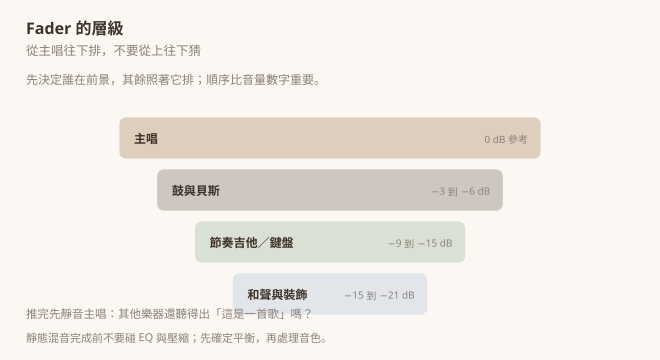

# **第 13 堂：靜態混音 (Static Mix)：平衡與主從關係建立**

混音是一門將多條音軌融合成一個統一且具說服力的立體聲畫面的藝術。在進入壓縮器、EQ、Reverb 等動態處理與效果器的世界之前，有一件最重要的事必須先做好：**靜態混音 (Static Mix)**。這一步驟決定了整首歌的骨架，也是最容易被初學者跳過的關鍵環節。本堂課將深入探討如何在沒有任何自動化與動態處理的情況下，僅靠音量推桿與聲向旋鈕，為你的混音打下穩固的基礎。

---

## 什麼是靜態混音？

靜態混音指的是在**不啟用任何自動化曲線 (Automation)、不掛載任何動態處理器（壓縮器、限制器）** 的情況下，純粹透過調整每條音軌的音量 (Level) 與聲向 (Pan) 來建立平衡。這聽起來很簡單，但實際操作時會發現，要讓所有樂器在沒有任何動態輔助下聽起來和諧且主次分明，遠比想像中困難。

靜態混音的核心目標是：

- **建立平衡**：讓每個頻段與每個樂器都有其應有的存在感，卻不互相掩蓋。
- **確立主從關係**：聽眾的耳朵應該清楚地知道此刻誰是主角（例如主唱或獨奏樂器），誰是配角。
- **找到「甜蜜點」**：每一個推桿的位置都處在一個「不能再大也不能再小」的臨界點上。

混音工程師 Andrew Scheps（曾混音 Adele、Red Hot Chili Peppers）曾說：「如果一個混音在靜態下聽起來就是對的，那麼加上動態處理後，它只會變得更好。」這句話點出了靜態混音的根本重要性 —— 如果基礎平衡是錯的，任何後續處理都只是在補救一個錯誤的起點。

---

## 為什麼要從 Fader 歸零開始？

許多初學者拿到分軌後的第一個反應是：「主唱要出來，先把主唱推桿往上拉！」這乍看合理，但實際上容易讓推桿位置散亂，失去全局視角。專業工作流程通常是：

1. **將所有推桿歸零 (Unity Gain，即 0 dB)**。
2. **全部播放，聽整體感覺**：此時通常會發現某個樂器太大聲或太小聲。
3. **先將節奏組（鼓、貝斯）拉到一個平衡的底盤**。
4. **再將主唱從靜音狀態慢慢推上來，直到它「浮在」伴奏之上**。

從 Unity 開始的好處是，你可以精準地用 dB 增量來感知「某個樂器比另一個大聲了多少」。如果你從隨機的位置開始，日後複盤或調整時將毫無依據。此外，許多 DAW 的 Mixer 介面都設計了「多數 DAW 都提供一鍵歸零快捷鍵（如 Pro Tools Alt+Click、Logic Option+Click、Ableton 雙擊），這不是偶然的——這是為靜態混音準備的核心操作。」的快捷鍵，這不是偶然的 —— 這是為靜態混音準備的核心操作。

---

## 建立參考點：主唱是最重要的燈塔

在一首典型的流行、搖滾或任何有 Vocal 的音樂中，**主唱 (Lead Vocal) 永遠是混音的絕對參考點**。聽眾潛意識會以人聲為中心去判斷其他樂器是否太大或太小。因此，靜態混音的標準流程是：

1. **先將節奏組（Kick、Snare、Bass）調到一個穩固的基礎平衡**（詳見下一節）。
2. **將主唱推桿拉到 Unity，然後播放歌曲最激烈的段落（通常是副歌）**。
3. **判斷主唱是否被伴奏淹沒**：如果你需要豎起耳朵才能聽清楚歌詞，代表伴奏音量過大。
4. **調整整個伴奏總線 (Instrument Bus) 的音量**，讓主唱自然地浮現，而不是靠推高主唱推桿來「壓過」伴奏。

這是一個關鍵的思維轉換：不要問「主唱需要多大聲」，而要問「伴奏需要多小聲，主唱才能自然突出」。後者通常導向更乾淨、更開闊的混音。主唱的理想位置大約是在整體混音的 -12 dB 到 -6 dB 之間的平均 RMS 響度，但這取決於歌曲動態，更重要的是用耳朵判斷 —— 當你聽著主唱歌詞時完全不需要費力，那就是對的位置。

---

## 節奏組的平衡：Kick、Snare、Bass 的三位一體

節奏組（鼓與貝斯）是整首歌的引擎。如果節奏組不平衡，整首歌聽起來就沒有重力感。以下是靜態混音中處理節奏組的實戰步驟：

### 大鼓 (Kick Drum)

大鼓是低頻的錨點。它不需要非常大聲，但必須有足夠的存在感讓你感覺到「衝擊」。一個好的起點是讓 Kick 的峰值大約落在 -10 dB 到 -6 dB 之間（取決於編曲密度）。Kick 應該與 Bass 有清楚的分工：Kick 負責 Attack 與衝擊感，Bass 負責 Sustained Tone 與和聲根基。

### 小鼓 (Snare Drum)

小鼓是節奏的「骨架」，承載了反拍與過門的動態。在靜態混音中，Snare 的峰值通常會設定得比 Kick 略大或相當（-8 dB 到 -4 dB），因為 Snare 的瞬態能量分散、又容易被其他中頻樂器遮蔽，峰值常略高於 Kick 才站得穩。Snare 的位置一旦確定，整首歌的 groove 就會落定。

### 貝斯 (Bass)

貝斯與大鼓的重疊區域（約 60-100 Hz）是最容易產生模糊聽感的區段。靜態混音時，建議先單獨聽 Kick 與 Bass 的組合，來回切換 Solo。當你聽到 Kick 與 Bass 各自清晰且互補時，才加入其他樂器。Bass 的音量通常設定在讓 Kick 的 Attack 可以「穿透」Bass 的長音之上。若 Bass 的音量壓過了 Kick，節奏感會變得鬆散。

---

## 加入支撐樂器：節奏吉他、鍵盤與 Pad

當節奏組與主唱的平衡確立後，下一步是加入支撐樂器（Rhythm Guitar、Keyboard、Pad 等）。這些樂器的角色是填補中頻的空間，但**絕對不能搶走主唱的風采**。

實戰技巧：

1. **將節奏吉他先設到一個比主唱小約 3-6 dB 的位置**。
2. **聆聽主唱的段落**：如果主唱出現時，節奏吉他讓你分心或壓迫感增大，就將吉他推桿再降 1-2 dB。
3. **檢查樂句的空隙**：在靜態混音中，節奏吉他的音量可以參考「當主唱沒有在唱的時候，吉他聽起來是否飽滿」—— 也就是說，容忍主唱段落中吉他稍微被掩蓋，這其實是自然的動態。

鍵盤與 Pad 類樂器的處理方式類似，但它們通常佔據較穩定的中高頻，建議先 Solo 聆聽確認它們不會與主唱的 2-4 kHz 區段打架。必要時在靜態階段先靠音量平衡，稍後再用 EQ 處理頻率衝突。

---

## 聲向擺放：建立靜態立體聲底盤

靜態混音不只是音量平衡，聲向 (Pan) 也是這個階段必須決定的參數。許多混音師會在推完 Fader 後立刻決定聲向，因為聲向會反過來影響你對音量的感知 — 同一個樂器放在正中央聽起來會比放在極左或極右更「大聲」。

基本聲向原則：

### 中央聲道 (Center)

所有「骨幹樂器」應該放在中央：主唱、大鼓、小鼓、貝斯。這些是歌曲的支柱，放在中央可以確保它們在任何播放系統（包括單聲道手機喇叭）上都不會消失。

### 左右聲道 (L/R)

節奏吉他、Keyboard、Pad、合音、打擊樂器可以分布到左右。一個經典的做法是：將兩把節奏吉他分別 Pan 到 L 40 與 R 40，營造寬闊的節奏牆。合音可以放置在主唱後方的 L 20 與 R 20，提供包圍感而不干擾主唱的清晰度。

### 注意單聲道兼容性

雖然靜態混音階段主要在立體聲下工作，但時不時切換到 Mono 檢查非常重要。如果某個樂器在 Mono 下幾乎消失，代表你需要調整其聲向或相位。通常 Kick、Snare、Bass、主唱必須在 Mono 下依然清晰。

---

## 音量層級關係：誰大誰小？

| 角色 | 相對主唱 | 說明 |
|---|---|---|
| 主唱 | 0 dB（參考） | 整首混音的基準 |
| 鼓與貝斯 | −3 到 −6 dB | 撐住節奏與低頻 |
| 節奏樂器 | −9 到 −15 dB | 鋪底，不要搶主唱 |
| 和聲與裝飾 | −15 到 −21 dB | 只在需要的地方出現 |

靜態混音本質上就是在定義層級 (Hierarchy)。以下是一個典型的音量金字塔（從最大聲到最小聲），可作為通用參考：

1. **主唱 (Lead Vocal)**：絕對的焦點，必須浮在最上層。
2. **小鼓／軍鼓 (Snare)**：中頻的節奏錨點，需要足夠的穿透力。
3. **大鼓 (Kick) 與貝斯 (Bass)**：低頻引擎，相互平衡但不過度突出。
4. **節奏樂器 (Guitar / Keys)**：支撐主唱，不搶戲。
5. **效果音效、背景 Pad、細微打擊樂**：營造氛圍與細節，聽眾不應刻意注意到它們的存在。

這並不是絕對規則 —— Jazz 或 Classical 的層級關係可能完全不同 —— 但在流行、搖滾、電子音樂中，上述金字塔是經過無數金曲驗證的框架。初學者先以此為基準進行靜態混音，再根據歌曲風格微調。

---

## 使用參考曲目檢查靜態平衡

靜態混音階段最容易遇到的問題是：因為反覆聽著同樣的 Loop 而失去客觀判斷力，導致 Bass 越推越大、主唱越調越小。這時候就需要參考曲目 (Reference Track) 來校正聽感。

操作方式：

1. **選擇一首與你的歌曲風格、編制類似的商業發行曲**（最好是母帶後期的成品）。
2. **將參考曲目匯入 DAW，並將其音量校準到與你的混音大致相同**（可以用 LUFS 表頭或耳朵比對）。
3. **用 Solo、Mute 來回切換參考曲目與你的混音**，比較以下幾點：
   - 主唱的音量比例是否相似？
   - Kick 與 Bass 的平衡是否感覺一致？
   - 整體的「Pressure」或「能量感」是否在同一個水準？

4. **不要追求完全一樣** —— 不同歌曲有不同的動態範圍，參考曲目的作用是提供一個「聽感基準」，讓你不至於偏離業界標準太遠。

一個進階技巧：在參考曲目的立體聲軌上掛 EQ，用低通／高通濾波只聽特定頻段（例如 LPF 到 150 Hz 專聽 Kick 與 Bass），比對你的混音低頻比例是否接近。 來模擬不同樂器的頻率響應，藉此比對特定頻段的比例。例如，用一個 Low-Pass Filter 只聽 Kick 與 Bass 的低頻，比對你的低頻是否與參考曲目接近。

---

## Fader Ride 技巧：找到每個元素的甜蜜點

「Fader Ride」這個詞源自類比控台的時代，混音師用手推移推桿來找到每個樂器最適合的靜態位置。在數位 DAW 中，這個技巧同樣重要。

### 如何進行 Fader Ride

1. **從節奏組開始**：將 Kick、Snare、Bass 的推桿先拉到 -∞，然後一個一個拉上來。先拉 Kick 到感覺「有衝擊但不過重」的位置，再加入 Snare 並調整，最後加入 Bass。
2. **來回 Solo 比對**：Solo 一個樂器與 Full Mix 交錯聆聽。如果你 Solo 某個樂器時覺得它好聽，但在 Full Mix 中聽不到，代表它的音量不足或被頻率遮蓋了。相反，如果 Solo 時覺得合理，但在 Full Mix 中覺得太突出，代表音量過大。
3. **閉上眼睛聽**：這不是玄學 —— 視覺會影響聽覺判斷。閉上眼睛聆聽一段副歌，然後睜開眼睛看推桿位置，問自己：「這個推桿位置反映了我聽到的平衡嗎？」
4. **大動作調整，小幅度微調**：先以 3-5 dB 為單位做大方向調整，找到「過大」與「過小」的邊界，再以 0.5-1 dB 的精度微調到最佳位置。

Fader Ride 的終極目標是：每一個推桿的位置都處在一個「再往上 1 dB 就太多，再往下 1 dB 就不夠」的精準平衡點。這需要大量的練習來培養聽覺敏感度。

---

## 何時要從靜態混音進入動態處理？

靜態混音完成後，你應該已經對混音的整體平衡感到滿意。這時候的訊號特徵是：

- 所有樂器的音量比例已經大致正確。
- 主從關係清楚，聽眾不需要思考就知道要聽哪裡。
- 聲向配置提供了寬闊且穩定的立體聲畫面。
- 沒有任何一個樂器在特定段落突然消失或爆出。

當以上條件都滿足後，**才**開始掛上壓縮器與 EQ 來解決剩下的問題：

- **壓縮器**：用來控制動態範圍，讓 Bass 線條更一致、讓 Vocal 的尾音不會忽大忽小。
- **EQ**：用來解決頻率衝突，例如 Kick 與 Bass 的低頻打架、主唱與吉他的中高頻重疊。
- **Reverb / Delay**：用來建立空間感與深度。

一個很實用的判斷標準是：如果靜態混音階段你覺得「這個 Bass 在 A 段剛剛好，但到了副歌就太大聲了」，這就是動態處理要解決的問題 —— 你可能需要壓縮器來縮小 Bass 的動態範圍，或是在副歌處做 Automation。**不要為了「預先解決」副歌的問題而在靜態階段就把 Bass 壓得很低，否則 A 段會變得薄弱無力。**

---

## 常見靜態混音錯誤

- **過早使用壓縮器**：在靜態平衡都還沒定下來之前就掛壓縮器，會讓推桿調整的聽覺回饋失真，導致你在錯誤的基礎上做決策。
- **每個樂器都想突出**：混音不是比賽誰大聲。如果每一個樂器都在搶聽眾的注意力，聽眾就會感到疲勞。學會「讓某些樂器在特定段落退居幕後」才是專業混音的標誌。
- **忽略頭尾段落**：許多人只專注在最精彩的部分（副歌），卻忽略了主歌與橋段。一個好的靜態混音應該在歌曲的所有段落都維持正確的比例層級。
- **用 Solo 鈕做最終判斷**：Solo 是診斷工具，不是決策工具。最終判斷必須在 Full Mix 下進行，因為某個樂器在 Solo 下聽起來完美的音量，在 Full Mix 中很可能完全不合適。
- **不做 Mono 檢查**：不放心的話可以從 DAW 匯出一個 Mono 版本到手機上聽。如果 Kick 消失了或主唱被蓋住，代表聲向配置有問題或相位出了狀況。

---

## 結語

靜態混音是一門看似簡單、實則深厚的技藝。它強迫你專注在音樂的本質 —— 音量與位置 —— 而不被華麗的效果器所分心。當你能夠純粹靠推桿與聲向就讓混音聽起來完整、平衡且具有音樂性時，你就已經掌握了混音的核心能力。後續的動態處理與效果器只是在這樣的基礎上錦上添花。從今天開始，每次混音都先給自己 30 分鐘的「靜態混音時間」，關掉所有效果器，只用 Fader 與 Pan，你會驚訝於自己的進步速度。

下一堂課，我們將探討動態處理的秘密武器 —— 壓縮器 (Compressor) 的原理與使用時機。
