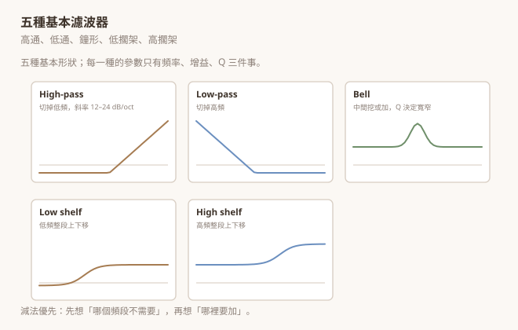
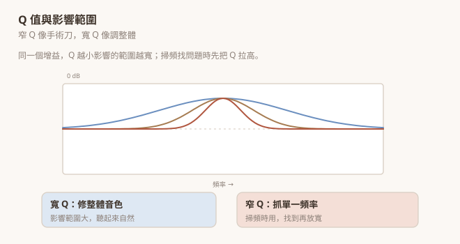

# **第 14 堂：均衡器 (EQ)：濾波器應用與掃除干擾頻率**

均衡器（Equalizer，簡稱 EQ）是混音中最核心、最常使用的工具之一。它可以調整音訊中特定頻率的音量大小，從而改變聲音的質感、清晰度與空間感。學會正確使用 EQ，是從「聽得懂」邁向「調得好」的關鍵一步。

## 什麼是 EQ？EQ 的核心概念

EQ 的本質是「頻率的手術刀」。它讓你針對某一個或某一段頻率範圍進行增益（Boost）或衰減（Cut）。在數位音訊工作站（DAW）中，EQ 通常以插件形式出現，常見的類型包括：

- **參數等化器（Parametric EQ）**：可自由設定頻率點、增益值與 Q 值（頻寬）。最靈活，適合精細調整。
- **圖形等化器（Graphic EQ）**：固定頻段滑桿，常用於現場音響或快速調整。
- **動態 EQ（Dynamic EQ）**：結合壓縮器概念，只在特定頻率超過閾值時才觸發調整。

無論哪一種 EQ，你都需要理解三個基本參數：

- **頻率（Frequency）**：你要處理的聲音位置，單位為 Hz 或 kHz。
- **增益（Gain）**：你要增加或減少多少音量，單位為 dB。
- **Q 值（Q Factor）**：影響範圍的寬窄。Q 值越高，影響範圍越窄、越精準；Q 值越低，影響範圍越寬、越平滑。

## 五種基本濾波器類型

EQ 中的濾波器決定了你如何影響聲音。以下是五種最常用的類型：

### 高通濾波器（High-Pass Filter, HPF）

又稱為低切濾波器（Low-Cut）。它允許高於某個頻率的訊號通過，衰減低於該頻率的訊號。這是最常用的濾波器之一，因為它能有效去除不必要的低頻噪音。例如，人聲麥克風可能收錄到空調低頻轟鳴聲，用 HPF 設定在 80–100Hz 即可清除。

### 低通濾波器（Low-Pass Filter, LPF）

又稱為高切濾波器（High-Cut）。它允許低於某個頻率的訊號通過，衰減高於該頻率的訊號。常用於減少嘶聲（Sibilance）或讓聲音變得更溫暖、更遠。例如，背景合聲設定 LPF 在 8–10kHz，可以讓它退到主唱後方。

### 帶通濾波器（Band-Pass Filter, BPF）

只允許某一段頻率範圍通過，低於和高於該範圍的訊號都被衰減。聽起來像電話音效（約 300Hz–3.4kHz）。常用於特殊效果或模擬老式收音機、電話聲。

### 陷波濾波器（Notch Filter）

極窄的帶阻濾波器，專門針對某一個精確頻率做深度衰減。當你聽到某個樂器有固定的嗡嗡聲（例如 50Hz 或 60Hz 的電源哼聲），Notch Filter 可以精準切除而不影響周圍頻率。Q 值通常設定在 10–30 之間。

### 擱架濾波器（Shelving Filter）

分為高擱架（High Shelf）和低擱架（Low Shelf）。它會影響某個頻率點以上的所有範圍（高擱架）或以下的所有範圍（低擱架），增益曲線像一個架子。常用於整體調整聲音的明亮度或厚實度，而非處理特定問題頻率。

## 頻率範圍總覽

要使用 EQ，你必須知道每個頻率範圍聽起來像什麼。以下是音樂製作中常用的頻率分段：

| 頻段 | 範圍 | 聽感特徵 |
|------|------|----------|
| 極低頻（Sub） | 20–60Hz | 身體感受到的震撼，電音 Sub Bass、大鼓最低層 |
| 低頻（Bass） | 60–250Hz | 節奏組的根基，Bass 吉他、大鼓的主體 |
| 低中頻（Low Mids） | 250–500Hz | 聲音的厚實度，但過多會造成模糊混濁 |
| 中頻（Mids） | 500Hz–2kHz | 樂器的主要泛音區，人聲的清晰度核心 |
| 上中頻（Upper Mids） | 2–4kHz | 聲音的穿刺感與攻擊性，過多會刺耳 |
| 存在感（Presence） | 4–6kHz | 樂器的臨場感與清晰度，人聲唇齒音 |
| 高頻光澤（Brilliance） | 6–20kHz | 空氣感與細節，鈸、Hi-Hat 的延展 |

## 高通濾波器：清除低頻轟鳴

高通濾波器是你的第一道防線。幾乎每個非低音樂器都應該使用 HPF。以下是常見的起點設定：

- **主唱人聲**：80–120Hz（去除麥克風震動與低頻噴麥聲）
- **木吉他、鋼琴**：80–150Hz（去除舞台震動與低頻嗡鳴）
- **電吉他（節奏）**：100–200Hz（避免與 Bass 打架）
- **Overhead 與 Hi-Hat**：200–300Hz（去除鈸的低頻共振）
- **小鼓（Snare）**：100–150Hz（保留 Punch，去除低頻雜訊）

大原則是：慢慢往上調 HPF 的頻率點，直到你發現樂器的聲音開始變薄、失去重量感，再稍微往下一點點。這就是最理想的 HPF 設定點。

## 掃除技術：如何找到問題頻率

掃除技術（Sweeping Technique）是 EQ 混音中最實用的技巧之一，特別適合用來找出干擾頻率。

**步驟如下：**

1. 在 Parametric EQ 上選擇一個峰值濾波器（Peak Filter）。
2. 將增益設定為較大的值（+8 到 +12dB），這一步是為了讓問題容易被聽見。
3. 將 Q 值設為較窄的範圍（約 1–3），讓影響範圍集中。
4. 邊播放音軌，邊慢慢滑動頻率點，從低頻到高頻。
5. 當你聽到某個頻率發出特別刺耳、轟鳴或不舒服的聲音時，就是問題頻率。
6. 找到後，將增益從 Boost 改成 Cut（衰減 -3 到 -6dB），並適度放寬 Q 值讓調整更自然。

掃除技術對以下情況特別有效：

- 人聲的鼻音共振（通常在 500Hz–1kHz 附近）
- 電吉他的箱體共振（通常在 100–300Hz）
- 房間駐波造成的低頻嗡鳴（通常在 50–150Hz）

## 衰減 vs. 增益：為什麼減法 EQ 更安全

新手最常犯的錯誤就是一拿到 EQ 就開始 Boost。事實上，專業混音師的原則是：**先 Cut，再考慮 Boost**，也就是「減法 EQ」。

**減法 EQ 的優勢：**

- **保留動態餘量（Headroom）**：衰減不會增加整體音量，減少削波的風險。
- **更自然的聲音**：衰減問題頻率後，聲音往往比 Boost 好聽頻率更乾淨。
- **減少相位問題**：大量 Boost 會引入相位偏移，特別是 Q 值較窄時。
- **強迫你思考**：Cut 迫使你找出「什麼是多餘的」，而不是盲目增加。

**什麼時候應該 Boost？**

- 當某個樂器的自然頻率明顯不足，且 Cut 無法解決時。
- 需要讓某個樂器在混音中突出，且用音量推子調整會破壞平衡時。
- 創造性用途，例如讓合成器 Bass 的低頻更飽滿。

Boost 的建議上限通常是 +3 到 +6dB。如果需要超過 +6dB，代表你可能選錯了音色或錄音有問題。

## 清理 200–500Hz 的模糊區

200–500Hz 是所有混音中最容易變得模糊、混濁的頻段。這裡是許多樂器的基頻與泛音重疊區，也是最容易出現「泥濘感」（Muddy）的地方。

**常見問題症狀：**

- 整個混音聽起來「悶悶的」、「髒髒的」
- 樂器之間分不清楚
- 低頻沒有清晰的輪廓

**清理策略：**

1. **Bass 與大鼓**：在 200–300Hz 做窄幅 Cut（-2 到 -4dB），減少模糊感。
2. **節奏吉他與鋼琴**：在 300–500Hz 做較寬的 Cut（-2 到 -3dB），讓中頻更乾淨。
3. **人聲**：在 250–400Hz 做微幅 Cut（-1 到 -2dB），減少鼻音感。
4. **整體混音**：使用掃除技術，找到最糊的那個頻率點，做窄幅 Cut。

注意不要 Cut 過頭，否則聲音會失去溫暖感和厚度。每次 Cut 後，A/B 比較（關閉/開啟 EQ）確認是否真的有改善。

## 減少 2–4kHz 的刺耳感

2–4kHz 是聽覺最敏感的頻段，也是「聽覺疲勞」的主要來源。過多的 2–4kHz 會讓聲音聽起來刺耳、令人煩躁。

**常見問題症狀：**

- 人聲聽起來「尖銳」、「刮耳」
- 電吉他 Solo 聽久了耳朵會痛
- 整體混音缺乏耐聽度

**處理方法：**

1. **主唱人聲**：在 2.5–3.5kHz 用較寬 Q 值做 -1 到 -3dB 的 Cut，讓聲音更圓潤。
2. **電吉他**：在 2–4kHz 做 -2 到 -4dB 的 Cut，特別是長時間 Solo 段落。
3. **小提琴、銅管**：在 3–4kHz 做窄幅 Cut，減少尖銳感。
4. **整體 Bus**：在 2.5kHz 附近做 -1 到 -2dB 的寬幅 Cut，可以增加混音的耐聽度。

但也要小心不要 Cut 太多，否則聲音會失去攻擊性與穿透力。一個好的測試是：在較小的音量（如手機喇叭）聽混音，如果還是刺耳，代表 EQ 需要調整；如果只有大音量時刺耳，那是音量本身的問題。

## 用高擱架增加空氣感與臨場感

高頻的處理是最容易被忽略但也最能提升混音品質的環節。高擱架濾波器（High Shelf）設定在 8–12kHz，可以為聲音增添「空氣感」（Air）。

**應用場景：**

1. **主唱人聲**：8–12kHz 高擱架 +2 到 +4dB，讓聲音更有穿透力與開闊感。
2. **木吉他、鋼琴**：8–10kHz 高擱架 +2 到 +3dB，增加清脆感。
3. **Overhead 鈸組**：10–12kHz 高擱架 +1 到 +3dB，讓 Hi-Hat 與 Crash 更閃耀。
4. **整體混音 Bus**：10kHz 高擱架 +1 到 +2dB，增加混音的「高階感」。

**注意事項：**

- 過多的高頻 Boost 會引入嘶聲和噪音。如果原始錄音品質不佳，Boost 高頻反而會放大瑕疵。
- 8kHz 以上的 Boost 對系統的取樣率與 DAC 品質較敏感，在耳機上聽起來剛好，在喇叭上可能過亮。建議在不同系統上反覆測試。
- 如果有嚴重的嘶聲（Sibilance），先用 De-esser 處理，再用 High Shelf。

## 各樂器的實用 EQ 流程

### 人聲（Vocal）

1. **HPF**：80–120Hz，清除低頻噪音。
2. **Low Mids 清理**：250–400Hz 微 Cut（-1 到 -2dB），減少鼻音。
3. **Mids 清晰度**：如果聲音太遠，在 1–2kHz 小 Boost（+1 到 +2dB）。
4. **刺耳點**：掃除 2–4kHz，找到問題點後 Cut（-2 到 -4dB）。
5. **Presence**：4–6kHz 小 Boost，增加臨場感。
6. **Air**：8–12kHz High Shelf +2 到 +4dB。

### 電吉他

1. **HPF**：100–150Hz，避免干擾 Bass 區域。
2. **Muddiness 整理**：200–400Hz 寬 Cut（-2 到 -4dB），讓吉他更清晰。
3. **Attack 增強**：1–3kHz 小 Boost（+1 到 +3dB），增加破音吉他的攻擊感。
4. **Harshness**：2–4kHz 根據需要做微 Cut。
5. **Sparkle**：8–10kHz High Shelf 微 Boost。

### 大鼓（Kick Drum）

1. **Sub 震撼力**：50–60Hz 小 Boost（+2 到 +4dB）或 Low Shelf。
2. **Muddiness**：200–400Hz Cut（-2 到 -4dB），讓 Punch 更乾淨。
3. **Attack 打擊感**：3–5kHz 小 Boost（+2 到 +4dB），讓大鼓的 Click 聲更明顯。
4. **HPF**：如果有 Sub Kick 麥克風以外的軌道，設定在 30–40Hz。

### 小鼓（Snare Drum）

1. **Body 厚度**：200–250Hz 小 Boost（+2 到 +3dB）。
2. **Muddiness**：400–600Hz 微 Cut（-1 到 -2dB）。
3. **Crack 打擊感**：1–3kHz 小 Boost（+2 到 +4dB）。
4. **Air**：8–10kHz High Shelf 微 Boost。

### Bass 吉他

1. **Sub 震撼力**：50–80Hz Low Shelf +2 到 +4dB（如需要）。
2. **指板噪音**：1–3kHz 窄幅 Cut（-2 到 -4dB），去除手指滑動的摩擦聲。
3. **Attack 清晰度**：700Hz–1kHz 小 Boost（+1 到 +2dB），讓 Bass 在中頻更有存在感。
4. **HPF**：30–40Hz，去除極低頻的無用震動。

## 新手最常見的 EQ 錯誤

### 錯誤一：過度 Boost

新手很容易陷入「越多越好」的迷思，在某個頻率 Boost 了 +6dB 甚至更多。結果聲音不但沒有變好，反而更奇怪、更不自然。記住：EQ 是微調工具，不是音量推子。超過 +6dB 的 Boost 通常都是一個警訊，代表原始聲音有更大的問題。

### 錯誤二：不檢查相位

當你在同一個訊號鏈中使用多個 EQ 時，特別是做大幅 Boost 搭配窄 Q 值，很容易引入相位偏移。這會導致聲音聽起來「空空的」或「不紮實」。使用 Linear Phase EQ 可以減少這個問題，但它會增加延遲（Latency）。

### 錯誤三：只用耳朵不看頻譜分析儀

雖然耳朵是最終的判斷標準，但頻譜分析儀（Spectrum Analyzer）可以提供客觀的視覺輔助。它可以幫助你快速找到不正常的頻率堆積，特別是在低頻區域（人耳對此較不敏感）。

### 錯誤四：做 EQ 調整後不進行 A/B 比較

永遠要在 EQ 開啟和關閉之間反覆切換比較。如果關掉 EQ 後你覺得聲音反而更好聽，代表你的 EQ 調整有問題。A/B 比較能幫助你客觀判斷每個調整是否真的有效。

### 錯誤五：Solo 調 EQ，但在整軌聽時不對

Solo 音軌時做的 EQ 調整，在全部樂器一起播放時可能完全不適用。因為 Solo 時你聽不到其他樂器的頻率重疊。建議每次調整後都要在整軌模式下聆聽，確認該樂器在混音中的位置是否正確。

### 錯誤六：忽略 Gain Staging

如果你在 EQ 上做 Boost，整體音量會增加。這可能導致訊號鏈後方的壓縮器或 Limiter 觸發過早，甚至產生削波。記得在 Boost 後調整軌道的輸出音量，保持 Gain Staging 的一致性。

### 錯誤七：所有音軌都用相同的 EQ 設定

每一個錄音、每一首歌、每一個樂器都不同。不要複製貼上 EQ 設定。花時間真正去聽你的素材需要什麼，而不是套用模板。

## 結語

均衡器是混音工作中最強大的工具之一，但它的力量來自於克制與精準。真正的 EQ 高手不是那些會 Boost 出華麗聲音的人，而是那些知道該 Cut 什麼、該保留什麼的混音師。從今天開始，練習用「減法思維」來處理 EQ：先 Cut 問題，再考慮 Boost。

下一堂課，我們將深入探討壓縮器（Compressor）的動態處理原理，學習如何控制聲音的動態範圍，讓混音更專業、更具凝聚力。
