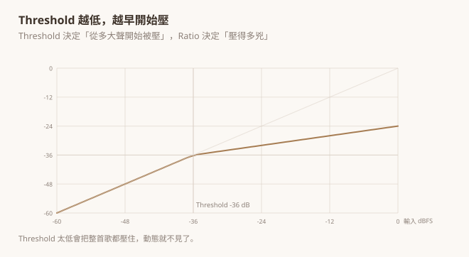
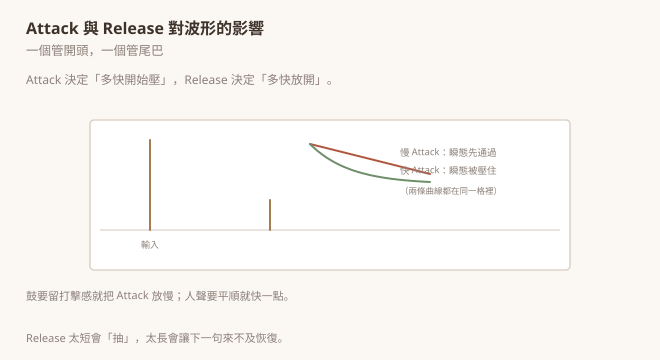
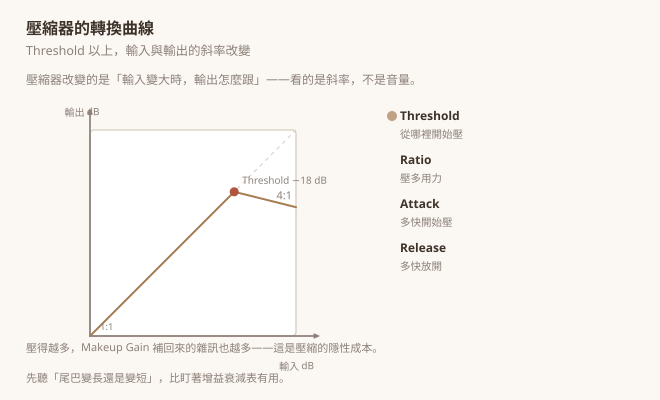
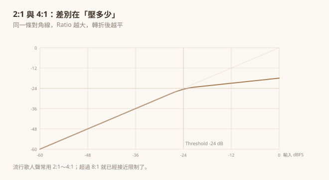
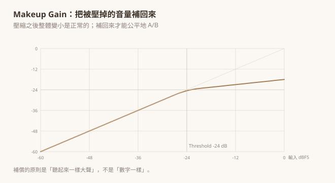
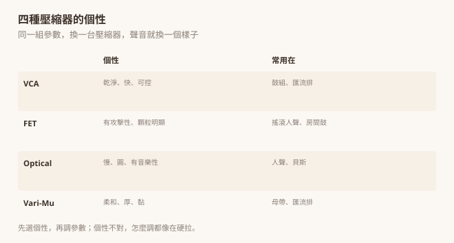
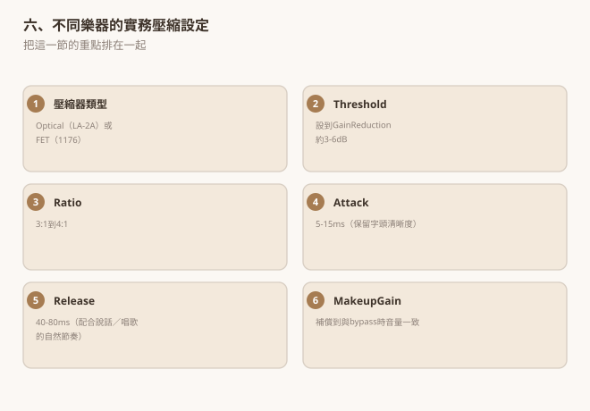
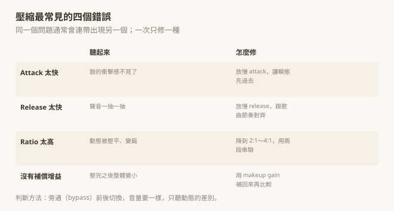
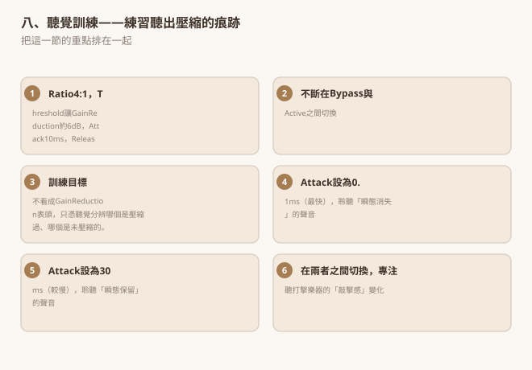

# **第 15 堂：壓縮器 (Compressor)：動態控制原理與聽覺訓練**

## 一、什麼是壓縮？動態範圍的控制藝術

壓縮器（Compressor）是音樂製作中最重要的動態處理工具之一。它的核心任務是**縮小聲音訊號的動態範圍**——也就是讓最大聲與最小聲之間的差距變小。為什麼要這麼做？因為人類的聽覺系統和錄音媒體都有其物理限制：太小的聲音會被雜訊淹沒，太大的聲音會產生失真。壓縮器讓聲音保持在一條「恰到好處」的水平線上。

想像一位歌手在錄音時，副歌激昂處音量爆增，主歌呢喃處卻細若游絲。如果直接將這樣的錄音匯入混音，你會面臨一個兩難：把音量調大，副歌會刺耳破裂；把音量調小，主歌又聽不清楚。壓縮器的存在正是為了解決這個難題——它自動偵測音量過大的段落，將其降低，使整體動態更加平穩，然後再利用所謂的「補償增益」（Makeup Gain）將整體音量拉回理想水準。

在現代音樂中，壓縮器的應用無所不在：流行人聲的紮實貼耳、電貝斯的持續低頻、鼓組的打擊力道與延音平衡、甚至整首混音的「黏合感」，都離不開壓縮器的巧妙運用。然而，壓縮器也是最容易被誤用的工具——過度的壓縮會讓音樂失去生命力，產生所謂的「泵動效應」（Pumping）與「呼吸效應」（Breathing）。這堂課將從原理到實作，帶你徹底掌握這項不可或缺的混音利器。

---

## 二、四大核心參數：Threshold、Ratio、Attack、Release

| 參數 | 作用 | 常用起點 |
|---|---|---|
| Threshold | 從哪裡開始壓 | 比峰值低 3–6 dB |
| Ratio | 壓縮比例 | 人聲 3:1–4:1，鼓 4:1–8:1 |
| Attack | 多快開始壓 | 10–30 ms（保留瞬態） |
| Release | 多快放開 | 80–200 ms（跟著節奏） |

任何壓縮器，無論是硬體還是軟體，都圍繞著四個基本參數運作。理解這四個參數，你就掌握了壓縮器的全部邏輯。

### 2.1 Threshold（閾值）：壓縮啟動的門檻

Threshold 決定壓縮器「何時開始動作」。它的單位是 dB（分貝），設定一個音量臨界點：當輸入訊號的音量**超過**這個 Threshold 時，壓縮器開始作用；低於 Threshold 的訊號則保持原樣，不受影響。

- **Threshold 設得很低（例如 -40 dB）**：幾乎所有訊號都會被壓縮，產生非常明顯的壓縮效果。
- **Threshold 設得很高（例如 -10 dB）**：只有最大的峰值會觸發壓縮，細微的聲音完全不受影響。
- **實務建議**：先將 Threshold 拉到最低（最敏感），讓壓縮效果明顯可見，再慢慢往上調，直到壓縮只在你想控制的最大聲段落發生。觀察壓縮器的增益衰減表（Gain Reduction Meter），理想的壓縮量通常落在 3-6 dB 之間。

### 2.2 Ratio（比例）：壓縮的力度

Ratio 定義了「超過 Threshold 的訊號被壓縮多少」。它的寫法通常是 X:1，意思是「每超過 Threshold X dB，輸出只增加 1 dB」。

- **2:1**（輕度壓縮）：輸入超過 Threshold 10 dB → 輸出只增加 5 dB。適合人聲、木吉他等需要溫和動態控制的音源。
- **4:1**（中度壓縮）：輸入超過 Threshold 10 dB → 輸出只增加 2.5 dB。電貝斯、電吉他、背景人聲的常見設定。
- **8:1**（強力壓縮）：輸入超過 Threshold 10 dB → 輸出只增加 1.25 dB。鼓組、銅管、需要強力控制的音源。
- **10:1 以上**（Limiting／限制模式）：此時壓縮器實際上是 Limiter（限制器），幾乎不允許訊號超過 Threshold。母帶後期處理常用。

Ratio 與 Threshold 是連動的。降低 Threshold 會讓更多訊號被壓縮，提高 Ratio 會讓壓縮的力度更強。兩者搭配使用，才能達到理想的動態控制。

### 2.3 Attack（啟動時間）：影響瞬態的鋒利度

Attack 決定壓縮器「偵測到訊號超過 Threshold 後，多快開始壓縮」。單位是毫秒（ms）或微秒（µs）。

- **快 Attack（0.1 - 1 ms）**：壓縮器幾乎瞬間反應，將訊號的起始瞬態（Transient）一同壓掉。聲音會變得較為平滑、內斂，但也可能失去打擊樂器的衝擊感。適合控制刺耳的峰值，或用於貝斯讓延音更一致。
- **慢 Attack（10 - 30 ms）**：壓縮器讓訊號的起始瞬態「通過」後才開始壓縮，保留原始的攻擊感與力度。非常適合鼓組——你不想把小鼓的敲擊感壓掉，只想控制後續的延音。
- **實務技巧**：調整 Attack 時，用耳朵聆聽「聲音的開頭」是否改變。如果小鼓聽起來變「悶」了，表示 Attack 太快；如果人聲的氣音或字頭變得突兀，表示 Attack 太慢。

### 2.4 Release（釋放時間）：塑造聲音的尾巴

Release 決定壓縮器「訊號低於 Threshold 後，多快停止壓縮」。單位也是毫秒或秒。

- **快 Release（20 - 100 ms）**：壓縮器迅速恢復，讓聲音的尾音自然流出。但若 Release 過快，在訊號快速波動時會產生明顯的「泵動效應」（Pumping）——音量像在呼吸一樣起伏。
- **慢 Release（200 ms - 數秒）**：壓縮器持續作用，將聲音的各個部分壓得更平均，但也可能讓安靜的段落聽起來「被吸住」。
- **與音樂節奏同步**：Release 時間可以配合歌曲的速度來設定。例如 BPM 120 的歌曲，一拍約 500 ms，將 Release 設在 200-400 ms 之間，讓壓縮器的恢復與音樂律動同步。
- **實務建議**：聆聽壓縮器釋放時是否有不自然的「抽氣聲」。理想的 Release 是讓壓縮器在不知不覺中完成動作。

---

## 三、Makeup Gain：補償增益的藝術

壓縮器降低了大聲段的音量，整體聽感自然會變小聲。Makeup Gain（補償增益，常標示為 Output Gain 或 Makeup）的功能就是在壓縮後將整體音量拉回原本的水準，甚至更高。

**關鍵心法**：利用 Makeup Gain 進行「A/B 比較」。將壓縮器的效果切換開關（Bypass），在開啟與關閉之間切換，同時用 Makeup Gain 補償音量，使兩者聽起來「一樣大聲」。這樣你才能公平地判斷壓縮器是否真的讓聲音變好了——而不是單純因為變大聲而覺得更好聽。

一個常見的初學者錯誤是：開了壓縮器後覺得聲音變好，但其實只是因為 Makeup Gain 讓音量變大了而已。**永遠做音量匹配的 A/B 比較。**

---

## 四、視覺 vs 聽覺：學會用耳朵聽壓縮

這可能是最重要的一堂課：**壓縮器是用聽的，不是用看的。** 許多新手盯著壓縮器的 Gain Reduction 指針，以為看到 6 dB 的衰減就代表做對了。事實上，壓縮器的視覺指示僅供參考，你的耳朵才是最終裁判。

**為什麼不能只看表頭？**

- 不同音源對壓縮的反應不同：人聲的 4 dB 壓縮和貝斯的 4 dB 壓縮聽起來完全不一樣。
- Attack 和 Release 的設定決定了壓縮的「質感」，而這是表頭無法顯示的。
- 同樣的 Threshold 與 Ratio，在不同頻率分布的聲音上會產生截然不同的效果。

**聽覺訓練的入門方法：**

1. **先過度壓縮**：將 Threshold 拉低、Ratio 拉到 8:1 以上，Attack 設最快、Release 設最快。仔細聆聽這種「窒息感」的聲音——記住這個聲音，這就是壓縮過度的樣貌。
2. **再慢慢放鬆**：將 Ratio 降到 4:1，Attack 調慢到 10 ms，Release 調到 200 ms。感受聲音如何從「被掐住」變得「自然流暢」。
3. **極端 A/B 測試**：在壓縮器開啟與關閉之間切換，專注於聽「聲音的哪些部分變了」——是變亮了？變厚了？變平了？還是更有衝擊力了？
4. **聆聽特定細節**：注意壓縮前後的聲音尾巴（Reverb tail 或自然殘響）是否有變化、背景噪聲是否被放大或壓制、字頭與氣音的清晰度是否受影響。

專業混音師的祕訣：**閉上眼睛聽**。視覺干擾（波形顯示、指針跳動）會誤導你的判斷。關掉螢幕或用布蓋住壓縮器的顯示區域，只用耳朵做決定。

---

## 五、不同類型的壓縮器：VCA、FET、Optical、Vari-Mu

並非所有的壓縮器聽起來都一樣。不同的電路設計和感光／電壓控制方式，賦予了每種壓縮器獨特的聲音特質。

### 5.1 VCA（Voltage Controlled Amplifier）

- **代表機型**：SSL G-Bus Compressor、API 2500
- **特性**：精準、透明、反應極快
- **優點**：控制力強，參數設定精確，失真極低
- **適用場景**：鼓組總線、立體聲混音總線（Stereo Bus）、需要乾淨動態控制的場合
- **聽感特徵**：不會大幅改變音色，主要做動態控制

### 5.2 FET（Field Effect Transistor）

- **代表機型**：UREI 1176（經典中的經典）
- **特性**：快速、飽滿、富有個性
- **優點**：Attack 可以極快，能為聲音增添「砂礫感」與「衝擊感」
- **適用場景**：電貝斯（經典的 1176 貝斯聲）、人聲（平行壓縮）、小鼓
- **聽感特徵**：即使 Ratio 不高，FET 壓縮器仍會為聲音增添一種「被推動」的能量感

### 5.3 Optical（光學壓縮器）

- **代表機型**：LA-2A、LA-3A
- **特性**：平滑、溫暖、音樂性強
- **優點**：Attack 和 Release 由內置光感元件自動決定（通常較慢），操作極簡（通常只有 Gain 和 Peak Reduction 兩個旋鈕）
- **適用場景**：人聲（幾乎是錄音室標準）、木吉他、貝斯
- **聽感特徵**：壓縮動作非常平滑，幾乎感覺不到壓縮器在作用，但聲音變得更加飽滿紮實。LA-2A 擁有「自動 Release」的特性——壓縮量越大，Release 越慢，非常適合動態變化大的聲樂

### 5.4 Vari-Mu（可變 μ 值／電子管壓縮器）

- **代表機型**：Fairchild 670、Manley Variable Mu
- **特性**：溫暖、黏合、音樂性濃厚
- **優點**：將整個混音「黏合」在一起，增添類比溫暖感
- **適用場景**：混音總線、立體聲總線、鋼琴、弦樂
- **聽感特徵**：壓縮動作是漸進式的——訊號越強，壓縮量越大，但過渡極其自然。能讓多個樂器聽起來像一個整體

**選擇建議**：如果你是初學者，先從一個 VCA 或 Optical 壓縮器插件開始學習基本參數。熟悉 Threshold、Ratio、Attack、Release 之後，再去嘗試不同類型的壓縮器，感受它們的「個性」。

---

## 六、不同樂器的實務壓縮設定

以下提供各類樂器的起點設定。請記得：**這些只是參考起點**，你必須根據實際錄音素材和音樂風格進行調整。

### 6.1 人聲（Lead Vocal）

- **壓縮器類型**：Optical（LA-2A）或 FET（1176）
- **Threshold**：設到 Gain Reduction 約 3-6 dB
- **Ratio**：3:1 到 4:1
- **Attack**：5-15 ms（保留字頭清晰度）
- **Release**：40-80 ms（配合說話／唱歌的自然節奏）
- **Makeup Gain**：補償到與 bypass 時音量一致
- **進階技巧**：使用串聯壓縮——先用 1176 做快速峰值控制（Ratio 4:1，快 Attack），再串接 LA-2A 做整體動態平滑（Gain Reduction 約 2-3 dB）

### 6.2 大鼓（Kick Drum）

- **壓縮器類型**：VCA 或 FET
- **Threshold**：設到 Gain Reduction 約 4-8 dB
- **Ratio**：4:1 到 6:1
- **Attack**：3-10 ms（保留衝擊感；太慢會聽不到壓縮效果，太快會失去 Punch）
- **Release**：50-100 ms（讓壓縮在下一擊之前恢復）
- **進階技巧**：慢 Attack（20-30 ms）+ 快 Release（20-40 ms）可以讓大鼓的「衝擊頭」通過，同時將延音壓住，創造出 punchy 又有控制力的鼓聲

### 6.3 小鼓（Snare Drum）

- **壓縮器類型**：FET（1176）或 VCA
- **Threshold**：設到 Gain Reduction 約 5-10 dB
- **Ratio**：4:1 到 8:1
- **Attack**：1-5 ms（保留敲擊感；Attack 太快要小心失去力度）
- **Release**：100-300 ms
- **進階技巧**：若要讓小鼓聽起來更有「存在感」，使用慢 Attack（10-20 ms）+ 適度 Makeup Gain，讓小鼓的自然殘響被壓縮器抬升出來

### 6.4 電貝斯（Electric Bass）

- **壓縮器類型**：FET（1176）或 Optical（LA-2A）
- **Threshold**：設到 Gain Reduction 約 4-6 dB
- **Ratio**：3:1 到 4:1
- **Attack**：10-30 ms（保留指彈或撥弦的 Attack）
- **Release**：200-400 ms（讓延音平順）
- **進階技巧**：貝斯壓縮的目標是讓每個音符的音量一致。設定 Release 時，注意聆聽最低音與最高音之間是否有音量差異——理想的壓縮能讓整條貝斯線聽起來均勻流暢

### 6.5 電吉他（Electric Guitar）

- **壓縮器類型**：VCA 或 Optical
- **Threshold**：設到 Gain Reduction 約 3-5 dB
- **Ratio**：3:1 到 5:1
- **Attack**：5-15 ms
- **Release**：200-500 ms
- **注意**：如果吉他本身已經有破音效果（Distortion／Overdrive），破音本身就帶有壓縮特性，此時可能需要更輕微的壓縮量

### 6.6 立體聲混音總線（Stereo Bus／Master Bus）

- **壓縮器類型**：VCA（SSL G-Bus 風格）或 Vari-Mu
- **Threshold**：非常輕微——只讓 Gain Reduction 在 1-3 dB
- **Ratio**：1.5:1 到 2:1（非常溫和）
- **Attack**：10-30 ms（保留瞬態）
- **Release**：Auto 或 100-500 ms（配合歌曲節奏）
- **黃金法則**：混音總線壓縮的目標不是「控制動態」，而是「黏合混音」。如果壓縮量超過 3 dB，通常代表你的混音還沒處理好，應該回頭調整各軌道的動態

---

## 七、常見錯誤與解決方案

### 7.1 過度壓縮（Over-Compression）

- **症狀**：聲音聽起來扁平、無趣、動態全失。混音感覺「窒息」，沒有任何呼吸空間。
- **原因**：Threshold 太低、Ratio 太高，導致壓縮器幾乎一直在運作。
- **解法**：先將壓縮量降一半。如果 Gain Reduction 顯示 10 dB，試著調到 5 dB 左右。檢查 Makeup Gain 是否開太大——有時候你覺得變好聽，只是因為變大聲了。

### 7.2 泵動效應（Pumping）

- **症狀**：聲音的音量像在「呼吸」或「泵動」，特別是在有節奏的樂器（如大鼓）觸發壓縮器時，背景樂器或殘響會跟著起伏。
- **原因**：Release 時間太短，壓縮器在每次訊號低於 Threshold 後快速恢復，產生可聽見的音量波動。
- **解法**：調慢 Release 時間，或使用較低的 Ratio。如果 Pumping 發生在混音總線，試著用側鏈（Sidechain）過濾低頻（但本課程入門階段先不涉及 Sidechain）。

### 7.3 呼吸效應（Breathing）

- **症狀**：背景噪聲或殘響在壓縮器釋放時被「吸上來」，聽起來像在呼吸。
- **原因**：與 Pumping 類似，但通常發生在 Release 時間適中但 Threshold 太低的狀況下──安靜段落的背景噪聲在壓縮器釋放時突然被放大。
- **解法**：提高 Threshold，減少壓縮量。或者使用 Noise Gate 先處理不必要的背景噪聲。

### 7.4 Attack 過快導致瞬態消失

- **症狀**：打擊樂器聽起來「悶悶的」，沒有敲擊感；人聲的字頭消失，聽不清楚歌詞的第一個子音。
- **原因**：Attack 時間設得太快，壓縮器在瞬態發生的瞬間就將其壓掉了。
- **解法**：調慢 Attack（增加數值），讓更多的瞬態通過。從 10-20 ms 開始嘗試。

### 7.5 Release 過慢導致聲音「卡住」

- **症狀**：聲音聽起來一直處在被壓縮的狀態，缺乏動態變化。特別是在安靜段落，聲音無法自然「呼吸」。
- **原因**：Release 時間太長，壓縮器來不及恢復。
- **解法**：調快 Release，但注意不要快到引起 Pumping。找到兩者之間的甜蜜點。

---

## 八、聽覺訓練——練習聽出壓縮的痕跡

壓縮器最難的部分不是學會怎麼轉旋鈕，而是學會聽出壓縮的效果。以下是幾個具體的聽覺訓練練習。

### 練習一：壓縮與否的 A/B 辨識

找一段動態變化大的錄音（例如只有人聲和一把木吉他的現場錄音，或是一段爵士鼓獨奏）。在 DAW 中插入壓縮器，使用以下設定：

- Ratio 4:1，Threshold 讓 Gain Reduction 約 6 dB，Attack 10 ms，Release 100 ms
- 不斷在 Bypass 與 Active 之間切換
- **訓練目標**：不看成 Gain Reduction 表頭，只憑聽覺分辨哪個是壓縮過、哪個是未壓縮的。閉上眼睛，請朋友幫你按 Bypass，你來猜。

### 練習二：聽出 Attack 時間的變化

在同一個音源上（小鼓或打擊樂最佳），固定 Threshold 和 Ratio，只改變 Attack：

1. Attack 設為 0.1 ms（最快），聆聽「瞬態消失」的聲音
2. Attack 設為 30 ms（較慢），聆聽「瞬態保留」的聲音
3. 在兩者之間切換，專注聽打擊樂器的「敲擊感」變化
- **訓練目標**：能夠用耳朵分辨出 Attack 時間的差異，並能說出「這個 Attack 太快了」或「這個 Attack 可以再慢一點」

### 練習三：聽出 Release 時間的 Pumping

在一個有持續背景樂器的段落（如 pad 或鋼琴和弦），加上一個節奏明顯的鼓聲。
在包含 pad 與大鼓的總線（Bus）上設定壓縮器，Threshold 較低、Ratio 較高（例如 8:1），然後：

1. Release 設為 20 ms（最快），聆聽 Pumping 效應——背景 pad 會跟著大鼓節奏起伏
2. Release 設為 500 ms（較慢），聆聽 Pumping 如何減少
- **訓練目標**：能清楚辨識 Pumping 效應，並理解 Release 時間對它的影響

### 練習四：壓縮量聽覺訓練

找一段動態範圍大的錄音（鋼琴獨奏或管弦樂都很適合）。

1. 設定一個溫和的壓縮（Ratio 2:1，Gain Reduction 約 2 dB）
2. 聆聽後，將壓縮量加大（Ratio 6:1，Gain Reduction 約 8 dB）
3. 再加大到極限（Ratio 20:1，Gain Reduction 約 15 dB）
4. 聆聽每個階段的動態變化——何時開始覺得聲音被「壓扁」了？
- **訓練目標**：建立「恰當壓縮」與「過度壓縮」之間的聽覺記憶

### 練習五：不同壓縮器類型的盲測

找三個不同類型的壓縮器插件（例如一個 VCA、一個 Optical、一個 FET），在同一個音源上做接近的壓縮量設定（Gain Reduction 約 4 dB）。不要看名字，不斷切換聆聽：

- 哪一個聽起來最「乾淨」？
- 哪一個聽起來最「有顏色」？
- 哪一個讓音源聽起來最「自然」？
- **訓練目標**：建立對不同壓縮器音色差異的聽覺辨識能力

---

## 九、結語：壓縮器是你的聲音雕刻師

壓縮器是聲音工程中最強大的工具之一，也是最容易被誤用的工具。學習壓縮器的正確心態是：**以最小的壓縮量，達到最佳的聽覺效果。** 過度的壓縮不會讓你的混音聽起來更專業，反而會讓它失去生命力與動態感。

最後送給各位一個黃金原則：**關掉螢幕，打開耳朵。** 當你不再依賴視覺指針和波形，而是真正用耳朵去感受壓縮器對聲音的影響時，你就從一個「操作員」蛻變成了一個真正的「聲音工程師」。

下一堂課，我們將探討限制器（Limiter）與 Mastering 的基礎概念，敬請期待！
