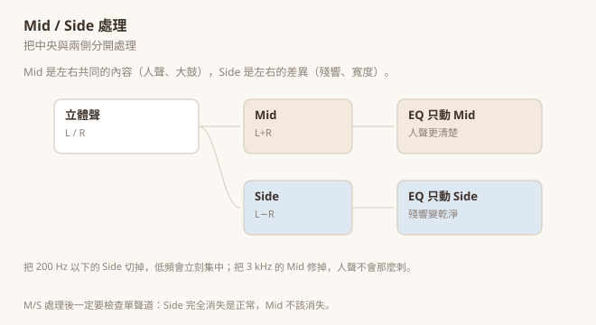
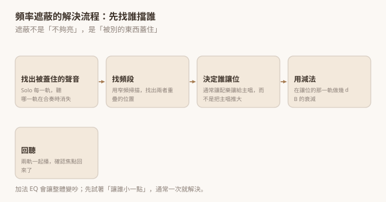

# **第 16 堂：進階 EQ：頻率遮蔽解決與 Tone Shaping**

在前面的課程中，我們已經學會了 EQ 的基本操作：衰減、提升、掃頻找出問題頻率。然而，當你的編曲從三五個樂器擴展到十幾二十軌時，你會發現無論怎麼調整單一樂器的 EQ，混音聽起來還是模糊不清。這不是你的 EQ 技術有問題，而是你遇到了混音中最常見也最棘手的敵人——**頻率遮蔽（Frequency Masking）**。這堂課我們將深入探討頻率遮蔽的成因、辨識方法，以及如何運用進階 EQ 技巧來解決它，同時將 EQ 從「修正工具」升級為真正的「音色雕塑武器」。

---

## 什麼是頻率遮蔽？

頻率遮蔽的概念可以用一個簡單的比喻來理解：想像你在一間房間裡，同時有十個人在說話。如果每個人的音量都差不多，你很難聽清楚任何一個人說了什麼。但如果其中一個人突然提高音量，你就可以聽清楚他，其他人則變成背景噪音。在混音中也是一樣——當多個樂器在同樣的頻率範圍內都有能量時，它們會互相「遮蔽」，導致每一個樂器都聽不清楚。

從聲學角度來看，頻率遮蔽可以分為兩種：

**同時遮蔽（Simultaneous Masking）**：兩個聲音同時發出，頻率接近的音會遮蔽另一個。例如，大鼓的基頻（約 60-100 Hz）如果能量過強，可能會遮蔽貝斯的低頻。

**時間遮蔽（Temporal Masking）**：一個大聲響發出後，人耳在短時間內（約 5-200 毫秒）對接近頻率的敏感度會降低。這就是為什麼兩個音色相近的樂器如果彈奏時間太接近，聽起來會糊在一起。

### 典型的遮蔽場景

在實際混音中，以下組合最容易發生頻率遮蔽：

- **大鼓 vs. 貝斯**：兩者都在低頻範圍（40-250 Hz）爭奪空間
- **電吉他 vs. 節奏吉他**：同樣是 mid-range 樂器，常常在 200-800 Hz 打架
- **鋼琴 vs. 吉他**：兩者都是泛音豐富的和聲樂器，覆蓋範圍高度重疊
- **人聲 vs. 合成器 pad**：人聲的清晰度很容易被 mid-range 的 pad 聲響掩蓋
- **鈸 vs. 合成器的高頻**：空氣感和高頻細節（8-12 kHz）互相競爭

---

## 如何辨識頻率遮蔽

在開始解決問題之前，你需要先學會「聽見」遮蔽。以下是幾種實用的辨識技巧：

### 獨奏比較法（Solo Comparison）

這是最直覺的方法。先獨奏一個樂器聽清楚它的音色，然後關掉獨奏，在完整混音中聽同一個樂器。如果在混音中該樂器明顯變模糊或消失，就代表它正在被其他樂器遮蔽。

### 頻譜分析儀輔助

使用頻譜分析儀（如 SPAN 或 FabFilter Pro-Q 的頻譜顯示）觀察各個樂器的頻率分布。當你發現兩個或多個樂器在同一頻段都有明顯的能量高峰時，就很可能存在遮蔽問題。注意觀察頻譜中的「凹陷」——如果某個樂器在某頻段有明顯的能量，但在混音中卻聽不到，那它就被遮蔽了。

### 高通濾波測試

對每一個非低音樂器逐步推高高通濾波器的頻率（從 20 Hz 慢慢往上推），同時聆聽混音。當你推高到某個頻率時，混音突然變得清晰，這就表示你找到了遮蔽發生的區域。這個方法同時也告訴你，那些低於這個頻率的能量其實是無用的低頻噪音，正在佔用寶貴的動態餘裕。

### 動態頻譜分析

有些遮蔽是「間歇性」的——只有在某個樂器彈奏特定音符時才會發生。使用 EQ 的頻譜顯示並觀察「峰值保持」功能，找出那些偶發但嚴重的頻率撞擊點。

---

## 解決頻率遮蔽的核心技巧

### 互補式 EQ（Complimentary EQ）

互補式 EQ 是解決頻率遮蔽最經典也最有效的方法。核心概念是：**在同一個頻段，讓一個樂器提升時，另一個樂器衰減，反之亦然。**

舉例來說，如果你發現大鼓和貝斯在 100 Hz 打架：

1. 在大鼓的 100 Hz 做 2-3 dB 的提升（Q 值中等，約 1.0-1.5）
2. 在貝斯的 100 Hz 做 2-3 dB 的衰減（同樣的 Q 值）
3. 在貝斯的 60 Hz 做提升（讓貝斯的低頻主體從這裡出來）

這樣一來，大鼓和貝斯在頻譜上就「錯開」了。大鼓負責 100 Hz 的衝擊感，貝斯負責 60 Hz 的厚實感，兩者不再互相遮蔽。

**實戰範例：吉他與人聲的互補**

假設你的電吉他強力和弦和人聲主旋律在 2-4 kHz 打架（這是人聲清晰度的關鍵頻段）：

- 在電吉他的 3 kHz 做 3-4 dB 的衰減（寬 Q，約 0.7），讓出空間給人聲
- 在人聲的 3 kHz 做 1-2 dB 的提升（同樣寬 Q），增加 presence
- 在電吉他的 5-7 kHz 做輕微提升，補償亮度

結果：人聲變清晰了，電吉他聽起來也沒有明顯變暗——因為人聲和吉他沒有同時播放同一個頻率。

### 側鏈 EQ（Sidechain EQ）

側鏈 EQ 是更進階的動態處理。它不是固定的衰減或提升，而是「當某個樂器出現時，自動調整另一個樂器的 EQ」。這需要在你的 DAW 中使用側鏈功能，將一個樂器的信號饋送到另一個樂器的 EQ 插件作為控制信號。

**典型應用：廣播主持人聲壓音樂**

這是最常見的側鏈 EQ 應用。當主持人講話時，背景音樂的 mid-range 會自動衰減；主持人停止講話時，音樂恢復正常音量。這不是單純的側鏈壓縮（volume ducking），而是選擇性地只降低音樂中與人聲衝突的頻段，保留音樂的低頻和高頻。

**實際操作步驟：**

1. 在背景音樂軌道上插入一個支援側鏈的動態 EQ（如 TDR Nova、FabFilter Pro-Q 3）
2. 將人聲軌道路由到該 EQ 的側鏈輸入
3. 設定動態節點在 2-4 kHz，當側鏈信號（人聲）出現時，該頻段自動衰減 3-6 dB
4. 設定 Attack 約 5-10 ms（反應要夠快），Release 約 100-200 ms

這樣的效果比單純側鏈壓縮更自然，因為音樂的頻率內容並沒有被「一刀切」，只有與人聲重疊的部分被壓低。

### 動態 EQ（Dynamic EQ）

動態 EQ 可以理解為「EQ 和壓縮器的結合體」。傳統 EQ 是靜態的——你設定衰減量後，不管樂器怎麼變化，衰減量都固定。動態 EQ 則會根據輸入信號的音量自動調整 EQ 的增益量。

**什麼時候需要用動態 EQ？**

- 當問題只在某些音符或段落出現時：例如一把貝斯在彈到高把位（約 300-500 Hz）時會產生惱人的箱音，但低把位時完全正常。用傳統 EQ 衰減 400 Hz 會讓低把位也變薄，用動態 EQ 則只在 400 Hz 能量過高時才衰減。
- 人聲的齒音（sibilance）：動態 EQ 可以在 6-8 kHz 設定動態衰減，只有在唱到「S」、「Sh」音時才作用，比傳統 de-esser 更精準。
- 電吉他的共振頻率：有些電吉他在特定音高會產生不必要的泛音共振，動態 EQ 可以只在這些音符出現時才壓制。

**參數設定建議：**

- Threshold（閾值）：設定在問題頻段的平均能量之上，確保正常演奏時不作用
- Attack：5-10 ms（夠快到可以抓住問題音頭的瞬間）
- Release：50-150 ms（取決於問題的持續時間）
- Range：2-6 dB（衰減量不宜過大，否則會產生 pumping 效應）

---

## Tone Shaping：將 EQ 作為創意工具

到目前為止，我們討論的 EQ 應用大多屬於「修正」層面——解決問題、消除衝突。但 EQ 真正的威力在於，你可以用它來雕塑每個樂器的「音色性格」，為你的混音注入獨特的聲音美學。

### 建立頻率簽名（Frequency Signature）

每個樂器在混音中都應該有一個明確的「頻率任務」。換句話說，你需要決定這個樂器在頻譜上的哪個區域負責什麼功能。

**以貝斯為例，一個完整的頻率簽名可能如下：**

- **超低頻（30-60 Hz）**：sub-bass 的體感，如果你要的是 EDM 或 hip-hop 風格，這裡需要飽滿的能量
- **低頻主體（60-120 Hz）**：貝斯的主要音高和厚實感
- **中低頻攻擊（500-800 Hz）**：貝斯的「指觸感」或撥弦聲，讓貝斯在小喇叭上也能被聽見
- **高頻滑順（2-4 kHz）**：如果是指彈貝斯，可以稍微提升這裡增加擦弦的細節

**以人聲為例：**

- **低頻（80-200 Hz）**：胸腔共鳴、溫暖感（提升會讓聲音聽起來更厚實）
- **中頻（200-500 Hz）**：鼻音/boxiness 區域（通常需要適度衰減以避免模糊）
- **中高頻（1-4 kHz）**：清晰度與 presence（提升這裡讓人聲浮在混音之上）
- **高頻（8-12 kHz）**：空氣感與亮度（使用 shelving EQ 輕柔提升）

### 風格化的 EQ 應用

不同音樂風格對 EQ 的要求截然不同：

**搖滾/金屬：**

- 大鼓：提升 3-5 kHz 增加打擊感，衰減 300-500 Hz 減少箱音
- 電吉他：大量使用中頻（800 Hz - 3 kHz）的凹凸來創造「嚎叫感」
- 貝斯：通常需要與大鼓的低頻緊密配合，常常使用大幅度的互補式 EQ

**電子舞曲（EDM）：**

- Kick：在 50-60 Hz 做大幅提升（sub-bass 衝擊力），在 2-4 kHz 增加 click
- Bass：常常與 kick 使用側鏈壓縮，並在 100-200 Hz 挖空給 kick 的 tail
- Synth lead：大量使用濾波器（filter）掃頻做為編曲元素

**爵士/原聲：**

- EQ 量通常很小（1-2 dB 為限），重點是 preserve 自然音色
- 使用高品質的類比模擬 EQ（如 Pultec 風格）增加諧波溫暖感
- 衰減多於提升，讓樂器「自然融合」

### 經典的 Tone Shaping 頻率表

以下是實戰中常用的頻率調整指南（以衰減或提升 2-4 dB 為基礎）：

| 頻段 | 調整方向 | 效果 |
|------|---------|------|
| 50-60 Hz | 提升 | 增加低頻的「體感」和衝擊力 |
| 80-100 Hz | 衰減 | 減少低頻的模糊感（muddiness） |
| 200-300 Hz | 衰減 | 減少箱音和低頻擁擠感 |
| 400-600 Hz | 衰減 | 增加清晰度，減少「紙箱聲」 |
| 800 Hz - 1 kHz | 衰減 | 減少電話聲/喇叭聲（honkiness） |
| 2-4 kHz | 提升 | 增加 presence 和攻擊感 |
| 5-7 kHz | 提升 | 增加亮度和清晰度 |
| 8-12 kHz | 提升 | 增加空氣感和高頻細節 |
| 10-12 kHz | 衰減 | 減少過度的齒音或嘶聲 |

---

## Mid-Side EQ：處理立體聲的頻率內容

Mid-Side EQ（簡稱 M/S EQ）是一種更精密的 EQ 處理方式，它允許你獨立處理立體聲信號的「中央（Mid）」和「兩側（Side）」內容。

- **中央（Mid）**：左右聲道相同的部分，通常包含人聲、大鼓、貝斯、主奏樂器
- **兩側（Side）**：左右聲道不同的部分，通常包含空間感、環境殘響、立體聲樂器

### M/S EQ 的應用場景

**1. 為人聲讓出中央空間**

在兩側（Side）通道的 200-500 Hz 做 2-3 dB 的衰減。這樣做的效果是：當你聆聽完整立體聲混音時，中央的人聲會變得更清晰，但兩側的立體聲音樂聽起來並沒有明顯變薄——因為人耳對中央頻率的變化更敏感。

**2. 控制立體聲的低頻**

在兩側（Side）通道的低頻（低於 200 Hz）做高通濾波。這是因為低頻通常應該集中在中央（mono compatible），過多的立體聲低頻會導致相位問題，尤其是在黑膠或藍牙喇叭上播放時。

**3. 增加立體聲的空氣感**

在兩側（Side）通道的 10-15 kHz 做 2-4 dB 的 shelving 提升。這樣可以增加立體聲的高頻細節和空間感，同時保持中央（通常是人聲）的穩定性和清晰度。

### 如何使用 M/S EQ

大多數專業 EQ 插件都支援 M/S 模式（如 FabFilter Pro-Q 3、iZotope Neutron、Waves API 2500 等）。啟用 M/S 模式後，你會看到每個 EQ 節點可以選擇作用於 Mid、Side 或雙聲道（Stereo）。

**實戰聚合範例：**

假設你有一軌立體聲的木吉他，錄得非常好但聽起來與人聲打架：

- 在 Mid 通道的 2-4 kHz 衰減 3 dB（讓出空間給人聲）
- 在 Side 通道的 2-4 kHz 提升 1-2 dB（維持木吉他的立體空間感）
- 在 Side 通道的低頻（< 200 Hz）做高通濾波（減少不必要的低頻立體聲）
- 在 Side 通道的 10 kHz 做 shelving 提升 2 dB（增加空氣感）

結果：人聲變清晰，木吉他仍然聲音豐富且具有立體感，低頻更乾淨。

---

## Linear Phase vs. Minimum Phase EQ

這是一個經常被忽略但非常重要的主題。不同類型的 EQ 會對聲音的瞬態和相位產生不同的影響。

### Minimum Phase EQ（最小相位 EQ）

這是最常見的 EQ 類型，幾乎所有的類比仿 EQ 和 DAW 內建 EQ 都是最小相位。

**優點：**

- 沒有延遲（zero latency），適合錄音監聽和現場表演
- 類比自然的聲音特性
- 類比建模的最小相位 EQ 因模擬電路特性而帶有諧波飽和感（此為建模效果，非相位拓撲本身所產生）

**缺點：**

- 會改變頻率邊界的相位關係，可能導致瞬態模糊
- 大幅度的 EQ 操作可能使聲音聽起來「不自然」

**適合使用時機：**

- 錄音階段的追蹤監聽
- 一般的混音工作（大多數情況）
- 需要類比溫暖感的音色塑造
- 對延遲敏感的場景（現場演出、直播）

### Linear Phase EQ（線性相位 EQ）

線性相位 EQ 使用 FIR（有限脈衝響應）濾波技術，確保所有頻率經過 EQ 後的相位延遲相同，不改變波形形狀。

**優點：**

- 不改變瞬態的相位關係，敲擊樂器和打擊樂器聽起來更精準
- 非常適合處理母帶階段的細微調整
- 大幅度 EQ 操作也不會產生相位失真

**缺點：**

- 有較高的延遲（latency），不適合錄音監聽
- 可能會產生「preringing（預振鈴）」現象——在瞬態之前出現微弱的振盪
- 較消耗 CPU 資源

**什麼時候要用 Linear Phase？**

1. **母帶處理**：在最後的立體聲總線上做細微的 EQ 調整時，不希望任何相位變化影響整體混音
2. **低頻處理**：在 kick 和 bass 這類低頻樂器上做大幅度的 EQ 調整時，最小相位 EQ 的低頻相位偏移可能導致低頻聽起來「軟軟的」
3. **多軌道群組處理**：當你是對一個群組（如鼓組 bus）做 EQ，而不是單一樂器時
4. **立體聲寬度處理**：在 M/S EQ 中的 Side 通道使用 Linear Phase 可以避免立體聲影像偏移

**不適合使用 Linear Phase 的情況：**

- 單一打擊樂器（如 Hi-hat、小鼓）：preringing 可能在瞬態之前出現，聽起來像一個微弱的「pre-echo」
- 錄音監聽：延遲過高，無法使用

### 實戰選擇建議

簡單的判斷法則：**當你只是在「修正」聲音時用 Minimum Phase，當你希望「精準調整」不改變聲音本質時用 Linear Phase。**

如果你只能選一種，選 Minimum Phase——它在絕大多數場景都表現良好，而且 相位偏移的問題比 preringing 更難聽出來。很多專業混音師整首歌只用 Minimum Phase EQ。

---

## 完整的頻率遮蔽解決流程

以下是一個你可以套用到任何混音的系統化工作流程：

### 第一步：建立頻率地圖（10 分鐘）

在開始混音之前，先用頻譜分析儀觀察所有軌道的頻率分布。記錄下每個樂器最主要的頻率範圍。用表格或圖示標出哪些頻段有多個樂器重疊——這些就是潛在的遮蔽熱點。

### 第二步：高通濾波清掃（10 分鐘）

對每一個非低音樂器（人聲、吉他、鋼琴、Hi-hat、弦樂等）設定高通濾波器。目標是移除所有不必要的低頻能量。常見的高通濾波點：

- 人聲：80-120 Hz
- 電吉他：80-100 Hz
- 木吉他：80-120 Hz
- 鋼琴：60-100 Hz
- Hi-hat：200-400 Hz
- 弦樂：100-200 Hz

每軌往上推高通濾波直到你聽到樂器明顯變薄，然後稍微退回一點到聽起來仍然自然的位置。

### 第三步：找出主要遮蔽點（15 分鐘）

每次獨奏兩個樂器（例如大鼓+貝斯、貝斯+吉他、吉他+人聲、人聲+pad），仔細聆聽它們組合時的聲音。你應該能聽到哪些頻率在打架。使用 EQ 的頻譜顯示來確認。

### 第四步：互補式 EQ 調整（20 分鐘）

針對每一組遮蔽對，決定哪個樂器是「主體」（優先保留完整頻率），哪個是「配角」（需要讓出空間）。在衝突頻段對配角做 2-4 dB 的寬 Q 衰減，對主體做輕微提升（如果需要）。

**優先級原則（重要性從高到低）：**

1. 人聲（永遠是最高優先級）
2. 主旋律樂器（主奏吉他、主奏 synth 等）
3. 節奏組核心（大鼓、小鼓、貝斯）
4. 和聲與填充（pad、節奏吉他、鋼琴）
5. 效果與細節（FX、打擊樂器、環境音）

### 第五步：動態處理（15 分鐘）

如果靜態 EQ 無法解決問題（比如當人聲和吉他同時出現時，吉他還是太搶），改用動態 EQ 或側鏈 EQ。設定動態衰減只在衝突發生時作用。

### 第六步：Mid-Side 檢查（10 分鐘）

在立體聲總線上啟用 M/S EQ。檢查 Side 通道是否有過多的低頻（< 200 Hz），並對 Side 通道做必要的高通濾波。同時檢查中央的 mid-range 是否過度擁擠。

### 第七步：參考曲目對比（永遠要做）

找一首與你的目標風格相似、混音品質良好的參考曲目。用頻譜分析儀比較你的混音和參考曲目的整體頻率分布。你的混音在每個頻段是否有類似的能量分布？如果某個頻段明顯超出參考曲目，那可能就是遮蔽的根源。

---

## 進階技巧：Notch Filtering 的藝術

Notch Filter（陷波濾波器）是一種極窄的 EQ 衰減（極高的 Q 值），專門用來消除單一頻率的問題。

### 什麼時候用 Notch Filter？

- **電源哼聲（50/60 Hz hum）**：在某些錄音中可能會出現電源頻率的哼聲，這個頻率非常精確且持續存在
- **吉他 feedback 的特定音高**：當電吉他在某個音高產生 feedback 時
- **房間共鳴**：錄音空間中的特定頻率共鳴（例如 200 Hz 的房間駐波）
- **電器干擾**：冷氣、冰箱、電腦風扇的特定頻率噪音

### Notch Filter 的操作要點

1. **先使用頻譜分析儀確認問題頻率**：不要憑感覺瞎猜
2. **Q 值要設得非常高**：至少 10-20 以上，確保只影響單一頻率
3. **衰減量：6-12 dB**：視問題嚴重程度而定，太多會產生明顯的「空洞感」
4. **使用 Linear Phase**：因為 high Q 的 Minimum Phase EQ 會在該頻率附近產生明顯的相位偏移

### 創意型 Notch Filter

有些製作人會故意使用 notch filter 來創造音色效果。例如在 synth lead 上每隔幾百 Hz 做一個小 notch，創造出類似「filter bank」的掃頻效果。或者在人聲上使用快速移動的 notch filter 來製造「電話聲」或「radio 聲」特效。

---

## 常見錯誤與注意事項

**錯誤一：過度 EQ**

這是最常見的錯誤。每個樂器都做了大幅度的 EQ，但合起來聲音反而變得更糟。記住：EQ 的黃金規則是「衰減要多於提升」。如果你發現需要對同一樂器做 5 個以上的 EQ 節點，可能需要回到源頭思考——是不是樂器本身的音色或錄音有問題？

**錯誤二：忽略聆聽環境**

在沒有經過聲學處理的房間裡混音，你聽到的頻率反應可能嚴重不準確。使用參考耳機（如 Sennheiser HD600、Beyerdynamic DT 900 Pro X）和參考喇叭，並經常對比參考曲目。

**錯誤三：獨奏太久**

獨奏聽起來完美的 EQ 設定，在完整混音中往往不適用。**總是以完整混音的聽感為準**。檢查 EQ 調整時，在獨奏狀態設好大概的參數後，一定要在完整混音中微調。

**錯誤四：忘記動態 EQ 的存在**

很多混音師還在用靜態 EQ 硬修那種「只在特定段落出現」的問題頻率。結果是：這個頻段在其他段落聽起來就「空洞」了。動態 EQ 是解決這類問題的最佳工具。

**錯誤五：不檢查相位問題**

大量的 EQ 操作（尤其是 Multiple Band 的 Minimum Phase EQ）可能會在無意中造成相位問題。定期檢查混音的 Mono 相容性——將監聽切換到 mono，確認所有樂器在 mono 下聽起來依然完整。

---

## 課後練習

1. **遮蔽聽力訓練**：找一首你喜歡的歌曲，嘗試在混音中「隔離」出每一個樂器。你能在完整混音中聽見 Bass 嗎？Hi-hat 在哪？人聲的清晰度來自哪個頻段？

2. **互補 EQ 實戰**：用你自己或他人的多軌混音，選一組打架的樂器（如節奏吉他和鋼琴），練習使用互補式 EQ 來解決遮蔽。比較使用前後的差異。

3. **M/S EQ 練習**：找一條立體聲的木吉他或鋼琴軌道，嘗試使用 M/S EQ：在 Side 做高通濾波（200 Hz），在 Mid 做 2-3 kHz 的衰減，在 Side 做 10 kHz 的提升。聽聽看對聲音的影響。

4. **動態 EQ vs. 靜態 EQ**：找一段有明顯問題頻段（如貝斯的特定音符箱音）的音檔，先用靜態 EQ 解決，再用動態 EQ 解決。比較兩種方法的差異，哪一個聽起來更自然？

5. **全混音流程**：找一首 8-12 軌的多軌檔案，按照本課的七步流程進行完整的頻率遮蔽處理。記錄每一步前後的聽感差異。

---

## 結論

進階 EQ 不僅僅是調整頻率高低而已，它是一門關於「空間分配」的藝術。在一個有限的頻譜範圍內，你的任務是讓每一個樂器都有屬於自己的頻率空間，互不干擾，同時又能在混音中扮演好各自的角色。

頻率遮蔽是混音中最大的挑戰之一，但只要掌握了互補式 EQ、動態 EQ、M/S EQ 這些工具，你就能將一團混亂的聲音整理成層次分明、細節豐富的專業混音。而 Tone Shaping 則是將混音從「聽得清楚」提升到「有特色有個性」的關鍵——你不再只是消除問題，而是積極地為每個樂器賦予獨特的聲音性格。

下一堂課，我們將探討壓縮器的進階應用——從基礎的動態控制到平行壓縮、多頻段壓縮與側鏈壓縮的深度技巧。到了那個階段，你將擁有混音中最核心的兩項工具：EQ 與壓縮器。
