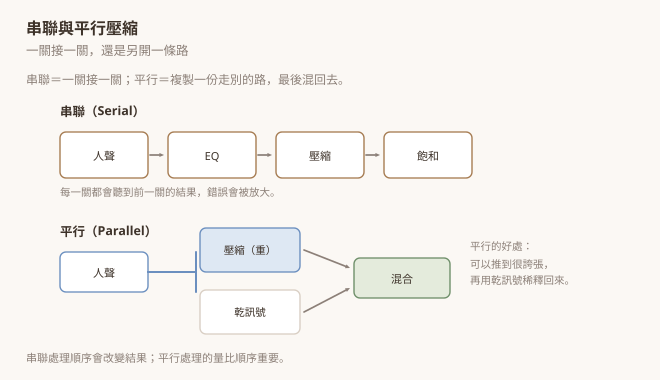
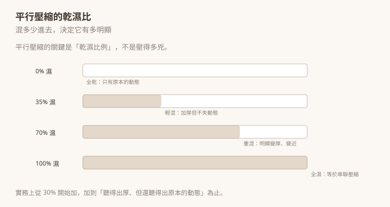

# **第 17 堂：進階壓縮：平行壓縮與串聯壓縮技巧**

在基礎壓縮課程中，我們學會了如何使用單一壓縮器來控制動態範圍。然而，專業混音工程師很少只靠一臺壓縮器解決所有問題。他們會運用 **平行壓縮（Parallel Compression）** 與 **串聯壓縮（Serial Compression）** 這兩種進階技術，創造出既飽滿又有力、同時保留自然動態的聲音。本堂課將深入剖析這兩種技巧的原理、設定方法與實戰應用。

## 什麼是平行壓縮？



平行壓縮，又稱為 **紐約壓縮（New York Compression）**，原理極其簡單卻極其強大：**將原始未壓縮的乾訊號，與經過重度壓縮的濕訊號混合在一起**。聽起來像是矛盾對吧？一邊要保持動態，一邊又要壓扁訊號——但正是這種組合創造出神奇的效果。

為什麼要這麼做？因為單靠傳統的串列壓縮（compressors inserted directly on a track），一旦你調高壓縮比或降低 Threshold，就必然會損失瞬態（transient）和動態細節。鼓的攻擊感變鈍、人聲的尾音被吞沒——這些都是過度壓縮的典型症狀。

平行壓縮完美解決了這個困境：**重壓版本提供飽滿的 sustain 和厚度，原始版本保留瞬態和動態**。兩者相加，等於「既有衝擊力又有延續力」的聲音。

### 平行壓縮的聽覺效果

- **鼓組**：小鼓變得更飽滿厚實，大鼓的尾音延長，但攻擊點依然清脆
- **人聲**：氣音和尾音細節被放大，聽起來更貼耳、更有情感
- **貝斯**：指板噪音和延音同時存在，音符之間的過渡更平滑
- **整體混音**：音量感知更大、更飽滿，但不會犧牲清晰度

## 平行壓縮的設定方式



實作平行壓縮有兩種主流方法，各有優缺點。

### 方法一：Send/Return 架構（推薦）

這是專業錄音室最常見的做法：

1. **建立 Aux Send（輔助軌）**：從原始音軌 Send 到一個空的 Aux 軌道
2. **在 Aux 軌上掛載壓縮器**：進行重度壓縮設定
3. **混合乾溼比例**：用 Aux 軌的推桿來控制壓縮訊號的加入量

**優點**：

- 原始音軌完全不受影響，可以隨時調整混合比例
- 可以讓多個音軌共用同一個平行壓縮 Aux（例如：整套鼓送同一個平行壓縮軌）
- 在壓縮器前可以串接 EQ，壓縮前先塑形

### 方法二：Duplicate Track（複製音軌）

1. **複製原音軌**：得到兩個完全一樣的音軌
2. **原始軌不做處理**或僅做輕微壓縮
3. **複製軌進行重度壓縮**
4. **調整兩軌音量平衡**

**優點**：

- 不需要建立 Aux，DAW 設定更快
- 可以在複製軌上加效果器 Plugin，自由度更高（例如加 distortion）
- 適合單一樂器處理

**缺點**：

- 原始軌和複製軌之間可能出現相位問題（尤其是使用線性相位以外 EQ 時）
- 耗費更多 CPU 資源
- 混音檔案較亂

### 實戰設定參數

平行壓縮的核心精神是「壓很重」。以下是經過業界驗證的起點參數：

| 參數 | 建議值 | 說明 |
|------|--------|------|
| Ratio | 8:1 ~ 20:1 | 極高壓縮比，甚至接近 limiting |
| Threshold | -30dB ~ -20dB | 讓壓縮器幾乎持續作用 |
| Attack | 1ms ~ 5ms | 允許部分瞬態通過後再壓縮 |
| Release | 50ms ~ 100ms | 中快 release，保持節奏感 |
| 乾溼混合比 | 20% ~ 50% 濕訊號 | 從少開始加，直到感覺明顯但不突兀 |

**黃金法則**：先將濕訊號推桿拉到最低（Mute），慢慢往上推，直到你「感覺到」聲音變厚了，再稍微退回來一點。這個點就是最佳平衡。

## 平行壓縮的應用場景

### 鼓組平行壓縮（鼓 Bus）

這是平行壓縮最經典的應用。幾乎所有現代流行、搖滾、嘻哈的鼓聲都使用了這項技術。

**設定步驟**：

1. 將所有鼓音軌（Kick、Snare、OH、Room）送至一個鼓 Bus
2. 從鼓 Bus Send 到平行壓縮 Aux
3. 在 Aux 上掛載一臺壓縮器，例如 **CLA-76（1176 模擬）** 或 **API 2500**
4. 設定 Ratio 12:1、Attack 0.5ms ~ 0.8ms、Release 80ms、Threshold 壓到 Gain Reduction 達 10~15dB
5. 慢慢推 Aux 推桿到與原始鼓聲混合

**聽感目標**：鼓的尾音（room sound 和 sustain）變得明顯，但攻擊點依然是乾淨的。整體鼓組聽起來更「大」、更「有力」。

### 人聲平行壓縮

人聲平行壓縮可以讓主唱的聲音更有「存在感」和「親密感」。

**設定步驟**：

1. 主唱音軌 Send 到人聲平行 Aux
2. 使用 **LA-2A（光學壓縮器模擬）**，Ratio 固定（LA-2A 的壓縮曲線大約是 3:1 到 6:1），Peak Reduction 調到 7~10dB
3. 或者使用 1176，Ratio 8:1、Attack 0.5ms ~ 0.8ms、Release 200ms
4. Aux 推桿設定在 -10dB 到 -5dB（相對於原始人聲）

**技巧**：在平行壓縮 Aux 前加一個 High-Pass Filter（約 200Hz），可以避免壓縮器被低頻隆隆聲觸發，讓壓縮更乾淨。

### 貝斯平行壓縮

貝斯在現代音樂中需要同時擁有「指板攻擊」（fingernail attack）和「低頻延續」（low-end sustain）。這兩者本質上是矛盾的，但平行壓縮可以兼得。

- 原始軌：保持自然的動態，突出 attack
- 平行軌：Ratio 10:1、Slow Attack（10~20ms）、Fast Release（40ms），讓壓縮器在 attack 之後才開始作用，抓住延音
- 混合比例大約 60% 原始 + 40% 壓縮

### 混音 Bus 平行壓縮

將整首混音 Send 到一組平行壓縮，可以賦予歌曲「黏合感」（glue），讓所有樂器聽起來更融為一體。

**建議**：

- 使用 VCA 風格的 Bus 壓縮器（如 SSL G-Bus Compressor）
- Ratio 2:1 ~ 4:1，非常溫和的壓縮
- Mix 旋鈕設定在 10% ~ 30%（如果 Plugin 有乾溼混合功能）
- 或用 Aux 推桿控制在 -12dB ~ -6dB

## 什麼是串聯壓縮？

串聯壓縮（Serial Compression）指的是 **將多臺壓縮器一臺接一臺串接在同一條訊號鏈上**。每一臺壓縮器只負責「壓一點點」，但疊加起來達到理想的總壓縮量。

這與平行壓縮完全相反：平行是「乾 + 重壓」並聯；串聯是「輕壓 + 輕壓 + ...」串接。

### 為什麼兩臺輕壓縮勝過一臺重壓縮？

這是最常被提到的混音智慧之一，背後有扎實的聲學原理：

1. **壓縮曲線更平滑**：單一壓縮器做 12dB 的 Gain Reduction，壓縮曲線非常陡峭，容易產生 pumping 和 breathing 效應。兩臺壓縮器各做 6dB，總和也是 12dB，但曲線更平滑自然。

2. **不同 Attack/Release 可互補**：第一臺用快 attack 捕捉瞬態，第二臺用慢 attack 控制整體動態。單一壓縮器無法同時做到這兩件事。

3. **不同壓縮風格疊加**：光學壓縮的溫暖 + FET 的 punch + VCA 的 glue，三種特色可以同時擁有。

4. **失真更低**：單一壓縮器做大量 Gain Reduction 時，失真和諧波失真會累積。分散到多臺壓縮器，每臺的工作量小，失真更低。

## 串聯壓縮的設定原則

### 原則一：Fast → Slow

通常第一臺用快壓縮器捕捉瞬態，第二臺用慢壓縮器控制整體動態。

**快壓縮器**（FET 或 VCA）：

- Attack: 0.1ms ~ 2ms
- Release: 50ms ~ 200ms
- Ratio: 4:1 ~ 8:1
- 目標：捕捉和馴服瞬態峰值

**慢壓縮器**（光學或 Vari-Mu）：

- Attack: 10ms ~ 30ms
- Release: Auto 或 500ms+
- Ratio: 2:1 ~ 4:1
- 目標：平滑整體音量，增加 sustain

### 原則二：輕壓再輕壓

每一臺壓縮器只做 2~6dB 的 Gain Reduction。串聯兩臺就是 4~12dB 的總壓縮量，但聽感上遠比單一壓縮器做 12dB 來得自然。

### 原則三：壓縮量遞減

第一臺可以做較多的壓縮（3~5dB GR），第二臺做更少（1~3dB GR）。因為第一臺已經處理了大部分動態，第二臺只需要微調。

## 串聯壓縮的實戰鏈

### 人聲串聯鏈：1176 → LA-2A

這是錄音史上最經典的人聲壓縮組合，被稱為「1176 into LA-2A」。

**第一步：1176（FET 壓縮器）**

- Ratio: 4:1
- Attack: 0.02ms ~ 0.8ms（旋鈕由 7 轉至 1）
- Release: 50ms ~ 100ms
- Input: 調到 Gain Reduction 約 3~5dB
- 作用：捕捉人聲的瞬態爆音、唇齒音和爆裂字頭

**第二步：LA-2A（光學壓縮器）**

- Peak Reduction: 30% ~ 50%（約 2~4dB GR）
- Gain: 補償輸出電平
- Attack/Release: 自動（Opto 壓縮器的特性是 attack 和 release 由輸入訊號決定）
- 作用：平滑整體動態，賦予溫暖的類比質感

**總結果**：人聲既有清晰的字頭（來自 1176 的快 attack），又有流暢的整體音量曲線（來自 LA-2A 的光學平滑）。這就是為什麼這個組合出現在無數經典唱片中的原因。

### 人聲串聯鏈（反向）：LA-2A → 1176

如果你想要更激進、更有侵略感的人聲，試試反過來：

- LA-2A 先做 4~6dB 的平滑壓縮
- 1176 再做 3~5dB 的壓縮，Ratio 8:1 或 12:1
- 最終人聲會更「前面」、更「貼耳」，適合搖滾或流行主歌

### 鼓 Bus 串聯鏈：API 2500 → SSL G-Bus

- **API 2500（VCA 壓縮器）**：Ratio 4:1、Attack 1ms、Release 100ms，做 3~4dB GR
- **SSL G-Bus Compressor（VCA 壓縮器）**：Ratio 2:1、Attack 10ms、Release Auto，做 1~2dB GR
- 結果：鼓組聽起來緊湊、有力、凝聚

### 貝斯串聯鏈：Dbx 160 → LA-2A

- **Dbx 160（VCA 壓縮器）**：Ratio 8:1，Attack 由程式內容自動決定（program-dependent），Release 選 Fast，做 4~6 dB GR
- **LA-2A**：Peak Reduction 20~30%，做 2~3dB GR
- 結果：attack 清晰、sustain 紮實、低頻穩定

## 平行與串聯的結合應用

專業混音師往往同時使用平行和串聯壓縮，以達到最精細的控制。以下是一個完整的壓縮策略範例：

### 範例：主唱完整壓縮鏈

```
音源 → EQ（高切低切）→ 串聯壓縮（1176 → LA-2A）→ 輔助 Send → 平行 Aux（1176 重壓 12:1）
```

**串聯部分**：控制動態，塑造聲音本體
**平行部分**：增加厚度和存在感

**混合步驟**：

1. 先調整串聯壓縮，讓人聲的基本動態穩定
2. 加入平行 Aux 從 -15dB 慢慢往上推
3. 直到人聲的尾音和氣音變得明顯
4. 用 Automation 控制平行 Aux 推桿：主歌少一點（-10dB），副歌多一點（-5dB）

### 範例：鼓組完整壓縮鏈

```
鼓 Bus → 串聯 API 2500 → 平行 Aux（1176 重壓 12:1，或 Distressor 重壓 15:1）
          └→ Room Mic 重壓 Aux（極端壓縮，創造空間感）
```

## 三大壓縮風格：Optical、FET、VCA

在選擇壓縮器時，了解三大類型對串聯和平行壓縮的應用至關重要。

### 光學壓縮（Optical Compressor）

**代表作**：Teletronix LA-2A、LA-3A
**特性**：Attack 和 Release 由輸入訊號自動決定，壓縮曲線平滑自然
**最佳用途**：

- 串聯壓縮的最後一臺（慢壓縮）
- 人聲、貝斯的平滑壓縮
- 平行壓縮的「厚度來源」

### FET 壓縮（Field Effect Transistor）

**代表作**：UREI 1176、Distressor
**特性**：極快的 attack（最快可達 20μs）、飽滿的諧波失真
**最佳用途**：

- 串聯壓縮的第一臺（快壓縮）
- 鼓組的瞬態捕捉
- 平行壓縮的重壓選擇

### VCA 壓縮（Voltage Controlled Amplifier）

**代表作**：SSL G-Series Bus Compressor、API 2500、Dbx 160
**特性**：精確、透明、黏合感強
**最佳用途**：

- 混音 Bus 的 glue 壓縮
- 串聯壓縮的中間環節
- 鼓組和貝斯的動態控制

### 實戰搭配矩陣

| 目標 | 串聯組合 | 平行壓縮器 |
|------|----------|-----------|
| 溫暖人聲 | 1176 → LA-2A | LA-2A（8:1 等效） |
| 激烈人聲 | LA-2A → 1176（高 Ratio）| 1176（20:1） |
| 緊湊鼓組 | API 2500 → SSL Bus | Distressor（10:1） |
| 厚重鼓組 | Distressor → LA-2A | 1176（12:1） |
| 平滑貝斯 | Dbx 160 → LA-2A | LA-2A |
| 混音 Bus | SSL Bus（2:1）→ Vari-Mu | - |

## 常見錯誤與解決方案

### 錯誤一：平行壓縮推太多

**症狀**：聲音變髒、模糊、瞬態消失
**解決方案**：從極少量開始（-15dB 以下的 Aux 推桿），每次只加 1~2dB。最好的平行壓縮往往是你不刻意注意就聽不出來的那種。

### 錯誤二：串聯壓縮太多

**症狀**：聲音死氣沉沉、動態窒息
**解決方案**：總 Gain Reduction 不要超過 10~12dB。記住，壓縮的目的是控制動態，而不是消滅動態。

### 錯誤三：所有音軌都用同樣的壓縮鏈

**症狀**：混音聽起來單調、缺乏層次
**解決方案**：不同樂器使用不同的壓縮策略。例如，主唱用 1176→LA-2A，合音只用一臺 LA-2A，鋼琴不用串聯壓縮只需要輕微的 VCA 壓縮。

### 錯誤四：忽略相位問題

**症狀**：平行壓縮打開後聲音反而變薄或變空洞
**解決方案**：檢查原始軌和平行軌之間是否有相位抵消。如果有，在平行 Aux 上使用 Linear Phase EQ，或稍微調整平行壓縮 Plugin 的延遲設定。

### 錯誤五：Attack 和 Release 設定不協調

**錯誤串聯**：兩臺都是快 Attack + 快 Release → 產生「撕裂感」
**錯誤串聯**：兩臺都是慢 Attack + 慢 Release → 瞬態完全失控
**解決方案**：一快一慢，互補為佳

## 結論：從理論到耳朵

壓縮是一門藝術，更是一門聽覺訓練。平行壓縮和串聯壓縮是專業混音工程師必須掌握的兩種核心技術，它們能讓你的混音從「好」變成「出色」。

**最後的建議**：

1. **先學串聯**：用兩臺輕壓縮取代一臺重壓縮，你會立刻感受到聲音的自然度提升
2. **再玩平行**：在串聯壓縮的基礎上加入平行壓縮，增加厚度和凝聚力
3. **大量練習**：每一首歌都需要不同的壓縮策略。同樣的設定在搖滾中很好聽，在爵士中可能完全不合適
4. **信任耳朵而非眼睛**：不要只看 Gain Reduction 錶頭，閉上眼睛聽聲音如何變化

下一堂課，我們將進入更進階的動態處理領域——**多頻段壓縮**和**側鏈壓縮調變**，敬請期待！