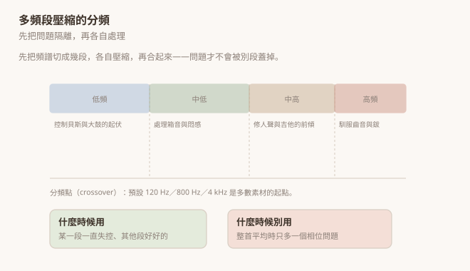

# **第 18 堂：多頻段壓縮 (Multiband Comp)：動態細部修飾**

## 什麼是多頻段壓縮？

多頻段壓縮器（Multiband Compressor）是動態處理器中功能最強大的工具之一。它與一般壓縮器的最大差異在於：一般壓縮器對整個音訊頻譜做統一的動態處理，而多頻段壓縮器會先透過分頻濾波器（Crossover Filters）將音訊拆分成數個獨立的頻段（通常是 2 到 4 個頻段），然後對**每個頻段分別進行獨立的壓縮處理**，最後再將這些處理過的頻段重新混合回單一音訊信號。

打個比方：一般壓縮器像是一位調音師對整個樂團同時喊「小聲點」；多頻段壓縮器則是可以分別對小提琴組說「大聲點」、對大鼓說「小聲點」、對銅管說「壓一下突發音」——每個聲部獨立管理，互不干擾。

這項技術最早出現在類比硬體時代的廣播與母帶處理，後來 TC Electronic 的 Finalizer 是硬體多頻段處理器的代表。現代的數位多頻段壓縮器（如 iZotope Ozone Dynamics、FabFilter Pro-MB、Waves C4/C6、Brainworx bx_masterdesk 等）已經將這項技術發展得極為成熟，甚至可以在頻譜上自由繪製壓縮區段。

## 多頻段壓縮 vs 一般壓縮：何時該用哪一種？

這是最常被問到的問題。以下提供一個簡單的判斷原則：

**先用一般壓縮，不足再補多頻段壓縮。**

| 情境 | 建議處理方式 |
|------|-------------|
| 整體動態控制、讓聲音更穩定 | 一般壓縮器即可 |
| 想要增加 sustain、讓聲音更厚實 | 一般壓縮器（甚至用類比模擬的 VCA/光電壓縮） |
| 只有特定頻率範圍會爆音或動態不穩 | 多頻段壓縮 |
| 低頻（Bass/Kick）能量忽大忽小，但中高頻沒問題 | 多頻段壓縮（只處理低頻段） |
| 人聲在某些齒音頻率過刺，但整體動態 OK | 多頻段壓縮或 De-esser |
| Master Bus 想要更細膩的動態控制，同時避免壓縮過度犧牲低頻 | 多頻段壓縮 |

**實務建議**：在單一音軌上，優先嘗試一般壓縮器。一般壓縮器設定簡單、聲音更自然、相位問題更少。當你發現一般壓縮無法解決「某個頻段的動態問題」時，才引入多頻段壓縮。

## 分頻點（Crossover）的設定策略

分頻點是多頻段壓縮中最關鍵的參數。分頻點設定不當，輕則效果不明顯，重則產生可聽的相位失真和頻譜凹陷。

### 常見的三頻段分頻策略

**三頻段設定（最常見）：**

| 頻段 | 頻率範圍 | 處理目標 |
|------|---------|---------|
| Low（低頻段） | 20 Hz - 200/250 Hz | 低頻能量控制（Bass、Kick） |
| Mid（中頻段） | 200/250 Hz - 4k/5k Hz | 中頻動態與箱音控制 |
| High（高頻段） | 4k/5k Hz - 20k Hz | 高頻亮度與齒音控制 |

**四頻段設定（Master Bus 常用）：**

| 頻段 | 頻率範圍 | 處理目標 |
|------|---------|---------|
| Sub（超低頻） | 20 - 80/100 Hz | 超低頻控制，避免低頻模糊 |
| Low（低頻） | 80/100 - 250 Hz | 低頻衝擊力與厚度 |
| Mid（中頻） | 250 Hz - 4k Hz | 主要音樂內容的動態 |
| High（高頻） | 4k - 20k Hz | 空氣感與齒音控制 |

實務上，分頻點應該根據**素材特性**做調整，而非死守教科書的數字。例如處理一首以 acoustic guitar 為主的歌曲，中頻分頻點可能就需要涵蓋更廣的範圍。

### 分頻點設定的黃金法則

1. **避開主要樂器的基頻**：不要讓分頻點正好落在人聲或主奏樂器的基頻上，否則壓縮器會在那個頻率產生不自然的反應。
2. **使用 Listen / Solo 功能**：大部分多頻段壓縮器可以 Solo 單一頻段。利用這個功能聆聽每個頻段的內容，確認分頻點是否恰當。
3. **分頻點重疊（Crossover Overlap）要平滑**：高品質的多頻段壓縮器使用 Linkwitz-Riley 分頻濾波器（通常是 LR4 或 LR8），能夠確保分頻點附近的頻率響應保持平坦。

## 馴服高頻段的刺耳齒音

高頻段的過度壓縮是新手最常犯的錯誤。人聲的高頻（約 5k - 10k Hz）包含齒音（Sibilance，如「S」、「T」、「Sh」等音），這些音的能量往往比周圍的聲音高出許多。

### 實戰步驟：用多頻段壓縮處理齒音

1. 設定高頻段的分頻點在 **5k - 6k Hz** 左右
2. 將 Threshold 調低，直到 Solo 該頻段時只有齒音會觸發壓縮
3. 設定 Ratio 在 **2:1 到 4:1** 之間
4. Attack 時間設定在 **1 - 5 ms**（夠快到可以抓住齒音，但不要太快到影響正常聲音）
5. Release 設定在 **20 - 50 ms**（快速恢復才不會吃掉後面的字）
6. Gain Reduction 控制在 **3 - 6 dB** 即可

**與專用 De-esser 的差異**：專用 De-esser 通常只對特定頻段做衰減，且 Attack/Release 時間是針對齒音最佳化的。多頻段壓縮的優勢在於可以同時處理齒音與其他高頻動態問題，但設定上需要更細心。

## 控制低頻段的能量不一致性

Bass 和 Kick 的低頻是最難混音的元素之一。原因是低頻的能量容易受音高變化影響：低音在彈奏較低的音符時能量更強，較高的音符則相對較弱。這會造成整首歌中低頻的「泵動感」（Pumping）。

### 實戰步驟：低頻段壓縮

1. 設定低頻段分頻點在 **100 - 250 Hz**（根據樂器特性調整）
2. 使用較低的 Ratio：**2:1 或 3:1**
3. Attack 設定在 **20 - 50 ms**（讓 transients 通過，只壓 sustain 部分）
4. Release 設定在 **50 - 100 ms**（配合音樂節奏）
5. Threshold 調整到 Gain Reduction 約 **2 - 4 dB**
6. 如果需要更緊實的低頻，可以增加 **Soft Knee**

這個設定對於電貝斯（Electric Bass）和 808 風格的合成貝斯特別有效。它能讓低頻線條更穩定，同時保留演奏的動態表情。

## 減少中頻段的箱音和悶感

「箱音」（Boxiness）是指聲音聽起來像是被關在箱子裡，通常集中在 **200 - 500 Hz** 這個範圍。Acoustic Guitar、木箱鼓、甚至人聲都可能出現箱音問題。傳統作法是用 EQ 直接挖掉這個頻段，但這麼做會永久性地改變音色。多頻段壓縮提供了一個更具音樂性的解決方案：只有在箱音過度時才壓制它。

### 實戰步驟：箱音壓制

1. 分頻點設定在 **200 Hz**（Low-Mid）和 **500 Hz - 1k Hz**（Mid）
2. Solo 聆聽這個頻段，確認箱音是否確實集中在這裡
3. 設定 Ratio **3:1 到 5:1**
4. Attack 時間設在 **10 - 20 ms**（讓正常的彈撥音頭通過）
5. Release 設在 **40 - 80 ms**
6. Threshold 設定使 Gain Reduction 在箱音出現時達到 **3 - 5 dB**

這種方式的好處是：當樂器彈奏正常時，壓縮幾乎不作用，音色保持自然；當箱音出現時，壓縮器自動介入壓制。這比 EQ 的靜態減法動態得多，也更保留原始音色。

## 多頻段 De-essing：與專用 De-esser 的比較

| 比較項目 | 多頻段壓縮做 De-essing | 專用 De-esser |
|---------|----------------------|---------------|
| 頻段彈性 | 可自訂分頻點和頻段寬度 | 通常只有固定頻率範圍 |
| Attack/Release 控制 | 完全可控 | 通常自動化或選項較少 |
| 同時處理多種問題 | 同一壓縮器可處理高頻與其他頻段 | 只能處理齒音 |
| 設定複雜度 | 較複雜，需要較多調整 | 簡單快速，一鍵到位 |
| 音色自然度 | 設定不當時容易產生不自然感 | 針對齒音最佳化，通常更自然 |

**實務建議**：如果你只需要處理齒音，專用 De-esser 更快、更自然。如果你同時還有其他高頻動態問題需要處理（例如高頻的整體不穩定性），多頻段壓縮是更好的選擇。

## Master Bus 的多頻段壓縮：黏合與精修

Master Bus 是整首歌曲的最後一道關卡。在這裡使用多頻段壓縮需要極其小心——用量過多會破壞混音的平衡，用量恰到好處則能讓整首歌更緊實、更有凝聚力。

### Master Bus 多頻段壓縮原則

1. **微量使用**：Gain Reduction 總量不超過 **1 - 3 dB**，每個頻段最多 **1 - 2 dB**
2. **極低 Ratio**：使用 **1.25:1 到 1.5:1** 即可，這更像是「動態微調」而非「壓縮」
3. **寬分頻點**：Master Bus 上建議使用較寬的分頻點（常見 LR4，需要更陡的斜率時用 LR8），減少分頻點附近的相位問題
4. **慢 Attack，中 Release**：Attack 設在 **30 - 50 ms**，Release 約 **50 - 100 ms**

### Master Bus 實用設定參考

| 頻段 | 分頻點 | Ratio | Attack | Release | GR 目標 |
|------|-------|-------|--------|---------|---------|
| 低頻 | 20 - 120 Hz | 1.5:1 | 30 ms | 80 ms | 1 - 2 dB |
| 中低頻 | 120 - 800 Hz | 1.3:1 | 40 ms | 60 ms | 0.5 - 1 dB |
| 中高頻 | 800 Hz - 5k Hz | 1.25:1 | 30 ms | 50 ms | 0.5 - 1 dB |
| 高頻 | 5k - 20k Hz | 1.5:1 | 20 ms | 40 ms | 1 - 2 dB |

注意：以上僅為起點設定。不同風格的音樂需要完全不同的設定。EDM 可能需要更積極的低頻控制，古典音樂則可能完全不需要多頻段壓縮。

## 常見陷阱與注意事項

### 陷阱一：過度處理（Over-processing）

這是多頻段壓縮最致命的問題。因為每個頻段都能獨立壓縮，人們常常不知不覺就把每個頻段都壓了 3 - 5 dB，加起來整首歌的動態全部消失。

**解決方案**：定期關閉所有頻段的壓縮，用 A/B 比對。如果關掉壓縮後反而覺得聲音更自然、更有活力，那就是壓縮過度了。

### 陷阱二：分頻點的相位問題

多頻段壓縮器的分頻濾波器會引入相位偏移。雖然 Linkwitz-Riley 濾波器在分頻點上能保持相位一致（Sum 回來的頻率響應是平坦的），但不同頻段的壓縮量不同時，分頻點附近的相位關係就會改變，導致可聽的音色變化。

**解決方案**：
- 使用高品質的多頻段壓縮器（FabFilter Pro-MB、iZotope Ozone）
- 避免在分頻點附近有重要樂器
- 使用 Linear Phase 模式（注意會有 Latency 和 Pre-ringing）

### 陷阱三：頻段之間的相互作用

當你壓縮低頻段時，壓縮器降低的是低頻的音量，但人耳的等響度曲線（Fletcher-Munson Curve）會使中頻聽起來相對變大。這意味著多頻段壓縮不僅改變了你壓縮的那個頻段，也間接改變了整體頻譜平衡。

**解決方案**：每次調整完後，用耳朵確認整體頻譜平衡，必要時用 Makeup Gain 補償。

### 陷阱四：Attack/Release 設定不當

不同頻段的聲音特性完全不同，需要的 Attack/Release 時間也截然不同。低頻需要較長的 Attack 才能讓 transients 通過，高頻則需要很快的 Attack 才能抓住齒音。

**解決方案**：每個頻段的 Attack/Release 都要獨立調整，不要偷懶使用統一的設定。

## 各類素材的實用設定速查

### 人聲（Vocal）

| 頻段 | 設定 | 目標 |
|------|------|------|
| Low (20 - 200 Hz) | Ratio 2:1, A 10ms, R 50ms, GR 2-3dB | 控制低頻噗聲和近接效應 |
| High (6k - 20k Hz) | Ratio 3:1, A 1ms, R 20ms, GR 3-5dB | 齒音控制與高頻動態 |

### 貝斯（Bass）

| 頻段 | 設定 | 目標 |
|------|------|------|
| Sub (20 - 80 Hz) | Ratio 4:1, A 30ms, R 100ms, GR 3-6dB | 穩定超低頻，避免模糊 |
| Mid (80 - 500 Hz) | Ratio 2:1, A 20ms, R 60ms, GR 2-3dB | 控制中低頻的箱音和動態 |

### 大鼓（Kick）

| 頻段 | 設定 | 目標 |
|------|------|------|
| Sub (20 - 60 Hz) | Ratio 3:1, A 20ms, R 80ms, GR 2-4dB | 控制低頻延展 |
| High (3k - 10k Hz) | Ratio 4:1, A 0.5ms, R 10ms, GR 3-5dB | 控制鼓皮擊打的刺耳高頻 |

### 完整混音（Full Mix / Master Bus）

| 頻段 | 設定 | 目標 |
|------|------|------|
| Low (20 - 150 Hz) | Ratio 1.5:1, A 30ms, R 80ms, GR 1-2dB | 穩定低頻能量 |
| Low-Mid (150 - 800 Hz) | Ratio 1.3:1, A 40ms, R 60ms, GR 0.5-1dB | 減少中低頻堆積 |
| High (5k - 20k Hz) | Ratio 1.5:1, A 10ms, R 40ms, GR 1-2dB | 控制高頻不規則性 |

## 結語：多頻段壓縮的正確心態

多頻段壓縮是最容易被誤用的工具之一。它能解決的問題很多，但製造的問題也不少。以下是幾個核心心法：

1. **先問為什麼**：在使用多頻段壓縮之前，先問自己：「這個問題能不能用一般壓縮或 EQ 解決？」如果答案是「可以」，那就先用更簡單的工具。
2. **越少越好**：多頻段壓縮的目標是解決特定頻段的動態問題，而不是改變音色。如果你發現自己在做的像是 EQ 的工作，那應該考慮改用 EQ。
3. **聽覺優先**：不要只看 Gain Reduction 的數字。閉上眼睛，用耳朵判斷聲音是否有變好。
4. **對比測試**：頻繁進行 Bypass / Active 的 A/B 比對。如果無法明確聽出差異，或者有差異但不確定哪個更好，那就保持現狀。

多頻段壓縮是專業混音師工具箱中的精密儀器，不是瑞士刀。學會何時不使用它，和學會如何使用它一樣重要。當你真正需要它的時候——穩定的低頻、乾淨的高頻、透明的動態控制——它會是你最強大的盟友。
