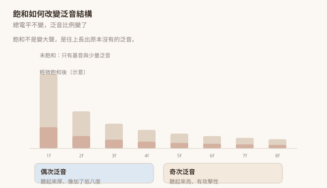
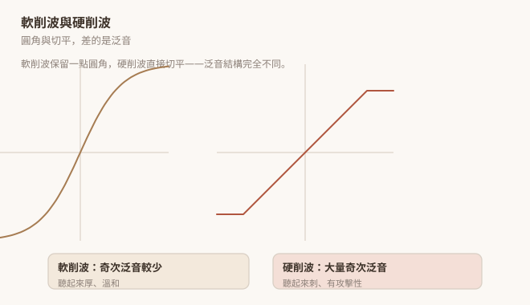

# **第 19 堂：飽和度與失真：類比諧波注入技術**

## 本堂課綱：重新認識「失真」這個好朋友

在數位音樂製作的世界裡，我們終其一生都在追求「乾淨」——乾淨的錄音、乾淨的訊號鏈、乾淨的混音。然而，真正讓音樂聽起來「像唱片」的關鍵，往往不是乾淨，而是那一層恰到好處的**髒**。這堂課，我們要談的主題叫作**飽和度（Saturation）**，以及它的親戚：失真（Distortion）與破音（Overdrive）。你將會學到如何利用飽和度為你的聲音注入類比諧波、增加存在感、賦予溫暖質地，並且在不犧牲動態範圍的前提下，讓混音更貼近聽眾習以為常的「唱片聲」。

---

## 什麼是飽和度？為聲音添加泛音

飽和度這個詞源自類比電路——當訊號通過一個電子元件（如真空管、電晶體、變壓器）時，若訊號強度超過該元件的線性工作範圍，波形便會開始被壓縮、切平，產生原本不存在的**諧波（Harmonics）**。這個過程稱為飽和。

### 飽和度的本質

- **非線性失真**：輸入與輸出不再成正比，波形被溫柔地壓縮。
- **諧波生成**：新增的諧波讓聲波頻譜變得更豐富，聽感上更「厚」、更「暖」。
- **動態壓縮**：飽和本身也是一種軟壓縮，峰值被馴服，RMS 上升，聽感變大聲。

舉個例子：一把乾燥的數位鋼琴，聽起來可能尖銳、生硬。但若讓它經過一點磁帶飽和，高頻被柔化、中低頻多了一層溫暖的泛音，鋼琴便瞬間有了「實體感」——這就是飽和度的魔法。

### 為何數位聲音需要飽和？

數位音訊本身是「完美」的——沒有底噪、沒有諧波失真、沒有頻率響應的波動。但正因為太完美，聽起來反而缺乏「血肉」。飽和度補上了類比時代那一層聽眾大腦早已習慣的「音樂性瑕疵」，讓聲音聽起來自然、立體、有溫度。

---

## 飽和、失真、破音——三兄弟的差別

這三個詞經常被混用，但它們在技術與聽感上有明確的層級差異。

### Saturation（飽和）

- 失真的程度最輕微（通常 < 1-5% THD）。
- 目標是**美化**，而不是破壞。
- 產生的諧波以人耳喜愛的偶次諧波為主。
- 應用場景：所有需要增加溫暖與厚度的軌道、混音總線。

### Distortion（失真）

- 失真程度中等至強烈（5-50% THD）。
- 目標是**改變音色特質**，甚至有時候是刻意製造「破音」。
- 奇次與偶次諧波並存，聽感上更銳利、更電氣化。
- 應用場景：電吉他破音、電子音樂的合成器音色設計。

### Overdrive（破音／過載）

- 類似失真，但通常模擬音箱前級被推爆的狀態。
- 動態反應更靈敏：彈得輕→乾淨，彈得用力→破音。
- 應用場景：搖滾吉他、藍調、需要動態表情的破音音色。

在混音應用中，**飽和度是最常被使用的工具**。你可以把它想像成「帶有色彩的音量推桿」——把訊號推上去的同時，順便加了一層美麗的諧波塗層。

---

## 四種主要的飽和類型

不同的類比元件會產生不同特性的飽和，以下是最常見的四種：

### 磁帶飽和（Tape Saturation）

模擬盤帶錄音機（如 Studer A827、Ampex 102）的行為。

- **聽感特徵**：溫暖、圓潤、高頻自然滾降。
- **諧波特性**：主要以偶次諧波為主，伴隨輕微的奇次諧波。
- **附加效果**：輕微的壓縮與音染、略微的抖晃（Wow & Flutter）。
- **經典插件**：Waves J37、Universal Audio Studer A800、Slate Virtual Tape Machines。
- **最佳場景**：混音總線、立體聲副總線、人聲、鋼琴、弦樂。

### 真空管飽和（Tube Saturation）

模擬真空管放大器（如 12AX7、6L6）的動態非線性行為。

- **聽感特徵**：豐富、甜美、富有音樂性，俗稱「管子味」。
- **諧波特性**：以偶次諧波（尤其是二次諧波）為主力，聽感極度悅耳。
- **附加效果**：動態壓縮感強烈，訊號越大壓越多。
- **經典插件**：Black Box HG-2、Soundtoys Radiator、Softube Saturation Knob。（WA76、CL 1B 是壓縮器，真空管電路本身帶飽和，但主要用途不是加飽和。）
- **最佳場景**：主唱、貝斯、木吉他、鋼琴——任何需要「貴氣」的聲源。

### 電晶體飽和（Transistor Saturation）

模擬電晶體電路的硬朗飽和特性。

- **聽感特徵**：鋒利、有攻擊性、比管子「髒」。
- **諧波特性**：奇次諧波較多，聽感上較為刺耳、更具侵略性。
- **經典插件**：Soundtoys Decapitator、Softube Harmonics、Trash 2。
- **最佳場景**：搖滾鼓組、電吉他、合成器貝斯——當你需要「砂紙感」時。

### 變壓器飽和（Transformer Saturation）

模擬類比控台上輸入輸出變壓器（如 Neve、API）的鐵芯飽和。

- **聽感特徵**：低頻變厚、高頻稍微壓暗、整體凝聚力提升。
- **諧波特性**：以二次諧波為主，但比管子更「緊」、更低頻。
- **附加效果**：相位偏移、頻率響應的低頻隆起。
- **經典插件**：Neve 1073 Channel Strip、API 2500 Bus Compressor、Brainworx bx_console。
- **最佳場景**：鼓組總線、混音總線、低音樂器。

---

## 在個別軌道上使用飽和度

飽和度最直接的用法就是掛在個別音軌上，針對每種樂器塑造音色。

### 鼓組（Drums）

鼓是飽和度最有感的應用對象。

- **小鼓（Snare）**：掛 Tape Saturation，Input 推到開始壓縮的位置。小鼓的瞬態會被馴服，尾音變厚，擊打感依然保留。飽和插件沒有 Attack 旋鈕；想留住瞬態衝擊，先用瞬態塑形器（Transient Shaper）壓低 Attack 再送進飽和。
- **大鼓（Kick）**：Tube Saturation 最適合。踢鼓的低頻會填入更多的「肉」，Q 彈感大增。與其用 EQ 死命 Boost 60Hz，不如用飽和度增加低頻的泛音密度，聽感更自然。
- **Overhead / 鈸**：微量的 Tape Saturation。只需要一點點（Input 推到 -2 到 -3 dB 的飽和點），讓銅鈸的刺耳高頻變得絲滑。
- **鼓組總線**：一台 API 2500 風格的 VCA Bus Compressor，搭配變壓器飽和，整組鼓立刻「黏」在一起，聽感像一張完整的唱片。

### 貝斯（Bass）

貝斯是飽和度最能發揮「聽不見但感受得到」作用的樂器。

- **合成器貝斯**：用 Distortion 風格插件（Decapitator）將 Blend / Mix 調到 20-30%，只加入微量失真。低頻本體保持乾淨，高頻域增加一層「沙沙的」顆粒感，讓貝斯在小喇叭上也能被聽見。
- **電貝斯（指彈）**：Tube Saturation，Drive 量約讓 VU Meter 指向 +3 到 +6 dB。貝斯的動態被馴服，每個音之間的音量更平均，音色更肥厚。
- **Upright Bass（原聲貝斯）**：Tape Saturation 最適合。保留原聲貝斯的自然木頭感，同時增加中頻的圓潤度。

### 人聲（Vocals）

人聲飽和是專業混音與業餘混音之間的分水嶺之一。

- **主唱**：Tube Saturation（如 Black Box HG-2）的經典用法。驅動量不大，輸入增益約 +2～3 dB（Triode 刻度約 2–3）。人聲會變得更有「臨場感」，像錄音室等級的麥克風前級推出來的質地。
- **背景和聲**：Tape Saturation，略高的驅動（輸入增益約 +4～6 dB）。和聲之間會產生融合效果，不會互相搶戲，整體聽感像同一組麥克風在同一個空間錄的。
- **饒舌 / 演說人聲**：Transistor Saturation，Mix 開到 10-15%。增加中頻的撕裂感與攻擊性，讓聲音「頂」在混音前方。

### 吉他（Guitars）

- **木吉他**：微量的 Tube Saturation。木吉他的瞬態比較尖，飽和後的中頻更甜、高頻更絲滑，聽起來像經過頂級前級。
- **電吉他（Clean）**：Tape Saturation，讓 clean tone 更厚、更立體。
- **電吉他（破音）**：已經有 distortion 的訊號再疊一層 Tape Saturation，可以馴服過度的刺耳高頻，讓破音變得更「大顆」。

---

## 混音總線飽和：Glue 的秘密武器

混音總線（Mix Bus，又稱 2-Bus）上的飽和度是「類比味」混音的最後一哩路。

### 做法

在所有軌道的最末端、Limiter 之前，掛上一個 Tape Saturation 插件（如 J37、Studer A800）。調整 Input Gain 直到總線的 VU 表平均指向 +2 到 +4 dB（約 1-2 dB 的 GR）。

### 效果

- **凝聚力**：所有軌道像被「壓在一起」，各樂器之間的頻率互相融合。
- **立體感**：磁帶的輕微串音（Crosstalk）讓左右聲道微微融合，音場聽起來更飽滿，而不是更寬。
- **高頻馴服**：數位混音最容易累積刺耳高頻，總線上的磁帶飽和會自然地滾降 12kHz 以上的極高頻。
- **音量競爭力**：飽和造成的動態壓縮讓 RMS 提升，混音整體聽感變大聲，不需要之後用 Limiter 硬推。

### 順序建議

壓縮器 → 飽和度 → EQ → Limiter

- 壓縮器先處理動態，飽和效果更一致。
- 飽和度會改變頻譜，所以之後再用 EQ 微調。
- 最後的 Limiter 只做極少量的最終限制。

---

## 諧波激發器：不加音量也能增加存在感

諧波激發器（Harmonic Exciter）是飽和度的一個分支應用——它有選擇性地只對特定頻段產生諧波，其餘頻段保持乾淨。

### 原理

傳統飽和度對全頻段（或一整個頻段）施加失真，而 Exciter 則透過分頻（Crossover）或多頻帶處理，只在中高頻或高頻的部分注入諧波。這樣一來，人耳感受到「細節變多了」、「空氣感變好了」，但並沒有真正增加音量。

### 應用場景

- **主唱**：以 2-5kHz 為中心，加入微量諧波。不用 EQ Boost，主唱的自然亮度提升。
- **立體聲混音**：6-12kHz 的 Exciter，讓混音頂端的空氣感出現，鈸的空氣音、房間殘響的尾韻變得更明顯。
- **整體音場**：給 20-100Hz 的低頻 Exciter（類似 Sub Harmonic Synthesizer），在低頻加入二次諧波，讓低音在小喇叭上也能被感知到。

### 推薦插件

- **Waves RBass / Aphex Vintage Exciter** — 經典的低頻與高頻激發。
- **Oeksound Soothe2** — 本質是動態共振抑制器，適合放在飽和之後修掉刺耳的諧波峰值，讓失真聽起來更圓潤（現場用的版本是另一個獨立產品 soothe live）。
- **iZotope Ozone Exciter** — 多頻帶激發，可分別控制四個頻段。

---

## 實戰飽和度設定參數

以下是一組經過實戰驗證的「起點參數」，你可以根據手上的素材微調：

### 小鼓飽和

- 插件：Waves J37 (Tape)
- Input：推到 VU +3 dB
- Speed：15 IPS（標準帶速；要更乾淨的高頻延伸再切到 30 IPS）
- Bias：略調低（−0.5 dB），增加二次諧波與飽和量
- Mix：100%

### 貝斯（合成器）飽和

- 插件：Soundtoys Decapitator
- Style：N（Neve）或 P（Pentode），需要更兇再按 Punish
- Drive：3.5
- Filter：低通約 8kHz（只讓低中頻飽和）
- Mix：30%（乾濕並存，保留低頻本體）

### 立體聲總線飽和

- 插件：Slate VTM (Virtual Tape Machines)
- Calibration：+6 dB / 185 nWb/m（高飽和量）
- Tape Type：GP9（現代磁帶，較乾淨）
- Speed：15 IPS
- 微調 Output Trim：讓總線音量維持在 -6 dBFS 左右（留給 Limiter 空間）

### 人聲 Tube 飽和

- 插件：Black Box HG-2
- Triode Drive：3.5
- Pentode Drive：0（只開三極管，維持偶次諧波特性）
- Low Cut：開（避免低頻噪音被飽和放大）
- Mix：100%

---

## 軟剪輯 vs 硬剪輯：該推到多遠？

飽和度最後的臨界點，就是剪輯（Clipping）——波形被硬生生地截斷。

### 軟剪輯（Soft Clipping）

- 波形在接近 0 dBFS 時被溫柔地「折彎」。
- 聽感上仍然平滑，不會產生刺耳的數位雜音。
- 適合用於：混音總線的峰值控制、鼓組的瞬態塑形。

### 硬剪輯（Hard Clipping）

- 波形在 0 dBFS 處被一刀切斷，平頂方形波。
- 產生大量奇次諧波，聽感刺耳、數位感強烈。
- 適合用於：電子音樂的合成器音色設計、刻意製造的 Lo-Fi 效果。
- 不適合用於：人聲、原聲樂器、混音總線（除非你是故意要那種 Grit）。

### 實戰判斷法

如果你的飽和度在聽感上開始出現「沙沙的」、像收音機雜訊的聲音，那就表示推過頭了。正確的做法是：**推到剛好聽到「變厚了」但還沒聽到「破掉了」那個臨界點**，再退回 1-2 dB。

---

## 類比溫暖在數位製作中的哲學

「Analog Warmth」這個詞在數位時代被講到快爛掉，但它真正的意義是什麼？

### 溫暖的科學解釋

1. **諧波結構**：類比飽和在頻譜上增加的諧波，其強度隨著頻率增高而自然衰減（-6 dB/oct）。這和自然聲學環境中聲音的衰減方式一致，因此人耳大腦認為「這聽起來很自然」。
2. **非線性壓縮**：類比元件的壓縮量與輸入訊號的瞬間強度有關，這種壓縮在時間軸上是「有生命的」——不像數位 Limiter 那樣機械地壓到底就停。
3. **相位偏移**：類比電路會產生頻率相依的相位偏移，讓立體聲訊號的左右聲道之間產生微微的時間差，聽感上音場更寬、更深。

### 如何在數位中重現

今天的數位飽和插件（如 FabFilter Saturn 2、iZotope Trash 2、Kazrog True Iron）已經可以極度精確地模擬類比電路的行為。關鍵不在於用不用類比硬體，而在於**理解類比飽和的原理，然後用對工具**。

---

## 總結提醒

| 概念 | 一句話記法 |
|------|-----------|
| 飽和度 | 加入美麗的泛音，讓聲音變厚 |
| 失真 | 改變音色的武器，用在新鮮感 |
| 破音 | 動態反應的表情工具 |
| 磁帶 | 溫暖、圓潤，適合總線 |
| 管子 | 甜美、貴氣，適合人聲 |
| 電晶體 | 鋒利、砂紙感，適合節奏樂器 |
| 變壓器 | 低頻變厚，適合鼓組與低音 |
| 諧波激發器 | 不加音量也能增加存在感 |
| 軟剪輯 | 溫和削峰，混音可用 |
| 硬剪輯 | 劇烈削峰，音效用途 |

飽和度是最被低估的混音工具——它同時是**動態處理器**、**頻率塑形器**、**諧波產生器**和**立體聲加寬器**。學會使用它，你的混音將從「數位樣板」進化成「類比質感的完整作品」。

下一堂課，我們將探討壓縮器的進階應用——從平行壓縮到多頻帶壓縮，讓你對動態的控制更上一層樓。
