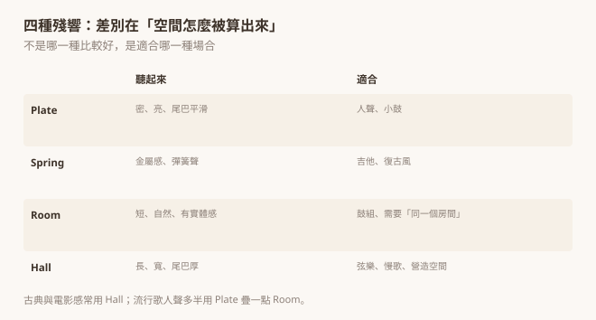
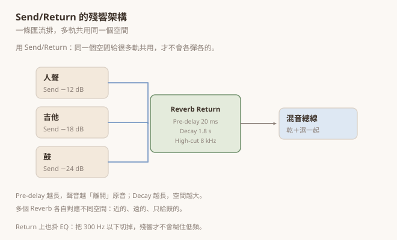
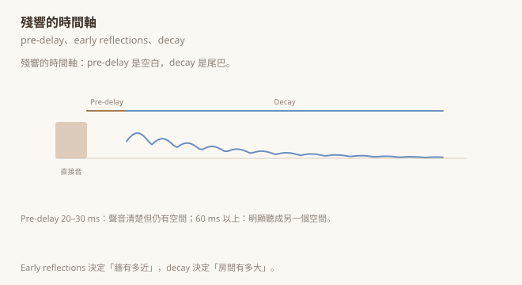

# **第 20 堂：Reverb 空間營造：Send/Return 架構與層次感**

## 一、什麼是 Reverb？自然聲學 vs 數位迴音

Reverberation（殘響，簡稱 Reverb）是指聲音在空間中反射、擴散後持續衰減的現象。當聲源發出聲音後，聲波撞擊牆壁、地板、天花板等表面產生無數次反射，這些反射聲以極短的時間差陸續抵達聽者耳朵，形成綿延的「尾音」，這就是殘響。

### 自然聲學的殘響

每一個空間都有其獨特的殘響特徵。小浴室高頻反射密集，產生短促明亮的殘響；大教堂的殘響可能長達五秒以上。殘響的長短取決於空間大小、形狀、建材與物體多寡。自然殘響讓我們的大腦能夠潛意識地判斷「我處在什麼樣的空間中」。

### 數位 Reverb

數位 Reverb 是透過 DSP 技術模擬自然空間聲學的插件或硬體，為乾冷的錄音賦予空間感與深度。常見技術包括演算法 Reverb（數學模型，參數靈活、CPU 負載低）和 Convolution Reverb（取樣真實空間脈衝響應，還原度極高但調整彈性低）。

## 二、Reverb 的類型

不同的 Reverb 類型各有獨特的音色特質與應用場景。

**Room Reverb（房間殘響）**：模擬小型房間自然反射，Decay 0.3~1.0 秒，高頻保留較多。適合鼓組、打擊樂。

**Hall Reverb（大廳殘響）**：模擬音樂廳廣闊空間，Decay 1.5~4.0 秒以上，尾音豐滿華麗。適合弦樂、鋼琴、合唱、電影配樂。

**Plate Reverb（金屬板殘響）**：利用金屬板機械振動產生殘響，1950~1970 年代經典工具。音色平滑密集，無明顯早期反射，Decay 1.0~3.0 秒。經典應用於人聲、小鼓。

**Spring Reverb（彈簧殘響）**：透過彈簧扭轉振動產生，常見於吉他音箱。具獨特「彈跳感」。廣泛用於 Surf Rock、Dub、Reggae。

**Chamber Reverb（殘響室殘響）**：將揚聲器放在真實迴音室播放，再用麥克風收錄空間殘響。Abbey Road、Motown 經典錄音室採用。音色溫暖有機。

**Convolution Reverb（卷積殘響）**：使用真實空間的脈衝響應取樣進行計算，還原度極高。缺點是參數靈活性低、CPU 消耗高。

## 三、Send/Return（Aux Bus）路由：為何優於 Insert 效果

在 DAW 中，將 Reverb 加在音軌上有兩種主要方式：Insert 與 Send/Return。

### Insert 方式的問題

Insert（插入式）是將 Reverb 插件直接掛在單一音軌的訊號鏈上。雖然設定簡單，但有以下缺點：

- **CPU 消耗巨大**：每一軌都掛一個獨立的 Reverb 插件，十個音軌就開十個，浪費運算資源
- **缺乏一致性**：每軌的 Reverb 參數各自獨立，難以讓所有樂器聽起來「在同一空間中」
- **無法共享殘響**：各音軌的殘響彼此隔離，失去自然的空間融合感
- **Mix 調整不便**：要調整所有音軌的殘響量時，必須一軌一軌手動操作

### Send/Return 架構

Send/Return（又稱 Aux Bus 或 Bus 架構）是專業混音的核心技術：

1. 建立一條輔助軌（Aux Track / Return Track）
2. 在該輔助軌上掛一個 Reverb 插件，將 Dry/Wet 設為 100% Wet（只輸出殘響訊號）
3. 將各音軌透過 Send（發送）路由到該輔助軌
4. 各音軌的 Send Level 控制送入殘響的量，即是該音軌的「濕度」

**優點總結：**

- **CPU 高效**：一個 Reverb 插件供多個音軌共享
- **空間一致性**：所有樂器的殘響來自同一個空間模擬，聽起來自然融合
- **獨立控制**：每軌的 Send Level 可獨立調整，輕鬆平衡各樂器的殘響深度
- **靈活的殘響處理**：可在 Return 軌上對殘響訊號進行 EQ、壓縮等處理，不影響原來的乾訊號
- **預延遲與 Mix 控制**：可輕鬆調整整體殘響的 Pre-delay、Decay 等參數，影響所有共用音軌

## 四、設定多重 Reverb Return：Room、Plate、Hall

專業混音通常不會只用一個 Reverb，而是同時使用 2~4 種不同的 Reverb，各自負責不同的空間層次。常見的配置是「三層殘響系統」：

### 第一層：Room Reverb（近距離空間感）

- Send/Return 編號：Bus 1
- Decay Time：0.4~0.8 秒
- 用途：讓聲音有「存在的空間感」，但不至於聽起來很遠
- 適用：鼓組、打擊樂、節奏吉他

### 第二層：Plate Reverb（音色融合）

- Send/Return 編號：Bus 2
- Decay Time：1.5~2.5 秒
- 用途：為聲音增添豐厚度與經典質感，不強調空間尺寸而是強調音色
- 適用：主唱、小鼓、鋼琴

### 第三層：Hall Reverb（縱深與氣氛）

- Send/Return 編號：Bus 3
- Decay Time：2.0~4.0 秒
- 用途：創造深遠的空間感與氛圍，讓樂器有「遠近層次」
- 適用：弦樂、Pad、背景和聲、獨奏樂器

### 實施步驟（以任何 DAW 為例）

1. 新增三條立體聲 Aux Track（或 Return Track），分別命名為「Room Verb」、「Plate Verb」、「Hall Verb」
2. 每條 Aux Track 插入對應的 Reverb 插件，將 Mix/Dry-Wet 設為 100% Wet
3. 在每個需要殘響的音軌上，開啟對應的 Send（通常是 DAW 的 Sends 面板），路由到上述三條 Aux Track
4. 調整每軌的 Send Level——通常節奏組（鼓、貝斯）送 Room 較多、送 Hall 較少；主唱送 Plate 和 Hall 較多

## 五、Pre-delay：在清晰度下創造深度

Pre-delay（預延遲）是指原始乾訊號發出後，到殘響開始出現之間的時間間隔。這是空間感營造中最容易被忽略但極其重要的參數。

### Pre-delay 的混音應用

- **短 Pre-delay（0~20ms）**：聲音立即被殘響包圍，適合營造「近距離但充滿空間感」的效果，常用於鼓組 Room Mic 的模擬
- **中等 Pre-delay（20~60ms）**：乾音與殘響之間有清晰的時間間隔，人聲聽起來清晰通透，同時又有充足的空間深度。這是主唱最常用的範圍
- **長 Pre-delay（60~120ms）**：乾音與殘響幾乎分離，製造戲劇性的「回聲」效果。適合獨奏樂器、特殊段落

**關鍵要點**：Pre-delay 能讓主唱在大量殘響中保持清晰度，因為聽眾耳朵會在殘響出現前先接收到乾訊號。人聲混音中，40~60ms 的 Pre-delay 搭配 Plate 或 Hall 是經典做法。

## 六、Decay Time：匹配殘響長度與曲風節奏

Decay Time（又稱 RT60）是殘響衰減 60dB 所需的時間，是決定空間大小的主要參數。

### 如何設定 Decay Time

| 曲風 / 情境 | 建議 Decay Time | 說明 |
|---|---|---|
| 快節奏流行、Funk、Metal | 0.5~1.2 秒 | 殘響過長會使節奏模糊 |
| Ballad、慢板 R&B | 1.5~2.5 秒 | 足夠的尾音撐起情感 |
| 電影配樂、Ambient | 2.5~5.0+ 秒 | 營造浩瀚空間感 |
| Jazz 小編制 | 1.0~2.0 秒 | 保留演奏細節與真實感 |
| EDM、電子音樂 | 0.3~1.5 秒（可 sidechain 閃避） | 節奏清晰為優先 |

### 以 BPM 計算 Decay Time

一個進階技巧是將 Decay Time 與歌曲速度對齊，使殘響尾音落在拍子上而非模糊地消散。計算公式：

- 1 拍 = 60000 / BPM（毫秒）
- 建議 Decay Time 落在 1~4 個拍子的長度

例如 BPM = 120：

- 1 拍 = 500ms，建議 Decay 設為 1.5~2.0 秒（3~4 拍長度）

這樣殘響尾音會在樂句的拍點上消散，保持節奏的整潔感。

## 七、對 Reverb Return 使用 EQ：高通與低通濾波

這是專業混音與業餘混音之間最大的區別之一——對殘響訊號本身進行 EQ 處理。

### 低切（High-Pass Filter）殘響

在 Reverb Return 軌加上 HPF（High-Pass Filter），通常設在 200~500Hz。原因：

- 低頻殘響容易累積，產生模糊不清的「泥濘感」（Muddy）
- 貝斯與大鼓的低頻本來就具有較強的能量，不需要殘響來增加空間感
- 清除低頻殘響能讓混音的低頻更乾淨、更有力量

**建議設定**：

- Room Reverb HPF：200~300Hz
- Plate Reverb HPF：300~500Hz
- Hall Reverb HPF：200~400Hz（可依情況降至 150Hz 保留溫暖感）

### 高切（Low-Pass Filter）殘響

在 Reverb Return 軌加上 LPF（Low-Pass Filter），通常設在 8~15kHz。原因：

- 高頻殘響容易導致刺耳感（Harshness），特別是 Cymbal 與 Hi-hat 過多的情況
- 模擬真實空間的自然高頻衰減——空氣會吸收高頻
- 讓殘響更柔軟、更「類比」

**建議設定**：

- Room Reverb LPF：12~16kHz
- Plate Reverb LPF：10~14kHz
- Hall Reverb LPF：8~12kHz（長的殘響適合更柔和的尾音）

### 中頻微調

有時若殘響在中頻（約 1~4kHz）產生「轟鳴感」或箱音，可以用 Bell EQ 進行小幅衰減（-1~3dB），讓殘響更乾淨透明。

## 八、Early Reflections vs Tail：控制空間感知

Reverb 的時域結構分為早期反射（Early Reflections）和尾音（Tail）。

早期反射是聲音發出後最初幾次撞擊牆壁反射回來的聲音（10~80ms 內到達），數量少、方向明確，是大腦判斷空間大小與距離的主要線索。尾音則是後續密集反射疊加而成的平滑衰減，決定了殘響的「氣氛」。

調整 Early Reflections 與 Tail 的比例可改變空間感知：增加 Early Reflections 並縮短 Tail，聲源聽起來近、空間具體；減少 Early Reflections 並延長 Tail，聲源聽起來遠、空間朦朧。若想讓主唱「在前方但背後有廣闊空間」，採用較少 ER、較長 Tail；若想讓鼓組在一個具體小房間的感覺，則增加 ER 並縮短 Decay Time。

## 九、創造深度：近距離樂器 = 較少的殘響

混音的深度（Depth）是聽覺上的三維感，讓聽眾能聽出樂器在虛擬聲場中的前後位置。殘響是創造深度的核心工具之一。

### 深度層級的基本原則

想像一個虛擬舞台，樂器按殘響量由少到多排列在前中後三個層次：

| 層次 | 殘響 | 典型樂器 |
|---|---|---|
| 前景（Close） | 少量 Room | 主唱、貝斯、大鼓 |
| 中景（Mid） | 適中 Plate | 吉他、鋼琴、小鼓 |
| 背景（Far） | 大量 Hall | 弦樂、Pad、和聲 |

### 以殘響量建立距離感

聽覺心理學告訴我們：離聲源越遠，直達聲越弱，殘響比例越高。增加某個樂器的 Send Level，就是在大腦中把它「推遠」。實戰中先將所有 Send Level 歸零，從前景樂器開始只加極少殘響，中景逐步增加，背景樂器才配置較多殘響，自然形成清晰的前後層次。

**前景主唱**：Send Level 低，只加少量 Room 或 Plate（Pre-delay 40~60ms），保持清晰臨場感。**中景節奏吉他**：適量 Plate，Decay 約 1.5~2.0 秒。**背景和聲**：加大 Hall Send，Decay 2.0~3.0 秒。**Pad 樂器**：大量 Hall 或 Convolution，Decay 3.0 秒以上。

## 十、實用 Reverb 設定

以下是一些經典樂器的 Reverb 設定起始點，可根據實際歌曲需求微調。

### 主唱（Lead Vocal）

Plate 或 Hall，Decay 1.8~2.5 秒，Pre-delay 40~60ms，HPF 300~400Hz，LPF 10~12kHz，Early Reflections 約 50%。可再加一個短 Room 營造近距離感。

### 小鼓（Snare）

Plate 或 Room，Decay 0.8~1.5 秒（Ballad 可到 2.0 秒），Pre-delay 0~20ms，HPF 200~300Hz，LPF 12~15kHz。使用 Gate Reverb 可在小鼓擊打後快速切斷殘響，營造 80 年代經典鼓聲。

### 大鼓（Kick Drum）

Reverb 用量極少。若需空間感，用短 Room，Decay 0.3~0.6 秒，HPF 50~80Hz，LPF 3~5kHz。更好的做法是對大鼓的 Room Mic 訊號加殘響，而非 Close Mic。

### 電吉他（Electric Guitar）

節奏吉他：Room，Decay 0.6~1.0 秒。Solo 吉他：Plate 或 Hall，Decay 1.5~2.0 秒，Pre-delay 20~40ms。Clean 吉他：Spring Reverb（經典 Fender 音箱音色），Decay 1.0~1.5 秒。

### 鋼琴（Piano）

古典鋼琴：Hall，Decay 2.0~3.0 秒，Pre-delay 30~50ms，HPF 150~200Hz。流行鋼琴：Plate，Decay 1.5~2.0 秒。注意不要讓殘響掩蓋鋼琴的 Attack 瞬態。

### 背景和聲（Background Vocals）

Hall，Decay 2.0~3.0 秒，Pre-delay 20~40ms（比主唱短，使其位於主唱後方），Send Level 比主唱多 3~6dB，HPF 400~500Hz。

## 結語

Reverb 是混音中建構三維聲場的核心工具。透過 Send/Return 架構，我們能高效、靈活地使用多種殘響，分別掌控音場的寬度、深度與高度。掌握 Pre-delay、Decay Time、EQ 以及 Early Reflections 與 Tail 的關係，就能精準設計出每首歌獨特的聽覺空間。

請記住：好的殘響是「聽不出來」的殘響——它不應該被注意到，而是讓整體混音感覺更自然、更立體、更有情感。花時間仔細調整每一條 Send Level，你會發現混音從 2D 平面變成 3D 立體的關鍵，就在於這些看不見的空間細節。
