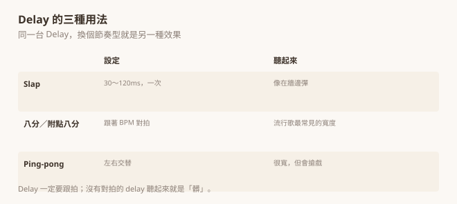
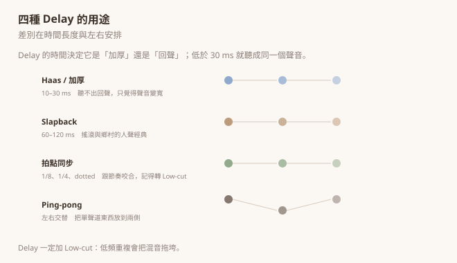
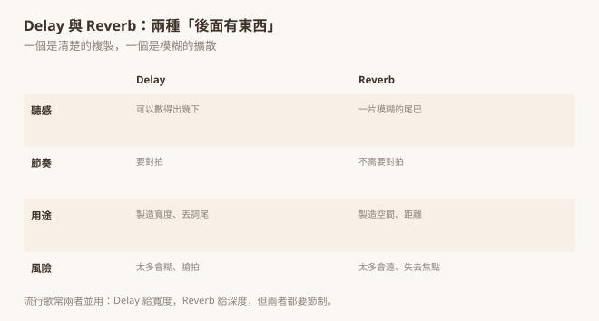
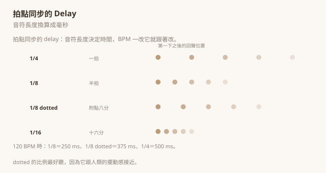

# **第 21 堂：Delay 延遲應用：立體聲寬度與音牆堆疊**

## 1. 什麼是 Delay？基礎概念與類型

Delay（延遲效果）是將輸入訊號複製一份，經過一段可設定的時間後再播放出來的效果器。它是音樂製作中最核心也最靈活的效果之一，從輕微的空間感營造到巨大的音牆堆疊，都離不開 Delay 的巧妙運用。

### 1.1 基本參數

任何 Delay 效果器都有幾個共同的核心參數：

- **Delay Time（延遲時間）**：原始訊號與延遲訊號之間的時間間隔，單位為毫秒（ms）或與歌曲速度同步的音符時值。
- **Feedback（回授）**：將延遲後的訊號再送回 Delay 輸入端，產生多次重複的效果。Feedback 值越高，重複次數越多，最終可能產生自激振盪（self-oscillation）。
- **Mix / Wet-Dry Blend（混音比例）**：原始訊號（Dry）與效果訊號（Wet）之間的比例。
- **Filter（濾波器）**：許多 Delay 內建高低通濾波器，用來修飾延遲回聲的頻率內容。

### 1.2 三種基本 Delay 類型

| 類型 | 特徵 | 典型應用 |
|------|------|----------|
| **Simple Delay（單一延遲）** | 一條延遲線，聲音在固定時間後重複 | vocal 的 slapback、吉他 solo 增厚 |
| **Ping-Pong Delay（乒乓延遲）** | 延遲訊號交替出現在左右聲道 | 立體聲寬度拓展、節奏性樂段 |
| **Multi-Tap Delay（多點延遲）** | 多條延遲線同時作用，每個 tap 有獨立的時間與聲像 | 複雜節奏 pattern、音牆堆疊 |



## 2. 延遲時間與速度同步



將 Delay Time 與歌曲的 BPM（Beats Per Minute）對齊，是確保 Delay 不「亂拍」的關鍵。現代 DAW 幾乎都內建 Tempo Sync 功能，但了解背後的計算邏輯仍然重要。

### 2.1 常見音符時值的延遲時間計算公式

```
Delay Time (ms) = (60,000 / BPM) x 音符倍數
```

以 BPM = 120 為例：

- **四分音符（Quarter Note）**：(60,000 / 120) x 1 = **500 ms**
- **八分音符（Eighth Note）**：(60,000 / 120) x 0.5 = **250 ms**
- **十六分音符（Sixteenth Note）**：(60,000 / 120) x 0.25 = **125 ms**
- **附點八分音符（Dotted Eighth）**：(60,000 / 120) x 0.75 = **375 ms**
- **三連音八分音符（Eighth Triplet）**：(60,000 / 120) x 0.333 = **~167 ms**

### 2.2 附點八分音符的魔力

附點八分音符（Dotted Eighth）搭配三連音節奏（shuffle / swing feel）時，Delay 的回聲會落在節奏的「縫隙」之間，產生一種流動感十足的節奏互動。這在 U2 的吉他音色、EDM 的 vocal 處理中極為常見。

> 實戰建議：vocal 的長音結尾設定 Dotted Eighth Delay，配合 Ping-Pong 模式，立刻擁有專業級的立體感。

## 3. Haas Effect：用短延遲創造立體聲寬度

Haas Effect（哈斯效應）是心理聲學（psychoacoustics）中一個重要的現象：當兩個相同的聲音抵達人耳的時間差在 **1 ms 到 40 ms** 之間時，大腦會將它們感知為「來自同一個方向但具有寬度感」，而不是兩個分開的聲音。

### 3.1 實作步驟

1. 將原始音軌複製一份（或傳送至 Aux Track）。
2. 將複製軌的聲像（Pan）極左（L100），原始軌極右（R100）。
3. 在複製軌上插入一個 Delay，設定 **5 ms 到 20 ms** 的延遲時間（不回授，Feedback = 0%）。
4. 調整 Mix 至 100% Wet（只聽到延遲聲）。

結果：聽感上聲音會從中央展開，彷彿整個立體聲場都被填滿。

### 3.2 注意事項

- **時間限制**：超過 40 ms 會變成可辨識的 echo（回聲），失去 Haas Effect 的效果。
- **單聲道相容性**：Haas Effect 在 mono 下會產生 comb filtering（梳狀濾波），導致聲音變「空」。務必在混音過程中檢查 mono 兼容性。
- **最佳應用場景**：背景合聲、pad 音色、吉他 double tracking。主 vocal 建議謹慎使用，因為 mono 相容性問題可能影響主唱清晰度。

## 4. Ping-Pong Delay：節奏與空間的結合

Ping-Pong Delay 將延遲訊號交替分配到左右聲道。例如輸入在中央，第一次回聲在左聲道，第二次在右聲道，第三次又在左聲道，如此交替。

### 4.1 設定範例（BPM = 120）

| 參數 | 設定值 | 效果 |
|------|--------|------|
| Delay Time | 250 ms (8分音符) | 節奏明確的左右交替 |
| Feedback | 20-30% | 3-5 次回聲後自然衰減 |
| Pan | L100 / R100 | 最大化立體聲寬度 |
| Mix | 30-50% | 與原始訊號保持平衡 |

### 4.2 應用場景

- **主歌與副歌的過渡**：在主歌最後一句歌詞加上 Ping-Pong Delay，製造進入副歌前的空間感擴張。
- **吉他 arpeggio**：分解和弦配合 Ping-Pong Delay，聽起來像兩把吉他在對話。
- **合成器 lead**：簡單的單音旋律經過 Ping-Pong Delay 後立刻變得豐富。

## 5. Slapback Delay：搖滾經典音色

Slapback Delay 是最古老也最經典的 Delay 用法之一，起源於 1950 年代的類比磁帶延遲。它的特點是：

- **短延遲時間**：70 ms 到 120 ms
- **單次重複**：Feedback 極低（0-10%），通常只聽到一次回聲
- **模擬磁帶溫暖感**：可以加上輕微的 saturation 或 low-pass filter

### 5.1 經典應用

- **Rockabilly 吉他**：Elvis Presley、Stray Cats 的吉他都大量使用 Slapback。設定 80-100 ms，單次回聲，吉他在中央，回聲在中央或稍微偏右。
- **Vocal 潤色**：70-100 ms 的 Slapback 可以為 vocal 增加厚度，同時保留清晰度。這也是早期搖滾樂 vocal 的標誌性聲音。
- **口琴與管樂**：Slapback 能為單音吹奏樂器增加「雙音」的錯覺，聽起來更有力量。

> 小技巧：在 Slapback 的回聲路徑上掛一個 Low-Pass Filter（6-8 kHz 以下），模擬磁帶延遲的高頻衰減特性，讓聲音更復古。

## 6. Delay vs Reverb：何時選用哪一種？

Delay 與 Reverb 都是創造空間感的工具，但它們的聽感與用途截然不同。

| 面向 | Delay | Reverb |
|------|-------|--------|
| **時間結構** | 明確、可數的回聲 | 模糊、連續的殘響尾音 |
| **節奏感** | 可與 BPM 同步，創造節奏 | 不強調節奏，營造氛圍 |
| **清晰度** | 保留原始聲音的輪廓 | 會模糊原始聲音的輪廓 |
| **空間感** | 創造「距離」與「寬度」 | 創造「房間大小」與「包圍感」 |
| **混音佔用** | 對頻譜的佔用較少 | 容易佔滿頻率空間 |

### 6.1 實戰選擇指南

- **需要強調節奏**：用 Delay。例如 rap vocal 的結尾短語、EDM 的 synth stab。
- **需要氛圍鋪底**：用 Reverb。例如 pad、ambient textures、ballad vocal。
- **深度感不足時**：先加 Delay，還不夠再加 Reverb。Delay 在前、Reverb 在後的串接（Serial）配置最常見。
- **兩者一起用**：將 Delay 的輸出送到 Reverb（Delay → Reverb），可以創造深度與空間感兼具的豪華音色。此時 Delay 的 Mix 設在 20-30%，Reverb 設在 15-25%，效果最佳。




## 7. 用多層 Delay 堆疊出音牆

Sound Wall（音牆）並不一定要靠大量的樂器堆疊。用多個不同設定的 Delay，可以讓一個簡單的聲音訊號膨脹成壯觀的聲響。

### 7.1 三層 Delay 堆疊法

假設我們只有一條 vocal 或 synth pad，可以建立三個 Aux Track，分別設定不同的 Delay：

| 層級 | Delay Time | Feedback | 聲像 | 濾波 | 用途 |
|------|-----------|----------|------|------|------|
| Layer 1 | 1/8 note (250ms) | 15% | 中央 | 無 | 主要節奏回聲 |
| Layer 2 | Dotted 1/8 (375ms) | 20% | L60 | HPF 200Hz | 立體感與律動 |
| Layer 3 | 1/4 note (500ms) | 25% | R60 | LPF 4kHz | 寬廣的殘響感 |

將三個 Aux 的 Send Level 分別微調（-12 dB、-18 dB、-24 dB），你會發現原本乾澀的聲音瞬間變成一道厚實的聲牆。

### 7.2 注意事項

- **避免頻率累積**：多層 Delay 很容易在特定頻率疊加，產生「轟鳴感」。每個層級的 Delay 都應該用 EQ 做頻率區隔。
- **節奏不衝突**：確保不同 Delay Time 之間不互相打架。1/8 + Dotted 1/8 是經典的安全組合。
- **立體聲場不要過寬**：不是所有聲音都要極左極右。保留中央位置給主要元素，讓延遲回聲在兩側展開即可。

## 8. Filtered Delay：用 EQ 修飾回聲



Filtered Delay（過濾延遲）是指在 Delay 插件的 Feedback 路徑中啟用內建 Filter（LPF/HPF），或在 DAW 中將 Delay 的輸出經 EQ 後再送回輸入端，構成外部回授迴路，讓每次回聲的頻率內容逐漸變化。

### 8.1 實作方法

1. 在 DAW 中建立 Send Track，插入 Delay 效果器。
2. 使用 Delay 插件內建的 Feedback Filter（LPF/HPF），或在 feedback 路徑中建立外部迴圈將 EQ 插入回授端，使每輪回聲逐次變暗。（最好是類比風格的 EQ 或 Filter plugin）。
3. 設定 Low-Pass Filter 在 5-8 kHz，High-Pass Filter 在 200-400 Hz。
4. 將 Feedback 設在 30-50%，讓回聲循環多次。

結果：所有回聲的高頻都被同樣削減，聽起來像聲音在遠處消散。若要每次回聲逐次變暗，得使用 Delay 內建的 Feedback Filter，或手動搭建外部回授迴路；這比單純降低 Feedback 量自然得多。

### 8.2 進階應用

- **Low-Pass Delay**：適合 bass、kick 等低頻元素，保留衝擊感的同時不讓回聲干擾中高頻。
- **High-Pass Delay**：適合 vocal、hi-hat，避免低頻回聲製造混濁。
- **Band-Pass Delay**：創造電話音效或收音機效果的回聲，常用在 intro 或 bridge 段落做對比。

> 推薦設定：在回授路徑掛 FabFilter Pro-Q 或 Stock EQ，HPF @ 300Hz (slope 12dB/oct) + LPF @ 7kHz (slope 12dB/oct)。這是最通用的 Filtered Delay 起點。

## 9. Automated Delay Throw：精準的詞尾回聲

Delay Throw（又稱 Delay Dump 或 Echo Throw）是一種常見於現代流行音樂的 vocal 處理技巧。它只在特定的歌詞或短語結尾觸發 Delay，其餘時間保持乾聲。

### 9.1 實作步驟（以 Ableton Live / Logic Pro 為例）

1. 將 vocal 送至一個 Aux Track，aux 上只掛 Delay（建議 1/4 note 或 Dotted 1/8，Feedback 60-70%，Mix 100% Wet）。
2. 在 Aux Track 的輸入 Send 上畫 Automation。
3. 只在你想產生回聲的詞句結尾，將 Send Level 瞬間拉高（例如從 -inf 拉到 -6 dB）。
4. 回聲出現後，再將 Send Level 拉回 -inf。

### 9.2 經典應用範例

- **空靈系 pop vocal：在每句結尾的最後一個字觸發長回聲（1/2 note delay，Feedback 50%），營造空靈感。**：在每句結尾的最後一個字觸發長回聲（1/2 note delay，Feedback 50%），營造空靈感。
- **Hip-hop ad-lib**：在 punchline 結尾觸發快速重複的 short delay（1/16 note，Feedback 70%），增加節奏力度。
- **Rock 主歌到副歌**：在主歌最後一句觸發 Delay Throw，讓回聲在副歌開頭繼續殘留，形成無縫過渡。

### 9.3 實戰提示

- 在 Automation 曲線上使用 smooth / ramp 過渡，避免 click 聲。
- Delay Throw 的 Wet 量不要超過原始 vocal 的 -6 dB，以免喧賓奪主。
- 在 Delay 後串一個 Reverb（Send → Delay → Reverb），回聲會帶著殘響消散，聽感更加華麗。

## 10. 不同樂器的實用 Delay 設定速查表

以下是經過實戰驗證的 Delay 設定，可以直接套用：

### 10.1 Vocal

| 風格 | Delay Time | Feedback | 聲像 | Mix | 備註 |
|------|-----------|----------|------|-----|------|
| 流行主歌 | Dotted 1/8 | 15-20% | 中央或微偏 | 20-30% | 保持清晰度 |
| R&B / Hip-Hop | 1/4 note | 30-40% | Ping-Pong | 25-35% | 節奏感強烈 |
| 搖滾 Slapback | 80-100ms | 5-10% | 中央 | 30-40% | 復古厚實感 |
| Ballad 長音 | 1/2 note | 40-50% | 立體聲 | 30-40% | 搭配 Reverb |

### 10.2 電吉他

| 風格 | Delay Time | Feedback | 備註 |
|------|-----------|----------|------|
| Solo (U2 / The Edge) | Dotted 1/8 | 30-40% | Ping-Pong，搭配輕度 Overdrive |
| Clean Arpeggio | 1/8 note | 15-20% | 聲像置中，Mix 20% |
| Heavy Riff | Slapback 60-80ms | 5% | 增加厚度不影響節奏 |
| Ambient Pad | 1/2 note + 1/4 note | 40-50% | 雙層 Delay，Filtered |

### 10.3 合成器與鍵盤

| 類型 | Delay Time | 設定重點 |
|------|-----------|----------|
| Lead Synth | 1/8 note + Ping-Pong | 讓旋律在立體聲場中流動 |
| Pad | Dotted 1/4 + Filtered | HPF 200Hz + LPF 6kHz，製造寬廣感 |
| Pluck | 1/16 note + Low Feedback | 節奏感強的短回聲 |
| Bass | Slapback 50ms (Mono) | 不建議立體聲 Delay，低頻會模糊 |

## 11. 進階技巧：Delay 的創意應用

### 11.1 Reverse Delay（反轉延遲）

將延遲的聲音反轉播放，製造出「吸氣」或「倒帶」的效果。做法：將一段 audio 用 Delay 處理後，錄製到新音軌，再將該音軌反轉（Reverse）。

### 11.2 Delay Panning Automation

讓 Delay 的聲像隨著時間移動。例如將 Delay Output 的 Pan 設定 LFO 自動擺動（Auto-Pan），回聲就會在左右之間來回掃描。

### 11.3 Sidechain Delay

將 Delay 的回聲用 kick drum 做 sidechain compression。每次大鼓擊打時，Delay 的回聲會被壓低，創造出呼吸感和節奏律動。這在 EDM、House 中極為常見。

### 11.4 極端 Feedback 效果

將 Feedback 調到 90% 以上，Delay 會產生自激振盪。配合 Filter 的劇烈變化，可以製造出科幻感十足的聲效、過場噪音或實驗性片段。使用時務必控制音量，避免損壞聽力或設備。

## 結語

Delay 遠不止是「讓聲音變大變寬」的工具。當你理解了它在時間、空間、頻率、節奏四個維度上的運用方式，延遲效果就會成為你混音與編曲中最強大的武器之一。從 Haas Effect 的微妙寬度、Slapback 的復古魅力，到多層 Delay 堆疊的壯闊音牆，每一種用法都值得反覆試驗。

記住一個原則：**Delay 的目的是「強化」原始聲音，而不是「掩蓋」它。** 當你設好一個 Delay 參數後，關閉它再打開，如果發現沒有 Delay 的聲音更吸引人，那就代表這個 Delay 還需要調整。

下一堂課，我們將探討 Reverb 殘響的進階設定——從 Room、Hall 到 Plate、Spring，以及 Convolution Reverb 的應用。

---

**重點回顧**

- Delay 有三種基本類型：Simple、Ping-Pong、Multi-Tap
- BPM 同步的附點八分音符是最萬用的延遲時間
- Haas Effect（5-20ms）可拓展立體聲寬度，但 mono 下會產生梳狀濾波，須檢查單聲道相容性
- Filtered Delay 讓回聲距離感更自然
- Delay Throw 能精準控制哪些詞句有回聲
- 多層 Delay 堆疊注意頻率區隔與節奏不衝突
