# **第 22 堂：調變效果：Chorus, Flanger, Phaser 的流動感運用**

## 一、什麼是調變效果？

調變效果（Modulation Effects）是一類透過持續改變音訊訊號的時間、頻率或相位來產生動態變化的聲音處理技術。它們的核心原理是引入一個低頻振盪器（LFO, Low-Frequency Oscillator）來控制某個參數（如音高、時間延遲、相位偏移），使聲音產生週期性的變化，從而賦予靜態的聲音以「流動感」與「生命感」。

### 調變效果的三個基本要素

所有調變效果都可以拆解為三個組成部分：

**LFO（低頻振盪器）**：產生週期性控制訊號的振盪器，頻率通常低於 20Hz。LFO 的波形（正弦波、三角波、方波等）決定了調變的「形狀」——正弦波平滑流暢，三角波線性均勻，方波則產生突兀的切換效果。

**目標參數**：LFO 所控制的對象——可以是音高（Pitch）、時間延遲（Delay Time）、相位（Phase）、濾波器頻率（Filter Cutoff）等。不同的目標參數決定了調變效果的種類。

**調變深度（Depth / Amount）**：控制 LFO 對目標參數的影響幅度。深度越大，效果越明顯；深度越小，效果越微妙。

### 調變效果如何為聲音注入「動感」

沒有調變效果的聲音是「靜態」的——它的頻譜和時間結構在持續時間內保持不變。人耳對這種靜態聲音很快就會產生聽覺疲勞。調變效果透過持續的細微變化，讓聲音的頻譜不斷漂移、抖動、掃掠，使聽覺系統保持警覺與興趣。這也是為什麼好的混音會加入適量調變效果來讓音色「活起來」。

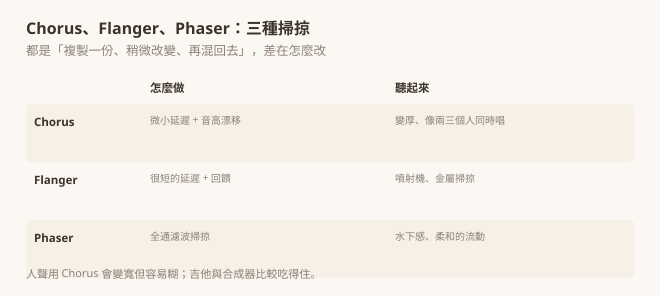

## 二、Chorus：加倍效果與音色增厚

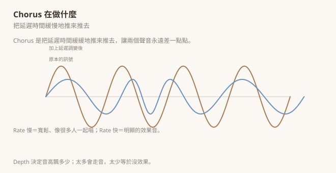

### Chorus 的原理

Chorus（合聲效果）模擬多個演奏者同時演奏同一個樂器時產生的細微差異。當一群人同時唱同一個音符時，每個人之間存在極小的音高偏差（Pitch Deviation）和時間偏移，這些人耳無法單獨分辨的微小差異疊加在一起，形成一種「比一個人更飽滿」的聲音。

Chorus 效果透過以下方式實現：

1. 將原始訊號複製一份或多份（稱為 Voices）
2. 對複製訊號施加極小的時間延遲（通常 10~30ms）
3. 使用 LFO 持續微調這些延遲線的延遲時間（這會產生細微的音高抖動）
4. 將原始訊號與處理後的複製訊號混合

結果是聲音聽起來變得更寬、更厚、更豐滿，彷彿有多個聲源同時發聲。

### Chorus 的典型聲音特質

- **寬廣感**：聲音的立體聲像明顯擴展
- **豐厚度**：單薄的音色變得飽滿、有質感
- **自然度**：在所有調變效果中聽起來最接近自然聲學現象
- **溫暖度**：高頻不會過度突出，整體音色柔軟圓潤

### 經典 Chorus 硬體

80 年代是 Chorus 的黃金時代。Boss CE-1 / CE-2（吉他效果器）、Roland Dimension D（錄音室機架）、Eventide 系列處理器等經典設備定義了 Chorus 的聲音美學。這些硬體至今仍被視為 Chorus 聲音的標竿，許多軟體插件都致力於模擬它們的音色。

## 三、Flanger：動態 Comb Filter 與噴射機聲

### Flanger 的原理

Flanger（鑲邊效果）的歷史可以追溯到 1950 和 60 年代的錄音室。工程師發現將兩個同步播放的相同錄音帶其中一個的 flange（捲帶盤邊緣）用手輕微壓住，使其速度略微減慢，兩者的相位差會產生一種「洞洞的、旋轉的」聲音效果。

Flanger 的訊號處理方式：

1. 將原始訊號複製一份
2. 對複製訊號施加極短的延遲（通常 0.1~10ms）
3. 用 LFO 持續調變這個延遲時間
4. 將延遲後的訊號與原始訊號相加

關鍵在於：當一個訊號與其自身的短延遲拷貝混合時，會在頻譜上產生週期性的相消與相長干涉，形成一系列規律的凹陷和凸起，稱為 Comb Filter（梳形濾波器）。當 LFO 讓延遲時間不斷變化時，這些梳形濾波的頻率位置也隨之移動，產生那道經典的「wwooosshh」掃掠聲。

### Flanger 的典型聲音特質

- **梳形濾波掃掠**：頻譜上如同梳子般規律排列的凹陷在移動
- **噴射機效果**：極具辨識度的 Jet Plane Swoosh 聲
- **明顯的動態感**：效果強烈，在混音中極容易被注意到
- **金屬感**：Feedback（再生）增加時，聲音變得更加尖銳、金屬化

### Flanger 與 Feedback

Flanger 的 Feedback（或稱 Regeneration）參數將輸出訊號的一部分反饋回效果器的輸入端。Feedback 為正數時會增強梳形濾波的共振尖峰，使效果更強烈、更「吵」；Feedback 為負數時反轉相位，產生不同的音色特徵。Feedback 調高時，Flanger 的聲音會從溫和的掃掠變成極具侵略性的聲響效果。

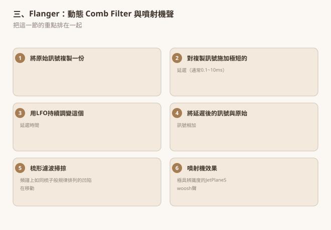

## 四、Phaser：Notch Filter 掃掠與水漾空間感

### Phaser 的原理

Phaser（相位效果）與 Flanger 經常被混淆，但兩者的工作原理截然不同。

Phaser 的核心是 All-Pass Filter（全通濾波器）。全通濾波器不會改變訊號的頻率響應（所有頻率通過時的音量不變），但會對不同頻率引入不同的相位偏移。當一個經過全通濾波器的訊號與原始訊號混合時，在某些頻率點上，兩者的相位正好相反，產生相消干涉，形成頻譜上的凹陷（Notch）。多個 All-Pass Filter 串聯產生多個 Notch。

Phaser 的訊號處理路徑：

1. 將原始訊號送入一串 All-Pass Filter
2. 用 LFO 調變這些濾波器的截止頻率（相位偏移的中心頻率）
3. 將處理後的訊號與原始訊號混合
4. Notch 的位置隨著 LFO 的週期在頻譜上上下掃掠

**關鍵**：Flanger 產生的是週期性、等間距的 Comb Filter，而 Phaser 產生的 Notch 在頻譜上並不是等間距的，它們在低頻比較稀疏、高頻比較密集。這使得 Phaser 的聲音比 Flanger 更加柔和、更有「水漾感」。

### Phaser 的典型聲音特質

- **水漾感**：聲音彷彿在水中晃動，圓潤流暢
- **空間旋轉感**：類似旋轉音箱（Leslie Speaker）的效果，但更加細緻
- **柔和度**：比 Flanger 更溫和、更易於融入背景
- **復古質感**：70 年代 Funk 與 Psychedelic Rock 的標誌性聲音

### Phaser 的級數（Stages / Poles）

全通濾波器的級數（Stages，通常為 2 的倍數，如 4、6、8、12 級）決定了 Notch 的數量。級數越多，Notch 越密集，效果越明顯：

- **4-Stage Phaser**：2 個 Notch，效果細緻微妙，經典 Small Stone 風格
- **6-Stage Phaser**：3 個 Notch，將 MXR Phase 90 移至 4-Stage 條目。
- **8-Stage Phaser**：4 個 Notch，效果更飽滿濃郁
- **12-Stage Phaser**：6 個 Notch，聲音複雜而濃烈

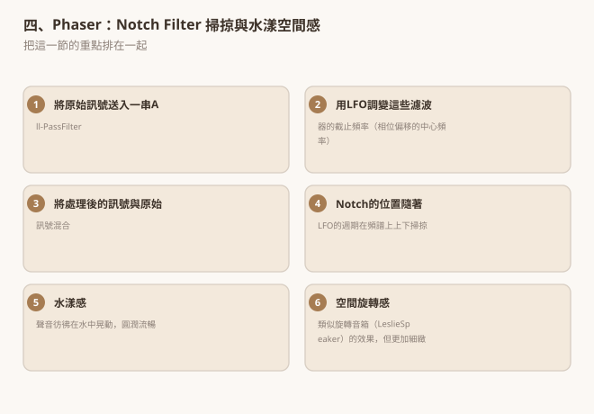

## 五、Chorus、Flanger、Phaser 的技術差異

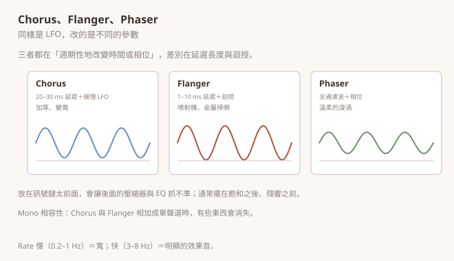

雖然三者都屬於調變效果，但從技術層面來看，它們的本質區別在於延遲時間的長短和訊號處理的方式。

### 延遲時間的比較

| 效果 | 典型延遲時間 | 調變機制 | 頻譜特徵 |
|---|---|---|---|
| Chorus | 10~30ms | 調變延遲時間 → 音高抖動 | 無明顯濾波，音高微變 |
| Flanger | 0.1~10ms | 調變極短延遲 → Comb Filter | 等間距週期性凹陷 |
| Phaser | 無（使用 All-Pass Filter） | 調變相位偏移 → Notch Filter | 非等間距 Notch |

### 聽覺差異速辨

- **Chorus**：聲音變厚、變寬，聽起來像多人合奏，沒有明顯的「掃掠感」
- **Flanger**：有明顯的「wwooosh」掃掠聲，效果強烈，帶金屬感
- **Phaser**：柔和的水漾旋轉感，像聲音在水中波動，沒有 Flanger 那麼高亢尖銳

一個實用的辨別技巧：將 Rate 調到最快——Flanger 會發出像噴射機引擎般的急促聲音；Phaser 則像快速旋轉的音箱；Chorus 則是快速顫抖但不會有明顯掃掠。

### 立體聲像的差異

- **Chorus**：最擅長擴展立體聲寬度，特別是立體聲 Chorus 能將聲音拉伸到左右極端
- **Flanger**：立體聲 Flanger 的 Comb Filter 在左右聲道可設置為相反方向掃掠，產生環繞旋轉感
- **Phaser**：立體聲 Phaser 的旋轉感最強烈，模擬 Leslie 旋轉音箱的效果極佳

## 六、Chorus 的實際應用

### Chorus 在 Vocal 上的應用

Chorus 是 Vocal 處理的萬用工具。對於主唱，輕微的 Chorus（Rate 0.3~0.6Hz，Depth 25~40%）可以讓聲音在混音中更突出，產生類似「雙軌錄製」的豐滿效果但不必真的錄兩次。對於背景和聲，Chorus 用量可增加（Rate 0.5~1.0Hz，Depth 40~60%），讓和聲聽起來人數更多、更寬廣。

經典技巧：在副歌段落自動打開 Chorus，讓主唱在副歌時聽起來更加宏亮飽滿，與主歌形成動態對比。

### Chorus 在電吉他上的應用

80 年代搖滾的標誌性聲音——Clean 電吉他加上 Chorus。從 The Police 到 Nirvana（《Come As You Are》），Chorus 讓 Clean 吉他音色變得晶瑩剔透、富有空間感。

- **Clean 節奏吉他**：Rate 0.4~0.8Hz，Depth 30~50%，可搭配輕微 Reverb 營造夢幻感
- **Clean Arpeggio**：Rate 0.3~0.5Hz，Depth 25~40%，讓分解和弦如流水般滑動
- **Distortion 吉他**：Chorus 放在破音前效果較柔和，放在破音後效果較強烈但容易產生噪音

### Chorus 在合成器上的應用

合成器是 Chorus 最自然的夥伴。許多經典合成器（如 Roland Juno-106、JX-3P、Korg Polysix）內建了不可或缺的 Chorus 電路，它們的聲音與 Chorus 密不可分。

- **Pad 音色**：Chorus 讓合成器 Pad 從單薄變成浩瀚的音牆
- **Lead 音色**：微量的 Chorus 讓主旋律線條更加流暢、有延展性
- **Bass 音色**：謹慎使用，過多的 Chorus 會讓低頻變得模糊，建議僅在 200Hz 以上增加 Chorus

### Chorus 設定建議

| 參數 | 微妙增厚 | 明顯寬度 | 最飽滿 |
|---|---|---|---|
| Rate | 0.3~0.5Hz | 0.6~1.2Hz | 1.5~3.0Hz |
| Depth | 15~30% | 35~55% | 60~80% |
| Voices | 1~2 | 2~3 | 3~4 |
| Mix | 20~35% | 40~55% | 60~75% |

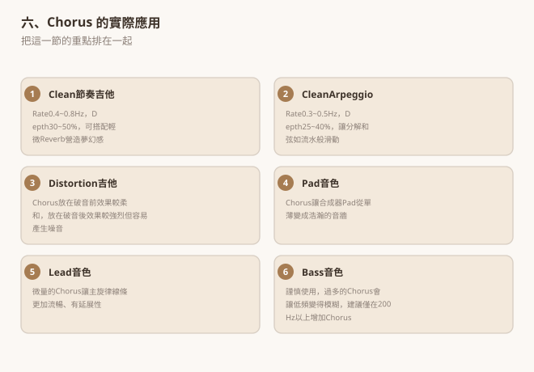

## 七、Flanger 的實際應用

### Flanger 在鼓組上的應用

Flanger 在鼓組上可以創造出極具衝擊力的效果。最經典的應用是將 Flanger 用在 Cymbal 或整個鼓組的 Bus 上，創造出類似 Van Halen《Unchained》那種戲劇性的鼓聲。（《In The Air Tonight》的鼓聲是 gated reverb，不是 Flanger。）

- **Snare 加 Flanger**：Rate 0.2~0.4Hz 慢速掃掠，Feedback 20~30%，在 Snare 擊打時產生動態變化的尾音
- **Hi-hat / Cymbal**：Rate 0.6~1.0Hz，Depth 30~50%，製造節奏性的閃爍感
- **鼓組 Bus 總線**：Rate 0.1~0.3Hz 極慢掃掠，Mix 10~20%，為整個鼓組賦予微妙的動態呼吸感

### Flanger 在吉他上的應用

Flanger 與失真吉他的結合是搖滾史上最經典的搭配之一。失真加上 Flanger，會讓原本已經很密的泛音再被掃頻推擠，聽起來更寬、更有侵略性。

- **失真節奏吉他**：Rate 0.3~0.6Hz，Depth 30~50%，Feedback 10~25%，讓 Chord 聽起來有動態的「轟鳴感」
- **Clean 吉他**：慢速 Flanger（Rate 0.2~0.4Hz）可營造類似 Chorus 但更豐富的聲音
- **Solo 吉他**：快速 Flanger（Rate 1.0~2.0Hz）搭配高 Feedback 可製造復古科幻音效

### Flanger 的創意效果

- **上升掃掠效果**：將 LFO 設為 Single Shot 或使用 Automation 手動控制 Frequency，模擬噴射機起飛的聲音
- **過渡效果**：在歌曲段落轉換處（如主歌到副歌）插入短暫的 Flanger 自動化掃掠，作為聽覺過渡信號
- **極端設定**：Rate 最大 + Feedback 最大 + Depth 最大，產生極具實驗性的共振噪音，可用於 Industrial 或實驗音樂

### Flanger 設定建議

| 參數 | 微妙動態 | 經典搖滾 | 極端效果 |
|---|---|---|---|
| Rate | 0.1~0.3Hz | 0.4~0.8Hz | 1.0~4.0Hz |
| Depth | 15~30% | 35~55% | 60~100% |
| Feedback | 0~15% | 15~35% | 40~80% |
| Mix | 15~30% | 35~50% | 50~80% |

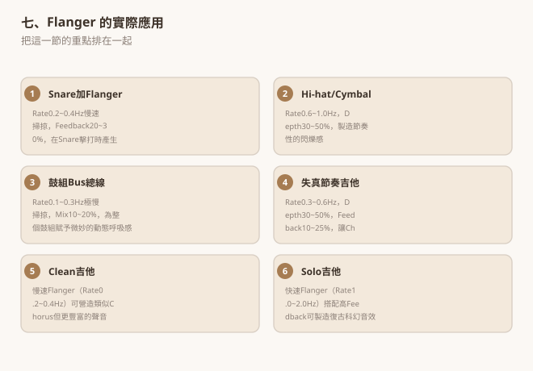

## 八、Phaser 的實際應用

### Phaser 在鍵盤與鋼琴上的應用

Phaser 與鍵盤樂器的搭配是 70 年代音樂的標誌。從 Herbie Hancock 到 Stevie Wonder，Phaser 讓電鋼琴（特別是 Rhodes 和 Wurlitzer）的聲音充滿了迷人的動態與生命力。

- **Rhodes 電鋼琴**：4-Stage Phaser，Rate 0.4~0.8Hz，Depth 30~50%。這是爵士放克音樂的必備音色
- **Acoustic Piano**：輕微 Phaser（Rate 0.2~0.4Hz，Depth 15~25%），讓原聲鋼琴在混音中更突出、更有流動感
- **Clavinet**：Phaser + Wah-Wah 是經典 Funk 音色組合

### Phaser 在節奏吉他上的應用

Phaser 在節奏吉他上的應用最為著名的莫過於 70 年代搖滾與 Funk。Pink Floyd 的經典歌曲大量使用 Phaser 在節奏吉他上，營造迷幻的空間感。

- **Funk 節奏吉他**：4-Stage Phaser，Rate 0.6~1.2Hz，Depth 30~50%，讓每一下 Strums 都帶有動態的「晃動感」
- **迷幻搖滾節奏**：Rate 0.2~0.5Hz，Depth 40~60%，慢速的 Phaser 掃掠營造出像在夢境中的漂浮感
- **Arpeggio 分解和弦**：Rate 0.3~0.6Hz，6-Stage Phaser，讓每一個音符依序通過不同的相位 Notch

### Phaser 在 Pad 與合成器上的應用

Phaser 非常適合用於長音類型的音色。合成器 Pad、弦樂、背景氛圍音色加上 Phaser 後，會從靜態的背景變成一塊「會呼吸的聲響畫布」。

- **合成器 Pad**：6~8-Stage Phaser，Rate 0.1~0.3Hz（極慢），Depth 40~70%，創造浩瀚的動態聲景
- **弦樂組**：4-Stage Phaser，Rate 0.2~0.4Hz，Depth 25~40%，增加弦樂的流動感而不失真實性
- **Ambient 效果**：多級 Phase 搭配長 Reverb 與 Delay，適合製作電影感背景音效

### Phaser 設定建議

| 參數 | 微妙水漾 | 經典復古 | 強烈旋轉 |
|---|---|---|---|
| Rate | 0.2~0.4Hz | 0.5~1.0Hz | 1.2~4.0Hz |
| Depth | 15~30% | 35~55% | 60~80% |
| Feedback | 0~10% | 10~30% | 30~60% |
| Stages | 4 | 4~6 | 6~12 |
| Mix | 20~35% | 40~60% | 60~80% |

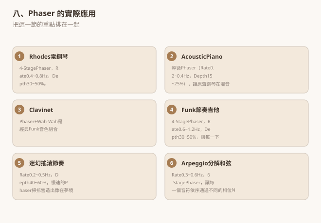

## 九、Rate、Depth、Feedback、Mix 四大參數解析

### Rate（速率）

Rate 決定 LFO 掃掠的速度，單位為 Hz（每秒週期數）或以一拍為單位的同步模式（如 1/4 Note、1/8 Note）。

- **慢速（0.1~0.5Hz）**：效果不明顯，適合營造微妙呼吸感
- **中速（0.5~1.5Hz）**：效果明顯，適合大多數應用場景
- **快速（1.5~5.0Hz）**：效果強烈，產生顫抖或旋轉的聽感

許多現代插件支援 Tempo Sync（速度同步），讓 Rate 自動與歌曲 BPM 對齊。建議將 Chorus 和 Phaser 設為 1/4 Note 或 1/2 Note 的速率，讓效果的週期與音樂的節奏同步。Flanger 則可以嘗試更短的音符值（1/8、1/16 Note）來製造節奏感。

### Depth（深度）

Depth 控制 LFO 對目標參數的影響範圍。

- **淺深度（10~25%）**：微妙的變化，幾乎不易察覺但增加了「生命感」
- **中等深度（30~50%）**：明顯的效果變化，適合多數樂器
- **深深度（55~80%）**：強烈的調變，聲音的動態範圍大
- **極深（85~100%）**：效果誇張，聲音可能不穩定，適合特殊效果

一個實用技巧：設定 Rate 時先調到最快來聽效果輪廓，調整 Depth 到想要的程度後再將 Rate 調回正常速度。

### Feedback（再生/反饋）

Feedback 僅存在於 Flanger 和部分 Phaser 中（Chorus 通常沒有或僅有極少量）。

- **正 Feedback**：增強共振峰值，效果更強烈、更金屬化
- **負 Feedback**：反轉相位，產生不同的音色質感
- **低 Feedback（0~20%）**：溫和的效果，適合背景應用
- **中 Feedback（20~50%）**：明顯的共振，經典 Flanger 聲
- **高 Feedback（50% 以上）**：極端的共振，接近自激振盪

注意：Feedback 超過某一臨界點（通常在 90% 以上）時，效果器會產生自激振盪，發出持續的尖銳嘯叫聲。這在某些實驗性音樂中被刻意使用。

### Mix（乾濕比例）

Mix 控制原始乾訊號與處理後濕訊號的比例。

- **低 Mix（10~25%）**：效果難以察覺，僅增加微量動態
- **中 Mix（25~50%）**：效果明顯但不過分，適合大多數應用
- **高 Mix（50~75%）**：效果主導，原始聲音被大幅改變
- **100% Wet**：僅輸出效果訊號（可用於特殊聲效設計）

**_關鍵建議_**：對於混音中的調變效果，建議從低 Mix（20~30%）開始，緩慢增加直到效果「剛好被注意到」的程度，然後稍微退回一點。這個臨界點是最佳的 Mix 設定，既為聲音注入了流動感，又不會讓聽眾意識到效果器的存在。

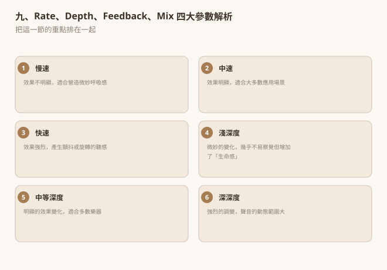

## 十、實戰組合：多個調變效果的疊加使用

使用多個調變效果時需要特別謹慎，避免產生「調變過度」導致聲音模糊、失去焦點。

### 效果疊加的基本原則

1. **總量控制**：多個調變效果的總 Mix 應控制在合理範圍內，不要讓每個效果都開到 50% 以上
2. **速率錯開**：若同時使用 Chorus + Phaser，將 Rate 設定為不同的速度（如 Chorus 0.5Hz、Phaser 0.3Hz），避免兩者同步產生週期性的「卡頓感」
3. **頻譜分工**：讓不同調變效果在不同頻率範圍作用——例如只在高頻使用 Phaser，中低頻使用 Chorus
4. **分層而非堆疊**：更好的方式是分別對不同樂器使用單一調變效果，而非在同一音軌上堆疊多個效果

### 經典組合範例

**Pink Floyd 風格的迷幻吉他**：在 Clean 吉他上先加輕微 Compressor，然後依序接入 Phaser → Chorus → Delay → Reverb。Phaser 提供掃掠動態，Chorus 增加寬度，Delay 和 Reverb 營造空間感。

**80 年代流行鼓聲**：鼓組 Bus 先掛輕微 Compressor 控制動態，然後 Chorus（Mix 15~25%），最後再接微量的 Hall Reverb。Chorus 讓鼓組聽起來更寬、更飽滿。

**電子音樂的超級 Pad**：合成器 Pad 訊號分為兩路——一路正常處理，另一路加上 Flanger（Rate 0.2Hz、Depth 60%）後用 LPF 切除高頻。兩路混合後得到既有厚度又有動態流動感的音色。

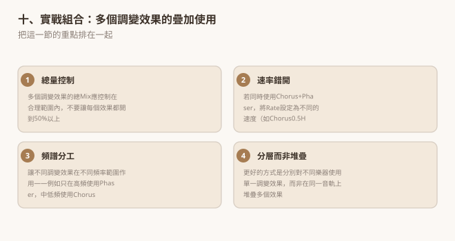

## 十一、創意調變：參數自動化與動態紋理

在現代音樂製作中，靜態的調變效果設定是不夠的——真正精彩的效果來自於參數的動態變化。

### Rate 自動化

在歌曲的不同段落改變 Rate 值，可以創造出具有敘事性的聲音變化：

- **主歌**：Rate 0.3Hz（緩慢呼吸）
- **導歌**：Rate 自動上升至 0.8Hz（逐漸緊湊）
- **副歌**：Rate 1.2Hz（節奏感強烈）
- **橋段**：Rate 回到 0.2Hz（放鬆、開闊）

### Depth 自動化

Depth 的變化直接影響效果的「強度」，適合用來強化歌曲的情緒起伏：

- **Verse 到 Chorus**：Depth 從 20% 爬升至 50%，讓副歌的「寬度感」比主歌更強烈
- **結尾長音**：Depth 逐漸增加，伴隨著長音 fade out，製造迷幻的消散效果
- **過門（Fill）**：在鼓組過門處短暫將 Depth 推高 20~30%，創造瞬間的動態變化

### Feedback 自動化

對於 Flanger 和 Phaser，Feedback 的自動化可以製造出極具戲劇性的效果：

- **段落轉換**：在進入副歌前的最後一拍，將 Feedback 短暫推高到 60~80%，產生一個「尖叫」般的過渡音效
- **歌曲結尾**：Feedback 逐漸升高直到產生自激振盪，然後用 Reverb 將這個振盪聲延展成尾聲

### 搭配 Sidechain 調變

進階技巧：利用 Sidechain 訊號觸發調變效果的參數變化。例如，使 Flanger 的 Rate 隨著大鼓的節奏同步跳動，或者讓 Chorus 的 Depth 在 Hi-hat 擊打時產生瞬間變化。這種節奏性的調變在電子音樂和現代流行音樂中非常常見。

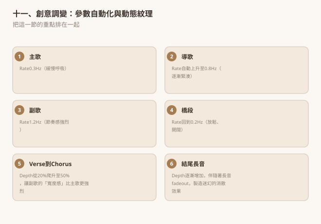

## 十二、調變效果的訊號鏈位置

調變效果在效果器鏈中的位置會顯著影響最終聲音：

### 在 Distortion / Overdrive 之前

調變效果放在破音之前，LFO 調變的是破音前的訊號，破音本身的非線性失真會放大這些調變，產生更豐富的泛音和更「狂暴」的聲音。把 Flanger 放在破音之前，是搖滾吉他最常見的用法。

### 在 Distortion / Overdrive 之後

調變效果放在破音之後，調變的是已經失真過的訊號，效果比較平滑、可控，但也比較「乾淨」。這是 Flanger 和 Phaser 更常見的擺放位置，因為效果更加可預測且易於控制。

### 在 Delay / Reverb 之前

將調變效果放在時間效果之前，使殘響和延遲處理的是已經具有動態變化的訊號，創造更複雜的空間紋理。

### 在 Delay / Reverb 之後

較少見，但可用於創造特殊的「晃動空間」效果——空間本身的聲音在持續變化，產生類似失重感的聽覺體驗。

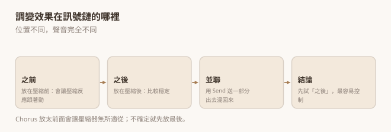

## 結語

Chorus、Flanger 與 Phaser 是音樂製作中最富有創造力的效果之一。它們能將靜態的音色轉化為充滿生命力的聲音，為混音注入流動感與動態層次。理解三者的原理差異——Chorus 是音高調變、Flanger 是極短延遲的 Comb Filter、Phaser 是全通濾波器的 Notch 掃掠——是正確選擇與運用它們的基礎。

在實際應用中，請記住「少即是多」的原則。好的調變效果應該是為聲音增添魅力而非喧賓奪主。從微妙的設定開始，仔細聆聽每一項調整帶來的變化，並善用參數自動化讓效果隨著音樂的進行而自然演變。當你能夠精準控制 Rate 的律動、Depth 的深淺、Feedback 的強弱與 Mix 的平衡，你的混音將會從靜態的二維平面躍升為動態的三維聽覺體驗。
