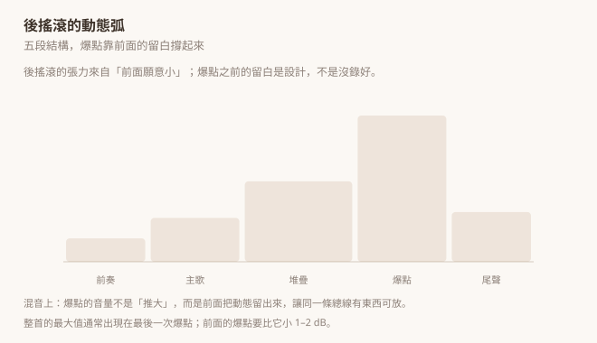

# **第 24 堂：後搖滾 (Post-rock) 實戰：大動態處理與音牆堆疊**

## 一、後搖滾的核心美學

後搖滾（Post-rock）在 1990 年代中期由 Talk Talk、Slint 等先驅奠定基礎，並經由 Explosions in the Sky、Sigur Rós、Mogwai、Godspeed You! Black Emperor 等樂團發揚光大。與傳統搖滾不同，後搖滾刻意打破「主歌—副歌」的流行結構，轉而追求**情緒敘事**與**聲音景觀**。其最顯著的標誌就是極端的**靜—響動態**（quiet-loud dynamics）：一段長達數分鐘的低語般柔軟段落，可以在數秒內爆裂成壓倒性的音牆。混音師的任務，就是在這個巨大的動態跨度中，保持每個層次的清晰度與情緒衝擊力。

## 二、極端動態的管理：從細語到爆裂

後搖滾的動態範圍經常超過 20 dB，遠高於一般流行音樂的 6–10 dB。這對混音的動態控制提出了獨特挑戰。

### 2.1 音量自動化是核心工具

古典樂式的音量自動化（volume automation）是後搖滾混音最重要的武器。在靜謐段落，主奏樂器可能需要低至 -24 LUFS，而高潮段落則衝上 -8 LUFS 甚至更高。不要依賴壓縮器來完成這項工作——壓縮器只能縮小動態，無法**塑造情緒弧線**。手動繪製音量自動化曲線，讓每一段 crescendo（漸強）都像真實的現場演奏那樣有機。

### 2.2 動態範圍的保留策略

後搖滾的魅力來自於它的「呼吸感」。混音時刻意保留 12–15 dB 的真實動態，不要用大量壓縮或限制器把整首歌壓平。可以在最終的母帶限制器上僅做 2–3 dB 的峰值捕捉，而不是用主流流行音樂的「響度戰爭」手法。聽眾在安靜段落時會不自覺地調高音量，然後在爆炸段落感受到震撼——這是後搖滾體驗的一部分。

### 2.3 分層級的動態控制

不要在所有軌道上做同樣的壓縮處理。建議採用分層策略：
- **單軌**：僅做極輕的壓縮（ratio 1.5:1–2:1），主要目的是控制意外峰值而非改變動態。
- **編組匯流排**：這裡可以做 3:1–4:1 的中等壓縮，將整個吉他組或鼓組黏合起來。
- **主匯流排**：只做輕微的 glue compression（ratio 1.5:1，threshold 僅吃 2–3 dB）。

這種分層策略可以在保留微觀動態的同時，控制宏觀的動態結構。

## 三、吉他音牆的建造技術

後搖滾的標誌性聲音：一堵厚重、綿延不絕的吉他音牆（wall of sound）。但這並非只是把音量開大，而是需要精心的層疊與頻率管理。

### 3.1 多層吉他錄音策略

建造音牆的基礎是**多軌疊加**。一首後搖滾作品通常有 4–6 軌甚至更多的吉他音軌。每軌扮演不同的角色：

- **Clean 層（clean arpeggios）**：使用單線圈拾音器，Fender 風格的清亮音色。通常在左右聲道各錄一軌，擔任節奏骨架。EQ 上保留較多中高頻（2–5 kHz），讓琶音有穿透力但不刺耳。
- **Drive 層（overdriven chords）**：使用中增益破音，彈奏開放和弦或五和弦。雙軌各 pan 至 L30/R30，建立音牆的中頻厚度。這層是音牆的「肉」。
- **Fuzz 層（sustained wall）**：使用大 fuzz 效果器（如 Big Muff），在高增益下演奏長音或緩慢的掃弦。這層通常 mono 置中或微偏，提供持續的音量支撐。低頻滾降（high-pass at 100–120 Hz）避免與貝斯打架。
- **Feedback / 泛音層**：利用吉他靠近音箱產生的 feedback，或自然泛音（harmonic），創造音牆中的「嘶嘶聲」與不確定感。這是情緒張力的來源。
- **Slide / 特殊技法層**：使用滑管（slide）或 Ebow（電子弓）演奏持續音，讓音牆中有一條持續不墜的旋律線。

### 3.2 音牆的頻率分配

當多軌吉他疊加時，最容易出現的問題是頻率打架。建立一個清晰的頻率分配計劃：

- **40–100 Hz**：留給貝斯與大鼓。
- **100–250 Hz**：吉他音牆的「低腰」部分。太多會導致混濁，需要謹慎處理。在 fuzz 和 drive 層做適度的低切（high-pass at 80–100 Hz），clean 層則可以切到 120–150 Hz。
- **250–800 Hz**：音牆的「身體」。這裡需要保留足夠的能量讓音牆聽起來豐滿，但也要注意不要堆積過多。drive 層是這個頻段的主力。
- **800 Hz–2 kHz**：音牆的「存在感」。適度削減（-2 到 -4 dB）可以讓多軌疊加時不那麼擁擠。
- **2–5 kHz**：clean 層的領地。這裡是琶音與音符細節的所在，fuzz 層在這裡應該被大量衰減。
- **5–10 kHz**：feedback 與空氣感。整體可以略做提升，但要注意避免刺耳。

### 3.3 立體聲場的設計

後搖滾的立體聲場通常比一般搖滾更寬、更富戲劇性：

- **Clean 層**：L80/R80，極寬的 pan，創造廣闊的空間感。
- **Drive 層**：L30/R30，在置中附近建立穩固的中頻。
- **Fuzz 層**：置中或 L15/R15，提供集中的衝擊力。
- **特殊效果層**：使用自動 pan 或隨機 pan，讓聲音在空間中緩慢移動。

在混音時，持續監聽 mono 相容性。雖然後搖滾愛用寬廣的 stereo，但許多聽眾仍會在手機或藍芽喇叭上聆聽。確保音牆在 mono 下仍有足夠的厚度和清晰度。

## 四、空間效果：Reverb 與 Delay 的藝術

後搖滾的聲音景觀高度依賴空間效果。但關鍵在於**質感而非數量**——不是加很多，而是加對地方。

### 4.1 Reverb 的層次配置

建議使用 3–4 個不同的 reverb send：

1. **短板 Room Reverb**（decay 0.5–1.2 秒）：用於鼓組和節奏吉他，模擬小型錄音室的自然空間。增加凝聚感而不模糊音頭。
2. **中板 Hall Reverb**（decay 1.5–2.5 秒）：用於主旋律樂器和 lead 吉他，創造「在一個中型音樂廳中」的感覺。pre-delay 設為 30–50 ms，保持音符清晰。
3. **長板 Cathedral/Shimmer Reverb**（decay 4–8 秒）：這是後搖滾的招牌空間。用於情緒高點和鋪底音色。加入微量的 pitch-shifting（+1 octave 混入極小量）可以產生 Sigur Rós 式的 shimmer 效果。
4. **Reverse Reverb**：這幾乎是後搖滾的標誌性效果。將 reverb tail 反轉使用，連接在音符之前營造「吸入」般的感覺。最經典的用法是在 crescendo 爆發的前一拍加入 reverse reverb，製造爆炸前的窒息感。

### 4.2 Delay 的運用

- **雙軌延遲**：將一個乾淨的延遲 send 分別送至左右聲道，左聲道設為 8 分音符、右聲道設為附點 8 分音符。這會創造一個寬廣的、像在峽谷中迴盪的效果。
- **類比延遲**：使用模擬 tape delay 的外掛（如 EchoBoy、Replika），加入適量的 wow & flutter，讓延遲聲不那麼完美，增加有機感。
- **Filtered Delay**：在 delay send 上加入 low-pass filter（6–8 kHz 截止），讓延遲的重複聲越來越暗，模擬聲音在遠處消散的自然現象。

### 4.3 空間效果的 automation

後搖滾中，reverb 和 delay 的 send level 應該是動態的。在安靜段落，加大 reverb send（讓樂器融入空間）；在爆炸段落，略微減少 reverb（讓樂器更直接、更有衝擊力）。這種 automation 會讓空間本身成為編曲的一部分。

## 五、鼓組製作：巨大、空間感、力量感

後搖滾的鼓組製作追求的不是「自然」，而是**史詩感**。鼓應該聽起來像在一個巨大的教堂或廢棄倉庫中演奏。

### 5.1 大鼓與小鼓的聲音設計

- **大鼓（Kick）**：需要厚實的 low-end（50–60 Hz 增加重量感）和清晰的擊打聲（3–5 kHz 的 click）。使用壓縮 ratio 4:1–6:1，attack 慢（20–30 ms），release 快，讓 kick 有「推出去」的感覺。高潮段落時，可以 automation 增加 kick 的 level 2–3 dB，讓每一次擊打都像心臟跳動。
- **小鼓（Snare）**：後搖滾的小鼓通常有長長的尾巴和大量的 room sound。錄音時就應該把 overhead 和 room mic 錄好，混音時大量使用 room track。在小鼓上使用 parallel compression：將小鼓訊號複製到一條壓縮極重（ratio 10:1，較高 threshold，attack 快）的 aux 軌道上，與原信號混合。這個「New York compression」技巧讓小鼓既有自然的 attack，又有厚厚的 body。

### 5.2 Room Mic 的爆炸性處理

後搖滾鼓組的秘密武器是 room microphone。將鼓組 room 訊號做以下處理：
- 大量壓縮（ratio 10:1 甚至無限比），attack 慢（10–20 ms），release 中快。
- 加入飽和（saturation）或 tape emulation，讓 room sound 聽起來像被推到了極限。
- 加入長 reverb（decay 2–3 秒），讓 room sound 本身就像一個樂器。
- 在高潮段落，將 room track 的 fader 大幅拉高，讓空間聲爆炸出來。

### 5.3 鈸與 Crash 的處理

後搖滾的鈸聲通常比一般搖滾更「大氣」。Crash cymbal 可以加大量 reverb，讓每一次 crash 都像一波巨浪。但要注意：過多的鈸在高潮段落會導致聽覺疲勞。可以使用 automation 在 crescendo 的高點略為降低 overhead 軌道 1–2 dB。

## 六、Crescendo 的建構：從低語到轟鳴

後搖滾的核心功力在於建構 crescendo——一段從極靜到極響的情緒旅程。

### 6.1 Arrangement 層面的漸強技巧

- **元素遞增**：從單一樂器開始（例如一把 clean 吉他彈奏動機），然後逐層加入第二吉他、貝斯、鼓的 hi-hat、小鼓、大鼓、crash……每一層的加入都讓張力提升一個台階。
- **節奏壓縮**：在 crescendo 的過程中，節奏型態從寬鬆的八分音符逐漸變密集——四分音符 → 八分音符 → 十六分音符 → 三連音。節奏密度本身就是張力的指標。
- **音域擴張**：從中音域開始，隨著 crescendo 發展，低音域（貝斯、大鼓）和高音域（crash、feedback）同時加入，形成全頻段的衝擊。

### 6.2 混音層面的漸強輔助

- **Filter automation**：在 crescendo 開始時，使用 high-pass filter 將低頻逐漸濾除（例如從 20 Hz 緩慢上升到 150–200 Hz），然後在爆炸的瞬間將 filter 急遽打開，讓低頻像洪水般衝出。
- **Width automation**：在安靜段落使用較窄的 stereo image，隨著 crescendo 逐漸加寬，到高潮時達到最寬。可以使用 stereo imager 工具自動化 width 參數。
- **Volume automation**：最直接且最有效。不要害怕畫上大幅度的音量曲線——後搖滾的聽眾期待的就是這種動態。
- **Reverb automation**：在 crescendo 前的最後幾拍，大幅增加 reverb send（製造巨大的空間感），然後在爆炸的瞬間降低 reverb，讓樂器直接擊中聽眾。

### 6.3 爆炸點後的釋放

一個好的 crescendo 不只是「越來越大聲」，更在於**爆炸後的處理**。常見的手法有：
- **完全 silence**：在高潮的頂點突然全部靜音，留下巨大的期待感。
- **突然減速**：鼓從密集的十六分音符驟降為四分音符甚至更慢，形成節奏的「減壓」。
- **音色崩塌**：使用大量的 feedback、失真、或 pitch-bend，讓音高和音色在爆炸後「碎裂」。

## 七、壓縮策略：溫柔 vs 激進

| 段落 | 動態 | 混音重點 |
|---|---|---|
| 前奏 | 很小 | 保留房間音與雜訊 |
| 主歌 | 小到中 | 主唱清楚，鼓組留空間 |
| 堆疊 | 中 | 逐層加入，不要一次全開 |
| 爆點 | 最大 | 低頻與失真一起進來 |
| 尾聲 | 收 | 讓殘響尾巴負責收尾 |

後搖滾的壓縮哲學與流行音樂截然不同。流行音樂追求「穩定且大聲」，後搖滾追求「動態且情緒化」。

### 7.1 單軌壓縮：輕柔的觸碰

對大部分樂器使用溫和的壓縮設定：
- **Ratio**：1.5:1–2.5:1
- **Threshold**：僅捕捉最高 6–8 dB 的峰值
- **Attack**：10–30 ms（讓音頭通過）
- **Release**：40–80 ms（自然回收）
- **Makeup gain**：僅補償壓縮降低的音量，不要刻意「推大」

### 7.2 匯流排壓縮：黏合劑

在吉他編組、鼓編組和主匯流排上使用更積極的壓縮：
- **Ratio**：3:1–4:1
- **Threshold**：捕捉 4–6 dB 的壓縮量
- **Attack**：10–15 ms
- **Release**：自動或中速（約 100 ms）
- 這層壓縮的目的是將多軌黏合成一個統一的聲音，而非控制動態。

### 7.3 Parallel Compression：保持動態的秘密武器

這是後搖滾最重要的壓縮技巧之一。將訊號複製到一條 aux 軌道，進行極重的壓縮（ratio 10:1，attack 快，release 慢），然後與原來的乾信號混合。這樣做的好處是：
- 保留了原信號的完整動態。
- 同時獲得壓縮帶來的厚度和持續感。
- 可以只在高潮段落 automation 增加 parallel 層的混合量。

## 八、Reverse Reverb、Swells 與聲音設計

### 8.1 Reverse Reverb 實作

1. 將一段音訊（吉他音符或小鼓 hit）複製到新軌道。
2. 加入一個 long reverb（decay 3–5 秒），將 reverb 渲染成音訊。
3. 將這個 reverb 音訊反轉（reverse）。
4. 將反轉後的 reverb 放置在原始音符前。
5. 混音時，反轉 reverb 的音量應比原始音符低 6–10 dB。

聽起來就像有一個「吸入」般的聲音在音符前積累能量。這個技巧在吉他旋律線和 crash cymbal 上效果極佳。

### 8.2 Guitar Swells

Swell 是後搖滾的標誌性技法：吉他音符從無聲平滑地升起。實作方式有幾種：
- **音量踏板**：現場錄音時使用音量踏板控制音符的 fade-in。
- **自動化**：在 DAW 中手動繪製音量曲線。
- **Sidechain compressor**：用一個輔助訊號觸發壓縮器的 release，模擬 swell 效果。

混音時，swell 軌道通常需要比其他吉他軌道更多的 reverb，並且在高潮段落可以做 automation 讓 swell 的音量緩慢上升，就像遠方來的風暴。

### 8.3 Field Recordings 與 Texture

許多後搖滾作品會融入實地錄音（field recordings）：雨聲、風聲、遠處的交通、錄音帶噪音、收音機雜訊。混音時將這些 texture 軌道放在立體聲場的極邊緣（L80–100/R80–100），音量僅 -20 到 -30 dB，它們不應該被「聽見」，而是應該被「感覺」到。在安靜段落，這些 texture 會顯現出來，為音樂增加一層無意識的空間感。

## 九、沉默與留白的角色

後搖滾教給混音師最重要的一課：**沉默是最強大的樂器**。在混音時請注意：

- 不要在段落之間使用淡出（fade-out）來掩蓋編輯點；留白應該是突然且完整的。
- 在極靜段落之後的爆炸，聽覺衝擊力是任何壓縮器都無法模擬的。
- 在主歌段落，刪掉所有不必要的元素——只留一把吉他和稀疏的鼓，讓聽眾在留白中感受空間。
- 使用 noise gate 去除錄音中的底噪並**不總是正確的**。後搖滾允許甚至鼓勵錄音的自然噪音（吉他音箱的嘶聲、手指在琴弦上的滑動聲）成為音樂紋理的一部分。

## 十、實戰混音：從安靜主歌到爆炸高潮

讓我們逐步演練一個典型的後搖滾混音流程。假設曲目結構為：Intro（安靜）→ Verse（中低）→ Build-up（漸強）→ Climax（爆炸）→ Outro（消散）。

### Step 1：Intro 段落混音（0:00–0:30）

- 僅有兩軌 clean 吉他（L75/R75）和一軌 field recording。
- **EQ**：clean 吉他在 150 Hz 以下做 high-pass，保留中高頻的清晰度。
- **Reverb**：使用長板 hall reverb send（decay 5 秒），send level 較高（-10 dB）。
- **動態**：幾乎無壓縮。讓吉他琶音自然地呼吸。
- **音量**：整體約 -24 LUFS，刻意安靜。

### Step 2：Verse 段落（0:30–1:30）

- 加入貝斯（mono 置中）和鼓組（hi-hat + 小鼓輕打）。
- **EQ**：貝斯在 60 Hz 提升 3 dB，high-pass at 40 Hz。小鼓在 200 Hz 削減 3 dB 減少盒狀感。
- **壓縮**：鼓組加入輕微的 bus compression（ratio 2:1），貝斯使用 gentle compression（ratio 2.5:1）。
- **空間**：加入貝斯的 reverb send（使用短版 room，send level -15 dB），讓貝斯不那麼乾。
- **音量**：約 -20 LUFS，較 intro 提升了 4 dB。

### Step 3：Build-up 段落（1:30–2:30）

- 加入第二層 drive 吉他（L30/R30）、hi-hat 轉為八分音符、小鼓加入 ghost notes。
- **自動化**：開始繪製 filter automation——在 1:30 到 2:30 之間，master bus 上的 low-pass filter 從 20 kHz 緩慢下降至 12 kHz，讓聲音逐漸變暗、有壓迫感。
- **Reverb automation**：逐步增加各軌道的 long reverb send（從 -15 dB 升至 -8 dB），營造空間逐漸變大的錯覺。
- **壓縮**：吉他 bus 的 compression ratio 從 2:1 調整到 3:1（threshold 降低 2 dB），開始施加更多控制。
- **音量**：緩慢提升至 -16 LUFS。

### Step 4：Climax 段落（2:30–3:00）

- **爆炸瞬間**：在 2:30 的瞬間全員進入——fuzz 吉他、大鼓十六分音符、crash cymbal、全部樂器全力演奏。
- **Filter 驟開**：將 low-pass filter 瞬間打開至 20 kHz，低頻如洪水湧入。
- **音量**：立即跳升至 -9 LUFS。這個 7 dB 的跳躍是經過精心計算的——聽眾的生理反應會是心跳加速。
- **Room sound**：鼓組的 room track 音量推至最高，crash 的 reverb send 拉到 -5 dB。
- **壓縮**：此時 bus compressor 可能吃到 5–6 dB 的壓縮量，這是合適的——它提供了高潮的「擠壓感」。但請確保 attack 時間夠慢（20 ms 以上），讓音頭不被吃掉。
- **立體聲寬度**：使用 stereo imager 將寬度從 100% 提升至 130–140%（注意 mono 相容性）。

### Step 5：Outro 段落（3:00–3:30+）

- 從高潮中突然撤離——只留下 fuzz 吉他的 feedback 和長 reverb tail。
- **自動化**：將 reverb send 大幅拉高至 -3 dB，讓殘響持續消散。主音量自動化從 -9 LUFS 在 5–10 秒內降至 -30 LUFS。
- **Texture**：最後只剩 field recording 和微弱的吉他 feedback，持續 15–20 秒後 fade out。

## 十一、參考樂團與混音特徵分析

以下是後搖滾三大代表樂團的混音特徵，可作為調音時的參考目標：

### Explosions in the Sky

- **特徵**：雙吉他（有時三吉他）構築的綿密音牆。吉他音色偏 mid-gain，clean 與 drive 交替使用。
- **混音要點**：吉他中頻（800 Hz–2 kHz）略為凹陷，讓多層吉他不會打架。鼓組的 room sound 極大，是混音中最突出的元素之一。整體動態保留極好，安靜段落可低至 -26 LUFS，高潮達 -10 LUFS。
- **標竿曲目**："Your Hand in Mine"、"First Breath After Coma"

### Sigur Rós

- **特徵**：壓倒性的空間感、Jónsi 的 falsetto 人聲、大量 shimmer reverb、bow 演奏吉他。
- **混音要點**：reverb 的量幾乎是其他類型音樂的兩倍。人聲通常混入極長的 reverb（decay 6–10 秒），並在 reverb 上加入 pitch-shift +1 octave。低頻極深（sub-bass 段落），但貝斯的音符持續時間很長，混音時需要給低頻足夠的空間。
- **標竿曲目**："Hoppípolla"、"Sæglópur"

### Mogwai

- **特徵**：比前兩者更「重」、更「髒」。大量使用 fuzz 和失真。dynamic 的對比極為極端——從幾乎無聲到震耳欲聾。
- **混音要點**：fuzz 吉他的低頻通常比傳統混音更多（保留到 80–100 Hz），與貝斯共享低頻區域。這需要仔細的 sidechain 處理：用貝斯 sidechain 觸發吉他 bus 的壓縮器，在貝斯擊弦時稍微壓低吉他的低頻（2–3 dB）。鼓組的 kick 和 snare 在混音中非常靠前，攻擊性強。
- **標竿曲目**："Mogwai Fear Satan"、"Like Herod"

## 十二、後搖滾混音檢查清單

混音完成後，用這份清單檢查是否達到專業水準：

- [ ] 動態範圍是否保留了 12–15 dB（LUFS 差）？
- [ ] 安靜段落是否真的夠安靜（-20 LUFS 以下）？
- [ ] 高潮段落是否有足夠的衝擊力（-10 LUFS 左右）？
- [ ] 吉他音牆是否在 mono 下仍然厚實？
- [ ] 多層吉他是否有清晰的頻率分工，沒有打架？
- [ ] reverb 是否使用多層次配置，且在 automation 下動態變化？
- [ ] 鼓組的 room sound 是否有被充分利用？
- [ ] crescendo 的 automation 是否平滑且富有情緒曲線？
- [ ] 是否有使用 silence / 留白作為編曲元素？
- [ ] field recordings 或 texture 層是否在合適的音量（若隱若現）？
- [ ] 與參考曲目（如 Explosions in the Sky 的曲目）做 A/B 對比，聽感是否在同一水準？

## 結語

後搖滾混音與其說是「技術」，不如說是「敘事」。你不再只是調整 EQ 和壓縮參數，而是在塑造一條情緒弧線——從寂靜到轟鳴，再回到寂靜。每一個 automation 曲線都是一個故事的轉折，每一個 reverb tail 都是一個回憶的殘影。當你成功讓聽眾在最後一個音符消失後，仍然在沉默中等待了 10 秒才意識到音樂已經結束——那就是後搖滾混音的最高成就。
