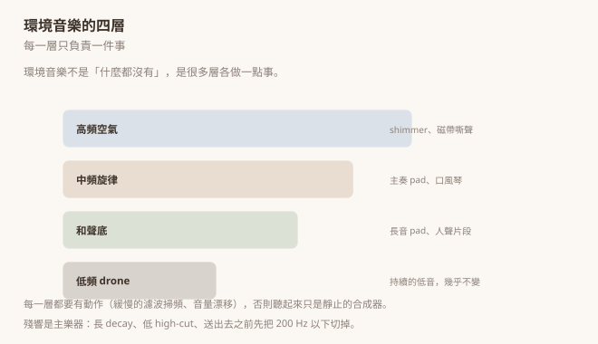
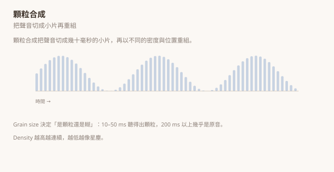

# **第 25 堂：環境音樂 (Ambient) 實戰：深度空間與低頻控制**

環境音樂（Ambient Music）是一種以氛圍、紋理與空間感為核心的音樂類型，由 Brian Eno 在 1970 年代正式定義。Eno 曾描述 Ambient 音樂應該是「既有趣又可以被忽略」的——它不強迫聽眾的注意力，卻能深刻地影響空間的情緒與感知。本堂課將從實戰角度出發，深入探討如何打造富有深度、層次與低頻控制力的 Ambient 作品。

---

## 什麼是環境音樂？

環境音樂的核心特質包括：

- **氛圍重於旋律**：重點不在於明確的主題或 hook，而在於聲音織體所創造的情緒與空間感。
- **緩慢演化**：段落變化極其細微，和弦與聲音可能持續數分鐘才發生變化。
- **空間即樂器**：殘響（Reverb）、延遲（Delay）與全景（Panning）不再是「效果器」，而是音樂的主體結構。
- **低調的低頻**：低頻必須深沉、寬廣，但絕不壓迫或轟鳴。
- **非線性敘事**：沒有傳統的主歌/副歌結構，而是以聲景（Soundscape）的方式流動。

Ambient 的風格跨度極廣，從 Brian Eno 的《Music for Airports》這種純粹的氛圍音景，到 Stars of the Lid 的 drone 取向，再到 Tim Hecker 的噪音/氛圍融合，甚至是近年來與電子音樂融合的 Ambient Techno、Ambient House。無論哪個分支，空間與低頻控制始終是技術核心。

---

## 打造 Pad 音色：疊層、濾波與緩慢調變

Pad 是 Ambient 音樂的聲音基石。與其他曲風不同，Ambient 的 Pad 不能只是靜止的和弦——它們必須呼吸、變化。

### 疊層原則

使用 3 至 4 層音色疊加，每層負責不同的頻率範圍：

1. **底層**：純淨的正弦波或 Saw 波，八度降低，負責低頻支撐。使用低通濾波器（LPF）將 cutoff 設在 200–400 Hz。
2. **中層**：豐富的和聲內容，使用 SuperSaw 或 wavetable 合成器，濾波在 800 Hz–2 kHz 之間。添加少量 chorus 增加立體感。
3. **高層**：輕柔的弦樂取樣或 FM 合成鈴聲，濾波在 4 kHz 以上，提供空氣感。
4. **紋理層**：不規則的噪音或顆粒聲，極度壓縮且混入大量殘響，作為背景織理。

每一層各自獨立的 LFO（Low Frequency Oscillator）調變 filter cutoff 或 volume，速度設定在 0.05–0.2 Hz（週期 5–20 秒），創造近乎察覺不到的緩慢波動。

### Filter Automation 實戰

在 DAW 中畫一條長達 8–16 小節的 filter cutoff 自動化曲線：

- 起點：cutoff 500 Hz，低共鳴
- 中段：cutoff 緩緩上升到 2 kHz，共鳴逐漸增加
- 尾段：cutoff 回到 800 Hz，volume 漸弱

這個簡單的自動化就能讓一個靜止和弦在兩分鐘內產生豐富的動態。

---

## 殘響：環境音樂的主樂器

| 層次 | 內容 | 處理方式 |
|---|---|---|
| 低頻 drone | 持續低音 | 幾乎不動，只微調濾波 |
| 和聲底 | 長音 pad | 慢速 chorus、低 high-cut |
| 旋律 | 主奏音色 | 少量 delay，保持可辨識 |
| 空氣 | shimmer、雜訊 | 高通、放寬聲像 |

在 Ambient 中，殘響不是「加一點空間感」，它就是樂器本身。正確使用殘響是區分「業餘氛圍」與「專業 Ambient」的關鍵。

### 大廳殘響與無限衰減

設定一個 Plate 或 Hall 類型的殘響：

- **Decay Time**：6–15 秒（傳統音樂很少超過 3 秒）
- **Pre-Delay**：50–200 ms，讓聲音在反射前先抵達聽者
- **Diffusion**：70–90%，讓聲音擴散均勻，避免明顯的回聲感
- **High Damping**：40–60%，削減高頻防止過亮
- **Low Damping**：0–10%，保留低頻的厚度

將 Pad 或紋理聲的 Send 量開到 70–100%，讓乾聲幾乎被殘響淹沒，創造出聲音在巨大洞穴中迴盪的效果。

### 無限衰減技巧

要做出永不停止的殘響尾音，可以將殘響的 Decay 推至最大，然後在殘響後串接一個 Compressor 和 Limiter：

- Compressor：Ratio 4:1，Threshold -20 dB，讓殘響尾音的動態被壓平
- Limiter：Ceiling -1 dB，確保殘響不會爆音

這個組合會讓殘響尾音以幾乎恆定的音量持續下去，形成無止盡的聲音光暈。

### 卷積殘響

卷積殘響（Convolution Reverb）使用真實空間的脈衝響應（Impulse Response, IR），可以創造出合成殘響無法比擬的真實空間感。

常用 IR 類型：

- **教堂和大教堂**：提供極長的衰減時間（10–20 秒）和豐富的早期反射
- **地下停車場或隧道**：獨特的低頻共鳴和金屬反射感
- **空曠倉庫**：中頻擴散均勻，適合墊在 Pad 下方
- **自然空間**：峽谷、洞穴錄製的 IR，提供不規則且充滿生命感的殘響

實戰技巧：將同一個聲音分別送入 Plate 殘響和卷積殘響，兩個殘響的 wet signal 再各自 pan 到左右聲道，可以創造出極具立體感的空間。

---

## 低頻設計：Drone 與 Sub-Bass

Ambient 的低頻不同於舞曲——它不追求衝擊力，而是追求持續的包覆感與身體共鳴。

### Sub-Bass Drone

使用純正弦波或非常少的泛音：

1. 選擇一個根音（例如 C2，約 65 Hz）
2. 複製兩軌，一軌比原音高一個八度（C3），另一軌高純五度（G2）
3. 三軌混音時，C2 與 G2 置中，只有 C3 pan 到左或右 20%，其餘保持單聲道。
4. 各軌添加獨立的 LFO 調變音量，速率約 0.08 Hz（週期 12 秒）

這樣做出來的 drone 會像大地的低吟，穩定但帶有微妙的動態。

### 避免低頻模糊的關鍵

低頻最常遇到的問題就是「模糊」（Muddy）。以下是實戰解決方案：

1. **高通濾波非低音樂器**：所有不負責低頻的軌道（Pad、殘響尾音、紋理聲）都掛上 HPF，斜率 12 dB/oct，cutoff 設在 80–150 Hz。
2. **Sidechain 共存**：如果同時有 Drone 和 Kick Drum，用極慢的 Sidechain Compression（release 500 ms–1 s）讓 drone 在 kick 擊發時稍微退讓，但以人耳無法察覺的速度恢復。
3. **頻率雕刻**：使用動態 EQ（如 FabFilter Pro-Q 3 或 TDR Nova），在 drone 的基頻（如 65 Hz）做一個窄頻（Q=4）的動態衰減 1–2 dB，當其他低頻能量過高時自動壓低該頻段。
4. **單聲道低頻**：將 120 Hz 以下的內容彙整成單聲道，避免低頻相位抵消導致某些聆聽位置完全失去低音。

### 低頻微動

Ambient 的低頻不該完全靜止。嘗試以下技巧：

- 在 sub-bass 上使用極慢的顫音（Vibrato），rate 0.1 Hz，depth 5–10 cents，創造微微搖曳的感覺。
- 使用自動化控制 sine wave oscillator 的頻率，在一個半音範圍內緩慢滑動（微升再降回），週期 30–60 秒，讓 drone 有生命的呼吸感。

---

## 田野錄音與聲音紋理

田野錄音（Field Recording）是 Ambient 製作中最強大的紋理素材來源。

### 錄音素材類型

- **風聲與樹葉摩擦**：中高頻噪音，可作為背景織理
- **雨聲與流水**：豐富的隨機節奏與頻率分佈
- **腳步聲與遠處人聲**：增添敘事感
- **機械運轉聲**：冷冽的工業氛圍
- **電磁干擾與無線電雜訊**：Lo-fi 質感

### 實戰處理

1. 載入一段田野錄音素材
2. 使用 Band-pass Filter，讓 cutoff 在 500 Hz–3 kHz 之間緩慢掃動
3. 添加 Shimmer Reverb（帶 pitch shifting 的殘響），創造夢幻的高頻光澤
4. 使用 Gate 或 Tremolo 效果，讓聲音以不規則的間隔出現和消失
5. 再用一個長 Decay 的殘響將處理後的聲音融入背景

田野錄音不應該搶眼——它應該是「剛剛好被注意到，但更多時候被感覺到」的存在。

---

## 顆粒合成：打造永不重複的紋理

顆粒合成（Granular Synthesis）是 Ambient 音樂的秘密武器。它能將任何聲音打碎成極小的片段（顆粒），再以新的順序、速度和密度重組，創造出永遠不會完全相同的聲音織體。

### 實用工具

- **Granulator II**（Max for Live）：Ableton Live Suite 附帶的顆粒合成器
- **Quanta**（Audio Damage）：獨立顆粒合成器 VST
- **Borderlands Granular**（App）：iOS 上的顆粒合成應用

### 實戰步驟

1. 載入一段長音素材（弦樂長音、人聲吟唱、或 drone）
2. 設定 Grain Size 為 50–200 ms
3. Density：10–30 grains/秒
4. Pitch 隨機化：±20 cents（輕微）
5. Position 隨機化：20–50%（從素材的不同位置取樣）
6. 播放速度：0.2–0.8x（放慢）
7. 輸出通過長殘響

結果是一個像雲霧般不斷變化的聲音——聽起來源自某個原始素材，但永遠不會重複自己。

---

## 敘事感：沒有主歌副歌的動態曲線

Ambient 雖然沒有傳統結構，但不等於沒有動態。專業的 Ambient 作品有清晰的「隱性動態曲線」：

### 三段式結構範例

**第一階段（0:00–2:00）——建立空間**

- 以田野錄音或輕微噪音開場
- 極淡的 sub-bass drone 逐漸 fade in
- 一個長殘響的 Pad 和弦從遠處浮現
- 音量曲線：從 ppp 到 pp

**第二階段（2:00–5:00）——紋理交織**

- 第二個不和諧或調式外音 Pad 加入，製造張力
- 顆粒合成紋理在高頻區浮動
- 殘響尾音堆疊，空間感達到最大
- 低頻 drone 的過濾器緩緩打開
- 音量曲線：從 pp 到 mf

**第三階段（5:00–8:00）——消散**

- 高頻紋理逐漸淡出
- 低頻 drone 回到最低點
- 一個新的和諧 Pad 取代原有的和弦，帶來釋放感
- 最後回歸田野錄音，形成首尾呼應
- 音量曲線：從 mf 回到 ppp

這個結構提供了情感的旅程，儘管沒有任何一個小節可以被稱為「副歌」。

### 自動化清單

建立一個自動化清單來控制整首作品的宏觀動態：

- **Master Volume**：整體音量跟隨三段式曲線
- **Reverb Send**：第二階段推高，第三階段緩緩降低
- **Filter Cutoff**：所有軌道的總體 cutoff 隨情緒上升而打開
- **Stereo Width**：使用 imager 插件控制寬度，第二階段最寬，第三階段回歸 mono
- **Noise Floor**：在段落轉換時引入少量的 tape hiss 或 vinyl noise，增加連貫性

---

## 實戰 Walkthrough：Drone + 紋理 + 演化

讓我們實際組裝一首短小的 Ambient 作品：

### 步驟 1：建立 Drone 基底

- 使用 Serum 或 Vital 合成器，兩個正弦波 oscillator：C2（65 Hz）和 G2（98 Hz）
- LFO 1 調變 Volume（rate 0.05 Hz，depth 30%）
- LFO 2 調變 Filter Cutoff（rate 0.1 Hz，depth 20%）
- 掛上 ValhallaShimmer 或類似的 shimmer 殘響（decay 12 s，mix 60%）

### 步驟 2：加入 Pad 層

- 第二個合成器：SuperSaw 演奏 Cmaj7 和弦（C E G B）
- 高通濾波 150 Hz，避免低頻重疊
- Chorus 效果量 40%
- 再送一個 Plate 殘響（decay 8 s，mix 70%）

### 步驟 3：顆粒紋理

- 載入一段弦樂長音到 Granulator II
- Grain size 120 ms，density 20/s
- 輸出經 Band-pass filter（800 Hz–4 kHz，cutoff 以 LFO 0.15 Hz 掃動）
- 音量極低，僅作為背景織理

### 步驟 4：空間元素

- 一段雨聲田野錄音，HPF 200 Hz
- 加入 Stereo Delay（左右各 400 ms 和 500 ms，feedback 30%）
- 再送卷積殘響（教堂 IR，mix 50%）

### 步驟 5：整理與混音

- 所有非低頻軌道 HPF 100 Hz
- 低頻 drone 的頻譜集中在 60–120 Hz
- 使用 SPAN（免費頻譜分析儀）檢查低頻是否均衡
- 整體混音 -14 LUFS（適合串流平台）
- Master Bus 掛上一個非常輕微的 Compressor（Ratio 1.5:1，Threshold -18 dB）

### 步驟 6：自動化曲線

沿著時間軸畫出 6 分鐘的自動化：

- 0:00–1:00：drone 和田野錄音 fade in
- 1:00–3:00：Pad 進入，殘響量推高，立體聲寬度打開
- 3:00–4:30：顆粒紋理加入，filter cutoff 上升
- 4:30–6:00：各元素逐一 fade out，殘響尾音自然衰減

---

## 總結

Ambient 音樂的製作與傳統音樂截然不同——它要求我們從「寫歌」的思維轉變為「設計聲音空間」的思維。關鍵要點：

1. **空間就是音樂**：殘響、延遲和全景安排不是附加效果，而是作品的骨架。
2. **低頻需要刻意管理**：深沉不等於轟鳴，使用 HPF、動態 EQ 與單聲道彙整來保持低頻清晰。
3. **緩慢演化創造深度**：任何參數的變化都應該以 10–60 秒為單位來思考。
4. **紋理重於音符**：聲音的質感比和弦進行或旋律更重要。
5. **敘事藏在動態裡**：即使沒有主歌副歌，透過音量、濾波和空間的變化，仍然可以帶領聽眾經歷一段情感旅程。

練習建議：找一段 10 分鐘的田野錄音，以它為素材創作一首完整的 Ambient 作品——不使用傳統樂器，完全依靠殘響、濾波與自動化來創造結構。這是訓練「聲音空間思維」最好的練習。
