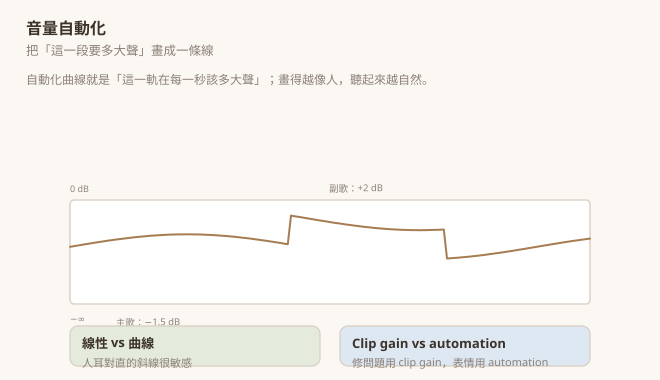
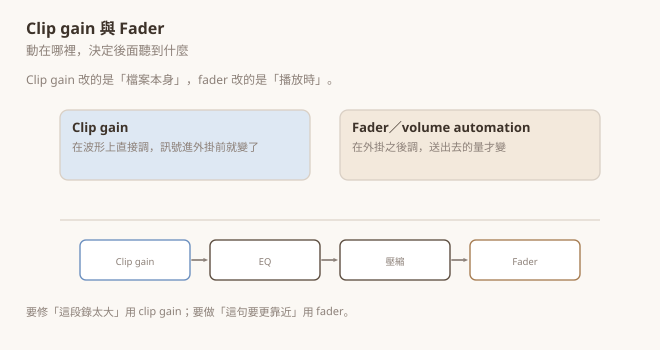

# **第 26 堂：Automation 自動化：描繪歌曲動態與情緒變化**

## 什麼是 Automation（自動化）？

在數位音樂製作中，Automation（自動化）指的是讓 DAW 在時間軸上自動改變任何可控參數的能力。想像你有一雙看不見的手，隨著歌曲進行，精準地推動音量推桿、轉動效果鈕、調整濾波器——這就是 automation 在做的事。

為什麼 automation 如此重要？因為音樂的本質是動態的。一首從頭到尾音量完全相同的歌曲會讓人感到枯燥乏味。Automation 讓我們能夠在時間軸上「畫出」音樂的起伏，從細微的漸強到戲劇性的爆發，從寧靜的段落到能量飽滿的高潮。沒有 automation，你的混音就像一張沒有明暗變化的黑白照片；有了它，才真正擁有色彩與深度。

現代 DAW（Ableton Live、Logic Pro、FL Studio、Cubase、Pro Tools 等）都提供完整的 automation 系統。你可以 automation 的參數包括但不限於：

- 音量（Volume / Gain）
- 聲像（Pan）
- 效果器參數（效果器的旋鈕、滑桿全部可 automation）
- 傳送量（Send Levels）
- 靜音 / 獨奏狀態（Mute / Solo）
- 樂器參數（合成器的 cutoff、resonance、envelope 等）

## 音量 Automation：混音中最關鍵的工具

如果說 automation 有一項你必須精通的核心技能，那就是音量 automation。這是塑造歌曲動態最直接、最有效的方法。

### 為什麼不只用 Compressor？

Compressor（壓縮器）確實可以控制音量，但它是被動的、基於門檻值的反應式處理。而 automation 是主動的、有意識的藝術決定。兩者相輔相成：

- **Compressor**：控制瞬間的動態範圍，讓表演更穩定
- **Automation**：在更大的時間尺度上（小節、段落）塑造音量輪廓

例如，主歌到副歌的漸強，compressor 做不到——它不知道哪裡是主歌哪裡是副歌。你必須用手動的 automation 來完成。

### 音量 Automation 的典型應用

**平衡主唱音量**：在一首歌中，歌手某些字可能比較小聲，某些字比較大聲。用 clip gain 或 volume automation 讓每一個字都清晰可聞，但又不失自然的動態感。

**段落的動態對比**：主歌保持較低的音量（例如 -8 dB 到 -6 dB），到了副歌提升到 -3 dB 甚至更接近 0 dB。這 3-5 dB 的差異就能創造出明顯的強度變化。

**結尾的淡出（Fade Out）**：歌曲結尾的淡出是最經典的音量 automation 應用。畫一條平滑下降的曲線，讓歌曲自然消失。

**預留呼吸空間**：在段落之間，稍微降低音量（約 1-2 dB），讓聽眾的耳朵有短暫的休息，然後再進入下一個段落，效果會更加強烈。

## 主歌到副歌的漸強 Build-Up

這是最實用也最常見的 automation 技巧之一。讓我們拆解從主歌到副歌的典型 build-up 策略：

### 總音量 Automation

在副歌開始前 2-4 小節，對 master fader 或所有樂器的群組軌道畫一條緩慢上升的曲線。這條曲線不應該是直線，而是略帶弧度的「S 曲線」（先慢後快再慢），這樣聽起來最自然。

### 各軌道的分層 Automation

真正高級的 build-up 來自於不同樂器在不同時間點進入：

1. **主歌前半段**：只有人聲、鋼琴／木吉他、Bass，音量維持在較低水平
2. **主歌後半段**：鼓組逐漸加入，Hi-Hat 和 Snare 開始提升音量，Bass 變得更有存在感
3. **Pre-Chorus**：所有樂器逐漸提升 2-3 dB，Pad/Synth 的濾波器慢慢打開
4. **副歌 Drop 點**：全部樂器達到最大音量，Crash Cymbal 加入，Reverb 變大

### 節奏樂器的 Build-Up

用 automation 控制鼓組的壓縮器 mix 量或平行壓縮的 send level。在主歌時壓縮較少，讓鼓聲較自然；逐漸接近副歌時增加壓縮量，讓鼓聲越來越「黏」、越來越有力。

## 聲像 Automation：為聲音注入動感

| 種類 | 控制什麼 | 常見用途 |
|---|---|---|
| 音量 | 軌道輸出 | 主歌到副歌的推拉 |
| 聲像 | 左右位置 | 讓某個元素慢慢飄移 |
| 效果參數 | reverb send、濾波 | 段落轉場 |
| 外掛開關 | 旁通 | 段落切換 |

聲像（Pan）automation 可以創造出聲音在立體聲場中移動的效果，為混音增添生命力。

### 自動平移（Auto-Pan）

模擬聲音在左右聲道之間來回移動的效果。常見應用：

- **Pad / Synth 背景音**：用緩慢的正弦波或三角波控制 pan，讓背景音在立體聲場中緩緩漂移，增加空間感
- **Arpeggio / 節奏音型**：用較快的速率（1/4 音符或 1/8 音符）讓音符左右跳動，製造活力
- **效果音（FX）**：點綴性的 riser、downlifter 或 sweeps，配合 pan automation 讓它們從一側移動到另一側

### Ping-Pong 效果

傳統上 ping-pong delay 會讓回音在左右聲道之間交替，但你也可以用 pan automation 手動實現類似效果：

1. 在一個打擊樂 hit 上畫 automation：第 1 拍 pan 全左，第 2 拍全右，第 3 拍回到中間
2. 配合 volume automation 讓每次重複的音量遞減，模擬自然的空間反射

### 段落過渡的 Panning

在段落轉換時（例如 bridge 結束要回到最後一次副歌），對一個 rising sound（如 riser）從左聲道 pan 到右聲道，製造出一種「掃過」空間的感覺，為轉場增加立體感。

## 效果器參數 Automation：聲音設計的核心

這是最有趣也最有創意的 automation 應用領域。透過自動化效果器參數，你可以讓音色隨著時間演變。

### Filter Sweeps（濾波掃頻）

最經典的效果參數 automation。對低通濾波器（Low-Pass Filter）的 cutoff 頻率畫 automation：

- **Build-Up 前**：將 cutoff 降到 200-500 Hz，讓聲音聽起來悶悶的、受壓抑
- **逐漸升高**：隨著能量累積，慢慢將 cutoff 提升到 8k-15k Hz
- **最高點**：在 drop 或副歌的瞬間完全打開濾波器，帶來強烈的釋放感

高通濾波器（High-Pass Filter）的 automation 同樣實用：在主歌時對低頻樂器（如 pad、吉他）使用較高的 HPF cutoff，讓低頻空間留給 kick 和 bass；到了副歌再把 cutoff 降低，讓這些樂器的低頻重新回來，增加厚度。

### Reverb Throws（殘響拋射）

在特定的字或音效上突然增加 reverb 的 wet mix，製造出聲音被「拋入深淵」的效果：

1. 在歌詞的最後一個字（通常是句子結尾）畫一瞬間的 reverb send 提升
2. 讓 reverb 的 decay time 設在 2-4 秒
3. 配合 volume automation 讓原本的乾聲 fading out，只留下殘響尾巴

這種技巧在 EDM、流行樂和電影配樂中非常常見，能為 vocal 增添戲劇性。

### Delay Feedback Automation

Delay 的 feedback（回授量）是另一個強大的 automation 目標：

- 在歌曲正常段落中，feedback 設在 10-20%，製造輕微的回聲
- 在段落結束或過渡時，將 feedback 突然提升到 60-80%，創造出瘋狂重複的音效
- 最後再將 feedback 降到 0%，讓延遲自然消失

如果配合 delay 的 ping-pong 模式再加上 pan automation，效果更加驚人。

### 其他常見的效果器 Automation

- **Distortion / Saturation**：在主歌時乾淨，副歌時增加 saturation，讓聲音更飽滿
- **Compressor Ratio / Threshold**：改變壓縮強度，影響聲音的 punch
- **EQ Frequency / Gain**：在 bridge 時提升中頻，增加親密感；在 chorus 時提升高頻，增加空氣感
- **Chorus / Flanger Rate**：調變效果的速率隨音樂情緒而變化

## 手動繪製 Automation vs 錄製推桿移動

兩種主要的 automation 創作方式各有優缺點。

### 手動繪製（Draw Automation）

用滑鼠在 automation 車道（automation lane）上直接畫曲線。

**優點**：

- 極度精確——你可以畫出任何形狀的曲線
- 容易編輯——點擊 breakpoint 即可調整
- 可重複——不會因為錄製時的手抖而產生誤差

**缺點**：

- 缺乏人性化的細微變化——可能聽起來太「機械」
- 速度較慢——需要一筆一筆地畫

**適用場景**：精確的參數變化，如 filter sweep 的曲線、淡出淡入、音量平衡微調。

### 錄製推桿移動（Record Fader Moves）

DAW 處於錄製 automation 模式時，你一邊播放歌曲一邊推動推桿或轉動旋鈕，DAW 會即時記錄你的所有操作。

**優點**：

- 有機、自然——人的手勢帶有微妙的 timing 和力度變化
- 直觀——用耳朵聽、用手操作，不需要視覺輔助
- 快速——一次錄製就能得到完整的 automation

**缺點**：

- 不夠精確——很難在正確的時機點達到完全正確的數值
- 需要練習——好的「手感」需要時間培養
- 編輯較麻煩——可能需要清理不必要的 breakpoint

**適用場景**：音量 automation、效果器參數的即時控制、表演性的參數變化。

### 最佳做法：兩者結合

先用手推錄製出自然的 automation，然後進入 automation lane 手動微調——移除多餘的 breakpoint、平滑鋸齒狀的曲線、微調 timing。這樣既保留了人性的感覺，又達到了專業的精確度。

## Clip Gain vs Track Automation

兩者都是在調整音量，但用處不同。

### Clip Gain（片段增益）

在音頻 clip 上直接調整增益，而不是在 track 的 automation lane 上。

**適合用於**：

- 錄音前的音量平衡——讓每個 clip 的音量一致
- 移除錄音中的音量不均（如歌手某些字特別大聲）
- 在編輯階段就完成的音量調整，與混音階段的 automation 分開管理

**優點**：clip gain 的調整發生在 fader 之前，因此不會影響 track automation 的後續調整。這提供了兩個層次的音量控制。

### Track Automation（軌道自動化）

在 track 的 volume fader 上 automation。

**適合用於**：

- 整體段落的音量變化（主歌到副歌的漸強）
- 與其他 automation（pan、效果器）配合使用
- 混音階段最後的修飾

**黃金法則**：用 clip gain 做「微調」，用 track automation 做「大輪廓」。先調整 clip gain 讓每個 clip 的音量一致，再畫 track automation 來塑造歌曲的動態輪廓。

## Automation 用於轉場（Transitions）

轉場是歌曲中段落之間的「橋樑」，好的轉場能讓音樂流暢地從一個情緒過渡到另一個情緒。

### Riser（上升音效）的 Automation

Riser 通常是一個持續升高的音色，搭配以下 automation：

- **Volume**：從近乎無聲逐漸提升到滿音量
- **Pan**：從左右來回加速移動，或從一側移動到另一側
- **Pitch / Filter Cutoff**：不斷升高，製造緊張感
- **Reverb Send**：逐漸增加，讓聲音越來越「大空間」

### Impact / Downlifter 的 Automation

在轉場的瞬間（如副歌的第一拍），impact 音效通常搭配：

- **Volume**：瞬間最大音量，然後快速衰減（像爆炸聲）
- **Reverb**：較高的 reverb，讓 impact 有龐大的空間感
- **Filter**：從高通快速降為全頻，或從低通快速升高

### Build-Up 的 Automation 組合拳

一個完整的 4 小節 build-up 可以這樣設定：

1. **第 1 小節**：snare 或 clap 每拍加入，volume automation 開始緩慢上升
2. **第 2 小節**：增加一個白噪音 riser，filter cutoff 從 200 Hz 開始上升
3. **第 3 小節**：增加速度感——將 riser 的 pan 速度加快，加入 delay feedback automation
4. **第 4 小節**：所有 automation 衝向最大值——volume、pan speed、filter cutoff、reverb、delay——在第 4 小節最後一拍達到最高點
5. **副歌第一拍**：全部 automation 瞬間重置，drop 進副歌

## 透過 Automation 創造情緒弧線

一首讓人難忘的歌曲，背後一定有一條精心設計的情緒弧線。Automation 是實現這條弧線的工具。

### 常見的情緒弧線 Automation 設計

**寧靜 → 高漲 → 爆發 → 回落**

這是最經典的結構。用 automation 來表現：

- **Intro**：音量較低，filter 較悶，pan 範圍較窄。營造神秘感
- **Verse 1**：逐漸打開，但仍保留空間。人聲在中間位置，樂器在兩側
- **Pre-Chorus**：volume 持續上升，filter 慢慢打開，pan 開始拓展到更寬
- **Chorus**：全部打開——最大音量、全頻段、寬廣立體聲場、豐富的 reverb
- **Bridge**：回到較小的設定，但與 intro 相比多一些元素，營造反思感
- **Final Chorus**：達到整首歌的最高潮——比第一次 chorus 更大聲、更寬廣、更多能量
- **Outro**：逐漸 fade out，filter 慢慢關閉，音量回到最低

### Automation 的「呼吸感」

好的 automation 曲線不是幾何直線，而是像呼吸一樣有起伏的曲線：

- **Attack 階段**：曲線應該略帶「S 形」，先慢、中間漸快、結尾再漸慢
- **Release 階段**：自然衰減，不要突然切斷
- **平滑曲線**：使用 DAW 的曲線工具（而不是直線工具）來畫 automation

在 Ableton Live 中，你可以按住 Ctrl（Mac：Cmd）拖曳 breakpoint 來畫曲線；在 Logic Pro 中，選擇「Curve」模式來自動平滑；在 FL Studio 中，右鍵點擊 automation clip 選擇「Smooth」。了解你的 DAW 的曲線編輯工具，並熟練使用。

## 實用 Automation 工作流程

以下是一個專業的 automation 工作流程：

### Step 1：先有混音再畫 Automation

不要在混音還沒穩定時就開始畫 automation。先做好基礎混音（音量平衡、EQ、Compression），再開始加入 automation。否則你可能會因為 mix 不斷改變而不斷重畫。

### Step 2：從音量開始

永遠先做音量 automation。這是最重要的，也是影響最大的。把歌曲的動態輪廓先畫出來，再考慮其他的 automation。

### Step 3：一次一個參數

不要試圖一次 automation 所有東西。專注於一個參數，把它做好，再進行下一個。常見的優先級：

1. Volume automation（各軌道 + master）
2. Filter cutoff automation（關鍵音色）
3. Reverb / Delay send automation（空間變化）
4. Pan automation（立體聲移動）
5. 其他效果器參數

### Step 4：使用 Automation 車道編輯器

大部分 DAW 都有專門的 automation 編輯介面。熟悉這些快捷鍵：

- **加入 breakpoint**：雙擊 automation lane
- **刪除 breakpoint**：選中後按 Delete
- **平滑曲線**：選中多個 breakpoint 後套用曲線工具
- **複製 automation**：選取 automation clip 後複製貼上

### Step 5：Automation 的清理與優化

畫完 automation 後，花時間清理：

- 移除不必要的 breakpoint（太多的 breakpoint 會讓曲線不平滑）
- 檢查是否有不必要的 automation 跳動（尤其是在段落交界處）
- 確認 automation 的 timing 是否與音樂同步（用 zoom in 到小節的尺度檢視）

## 自然感的 Automation 曲線技巧

### 1. 避免直線

人的耳朵對突然的變化非常敏感。與其用直角轉折的 automation，不如使用圓滑的曲線。尤其是在 volume automation 中，直線聽起來會很「機械」。

### 2. 使用 S 曲線

在漸強（ramp up）時，使用 S 曲線——開始慢、中間快、結尾慢。這模仿了自然聲音的包絡（envelope），聽起來非常自然。

### 3. 微小的不完美

如果是錄製的 fader  automation，不必把每個小抖動都修掉。微小的不完美反而讓 automation 聽起來更人性化。但明顯偏離的 breakpoint 還是要修正。

### 4. 參數之間的連動

多個參數一起變化會產生加乘效果。例如在 build-up 時，同時增加 volume、打開 filter、增加 reverb——三者的組合效果遠大於各自獨立使用的效果。

### 5. Automation 的「空間」

不要讓 automation 填滿整首歌的每一個瞬間。有時候，不 automation 就是最好的 automation——讓某些段落保持穩定，反而能讓有變化的部分更加突出。

## 結語

Automation 是 DAW 時代最強大的創作工具之一。它讓我們能夠在時間軸上「演奏」每一個參數，為音樂注入生命力、動態和情感。

從最基礎的音量 automation 開始練習，逐步延伸到 filter、pan、reverb、delay。每一次 automation 的加入，都讓你的音樂更貼近心中理想的樣貌。

記住：最好的 automation 是聽眾不會察覺到的 automation——它讓音樂自然地起伏、呼吸、流動，而不是讓聽眾注意到「喔，這個 automation 好厲害」。就像電影配樂一樣，當你注意到配樂的存在時，表示它已經失敗了；當配樂完美地融入畫面時，那才是真正的成功。

這也適用於 automation：讓它無聲地服務於音樂，讓音樂自己說話。