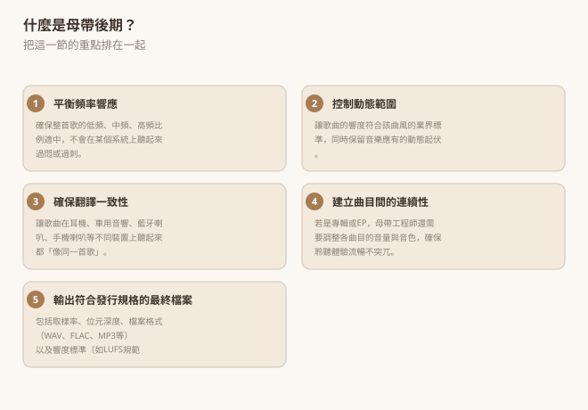
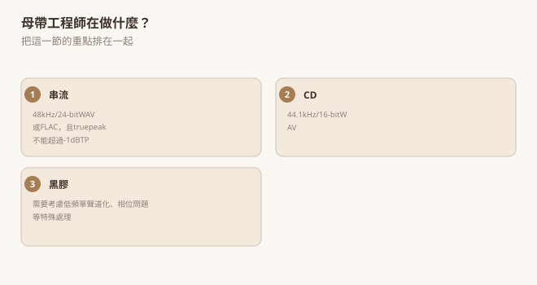
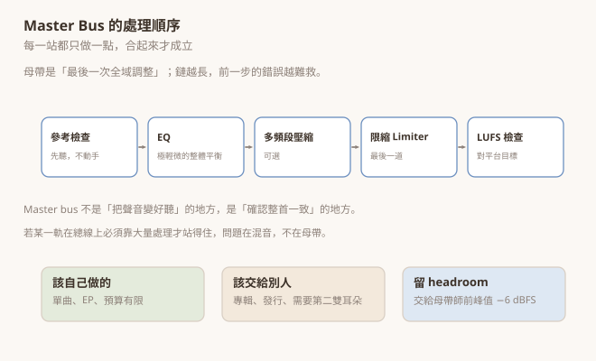
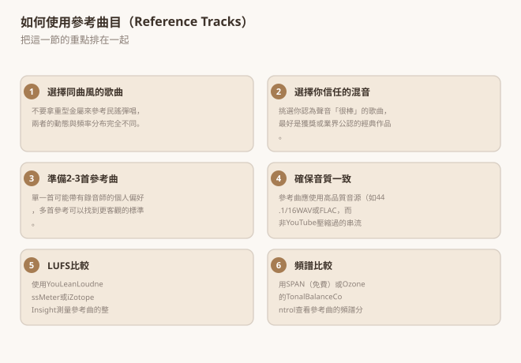
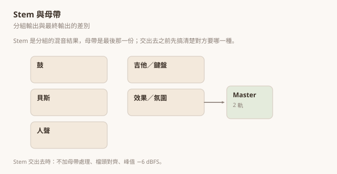

# **第 27 堂：母帶後期 (Mastering) 觀念：Master Bus 處理邏輯**

## 課程總覽

母帶後期（Mastering）是音樂製作流程中最後一道工序，也是從「混音成品」到「發行格式」之間最重要的一層把關。如果說混音是在微觀層面調整每一件樂器的平衡與質感，那麼母帶就是在宏觀層面確保整首歌曲在各種播放環境下都能呈現一致、專業的聲音。本堂課將深入剖析母帶後期的核心觀念、Master Bus（主軌）的處理邏輯，以及你該如何一步步建立自己的母帶工作流程。

---

## 什麼是母帶後期？

母帶後期的英文 Mastering 源自於 Master（母帶）這個詞，歷史上是指在類比時代將混音好的磁帶轉錄到最終的「母帶」載體上，以便大量壓製唱片。到了數位時代，母帶後期已經演變為一套完整的聲音優化流程，其目標包括：

- **平衡頻率響應**：確保整首歌的低頻、中頻、高頻比例適中，不會在某個系統上聽起來過悶或過刺。
- **控制動態範圍**：讓歌曲的響度符合該曲風的業界標準，同時保留音樂應有的動態起伏。
- **確保翻譯一致性（Translation）**：讓歌曲在耳機、車用音響、藍牙喇叭、手機喇叭等不同裝置上聽起來都「像同一首歌」。
- **建立曲目間的連續性**：若是專輯或 EP，母帶工程師還需要調整各曲目的音量與音色，確保聆聽體驗流暢不突兀。
- **輸出符合發行規格的最終檔案**：包括取樣率、位元深度、檔案格式（WAV、FLAC、MP3 等）以及響度標準（如 LUFS 規範）。

### 混音 vs. 母帶：根本差異

許多初學者常將「混音」與「母帶」混為一談，事實上兩者的層級完全不同：

| 面向 | 混音 (Mixing) | 母帶 (Mastering) |
|------|--------------|------------------|
| 處理對象 | 多軌分軌（每件樂器各自獨立） | 立體聲混音檔（已合併的兩軌） |
| 核心任務 | 平衡各樂器的音量、頻率、空間感 | 優化整體音色、響度與動態 |
| 處理範圍 | 單曲內所有元素相互協調 | 單曲優化，或專輯全曲目的連貫性 |
| 工具 | 多軌混音器、每軌獨立效果器 | 主軌處理器、高品質 EQ/Comp/Limiter |
| 聽感目標 | 清晰、平衡、有空間感 | 專業、響亮、一致、可發行 |

簡單來說：**混音是把食材處理好，母帶是最後調味與擺盤。**

---




## 母帶工程師在做什麼？

專業的母帶工程師不僅是操作設備的技術人員，更是音樂作品的最後一道品質關卡。他們的工作包含以下四大面向：

### 1. 音量與響度（Loudness）

母帶工程師會根據曲風與發行平台的要求，設定目標響度。例如串流平台（Spotify 約 −14 LUFS、Apple Music 約 −16 LUFS（整合式），而 CD 或舞曲可能需要更響亮的 -8 到 -10 LUFS。母帶工程師透過限制器與壓縮器來提升平均響度，同時避免過度削波造成的失真。

### 2. 音色平衡（Tonal Balance）

人耳對不同頻率的敏感度會受到音量影響（Fletcher-Munson 曲線）。母帶工程師會用高品質的線性相位 EQ（Linear Phase EQ）或類比風格的 EQ 來微調整體頻譜，確保低頻不會過多、高頻不會刺耳，同時保留音樂的原始特質。

### 3. 翻譯能力（Translation）

這是母帶後期最核心的價值之一。母帶工程師會在經過聲學處理的監聽環境中，使用多組參考系統（主監聽喇叭、近場喇叭、耳機、手機喇叭等）反覆聆聽，確保混音的決定在所有裝置上都能被正確還原。

### 4. 格式輸出（Format Delivery）

最終檔案需要符合發行端的要求。例如：

- **串流**：48kHz / 24-bit WAV 或 FLAC，且 true peak 不能超過 -1 dBTP
- **CD**：44.1kHz / 16-bit WAV
- **黑膠**：需要考慮低頻單聲道化、相位問題等特殊處理

---




## Master Bus 處理鏈：標準流程



母帶處理並非隨機掛上幾顆效果器，而是有一套經過驗證的邏輯順序。以下是業界最常見的 Master Bus 處理鏈：

```
輸入（立體聲混音檔）→ EQ → 壓縮器 → 限制器 → 抖動（Dither）→ 輸出
```

### 第一步：Subtle EQ（細微均衡）

母帶階段的 EQ 調整幅度通常非常小——1 dB 到 2 dB 的增減就已經算「大幅度」了。母帶 EQ 的目的不是修正混音的錯誤，而是錦上添花。

常見的母帶 EQ 動作：

- **低頻滾降（High-Pass Filter）**：在 20-30 Hz 處將極低頻的隆隆聲濾除，為低頻留下更多動態餘裕。注意不要切到基頻（例如大鼓的 50-60 Hz）。
- **空氣感提升（Air Boost）**：在 10-16 kHz 做一個柔和的 shelves 提升（約 +1 到 +2 dB），讓高頻更有延伸感與通透感。
- **中低頻減肥**：若混音在 200-400 Hz 區域有模糊感，可用寬 Q 值的 Bell 曲線減 1-2 dB，讓聲音更乾淨。
- **齒音抑制**：在 6-8 kHz 若發現過多的嘶聲，可做窄 Q 的衰減。

### 第二步：Master Bus Compression（主軌壓縮）

母帶壓縮器的作用不是像混音時那樣猛烈地控制動態，而是像「膠水」一樣將聲音的各個頻段黏合在一起，讓整體聽感更一致、更有凝聚力。

常見設定參考：

| 參數 | 建議值 |
|------|--------|
| Ratio（壓縮比） | 1.5:1 到 2:1（非常溫和） |
| Threshold（閾值） | 僅讓峰值超過閾值 2-4 dB |
| Attack（啟動時間） | 10-30 ms（保留瞬態） |
| Release（釋放時間） | 自動或 50-100 ms |
| Gain Reduction | 0.5 到 2 dB（極輕微） |
| Knee | Soft knee（軟膝） |

**重點**：母帶壓縮應該「幾乎聽不出來在壓縮」。如果關掉壓縮器後差異很明顯，代表壓得太多了。

常見的硬體壓縮器模擬插件有 SSL G-Master Bus Comp、API 2500、Manley Variable Mu、Shadow Hills Mastering Compressor 等。這些都是以「色彩」（Coloration）與「黏合」聞名的經典設計。

### 第三步：Limiting（限制器）

限制器是母帶處理中讓音量提高的關鍵工具。它的作用就像一個極高壓縮比（通常 10:1 以上）的壓縮器，確保訊號絕不超過設定的 Threshold。

使用限制器時需要注意：

- **增益衰減量（Gain Reduction）**：建議不超過 2-3 dB。如果為了提升響度而讓限制器持續壓縮超過 4-5 dB，聲音會明顯變得扁平、呆滯，失去動態。
- **True Peak 限制**：串流平台要求 true peak 不能超過 -1 dBTP，因此在限制器後應再掛一個 true peak 限制器或將輸出設為 -1.0 dBTP。
- **Intersample Peaks（ISP）**：數位轉類比時，某些採樣點之間會出現比原始樣本更高的峰值。True Peak 限制器能預防這些「隱藏峰值」造成的失真。
- **Lookahead（前瞻）**：設定 1-5 ms 的 lookahead 可以讓限制器更平滑地處理瞬態。

### 第四步：Dither（抖動）

抖動只在你需要降低位元深度時才使用，例如從 24-bit 降到 16-bit（CD 規格）。抖動的原理是在量化過程中加入極低水平的噪聲，將量化誤差轉化為隨機噪聲而不是可聽的失真。

**實務建議**：

- 若最終輸出為 24-bit WAV（串流用），**不需要**抖動。
- 若最終輸出為 16-bit WAV（CD 用），在最後一步加上抖動。
- 抖動必須是處理鏈的**最後一環**，之後不能再掛任何效果器或改變音量。

---


## Master Bus 的進階處理

### 立體聲增強（Stereo Enhancement）

在母帶階段適度拓寬立體聲寬度，能讓聲音聽起來更開闊。常見方法包括：

- **Mid-Side (M/S) 處理**：將立體聲訊號分為 Mid（中央，左右聲道相同部分）與 Side（側邊，左右聲道不同部分），然後分別處理。例如：
  - 稍微壓縮 Mid 聲道，讓中央的人聲與大鼓更穩定
  - 對 Side 聲道做高頻提升，增加空間感
  - 用 M/S EQ 分別調整中央與側邊的頻率平衡
- **立體聲擴展器**：使用像 Waves S1 或 iZotope Ozone 的 Imager 模組，將 Side 訊號的寬度適度增加。**注意**：過度擴展會導致相位問題，在單聲道播放時聲音消失或變形。
- **Haas Effect 延遲**：在母帶階段較少使用，但某些插件會利用極短延遲（5-20 ms）來創造寬度感——使用上要非常謹慎。

### 多頻段處理（Multiband Processing）

在母帶後期中，多頻段壓縮器或限制器可以用來針對特定頻率範圍做處理。例如：

- **低頻壓縮**：只對 20-120 Hz 的頻段做壓縮，讓低音更穩定，避免大鼓與貝斯打架。
- **中頻動態控制**：若人聲在副歌時突然變得太突出，可在 1-4 kHz 做輕微的多頻段壓縮。
- **高頻限制**：防止過亮的 Hi-Hat 或 Crash 造成聽覺疲勞。

代表插件：iZotope Ozone 的 Dynamic EQ / Multiband Compressor、FabFilter Pro-MB、Waves C6 等。

---


## 如何使用參考曲目（Reference Tracks）

參考曲目是母帶後期中不可或缺的工具。它能提供客觀的比較基準，幫助你判斷自己的作品在音色、響度、空間感上是否達到專業水準。

### 選取參考曲目的原則

1. **選擇同曲風的歌曲**：不要拿重型金屬來參考民謠彈唱，兩者的動態與頻率分布完全不同。
2. **選擇你信任的混音**：挑選你認為聲音「很棒」的歌曲，最好是獲獎或業界公認的經典作品。
3. **準備 2-3 首參考曲**：單一首可能帶有錄音師的個人偏好，多首參考可以找到更客觀的標準。
4. **確保音質一致**：參考曲應使用高品質音源（如 44.1/16 WAV 或 FLAC，而非 YouTube 壓縮過的串流）。

### 比較的方式

- **LUFS 比較**：使用 YouLean Loudness Meter 或 iZotope Insight 測量參考曲的整合響度，作為你的目標值。
- **頻譜比較**：用 SPAN（免費）或 Ozone 的 Tonal Balance Control 查看參考曲的頻譜分布，與你的混音疊加比對。
- **A/B 切換**：在你的 DAW 中將參考曲導入並對齊音量，反覆切換比較。注意要將音量匹配（人的耳朵會覺得更大聲的版本「聽起來更好」）。
- **聆聽清單**：用 Mastering The Mix 的 Reference 2 這類插件，可以直接在母帶鏈中快速切換參考曲。

---




## 監聽環境的重要性

母帶後期對監聽環境的要求遠比混音更加嚴格。原因很簡單：**如果你聽不到問題，你就無法修正它。**

### 空間聲學

- **低頻陷阱**：房間角落的低頻駐波會導致你誤判低音的多寡。如果房間有 60 Hz 的駐波，你可能會不自覺地減少低音，結果在其他系統上聽起來低頻不足。
- **第一反射點吸音**：側牆與天花板的第一反射點需要適當的吸音或擴散，避免早期反射干擾立體聲成像的判斷。
- **聆聽位置**：聆聽位置應在房間長度的約 38% 處（距前牆），與兩側牆壁距離相等；喇叭與聆聽者形成正三角形。

### 監聽喇叭

母帶工程師通常會使用全音域監聽喇叭（如 Genelec、ATC、Barefoot Sound 等），搭配超低音以完整聽到極低頻。然而，對於在家中自學的你來說，更重要的是**熟悉你的監聽系統**。無論喇叭或耳機的好壞，只要能熟練掌握其聲音特性，仍然可以做出不錯的母帶。

### 耳機監聽的注意事項

耳機無法真實再現立體聲交叉饋送（Crossfeed）的效果，容易導致：

- 中央聲道（人聲、大鼓）聽起來過於突出
- 立體聲寬度被誇大
- 低頻感知與喇叭不同

建議使用耳機模擬插件（如 Sonarworks Reference、Waves Nx、dSoniq Realphones）來模擬喇叭的聆聽環境。

---


## 常見的母帶錯誤

### 錯誤一：過度限制（Over-Limiting）

這是新手最常見的錯誤。為了讓歌曲「大聲」，把限制器的 Threshold 拉到非常低，導致：

- 音樂失去動態，聽起來扁平疲勞
- 瞬態被削平，打擊樂器失去衝擊感
- 出現明顯的 pumping 效果（音量在限制器釋放時突然回升）

**解決方法**：限制器的增益衰減量保持在 2 dB 以內。如果需要更響亮，回頭調整混音。

### 錯誤二：太多低頻（Muddy Low End）

在混音階段為了讓低音「有感覺」而加了過多的低頻，到了母帶階段會發現整體太渾濁。改善方式：

- 在母帶 EQ 中對 50-150 Hz 做適度衰減
- 用多頻段壓縮器控制低頻動態
- 或者在混音階段就用高通濾波器清除不必要的低頻

### 錯誤三：在母帶階段修正混音問題

母帶後期不是萬能的。如果混音本身就存在嚴重的頻率衝突（例如人聲被吉他蓋住）、相位問題或動態失控，母帶工程師能做的補救非常有限。**母帶無法取代混音**。

### 錯誤四：不檢查單聲道兼容性

許多母帶處理（特別是 M/S 處理或立體聲擴展）會導致單聲道播放時的訊號抵消。務必在母帶完成後，以單聲道模式檢查一次——確保人聲、大鼓、貝斯等核心元素不會消失。

### 錯誤五：忽略串流平台的響度標準

不同平台有不同的響度規範。將 CD 響度等級（約 -9 LUFS）的歌曲直接上傳到 Spotify，會觸發 loudness normalization，結果可能比你的參考曲還小聲。最好的做法是：

- 針對串流製作 Master：目標 -14 LUFS（整合式），true peak -1 dBTP
- 保留一個「不限制」的動態版本

---


## 何時該交給專業母帶工程師？



雖然你已經學會了母帶的基本流程，但有些情況下，交給專業人士仍然是更好的選擇：

1. **你的作品即將發行（商業發行）**：無論是串流、CD 還是黑膠，專業母帶工程師的經驗與監聽環境是家用環境無法比擬的。
2. **你對自己的監聽環境沒有信心**：如果你的房間沒有做聲學處理，你聽到的聲音可能與實際相差甚遠，這時做出的母帶決策很可能是錯的。
3. **你希望獲得「第二雙耳朵」的意見**：長時間聽同一首歌會產生聽覺疲勞，母帶工程師能以全新的角度聽到問題。
4. **預算允許**：專業母帶的價格通常在每首歌數千到數萬元不等（取決於工程師資歷與知名度），對於正式發行來說，這是非常值得的投資。

即使你決定交給專業人士，**學好母帶觀念仍然非常有價值**，因為：

- 你能更清楚地知道混音階段該預留哪些空間給母帶
- 你能與母帶工程師用更精準的語言溝通
- 如果你最終選擇自己母帶，你已經有了正確的方向與方法

---

## 實戰練習建議

1. **找一首你混好的歌曲**，導出立體聲混音檔。按照本課的處理鏈：EQ → Compressor → Limiter，嘗試做一次完整的母帶。注意每個環節的調整幅度都要「極小」。
2. **使用參考曲目**，找兩首同曲風的商業作品，用 LUFS 表測量它們的響度。嘗試將你的母帶調整到接近的響度值。
3. **在五種不同的裝置上聆聽**：耳機、筆電喇叭、手機喇叭、車用音響、藍牙喇叭。記錄每一種裝置上聽起來的差異。下次母帶時根據這些筆記調整。
4. **做 A/B 盲聽測試**：請朋友播放你的母帶與參考曲，你閉上眼睛判斷哪一首是哪一首。如果你無法清楚分辨，恭喜你——你的母帶已經接近專業水準了！

---


## 總結

母帶後期是音樂製作旅程中的最後一哩路，也是最需要經驗與耳朵的一環。核心觀念可以濃縮為八個字：**「宏觀調整、錦上添花」**。

- Master Bus 處理鏈的標準順序是 **EQ → Compression → Limiting → Dither**
- 每一次調整的幅度都要極小：1-2 dB 的 EQ、0.5-2 dB 的壓縮、1-2 dB 的限制
- 學習母帶最好的方式，是反覆比對自己的作品與專業參考曲
- 監聽環境比設備更重要，熟悉你的監聽系統遠比升級器材來得有效
- 避免過度限制與過多低頻，這兩個錯誤最容易被聽出來
- 當作品要正式發行時，考慮交給專業母帶工程師——這是最划算的投資之一

掌握好母帶後期，你的音樂就真正準備好要走出你的錄音室、進入這個世界了。


