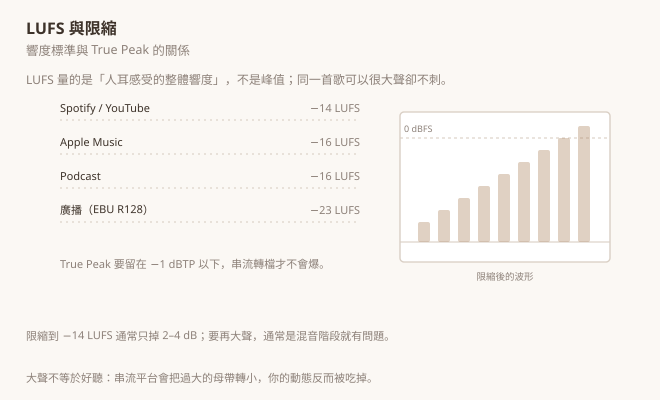

# **第 28 堂：響度標準：LUFS 觀念與 Limiter 使用**

## 什麼是 LUFS？

LUFS（Loudness Units relative to Full Scale）是國際電信聯盟（ITU-R BS.1770）所制定的響度衡量標準，中文可譯為「相對於滿刻度的響度單位」。它的核心目的，是提供一個與人耳感知一致的客觀響度度量。

過去我們使用 RMS（Root Mean Square）來測量音訊的平均能量，但 RMS 無法反映人耳對不同頻率的敏感度差異。人耳對中頻（約 2-4 kHz）特別敏感，對低頻與極高頻則較遲鈍。LUFS 在 RMS 的基礎上加入了 **K 加權曲線（K-weighting）**，模擬人耳的頻率響應，使測量結果更接近人耳的真實感受。

另一個常見的單位是 dBFS（decibels relative to Full Scale），它測量的是數位音訊的「瞬間振幅」，而非感知響度。一個訊號在 dBFS 中可能看起來很大（接近 0 dBFS），但聽起來卻不覺得大聲——這正是 LUFS 要解決的問題。

> **關鍵觀念：LUFS 測量的是「耳朵感受到的大小聲」，而非「波形的高度」。**

## 為什麼響度標準這麼重要？

在串流平台主宰音樂聆聽的時代，響度標準不再只是選項，而是必要條件。原因如下：

### 串流平台的標準化機制

主流平台都實施了 **響度正規化（Loudness Normalization）**：系統檢測歌曲的 LUFS 值後，自動調整播放音量至目標響度。這意味著：

- 如果歌曲「大聲」，平台將其調小（衰減增益）。
- 如果歌曲「小聲」，平台將其調大，但可能壓縮動態範圍。

### 響度正規化的實際影響

假設你製作了兩首音樂：

1. **動態豐富的古典樂**：Integrated LUFS = -20，峰值極高（例如 -1 dBTP）
2. **極度壓縮的電子樂**：Integrated LUFS = -8，削波邊緣（例如 -0.5 dBTP）

將兩者上傳至 YouTube（目標 -14 LUFS）：
- 古典樂：平台將其增益 +6 dB，使其達到 -14 LUFS。因為古典樂本身動態大，聽起來仍然自然。
- 電子樂：平台將其衰減 -6 dB，使其降到 -14 LUFS。但因為它原本就被壓縮得很「平」，衰減後動態對比消失，聽起來缺乏衝擊力與層次感。

**結論：一味追求混音「大聲」已無意義。** 平台最終會把它們拉到同一響度，反而保留動態的作品聽起來更有力量。

## LUFS 的三種測量方式

ITU-R BS.1770 定義了三種 LUFS 測量模式，各自應用於不同場景：

### 1. Integrated LUFS（整合式 LUFS）

測量整首曲目從頭到尾的「平均響度」。這是最重要的數字——串流平台正是根據 Integrated LUFS 來進行響度正規化。

- **建議範圍**：多數平台以 -14 LUFS 為理想目標，但對於動態較大的音樂（如古典或電影配樂），-16 到 -18 LUFS 也很常見。
- **測量方式**：從頭播放到尾，不重複不中斷。

### 2. Short-term LUFS（短期 LUFS）

測量最近 3 秒鐘的平均響度，用於觀察混音中某個段落或樂句的響度變化。

- **應用場景**：檢視主歌與副歌之間的響度對比是否恰當。如果主歌為 -18 LUFS、副歌突然跳到 -9 LUFS，這 9 LU 的落差可能是故意的動態效果，也可能讓聽眾覺得突兀。
- **混音用途**：確保副歌的 Short-term LUFS 穩定落在目標範圍內，不要有極端起伏。

### 3. Momentary LUFS（瞬時 LUFS）

測量最近 400 毫秒的即時響度，反應最快、最靈敏。

- **應用場景**：檢視打擊樂器（大鼓、小鼓）的瞬間響度是否過衝。
- **混音用途**：找到整首曲目中「最響亮的那 400 毫秒」作為調整依據。

### LUFS 測量的視覺化

在 DAW（如 Ableton Live、Logic Pro、Studio One）中使用 LUFS 表頭時，通常會同時顯示這三種讀數。建議養成習慣：

- **混音過程中**：注意 Short-term 和 Momentary LUFS，確保各段落響度平衡。
- **混音結束後**：從頭到尾播放一次，記錄 Integrated LUFS 作為匯出依據。

## True Peak：真實峰值的重要性

True Peak（真實峰值）與普通 Peak（樣本峰值）不同。在數位音訊中，取樣點之間的波形實際上是一條平滑曲線，取樣點本身的振幅可能低於曲線的實際最高點。

- **Sample Peak**：只檢查取樣點（Sample）的振幅。如果取樣點均低於 0 dBFS，就認為沒有削波。
- **True Peak**：透過超取樣（Oversampling）重建類比波形，找出「真實」的最高點。真正的類比波形可能在兩個取樣點之間超過 0 dBFS。

### True Peak 為何重要？

1. **編碼器失真**：壓縮成 AAC、MP3 或 OGG 等有損格式時，編碼器會重新取樣計算，可能將隱藏的 True Peak 暴露為可聽見的爆音。
2. **串流平台的規範**：Apple Music 要求 True Peak 不超過 -1 dBTP，Spotify 建議低於 −1 dBTP。
3. **類比設備保護**：如果最終要轉換為類比訊號（黑膠、廣播），True Peak 超標會直接導致功率放大器過載。

**實務建議**：在 Master Bus 的最後一級使用支援 True Peak 檢測的 Limiter，將 Ceiling 設為 -1.0 到 -0.5 dBTP，保留安全餘裕。

## 各平台的響度目標

不同平台對響度標準有不同的偏好。以下是 2025 年的主流規範：

| 平台 | Integrated LUFS 目標 | True Peak 上限 | 備註 |
|------|---------------------|----------------|------|
| **YouTube** | -14 LUFS | -1 dBTP | 全球最大影音平台 |
| **Spotify** | -14 LUFS（預設） | -1 dBTP | 可選「不進行正規化」 |
| **Apple Music** | -16 LUFS | -1 dBTP | 使用 Sound Check 技術 |
| **Tidal** | -14 LUFS | -1 dBTP | Master 品質建議 -1 dBTP |
| **Amazon Music** | -14 LUFS | -1 dBTP | 與多數平台一致 |
| **播客（Podcast）** | -16 到 -19 LUFS | -1 dBTP | 語音為主，要求更高一致性 |
| **廣播（電視）** | −23 LUFS（EBU R128，測量依 ITU-R BS.1770） | -2 dBTP | 各國略有不同（如日本 -24） |

### 實務策略：該以哪個平台為準？

最務實的做法是將曲目製作為 **-14 LUFS Integrated**，這是一條兼顧多數平台的黃金線：

- **YouTube 和 Spotify**：幾乎不需要調整，直接播放。
- **Apple Music**：-16 LUFS 與 -14 LUFS 只差 2 LU，播放時 Apple Music 會小幅衰減，音質不受影響。
- **如果 -14 LUFS 聽起來壓迫感太重**（例如古典樂、爵士樂），不要硬壓，保留自然的動態反而更好。

## 什麼是 Limiter？

Limiter（限制器）是一種動態處理器，其功能是「**訊號永遠不超過某個設定門檻**」。你可以把它想像成一個非常強硬的保安：

- 當訊號低於門檻：放行，不做任何處理。
- 當訊號高於門檻：瞬間將增益壓低，使訊號不超過門檻。

### Limiter 與 Compressor 的區別

- **Compressor（壓縮器）**：當訊號超過 Threshold，以設定的 Ratio（比例）衰減。例如 4:1 表示每超過 4 dB，輸出只增加 1 dB。壓縮是「漸進式」的。
- **Limiter（限制器）**：可以視為 Ratio 無限大（∞:1）的壓縮器，訊號一旦超過 Threshold，直接擋住，不允許任何超標。

兩者最大的差別在於「斜率」：Limiter 的反應極快，Attack time 通常低於 1 ms，用於捕捉最銳利的瞬間峰值。

## Limiter 的核心設定參數

一個標準的 Limiter 通常包含以下參數：

### 1. Ceiling（天花板）

這是 Limiter 的輸出上限，單位為 dBFS。訊號經過 Limiter 後，絕對不會超過這個值。

- **建議值**：-1.0 到 -0.5 dBFS。保留小於 0 dBFS 的餘裕，避免 DA/AD 轉換器或編碼器產生削波。
- **常見誤解**：Ceiling 不等於 Threshold。Ceiling 控制的是輸出範圍，Threshold 控制的是處理時機。

### 2. Threshold（門檻）

決定 Limiter 開始作用的音量。低於 Threshold 的訊號不受影響，高於 Threshold 的訊號被壓制。

- **數值越低**：Limiter 作用越強，整體響度提升越多，但動態壓縮越劇烈。
- **數值越高**：Limiter 只作用於最高的峰值，保留較多動態。

### 3. Attack（啟動時間）

Limiter 偵測到超標訊號後，多快開始壓制。

- **數值越小（< 0.1 ms）**：完全抓住瞬態，幾乎沒有 overshoot，但音色易「被拍扁」。
- **數值越大（1-5 ms）**：允許部分瞬態通過，保留衝擊感，但有短暫超標風險。

### 4. Release（釋放時間）

當訊號降回 Threshold 以下後，Limiter 多快恢復正常增益。

- **數值越小（< 10 ms）**：恢復迅速，但容易造成可聽見的「抽氣效應」（Pumping），尤其是在低頻持續的素材上。
- **數值越大（50-200 ms）**：恢復較慢，較為平滑，但可能導致後續小訊號被過度壓制（Gain Pumping）。

### 5. Look-ahead（前瞻時間）

這是 Limiter 最具突破性的設計——讓 Limiter「預先看到」即將到來的訊號。

- **原理**：DAW 允許將音訊延遲數毫秒處理，Limiter 在訊號到達輸出之前就先分析其振幅，提前做好壓制準備。
- **效果**：Look-ahead 可以有效減少 overshoot，讓 Limiter 的作用更透明、更難以察覺。
- **建議範圍**：1-5 ms。數值越大越安全，但會增加整體延遲。

### 6. Knee（膝點）

定義 Limiter 從不處理到完全處理之間的過渡曲線。

- **Hard Knee（0 dB）**：訊號一過 Threshold，立即開始限制，反應最銳利。
- **Soft Knee（1-6 dB）**：在 Threshold 附近有一個平滑過渡區，聽感上較不突兀，適合音樂素材。

## 透明限縮 vs 侵略性限縮

### 透明限縮（Transparent Limiting）

目標是**讓聽眾完全感覺不到 Limiter 的存在**。適用於動態豐富、自然度要求高的音樂（古典、爵士、原聲配樂）。

- 高 Ceiling（-0.5 dBFS 以上）
- 適中 Threshold（僅壓制最高 1-3 dB）
- 快速 Attack（< 0.1 ms）搭配 Look-ahead
- 中等 Release（50-100 ms），自然平滑
- 增益衰減總量（Gain Reduction）不超過 2-4 dB

### 侵略性限縮（Aggressive Limiting）

目標是**最大化整體響度**，即使犧牲部分動態和自然度。適用於電子舞曲、流行搖滾、EDM、陷阱音樂。

- 低 Threshold（壓制 6-10 dB 或更多）
- 慢速 Attack（0.5-3 ms），保留部分瞬態衝擊感
- 快速 Release（10-30 ms），快速恢復增益，保持響度
- 搭配前置壓縮器（Pre-compressor）分散處理壓力
- 增益衰減總量可能達到 6-12 dB

## 響度戰爭：大聲真的更好嗎？

1990 年代到 2010 年代初，音樂產業陷入所謂的「響度戰爭」（Loudness War）。製作人將專輯越做越大聲——壓縮再壓縮，直到波形幾乎變成方塊，代價是聽覺疲勞與動態喪失。

### 走出響度戰爭

今天的業界共識是回歸動態與響度的平衡。以下是幾個原則：

- **不要為了 -14 LUFS 而犧牲音樂性**。如果你的音樂在 -16 LUFS 聽起來完美，就保留 -16 LUFS。
- **使用多重處理而非單一 Limiter**。在前級先用 Compressor 和 Saturator 控制動態，最後再用 Limiter 做最終把關。
- **A/B 測試**：總是將處理前後的訊號進行 A/B 對比。如果處理後聽起來更差，就減少處理量。

## 實用限縮鏈：從 Compressor 到 Limiter

一套高效的 Master Bus 處理鏈大致如下：

### 第一步：前置壓縮（Pre-compression）

在 Limiter 之前先用 Compressor 控制整體動態範圍，減少 Limiter 的工作壓力。

- **Ratio**：2:1 到 4:1
- **Attack**：10-30 ms（保留瞬態）
- **Release**：50-100 ms（自然平滑）
- **Gain Reduction**：1-3 dB

### 第二步：飽和器或多段壓縮（Optional）

如果需要增加溫暖感或更精確的頻率控制，可以在 Compressor 後加入：

- **Saturator**：模擬錄音帶或真空管的非線性失真，增加諧波豐富度。
- **Multiband Compressor**：針對低頻過多的部分（如大鼓、貝斯）獨立壓縮，避免低頻觸發 Limiter 過度壓制中高頻。

### 第三步：真正的 Limiter

將 Limiter 設定為：

- **Ceiling**：-1.0 dBFS（或 -0.5 dBTP）
- **Threshold**：根據需要調整，目標增益衰減不超過 3-6 dB
- **Look-ahead**：1-3 ms
- **Attack**：< 0.1 ms 或自動
- **Release**：50-150 ms 或自動（視音樂風格而定）

### 第四步：True Peak Limiter（備選）

某些 DAW 或母帶插件提供專門的 True Peak Limiter（如 FabFilter Pro-L 2、iZotope Ozone Maximizer），它們使用更高的超取樣率來保證 True Peak 不超標。

- 在主 Limiter 後可再加一個輕度 True Peak Limiter，Ceiling 設為 -1.0 dBTP。
- 注意：不要讓兩個 Limiter 各自壓制總和超過 6 dB，否則動態會嚴重受損。

## 最後的 LUFS 檢查

在匯出前進行最終 LUFS 檢查，確保符合目標平台的規範。以下是最後檢查清單：

### 檢查項目

1. **Integrated LUFS**：整首曲目的平均響度。確認落在目標範圍內（一般建議 −14 到 −16 LUFS，但仍以聽感為主）。
2. **Short-term LUFS Range**：主歌與副歌的落差。落差過大（> 6 LU）可能需要調整 Automation 或壓縮參數。
3. **Momentary LUFS Max**：整曲中最響亮處。確保沒有突發的極端響度（例如意外的大鼓擊）。
4. **True Peak Max**：整曲中的 True Peak 最大值，絕對不能超過 Ceiling 設定。
5. **LRA（Loudness Range）**：描述整首曲目的動態範圍。古典樂 LRA 可達 10-20 LU，電子樂可能只有 3-8 LU。LRA 本身沒有好壞，但應與曲風匹配。

### 使用 LUFS 表頭的建議工具

- **Youlean Loudness Meter 2**（免費版已相當實用）
- **FabFilter Pro-L 2**（兼具 Limiter 與 LUFS 表頭）
- **iZotope Insight 2**（全方位的分析工具）
- **TBProAudio dpMeter 5**（免費且功能完整的 LUFS 表頭）

### 檢查流程

1. 從頭到尾播放整首曲目，同時監看 LUFS 表頭。
2. 記錄 Integrated LUFS 和 True Peak。
3. 如果 Integrated LUFS 過低（例如 -20 LUFS）：檢查音軌是否不夠飽滿，在 Master Bus 上加入輕度處理提升能量。
4. 如果 Integrated LUFS 過高（例如 -7 LUFS）：減少 Limiter 壓制量或降低 Threshold。
5. 再次播放，確保 True Peak 不超過標準。

### 最後提醒

LUFS 是科學工具，但音樂終歸是藝術。**不要讓數字綁架你的聽覺**。如果你在 -16 LUFS 聽起來已經非常完美，就沒有理由硬壓到 -14 LUFS。平台的正規化會處理剩下的差異，而你的音樂保留了最真實的動態生命力。

## 總結

| 觀念 | 重點 |
|------|------|
| **LUFS 定義** | 人耳感知的響度單位，以 K 加權曲線模擬聽覺 |
| **三種測量** | Integrated（整體）、Short-term（3秒）、Momentary（400ms） |
| **True Peak** | 真實類比峰值，影響編碼品質 |
| **平台目標** | YouTube/Spotify -14 LUFS、Apple Music -16 LUFS |
| **Limiter** | 終極峰值控制器，Ceiling 控制輸出上限 |
| **響度戰爭** | 過度壓縮犧牲動態，平台正規化使其失效 |
| **最佳實務** | 保留動態，用多級處理而非單一 Limiter 硬撐 |
| **最終檢查** | 確認 Integrated LUFS、True Peak、LRA 符合規範 |

掌握 LUFS 和 Limiter，你就掌握了音樂製作的「最後一哩路」。在串流時代，智慧地使用響度工具，才能在保留音樂感動的同時，滿足所有播放環境的技術要求。
