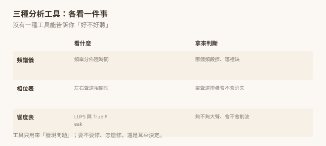
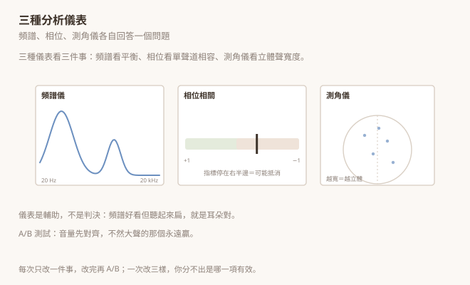
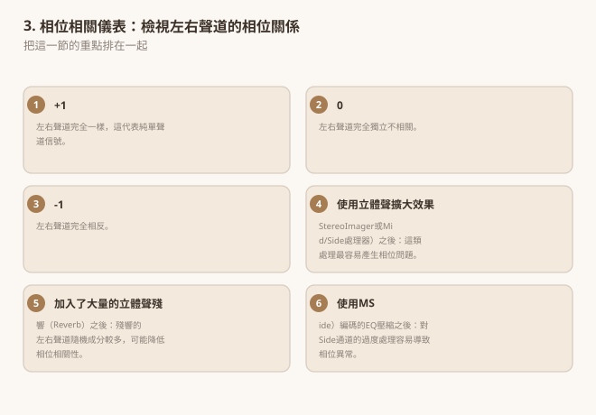
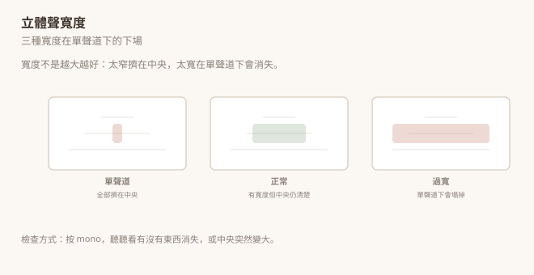
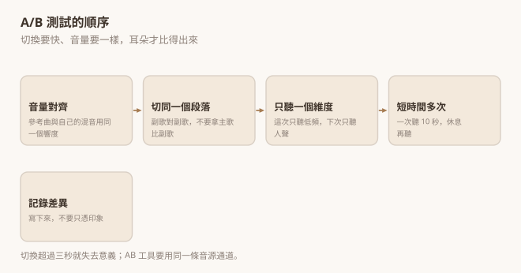
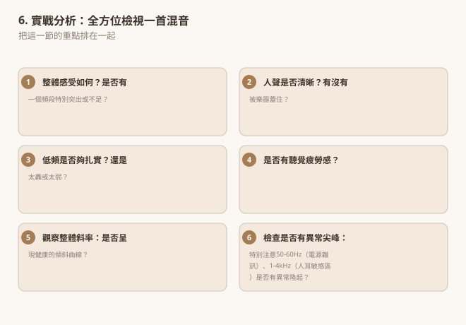
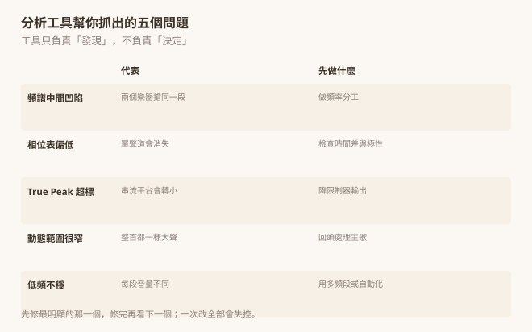

# **第 29 堂：專業分析：頻譜儀、相位檢視與 A/B 測試**

## 本堂目標：學會使用專業分析工具檢視與優化你的混音

當你完成一首歌的混音後，最關鍵的問題是：「這真的是好的混音嗎？」人耳是極具欺騙性的感官——長時間聆聽同一段音樂會產生聽覺疲勞，導致你做出錯誤的判斷。專業分析工具不是用來取代耳朵，而是用來補足耳朵的盲點。本堂將深入講解頻譜儀、相位相關儀表與 A/B 測試方法，幫助你從客觀數據與主觀聆聽兩個層面，全面檢視混音品質。

---

## 1. 混音中的分析工具概論

分析工具在混音流程中扮演三個核心角色：

**診斷角色**：找出混音中的問題——某個頻率是否過多？相位是否抵消？立體聲寬度是否合理？這些問題用耳朵可能隱約感覺「不對勁」，但分析工具能讓你精準定位病灶。

**驗證角色**：在你做出調整後，確認問題是否真的解決了。耳朵可能會被「變大聲了」的假象誤導，但分析儀表不會說謊。

**學習角色**：將你主觀聽到的聲音特徵與客觀圖表對照，久而久之訓練你的耳朵更精準地辨識頻率、相位與動態。

專業混音師通常會在以下環節使用分析工具：

- 混音起始階段：檢視每個音軌的頻率分布，規劃 EQ 策略
- 混音過程中：頻繁切換檢查立體聲與單聲道兼容性
- 混音結束前：用參考曲目做 A/B 對比，確認最終品質
- 母帶處理前：全面檢視頻譜平衡、峰值餘裕與相位相關性

常見的專業分析工具包括：iZotope Insight、FabFilter Pro-Q 3（內建頻譜分析）、Waves PAZ Analyzer、Voxengo SPAN（免費且強大）、Youlean Loudness Meter（免費）等。DAW 內建的分析工具（如 Ableton Live 的 Spectrum、Logic Pro 的通道 EQ 分析模式）也足以勝任多數任務。

---

## 2. 頻譜儀：用視覺閱讀頻率內容

頻譜儀（Spectrum Analyzer）將音訊的頻率內容以視覺化圖表呈現——橫軸是頻率（20 Hz 至 20 kHz），縱軸是音量（通常以 dB 為單位）。它就像音樂的「X 光片」，讓你一眼看出各個頻段的能量分布。

**閱讀頻譜儀的基本方法**：

頻譜的形狀可以告訴你混音的整體平衡。一個健康的混音，其頻譜曲線通常呈現從低頻到高頻逐漸衰減的趨勢——低頻較多、高頻較少。這聽起來像是一條從左到右微微向下傾斜的線，業界常稱之為「傾斜曲線」（Tilted Curve）。

具體來說：

- 20-60 Hz（超低頻）：應該有些能量，但不宜過多。過量會讓混音聽起來模糊不清，尤其在沒有重低音喇叭的系統上完全聽不到。
- 60-250 Hz（低頻）：通常是最有能量的區域。大鼓、貝斯的主要能量集中在這裡。曲線通常在此處達到最高點。
- 250 Hz-2 kHz（中低頻）：曲線開始平穩下降。過多的能量在此會讓混音聽起來「轟」或「鼻音重」。
- 2 kHz-8 kHz（中高頻）：繼續平穩下降。這是人耳最敏感的區域，樂器的清晰度與攻擊感在此決定。
- 8 kHz-20 kHz（高頻）：曲線最尾端。適當的高頻能量帶來空氣感與開闊感。

**什麼樣的頻譜曲線是「健康的」**？

一個健康的混音，其頻譜曲線應該是平滑的，沒有異常的尖峰或凹陷。每個樂團的歌曲可能有自己的特色曲線，但以下三點是共通的：

1. **沒有異常尖峰**：某個頻率突然高出周圍約 6 dB 以上，通常代表共振或回授問題。
2. **高頻延伸自然**：高頻不應突然斷掉（代表取樣率不足或過度低通濾波），也不應異常隆起（代表刺耳）。
3. **低頻不溢出**：最低頻（20-40 Hz 以下）如果仍有大量能量，通常是無用的低頻噪聲，應以高通濾波器切除。

**使用頻譜分析找出問題頻率**：

當你覺得混音有某種「不舒服」的感覺時，頻譜儀可以幫你精準定位：

- **混音聽起來「轟」或「濁」**：檢查 200-400 Hz 區域是否有過多的能量堆積。這是常見的「濁音區間」，累積過多的吉他、鋼琴、人聲的基頻會讓混音不清澈。
- **聽起來「刺耳」或「疲勞」**：檢查 3-6 kHz 區域。過多的能量在此會讓聽眾在幾分鐘內就感到聽覺疲勞。
- **聽起來「窄」或「悶」**：檢查 10 kHz 以上的高頻是否不足。對比參考曲目，如果參考曲目的高頻明顯更多，你的混音就需要加一些高頻空氣感。
- **低頻不夠扎實**：檢查 50-100 Hz 是否過少，或者 100-250 Hz 是否過多導致低頻模糊。

實戰技巧：在頻譜儀上設定一個「參考曲線」的 overlay（如果工具支援），然後切換到你的混音，兩者的差異就會一目了然。

---

## 3. 相位相關儀表：檢視左右聲道的相位關係

相位相關儀表（Phase Correlation Meter）是檢視立體聲信號相位關係的核心工具。它通常以一個從 -1 到 +1 的數值或儀表顯示：

- **+1（完全同相）**：左右聲道完全一樣，這代表純單聲道信號。所有單聲道音軌（如中央人聲、大鼓、貝斯）都會顯示 +1。
- **0（無相關性）**：左右聲道完全獨立不相關。寬闊的立體聲效果（如去相關化的環境殘響、人工寬度效果）會接近 0。
- **-1（完全反相）**：左右聲道完全相反。這是非常危險的狀態——在單聲道下這些信號會完全抵消，聲音消失不見。

**理想的相位相關數值範圍**：

對於一首完整的混音，相位相關儀表應該保持在 **+0.3 到 +0.8** 之間。這代表混音有足夠的立體聲寬度，同時又能確保單聲道兼容性。

如果數值長期低於 +0.3，代表立體聲成分過多，切換到單聲道時會有嚴重的音量損失與頻率抵消。如果數值長期高於 +0.8，代表混音太偏向中央，缺乏立體聲寬度與空間感。

**什麼時候需要特別注意相位問題**：

- 使用立體聲擴大效果（Stereo Imager 或 Mid/Side 處理器）之後：這類處理最容易產生相位問題。
- 加入了大量的立體聲殘響（Reverb）之後：殘響的左右聲道隨機成分較多，可能降低相位相關性。
- 使用 MS（Mid-Side）編碼的 EQ 壓縮之後：對 Side 通道的過度處理容易導致相位異常。
- 在合成器上使用了寬闊的 Unison 或 Detune 效果之後。

**單聲道兼容性檢查**：

這是所有專業混音流程中的必經步驟。為什麼？因為現實世界中大量的播放場景其實是單聲道：

- 手機的單喇叭
- 藍牙喇叭（多數為單聲道或虛擬立體聲）
- 夜店、商場的 PA 系統
- 社群平台（Instagram 限時動態的語音）
- 某些汽車音響系統

檢查方法很簡單：在你的 DAW 中將 Master 輸出切換為 Mono（單聲道），然後聆聽你的混音。注意以下幾點：

1. **音量是否明顯下降**？如果是，代表立體聲成分過多導致相位抵消。
2. **特定樂器（如人聲、大鼓）是否變小或消失**？代表該樂器可能有立體聲處理的相位問題。
3. **低頻是否變弱或消失**？低頻的相位問題最常見，因為低頻波長長，最容易受相位影響。
4. **整體頻率平衡是否改變**？例如中頻突然變多或變少。

一個好的混音在 Mono 模式下聽起來應該仍然完整——雖然立體聲寬度消失，但所有樂器都還在原位，頻率平衡沒有劇烈改變。

---

## 4. 測角儀：立體聲寬度的視覺化

測角儀（Goniometer 或 Vectorscope）是立體聲寬度的視覺化工具。它以 XY 座標的方式顯示立體聲信號：X 軸代表 Side（L−R，左右差異），Y 軸代表 Mid（L+R，中央成分）。

**如何閱讀測角儀**：

- **垂直線條**（集中在中央）：代表單聲道信號，也就是 Mid 成分。人聲、大鼓、貝斯等置中元素會顯示為垂直的線條或點。
- **水平擴散**（左右展開的雲狀圖）：代表立體聲信號，也就是 Side 成分。殘響、立體聲樂器、環境音會顯示為橫向展開的形狀。
- **對角線**：若圖形沿 135° 對角線（左上至右下）分布，代表左右聲道反相，Mono 下會完全抵消；沿 45° 對角線（左下至右上）則代表純單聲道（L=R）。
- **圓形或橢圓形**：理想的立體聲素材應該呈現類似橫向橢圓的形狀。太窄（接近垂直線）代表立體聲不足，太寬（接近水平線或超出邊界）代表可能有相位問題。

**健康的測角儀圖形**：

對於完整的混音，測角儀應該顯示一個以中央垂直軸為主的形狀，周圍有適度的水平擴散。中央的垂直線應該清晰可見（代表人聲與節奏組置中），兩側有對稱的雲狀擴散（代表立體聲資訊）。

如果圖形在水平方向超出邊界（左右觸到邊緣），代表該素材在單聲道下會有問題。如果圖形完全沒有垂直成分（全部是水平擴散），代表混音缺乏中央錨點，聽起來會像「一盤散沙」。

---

## 5. A/B 測試：對比參考曲目

| 工具 | 看什麼 | 極限 |
|---|---|---|
| 頻譜儀 | 頻率分布 | 時間與頻率解析度互換 |
| 相位相關儀 | 單聲道相容 | 只給一個數字 |
| 測角儀 | 立體聲寬度 | 好看不等於好聽 |
| 響度表 | LUFS、True Peak | 不反映音色 |

A/B 測試（也稱為參考曲目對比）是混音最後階段最重要的品質驗證方法。它的做法是：在你的混音與一首或多首參考曲目之間反覆切換，客觀比較兩者的差異。

**為什麼 A/B 測試如此重要**：

你已經聽了同一首混音數百次——你的耳朵已經「習慣」了現狀，失去了客觀判斷力。這叫做「聽覺適應」。參考曲目能打破這個循環，給你一個客觀的標準。

此外，人耳對絕對音量變化極其敏感，但對相對頻率平衡的判斷力很差。A/B 測試強迫你直接比較，而不是憑記憶判斷。

**Level-Matched A/B：音量差異會欺騙你的耳朵**：

這是最重要的觀念。人類的聽覺機制有一個內建的「越大聲越好聽」的偏誤——當一首歌比較大聲時，我們會自動覺得它的低頻更多、高頻更亮、整體更飽滿。這是 Fletcher-Munson 等響度曲線的效應。

因此，A/B 測試必須 **嚴格匹配音量**，否則測試毫無意義。具體做法：

1. 使用 LUFS 或 RMS 表測量你的混音與參考曲目的**平均音量**（Integrated LUFS 或 RMS）。
2. 透過 DAW 的輸出推桿或監聽控制器，將兩者調整到完全相同的音量。
3. 或者使用具備自動音量匹配功能的 A/B 工具（如 ADPTR Metric AB、Magic AB、Reference 2）。
4. 切換時，聽眾不應該感覺到音量變化——只應該感覺到「聲音變了」。

**設定可靠的 A/B 測試工作流程**：

**方法一：DAW 內部 A/B**

在 DAW 中將參考曲目匯入到一個音軌，並將其輸出繞過 Master 效果鏈（確保參考曲目沒有經過你的混音效果器）。使用 DAW 的輸出衰減來匹配音量。然後在你的混音與參考曲目之間靜音/取消靜音來切換。

**方法二：專用 A/B 插件**

使用專業的 A/B 比較插件，如：

- **ADPTR Metric AB**：可以載入最多 8 首參考曲目，自動匹配 LUFS 音量（包括短暫與整合響度），顯示頻譜、立體聲圖像、響度歷史等對比，堪稱業界標竿。
- **Mastering The Mix Reference 2**：簡單易用，支援載入多首參考曲目。
- **Magic AB**：支援載入多首參考曲目，會記憶你的音量匹配設定。

**方法三：外部監聽控制器**

如果你有硬體監聽控制器（如 Dangerous Music D-Box、SPL MTC 等），可以將你的混音輸出接在一個通道，參考曲目接在另一個通道，用硬體開關切換。這是延遲最小、最純淨的比較方式。

**用多首參考曲目進行跨系統對比**：

不要只對比一首參考曲目。選擇 3-5 首在風格、音色、響度上與你的作品相近的商業發行曲目，並在以下系統上聆聽對比：

- 監聽喇叭（主聆聽系統）
- 耳機（封閉式與開放式各一副）
- 筆記型電腦喇叭（測試低頻細節的丟失程度）
- 車用音響（如果方便的話）
- 手機喇叭（測試中頻清晰度）

在每個系統上進行 A/B 測試時，問自己三個問題：

1. 我的混音的頻率平衡是否與參考曲目相似？
2. 我的混音的立體聲寬度與空間感是否恰當？
3. 我的混音的整體響度是否在合理範圍內？

---

## 6. 實戰分析：全方位檢視一首混音

讓我們模擬一次完整的混音分析過程。假設你剛完成一首流行搖滾歌曲的混音，現在要進行最終檢查。

**步驟 1：初步聆聽（不用眼睛，只用耳朵）**

先不開任何分析工具，從頭到尾聽一次整首歌。記錄筆記：

- 整體感受如何？是否有一個頻段特別突出或不足？
- 人聲是否清晰？有沒有被樂器蓋住？
- 低頻是否夠扎實？還是太轟或太弱？
- 是否有聽覺疲勞感？

**步驟 2：頻譜分析**

打開頻譜儀（建議使用 Voxengo SPAN 搭配預設的「Mix Check」曲線）：

- 觀察整體斜率：是否呈現健康的傾斜曲線？
- 檢查是否有異常尖峰：特別注意 50-60 Hz（電源雜訊）、1-4 kHz（人耳敏感區）是否有異常隆起？
- 對比你的混音與參考曲目的頻譜疊加：如果有明顯差異，標記下來準備調整。

**步驟 3：相位與立體聲檢查**

打開相位相關儀表與測角儀：

- 觀察相位相關數值：是否維持在 +0.3 到 +0.8 之間？
- 切換到單聲道：聽整體音量是否明顯下降？特定樂器是否消失？
- 觀察測角儀：是否有超出邊界的橫向擴散？中央垂直成分是否清晰？

**步驟 4：A/B 對比測試**

載入 3 首參考曲目（例如風格相近的商業發行歌曲）：

- 匹配所有參考曲目與你的混音的音量（使用 LUFS 整合響度）
- 閉上眼睛，隨機切換——你能否分辨哪個是你的混音？
- 如果可以分辨，具體差異是什麼？（低頻更少？高頻更亮？立體聲更寬？）
- 根據對比結果，回到混音進行最後調整。

**步驟 5：跨系統驗證**

匯出你的混音與參考曲目的片段（各 30 秒副歌），存到手機上：

- 在手機喇叭上聽：人聲是否還清楚？低頻是消失了還是剛好？
- 在藍牙喇叭上聽：低頻是否過多？整體是否均衡？
- 在車上聽（如果可能）：引擎噪音可能掩蓋中低頻，檢查這個頻段是否足夠。

**步驟 6：最終確認**

完成以上所有檢查後，再做一次音量匹配的 A/B 測試。如果一切正常，你的混音就準備好進入母帶階段了。

---

## 7. 常見問題與解決方案

**Q1：我的混音在頻譜上看起來很漂亮，但聽起來就是不對勁？**

頻譜儀只能顯示頻率「量」的分布，無法顯示「質」的內容。一個頻譜曲線完美的混音可能聽起來仍很糟糕，因為它的諧波失真、瞬態處理、壓縮時間點可能都有問題。分析工具是輔助，不是判斷標準。最終還是要以耳朵為準。

**Q2：相位相關儀表一直低於 +0.3，該怎麼辦？**

這代表你的立體聲成分過多。請檢查使用了哪些立體聲擴大效果器或殘響，降低它們的立體聲寬度。也可以對立體聲素材使用 Mid/Side EQ，適度衰減 Side 通道的中頻能量。

**Q3：A/B 測試時，我的混音聽起來「不一樣」，但不知道哪裡不一樣？**

這是正常的。可以先從頻譜分析找線索——對比兩者的頻譜曲線，找出最大差異點。然後針對那個頻段做 EQ 調整，調整幅度約 1-3 dB 即可，再重新 A/B 測試，看是否更接近了。

**Q4：參考曲目聽起來明顯比較大聲，即使我已經匹配了峰值音量？**

這就是為什麼要用 LUFS 或 RMS 匹配，而不是用峰值（Peak）匹配。商業發行曲目的整合響度（Integrated LUFS）通常都在 -9 到 -7 LUFS 之間，而你的原始混音可能只有 -14 LUFS。使用響度表匹配平均音量，而不是峰值音量。

**Q5：在單聲道檢查時發現低頻消失了，怎麼辦？**

低頻消失幾乎都是相位問題。檢查所有低頻樂器（大鼓、貝斯）的錄音或 MIDI 音源是否有立體聲處理。如果有，將它們改為單聲道（用 Utility 或 Gain 插件將立體聲折疊為單聲道）。低頻樂器應始終保持在單聲道區域。

**Q6：我的測角儀顯示不對稱的圖形？**

左右不對稱代表立體聲資訊在左右聲道不平衡。這可能是某個立體聲效果器設定不當，或是錄音本身的問題。檢查你的立體聲素材（如立體聲鋼琴、立體聲殘響）是否左右平衡。

---

## 總結

專業分析工具是混音師的「透視眼」——頻譜儀讓你看穿頻率分布，相位儀表讓你看穿立體聲結構，A/B 測試則打破聽覺疲勞的迷霧。然而，這些工具永遠是輔助角色。最終判斷混音好壞的，仍然是你的耳朵與音樂直覺。

養成習慣：每次混音結束前，花 20-30 分鐘做一次完整的分析檢查，包括頻譜掃描、單聲道兼容性檢驗、以及音量匹配的 A/B 對比。隨著經驗累積，你會越來越快發現問題，並精準地進行修正。

**本堂作業**：選一首你正在製作的混音，依照本堂介紹的六個步驟（初步聆聽、頻譜分析、相位檢查、A/B 對比、跨系統驗證、最終確認）進行一次完整的分析。記錄每個階段的發現與對應的調整。同時選三首商業發行的參考曲目，在音量匹配後進行 A/B 對比，寫下你的混音與參考曲目的具體差異。
