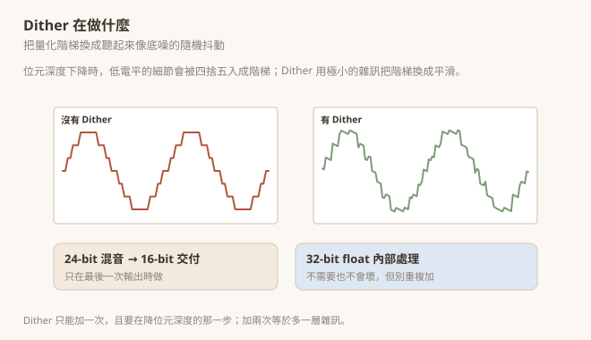
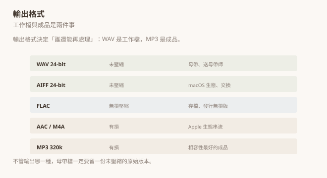

# **第 30 堂：最終成品：Dither 觀念與檔案輸出格式歸檔**

## 課程目標

經過前面二十九堂課的漫長旅程，從錄音、編輯、混音到母帶，你終於站在最終輸出的關卡前。最後這一步看似簡單——按下 Export（匯出）按鈕就好——但若不懂 Dither（抖動/噪聲整形）的原理，不熟悉各種音訊格式的特性，你的心血可能因為格式錯誤、位元深度不匹配，或是雙重 Dither 而被發行平台退件或導致音質受損。本堂課將系統性解析 Dither 背後的數位音訊理論、何時該用何時不該用，以及專業發行所需的檔案輸出與歸檔流程。

---

## 一、什麼是 Dither？



### 1.1 問題的根源：量化失真

在數位音訊中，類比訊號被取樣並量化成有限位元數的離散數值。當你從高位元深度（如 24-bit）降轉到低位元深度（如 16-bit）時，每個取樣點的有效數值範圍縮小，原本可以由 16,777,216 個階梯描述的訊號被強迫塞進 65,536 個階梯。這個過程會產生**量化誤差**（Quantization Error），在極小聲的段落中表現為可聽聞的失真或顆粒感。

想像你有一張解析度極高的照片，將其強制降為 256 色模式——原本平滑的漸層會出現帶狀色塊。16-bit 與 24-bit 的位元深度差異正是如此，只是發生在音量極低的尾音或殘響尾巴上。

### 1.2 Dither 的解決方案

Dither 是在降轉位元深度之前，刻意加入極低音量的噪聲（通常低於 -90 dBFS）。這個微小的噪聲會**打破量化誤差的規律性**，讓原本集中在特定頻段的失真轉變為隨機的底噪。人耳對隨機噪聲的敏感度遠低於規律性的失真，因此整體聽感反而更自然、更平滑。

關鍵原理：Dither 讓量化誤差從「與訊號相關的失真」變成「與訊號無關的噪聲」。前者是音樂性的破壞，後者是聽覺上可被忽略的背景。

### 1.3 簡單類比

如果你在黑暗的房間裡地毯上有一根針掉落，你幾乎不可能找到它。但如果你在地毯上撒滿許多小珠子，然後再丟一根針，你反而更容易從珠子的分布中察覺針的異常位置。Dither 就是那些小珠子——它犧牲了一點點噪聲底限，換來了更細微的訊號解析能力。

---

## 二、何時該用 Dither？

### 2.1 只有在降轉位元深度時才需要

這是最重要的黃金法則：

- **從 24-bit 降轉到 16-bit** → 需要 Dither
- **從 32-bit float 降轉到 24-bit** → 不需要 Dither（32-bit float 的 mantissa 足夠大）
- **24-bit 專案直接輸出 24-bit**（不做位元深度轉換） → 不需要 Dither
- **匯出成 MP3** → 不需要 Dither（MP3 編碼器內部有自己的量化機制）

### 2.2 母帶階段使用，混音階段通常不用

在混音階段，你應該使用足夠高的位元深度（24-bit 或 32-bit float）進行所有處理。只有在最終母帶輸出、準備發行用的 16-bit WAV 或 CD 規格檔案時，才在該次匯出中加入 Dither。

因此，一般的工作流程是：

1. 混音完成 → 匯出 24-bit/48kHz 的混音檔（不加入 Dither）
2. 母帶工程師處理 → 匯出最終母帶，以 24-bit 存檔（不加入 Dither）
3. **最後一步**：降轉到 16-bit/44.1kHz 發行格式 → 在這一步加入 Dither

### 2.3 真實案例：串流平台的要求

Spotify、Apple Music、Tidal 等平台通常接受 24-bit 44.1kHz 或 48kHz 的 FLAC/WAV。若你直接提供 24-bit 檔案，平台端自行降轉時會由他們的編碼器決定是否加 Dither——這意味著你無法控制 Dither 的演算法與品質。大多數專業母帶工程師會選擇自行輸出 16-bit 版本，確保 Dither 品質在自己的掌控之中。

---

## 三、Dither 的類型

### 3.1 TPDF（Triangular Probability Density Function）

最基礎、最安全的 Dither 類型。它使用三角形機率分布的噪聲，在所有頻率上平均分布（白噪聲）。優點是與任何後續處理都相容，缺點是底噪在所有頻率上一樣大，沒有針對人耳敏感度做最佳化。

**適用場景**：當你不確定後續會經過什麼處理，或需要絕對安全的通用方案時。

### 3.2 Noise Shaping（噪聲整形）

在 TPDF 的基礎上，將噪聲的能量從人耳最敏感的中高頻段（約 2kHz–4kHz）轉移到人耳較不敏感的高頻（>15kHz）與極低頻（<100Hz）區域。這讓可聽範圍內的噪聲能量大幅降低，等效動態範圍可以提升約 10–15 dB。

**不同廠商的 Noise Shaping 演算法**：

- **POW-r (Psychoacoustically Optimized Wordlength Reduction)**：有三種模式。POW-r #1 最輕微，POW-r #3 噪聲整形幅度最大，但也可能與後續編碼產生互動問題。
- **iZotope MBIT+**（Ozone／RX 內建）：可選 TPDF 或 Noise Shaping，並能調整噪聲量與整形曲線。
- **UV22HR (Apogee)**：Apogee 的專利技術，擅長保留極低頻的細節。
- **iZotope Ozone／RX 內建 Dither**：可選 TPDF 或 Noise Shaping，並能調整噪聲量與整形曲線。

**注意**：Noise Shaping 後的檔案不適合再經過任何 EQ、動態處理或格式轉換，因為這些操作會破壞精心設計的噪聲曲線。

### 3.3 淺度 Dither

有些現代編碼器（如 Izotope 的 Advanced 系列）提供可調節的 Dither 強度。對於已經有足夠動態範圍的音樂（特別是古典樂或爵士樂），你可以使用比標準更低的噪聲量，在某些情況下聽感更純淨。

---

## 四、何時不該用 Dither？

### 4.1 雙重 Dither 的陷阱

這是最常見的失誤。場景如下：

1. 你從 DAW 匯出混音，DAW 的 Master Bus 上掛了 Dither Plugin
2. 你把這個檔案匯入母帶軟體，再次輸出 16-bit 時又加了一次 Dither

兩次 Dither 疊加會讓底噪升高約 3dB，且兩組噪聲整形曲線相互干擾，產生可聽聞的 artifacts。**解決方案**：只在最終匯出步驟加一次 Dither，中間所有轉換都維持在高位元深度。

### 4.2 不需要 Dither 的情境彙整

| 情境 | 需要 Dither？ | 原因 |
|------|-------------|------|
| 24-bit → 24-bit | 否 | 位元深度未變 |
| 32-bit float → 24-bit | 否 | mantissa 足夠精確 |
| 24-bit → 16-bit WAV | 是 | 明顯的位元深度降轉 |
| 24-bit → MP3 | 否 | MP3 編碼器內部自行量化，外部 Dither 沒有意義 |
| CD 燒錄（16-bit PCM） | 是 | 紅皮書 CD 規格強制 16-bit |
| 匯出 24-bit FLAC | 否 | 保持原生位元深度 |

### 4.3 特殊情況：Bit Truncation

如果你完全不加 Dither 直接截斷位元（Bit Truncation），小音量訊號會產生 Harmonic Distortion（諧波失真），聽起來像粗糙的顆粒感。這就是為什麼「不加 Dither」在很多情況下反而比「加了 Dither」聽起來更糟——儘管不加 Dither 的測量數據（THD+N）可能更低。

---

## 五、輸出格式全面解析



### 5.1 無失真格式（Lossless）

#### WAV（Waveform Audio File Format）

- **優點**：業界標準，所有 DAW 與硬體都支援，無檔案大小限制，無壓縮偽影
- **缺點**：檔案巨大（約 10 MB/分鐘 at 16-bit/44.1kHz），不支援 metadata 嵌入（需要依靠 BWF 擴充格式）
- **使用場景**：CD 母帶、暫存交換、存檔備份

#### AIFF（Audio Interchange File Format）

- **本質上與 WAV 相同**：使用 LPCM 編碼，同樣無失真
- **唯一主要差異**：AIFF 支援原生 metadata，在 macOS 生態系中更友善
- **使用場景**：Mac 使用者間的交換、Logic Pro 原生格式

#### FLAC（Free Lossless Audio Codec）

- **優點**：壓縮比約 50–60%（節省大量空間），完全無失真（解壓後與原 WAV 位元完全相同），支援豐富 metadata 與專輯封面，開放原始碼
- **缺點**：部分老舊硬體不支援，編碼/解碼需要少量 CPU 運算
- **使用場景**：串流平台（Tidal、Qobuz）、個人收藏、網路傳輸

### 5.2 有失真格式（Lossy）

#### MP3（MPEG-1 Audio Layer 3）

- **位元率選擇**：128 kbps（廣播品質）、192 kbps（良好）、256 kbps（非常好）、320 kbps（MP3 最高品質）
- **優點**：相容性最佳，任何裝置都能播放，檔案極小
- **缺點**：有失真壓縮，高頻細節永久損失，不適合作為存檔格式
- **使用場景**：分發試聽、Podcast、手機儲存空間有限的裝置

#### AAC（Advanced Audio Coding）

- **位元率選擇**：通常 256 kbps 即可達到絕佳品質
- **優點**：在相同位元率下，音質優於 MP3（尤其是低頻與高頻的還原度），Apple 生態系的標準
- **缺點**：部分老舊裝置與 Linux 預設不支援
- **使用場景**：Apple Music、YouTube、iTunes 商店

### 5.3 何時選擇哪一種？

| 用途 | 建議格式 | 規格 |
|------|---------|------|
| CD 壓片 | WAV 16-bit/44.1kHz | 紅皮書規格 |
| 串流（高音質） | FLAC 24-bit/48kHz | 96kHz+ 對多數人無意義 |
| 串流（一般） | AAC 256 kbps 或 MP3 320 kbps | 視平台要求 |
| 存檔備份 | WAV 或 FLAC 24-bit/48kHz | 原始錄音規格 |
| 暫存交換 | WAV 24-bit/48kHz | DAW 間傳遞 |
| 試聽 Demo | MP3 192–256 kbps | 平衡品質與檔案大小 |

---

## 六、匯出設定實戰

### 6.1 Sample Rate（取樣率）的選擇

- **44.1kHz**：CD 標準，串流平台標準，絕大多數消費級裝置支援
- **48kHz**：影視配樂標準，常見於影片後期
- **96kHz / 192kHz**：理論上保留更多超音波頻率，但對於人耳聽覺範圍（20Hz–20kHz）無實質意義。若後續需要大量時間拉伸或音高移位，高取樣率有幫助

**實務建議**：若非特別需求，一律使用 48kHz 作為混音與母帶的標準取樣率。最終依據發行平台要求決定是否降轉至 44.1kHz。

### 6.2 Bit Depth（位元深度）的選擇

- **32-bit float**：混音階段使用，內部處理動態範圍極大，不怕 clipping
- **24-bit**：母帶與存檔標準，動態範圍約 144 dB，足以容納任何音樂
- **16-bit**：CD 與一般發行格式，動態範圍約 96 dB

### 6.3 DAW 匯出設定檢查清單

以 Ableton Live、Logic Pro、Pro Tools、Cubase 為例，通用步驟如下：

1. **設定取樣率**：確認 Session 與匯出設定一致（不同則會觸發 SRC，Sample Rate Conversion）
2. **設定位元深度**：選擇目標深度
3. **開啟 Dither**：若有降轉，確認 Dither 選項已正確開啟
4. **Normalize（標準化）**：通常關閉。你應該已經在母帶階段決定好整體音量
5. **Insert Silence（插入靜音）**：根據需要決定結尾淡出長度
6. **Conversion Quality（轉換品質）**：選擇最高品質（如 Best / High Quality），越高的 SRC 品質耗時越久但結果越好

---

## 七、專業檔案命名與 Metadata

### 7.1 檔案命名慣例

統一的命名規則讓發行商、串流平台與聽眾都能快速辨識檔案。以下是一個推薦的命名結構：

```
ArtistName_TrackTitle_MixVersion_Format_SampleRate-BitDepth.wav
```

實例：

- `周杰倫_告白氣球_AlbumMaster_44k16b.wav`
- `五月天_派對動物_Instrumental_48k24b.wav`
- `Adele_Hello_RadioEdit_44k16b.wav`

**版本標記建議**：

- `AlbumMaster`：專輯母帶
- `RadioEdit`：廣播剪輯版
- `Instrumental`：伴奏版
- `TVTrack`：電視尺寸
- `Clean` / `Explicit`：歌詞潔淨版 / 限制級版

### 7.2 Metadata 欄位

聲音檔案中的 metadata 不僅是方便整理，更是串流平台正確顯示資訊的關鍵。

**必須填寫的欄位**：

1. **Title**：曲名（注意大小寫與標點符號）
2. **Artist**：表演者名稱
3. **Album**：專輯名稱
4. **Track Number**：曲目編號
5. **Year**：發行年份

**建議填寫的欄位**：

6. **Genre**：音樂類型
7. **ISRC（International Standard Recording Code）**：國際標準錄音錄影資料代碼，每首曲目唯一，由 IFPI 指定的各國 National ISRC Agency 核發
8. **Label / Publisher**：唱片公司或發行商
9. **Composer**：作曲者
10. **Lyricist**：作詞者
11. **Album Art**：嵌入封面圖片（建議 3000×3000 px，JPEG 或 PNG）

### 7.3 ISRC 的重要性

ISRC 是追蹤版稅的核心識別碼。格式為：**CC-XXX-YY-NNNNNN**

- CC：國家碼（如 TW = 台灣、US = 美國）
- XXX：註冊者碼
- YY：發行年份末兩位
- NNNNNN：曲目編號（六位數）

沒有 ISRC 的曲目在串流平台上無法被正確追蹤播放次數，版稅將無法入帳。

---

## 八、歸檔與製作備份策略

### 8.1 專案檔案的目錄結構範例

一個專業的專案資料夾應該是任何人在你離職或電腦當機後都能接手的結構：

```
Project_TrackName/
├── Audio Files/              # 原始錄音檔案
│   ├── Recorded_Takes/       # 錄音取樣
│   └── Raw_DI/               # 原始 DI 訊號
├── Sessions/                 # DAW 專案檔
│   ├── Mixing/
│   └── Mastering/
├── Stems/                    # 分軌匯出
│   ├── Full_Mix/             # 完整混音
│   ├── Instrumental/         # 伴奏版
│   ├── Vocals/               # 人聲軌
│   └── Individual_Tracks/    # 各樂器獨立軌
├── Deliverables/             # 最終輸出
│   ├── WAV_24bit_48kHz/
│   ├── WAV_16bit_44k1kHz/
│   ├── FLAC_24bit_48kHz/
│   ├── MP3_320kbps/
│   └── AAC_256kbps/
├── Documents/                # 文件與授權
│   ├── Notes/                # 製作筆記
│   ├── Contracts/            # 合約掃描
│   └── ISRC_List.txt         # ISRC 列表
└── Project_Summary.txt       # 專案摘要
```

### 8.2 Stems（分軌匯出）的規範

如果你需要提供 Stems 給混音師、母帶工程師或現場演出團隊，請遵循以下規範：

- **格式**：24-bit WAV，與專案相同的取樣率
- **命名**：`Artist_Track_Stem_InstrumentName.wav`
- **時間起點**：所有 Stems 從 0:00 開始對齊（不要各自從不同時間點開始）
- **音軌間的 silence**：保留自然空白，不要硬切
- **處理狀態標記**：標明是 Raw（無效果）、Wet（有效果）還是 Mid/Side 分離

### 8.3 雲端備份與版本控制

- 使用 3-2-1 備份原則：**3 份備份、2 種不同媒介、1 份在異地**
- SD 卡 / 外接硬碟 → 本地 NAS → 雲端（Backblaze、Google Drive、Dropbox）
- 每次重大版本更新（Mix v2、Master v3）保留獨立檔案，不要覆蓋舊版
- 使用 Git LFS 或 Syncthing 管理大型音訊檔案

---

## 九、發行前的最終檢查清單

### 9.1 音訊品管（Quality Check）

- [ ] 全曲無破音（Clipping），最大 True Peak < -1 dBTP（建議 -1.5 dBTP 安全值）
- [ ] 沒有意外的雜音、Pop、Click 或喀擦聲
- [ ] 開頭與結尾的靜音長度正確（開頭 ≤ 0.5 秒，結尾建議 1–2 秒淡出）
- [ ] 左右聲道相位正確，無反相問題
- [ ] 頻譜分析無異常（如 DC Offset、超音波噪聲、突然的頻段凹陷）
- [ ] Dither 只加了一次，且只在位元深度降轉時加入

### 9.2 檔案品管

- [ ] 檔案命名符合發行商規範
- [ ] Metadata 全部填寫正確（特別是 ISRC 與曲序）
- [ ] 專輯封面嵌入，大小與格式符合平台要求
- [ ] 已驗證 MD5 或 SHA256 checksum（長距離傳輸後比對）

### 9.3 格式與平台檢查

- [ ] 若是 CD 發行：準備好 DDP（Disc Description Protocol）檔案或 ISO
- [ ] 若是數位發行：確認為 FLAC 16-bit/44.1kHz 或 WAV（視平台要求）
- [ ] 若是串流：確認 Loudness Normalization 符合 LUFS 目標（一般為 -14 LUFS 到 -16 LUFS 整合值）
- [ ] 若是實體 USB 或 SD 卡：確認檔案系統格式（FAT32 或 exFAT），檔名無特殊字元

---

## 十、最終輸出的發行方式

### 10.1 CD 燒錄與 DDP

實體 CD 雖然市佔率逐年降低，但在獨立音樂圈、古典樂與爵士樂領域仍有重要地位。

- **CD-R 燒錄**：使用專門的 Audio CD 燒錄軟體（如 Nero、Toast、CDBurnerXP），不可直接將 WAV 檔案拖入光碟做為資料檔。需使用「Red Book Audio CD」格式
- **DDP 檔案**：DDP（Disc Description Protocol）是 CD 壓片廠要求的標準格式。包含：
  - `DDPMS`（主資料）
  - `DDPID`（識別檔）
  - `PQ` 表（曲目間距與索引）
  - 完整的 16-bit/44.1kHz WAV 影像檔
- 使用軟體如 Sonoris DDP Creator、HOFA DDP Player Maker 或專業母帶 DAW（如 Sequoia、Pyramix）產生 DDP

### 10.2 數位發行平台

- **DistroKid**：低年費，簡單快速，適合獨立音樂人
- **TuneCore**：年費制、不限上架曲數，保留 100% 版稅
- **CD Baby**：傳統大廠，也處理實體發行
- **Apple Music for Artists / Spotify for Artists**：直接上架需要經過 Distributor

每個平台的規格要求略有差異，但通用規格是：

- 音訊：FLAC 或 WAV，16-bit 或 24-bit，44.1kHz 或 48kHz
- 封面：至少 3000×3000 像素，RGB，JPEG 或 PNG
- 檔案大小：單曲不超過 100 MB（部分平台限制）

### 10.3 高解析音訊發行

如果目標是發行高解析音訊（High-Resolution Audio），注意：

- 格式：FLAC 24-bit/96kHz 或 DSD（Direct Stream Digital）
- 平台：Tidal Masters、Qobuz Sublime+、HDtracks
- MQA（Master Quality Authenticated）雖然曾是主流，但目前已逐漸被 FLAC 24-bit 取代
- 注意網路傳輸頻寬：24-bit/96kHz 的 FLAC 檔案約為 16-bit/44.1kHz 的三倍大

---

## 十一、常見問題與陷阱

### Q1：我在 Ableton Live 中匯出 16-bit WAV，需要開 Dither 嗎？

- 需要。Ableton 的匯出選項中有「Dither Options」，在選擇 16-bit 時請開啟。建議使用 Triangular 或 POW-r #3。

### Q2：如果我的客戶要 24-bit WAV，我需要加 Dither 嗎？

- 不需要。24-bit 到 24-bit 沒有降轉，不需要 Dither。

### Q3：匯出 MP3 時需要先加 Dither 嗎？

- 不需要。MP3 編碼器內部使用自己的心理聲學模型與量化方式，外部 Dither 可能與其干擾。讓 MP3 編碼器自行處理即可。

### Q4：我從 96kHz 降轉到 44.1kHz，Sample Rate Conversion（SRC）本身會引入失真嗎？

- 會。取樣率轉換會引入 aliasing 與濾波器 artifacts。請務必使用高品質的 SRC 演算法（如 iZotope RX 的 SRC、r8brain、SoX 的極高品質模式），不要使用 DAW 的預設低品質模式。

### Q5：為什麼我的 16-bit 檔案聽起來比 24-bit 粗糙？

- 很可能有兩個原因：1) 沒有使用 Dither（bit truncation 導致量化失真）；2) 使用了低品質的 SRC。請檢查這兩個環節。

### Q6：串流平台要求的 -14 LUFS 標準，我應該在匯出時直接壓到 -14 LUFS 嗎？

- 不建議。你應該保持母帶的動態範圍（例如 -9 到 -11 LUFS 的流行樂標準），讓串流平台的 Loudness Normalization 自動將音量降低到 -14 LUFS。刻意壓縮到 -14 LUFS 會讓你的音樂在其他平台上聽起來音量不足。

---

## 十二、總結：最後一步的策略

從混音到發行，整個數位音樂製作流程的最終環節看似簡單，卻最容易出錯。以下是必須永遠記住的關鍵要點：

1. **Dither 只在位元深度降轉時使用一次**——不多不少，恰如其分
2. **高位元深度（24-bit 或 32-bit float）是混音與母帶的安全區**——所有處理都在這個範圍內進行
3. **發行格式取決於目標平台**——CD 用 16-bit/44.1kHz WAV，串流用 FLAC 24-bit 或 AAC 256 kbps，高解析用 FLAC 24-bit/96kHz
4. **Metadata 是版稅的命脈**——ISRC、曲名、藝人名稱缺一不可
5. **歸檔結構決定未來的工作效率**——好的命名與目錄規劃讓多年後的你還能輕鬆找到原始檔案
6. **備份永遠不嫌多**——3-2-1 備份策略是專業製作的底線

當你按下 Export 按鈕的那一刻，你不是在結束一個專案，而是在為你的音樂作品準備它跟世界見面的護照。格式正確、Dither 到位、metadata 完整，你的音樂就能毫無阻礙地抵達每一位聽眾的耳中。

恭喜完成全部三十堂數位音樂製作課程。從聲波的基本物理原理、錄音技術、MIDI 編輯、混音技法到最終的 Dither 與輸出歸檔，你已經掌握了從零到發行的完整知識體系。現在，打開你的 DAW，開始創作屬於你的聲音吧。

---

**延伸閱讀與資源**

- iZotope RX 系列手冊中的 Dither 章節
- Bob Katz《Mastering Audio: The Art and the Science》（母帶處理聖經）
- iZotope 官方 Dither 技術白皮書（izotope.com/resources）
- 紅皮書 CD 標準（IEC 60908）
- AES17 數位音訊測量標準
