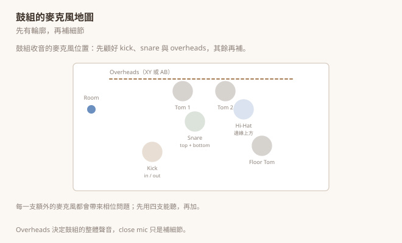
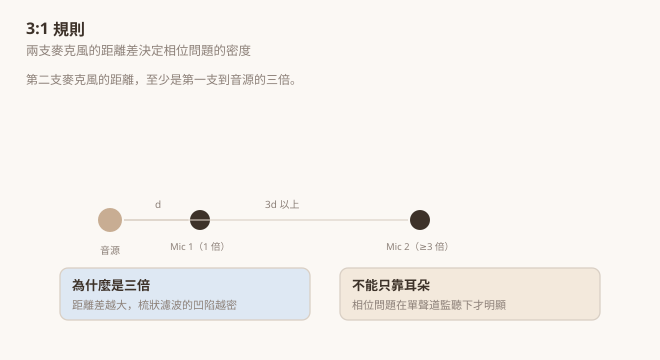
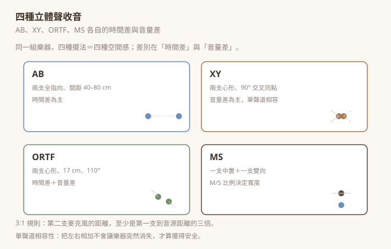
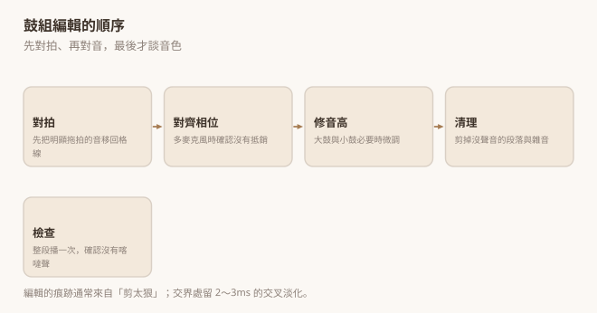

# **第 05 堂：麥克風擺位：原聲樂器收音技術**

錄音室裡，好的麥克風只是起點。真正決定聲音品質的，是麥克風的**擺位**——你把麥克風放在哪裡、離多遠、對著哪個角度。這一堂課，我們將聚焦於**原聲樂器**（acoustic instruments）的收音技術，從木吉他、鋼琴、爵士鼓到弦樂、管樂與打擊樂，逐一剖析每個樂器的最佳擺位策略，同時深入探討多麥克風的**相位相關性**這個核心概念。

---

## 一個核心觀念：指向性與距離的關係

在進入各樂器之前，請先記住兩個通用原則：

1. **距離決定音色**：麥克風越靠近樂器，低頻越強（近接效應 proximity effect），高頻細節越清晰，但樂器的「完整感」會減弱；麥克風越遠，空間反射越多，聲音越自然但越模糊。
2. **角度決定光澤**：對著樂器的共鳴點（如面板）得到飽滿的音色；對著邊緣或側面得到較亮的音色。微調幾度，聲音可能完全不同。

一般原聲樂器收音的起始距離約 **15-60 公分**，視樂器類型而定。

---

## 一、木吉他（Acoustic Guitar）收音

木吉他是最常被錄音的原聲樂器之一，卻也是最容易被錄壞的樂器。

### 1.1 單支麥克風：12 格 vs 音孔

| 擺放位置 | 優點 | 缺點 |
|-----------|------|------|
| **12 格處（第 12 琴格上方）** | 均衡、明亮、減少低頻轟聲 | 缺乏低頻厚度 |
| **音孔正前方** | 低頻飽滿、溫暖 | 容易產生轟聲（boominess），指顆粒感不明確 |

**實戰建議**：從 **12 格處**開始，距離琴身約 **20-30 公分**，麥克風指向第 12 格與音孔之間。你可以這樣想像——12 格是高頻的窗戶，音孔是低頻的倉庫；兩者之間的點就是「最佳聽覺平衡點」。

### 1.2 雙麥克風立體聲收音

想錄到更寬廣、更有空間感的木吉他，就用兩支麥克風。

#### （A）XY 方式（同軸重疊）

兩支心形指向麥克風以 **90 度**夾角相互交叉，振膜盡量靠近彼此（上下重疊），兩支各偏中心 45 度（夾角 120 度時則各偏 60 度）。

- **優點**：幾乎無相位問題（因為振膜在同一點），單聲道相容性極佳。
- **適合**：節奏吉他、需要清晰定位的錄音。

#### （B）Spaced Pair（間隔對）

兩支麥克風分開放置：一支在 12 格處（偏亮聲），一支在琴橋附近（偏厚聲），距離約 30-50 公分。

- **優點**：音色更豐富、更立體。
- **缺點**：相位問題較多，必須用 3:1 規則來控制（見後文）。
- **技巧**：兩支麥克風距離琴身的差別最好不超過一倍，否則左中右會出現「空洞感」。

**實戰比喻**：XY 像是用一台廣角相機拍照——畫面穩定、一體成形；Spaced Pair 像是用兩台相機拍同一個場景再合成——更立體、但需要對得更準。

---

## 二、鋼琴（Piano）收音

鋼琴是非常寬廣的樂器，低音弦在左側、高音弦在右側，音域橫跨七個八度以上。收音目標是捕捉這種寬度與動態。

### 2.1 平台鋼琴（Grand Piano）

**基本擺位——琴蓋內，靠近琴弦**

將平台鋼琴的琴蓋完全打開（用長撐桿撐到最高），麥克風從上方指向琴弦：

- **低音區**：麥克風放在左側，距離琴弦約 15-20 公分，指向低音弦的中段。
- **高音區**：麥克風放在右側，距離琴弦約 10-15 公分，指向高音弦的中段。

**立體聲擺位建議**：

- **AB 間隔對**：兩支全指向（或心形）麥克風分別放在低音區與高音區上方 20-30 公分，間距依琴體寬度調整，平台鋼琴通常要 60–120 公分才cover得到兩端。這是最自然、最飽滿的鋼琴立體聲。
- **ORTF 方式**：兩支心形麥克風相距 17 公分、夾角 110 度，放在琴弦中段上方。比 AB 更緊湊、定位更清楚。

### 2.2 直立鋼琴（Upright Piano）

直立鋼琴的琴弦是垂直的，聲波從背板向後射出、從前方面板傳出。

**最佳擺位**：將麥克風從**琴頂上方**指向內部，或將琴面朝房間開放空間，麥克風放在背板後方 30-60 公分處。

如果空間有限，也可以打開上方蓋板，將麥克風從琴頂伸入，指向琴弦中心，距離約 20 公分。

**小提醒**：直立鋼琴的聲音比平台鋼琴更集中、較少泛音。可以用兩支麥克風（一支針對低音、一支針對高音）來補足寬度。

---

## 三、爵士鼓（Drum Kit）收音

爵士鼓是錄音中最具挑戰性的樂器之一——因為它有太多聲源同時發聲。一套標準鼓組的收音通常分三層。

### 3.1 Close Miking（近距離收音）

每顆鼓獨立放置一支動圈麥克風（如 Shure SM57），距離鼓皮邊緣約 **5-10 公分**，指向斜向鼓面中心（約 30-45 度角）。

- **大鼓（Kick Drum）**：麥克風放在鼓皮正前方，距離鼓皮 5-15 公分，或直接放入鼓內（移除前方鼓皮）。略偏中心可得到較多打擊感（attack）；正對中心則得到更多低頻。
- **小鼓（Snare）**：麥克風放在鼓邊上方約 5 公分，指向鼓面中心與邊緣之間。若小鼓有上下兩個鼓皮，上鼓皮收音為主、下鼓皮收音為輔（注意相位反轉）。
- **Tom 鼓**：每顆 Tom 各一支麥克風，放在鼓面上方 5-10 公分，角度約 45 度。

### 3.2 上方拾音麥克風（Overheads）

Overheads 負責捕捉鈸（cymbal）與整體鼓組的立體感。通常使用一對電容式麥克風，採用 **XY**、**AB** 或 **ORTF** 方式架在鼓組上方約 90-120 公分處。

- **XY 方式**：定位精準、單聲道相容性高。
- **Spaced Pair**：聲音更寬、更立體，但小心鈸的定位漂移。

口訣：「Overheads 是鼓組的框架，Close mics 是細節填入。」

### 3.3 空間麥克風（Room Mics）

在錄音室中距離鼓組 **1.5-3 公尺**（或更遠）放置一對麥克風，捕捉房間的反射聲與整體衝擊感。通常使用全指向麥克風，甚至電容式或鋁帶式麥克風，以得到溫暖自然的空間聲。

**實戰技巧**：混音時，將 Room mics 的訊號壓縮 5-10 dB，可以讓鼓組聽起來更巨大、更有「房間感」。

---

## 四、弦樂器（小提琴、中提琴、大提琴）收音

弦樂器的聲音從琴身面板（f 孔區域）向外輻射，具有高度的指向性。

### 4.1 基本擺位

- **距離**：30-60 公分。太近會聽到過多的擦弦雜音（bow noise）；太遠則失去細節。
- **方向**：麥克風指向 **f 孔之間**或略偏上方，避開正對拉弓點（約在琴橋與指板之間），以減少弓毛摩擦聲。
- **高度**：與樂器面板平行或略高 15 度。

### 4.2 小提琴與中提琴的注意事項

小提琴的聲音集中且亮，容易產生尖銳感。用一支 **心形指向電容麥克風**，距離 40-50 公分，角度略偏上方（約 30 度），可以有效軟化高頻。

**實戰比喻**：把小提琴想像成一個手電筒——光束最強（最亮）的地方對聽眾，但對麥克風時我們希望聽到的是「環境光」，而不是直射的刺眼光芒。

### 4.3 大提琴

大提琴低頻豐富，距離可以近一些（30-40 公分）。麥克風指向 f 孔上方、琴橋後方，避免正對拉弓麵。也可以加入第二支麥克風放在琴身背面，錄製共鳴低頻，混音時混合使用。

---

## 五、管樂器（長笛、薩克斯風、小號）收音

管樂器的最大難題是**氣流和音量**。

### 5.1 長笛（Flute）

長笛的聲音從吹口（embouchure）與按鍵處同時發出，具有雙重聲源。

- **位置**：麥克風放在吹口與按鍵之間，距離約 **30-60 公分**。
- **角度**：偏離吹口直接氣流約 **45 度**，避免吹氣聲（breath noise）直接衝擊麥克風振膜。
- **層次**：如果演奏者動態很大，可以加一支 Room mic 補充空間感。

**小技巧**：用一條防風罩（windscreen）可以減少吹氣聲，但不要貼太近——距離才是關鍵。

### 5.2 薩克斯風（Saxophone）

薩克斯風的聲音從喇叭口（bell）及按鍵處同時發出。如果只對著喇叭口，聲音聽起來會又尖又扁。

- **最佳位置**：麥克風距離喇叭口 **45-90 公分**，略偏喇叭口上方約 30 度，這樣可以同時收到喇叭口的聲音與按鍵的機械聲，保留完整的音色。
- **近距離選項**：若想得到更直接的音色（如流行樂或 funk），可以將動圈麥克風放在喇叭口前方 10-20 公分。
- **避免**：不要直接把動圈麥克風塞入喇叭口——這會讓音色極度壓縮且不自然（除非你要的是那種特殊的 vintage 效果）。

### 5.3 小號 / 銅管（Trumpet / Brass）

銅管樂器的聲壓極高，可以用動圈麥克風或電容麥克風（帶衰減 pad）。

- **距離**：**30-90 公分**，麥克風偏離喇叭口中心線約 15-45 度。直對喇叭口會收到過多的氣流與尖銳感。
- **Room mic**：銅管在房間反射聲中聽起來最好，所以至少留 50% 以上的空間比例。

---

## 六、打擊樂器（Percussion）收音

打擊樂器的範圍極廣，從手鼓（conga, bongo）到鐵琴（xylophone, glockenspiel）與小型打擊樂器。

### 6.1 手鼓類（Conga / Bongo）

- **距離**：15-30 公分，麥克風指向鼓面中心偏邊緣——中心低頻多，邊緣 slap 聲明顯。
- **可選立體聲**：用兩支麥克風，一支針對低音（鼓中心）、一支針對 slap（鼓邊），混音時平衡。
- **過多低頻解決**：如果低頻過轟，將麥克風往後移 10 公分，或啟用低切濾波（high-pass filter）。

### 6.2 鐵琴、木琴類（Xylophone / Marimba）

這類樂器的高頻延伸很廣，適合使用電容麥克風。將麥克風懸掛在琴鍵上方約 **30-50 公分**，覆蓋整個音域寬度。

如果是獨奏，用一支；如果是合奏的一部分，用一對立體聲 AB 方式擺在樂器上方。

### 6.3 小型打擊樂器（Shaker, Tambourine, Triangle）

- **Shaker / 沙鈴**：距離 20-40 公分，心形指向，注意不要收到手部摩擦聲。可以用網狀防風罩。
- **Tambourine / 鈴鼓**：距離 15-30 公分，對準鈴片區域。貼太近會過暴，太遠會失去清脆感。
- **Triangle / 三角鐵**：一枝心形小振膜電容麥克風，距離 20-30 公分，對準三角鐵的開放端（開口處）。

---

## 七、多麥克風的相位相關性：3:1 規則

當你同時使用兩支（以上）麥克風錄製同一個聲源時，**相位**（phase）就成為最重要的課題。

### 7.1 什麼是相位問題？

當兩支麥克風與聲源的距離不同時，同一聲音到達兩支麥克風的時間不同。這個時間差會導致某些頻率相互抵消（out of phase），造成聲音變薄、空洞、缺乏低頻。

**最簡單的測試**：如果是立體聲錄音，按下 mono 鍵——如果聲音突然變小或變薄，那就表示有相位問題。

### 7.2 3:1 規則

這是一個廣為流傳的經驗法則：

> **當使用兩支麥克風錄製同一聲源時，第二支麥克風與第一支麥克風的距離，至少要是第一支麥克風與聲源距離的三倍。**

舉例來說：

- 如果 Mic A 離吉他面板 30 公分，那麼 Mic B 與 Mic A 之間的距離至少要是 **90 公分**。

這個規則可以大幅減少兩支麥克風之間的可聽相位抵銷。注意，它是一個粗略指引，並非絕對真理——在實際操作中仍需聆聽驗證。

### 7.3 相位檢查方法

1. **相位反轉測試**：將其中一軌的相位反轉（在 DAW 中按 phase invert 或 polarity flip 按鈕）。如果反轉後聲音變大（原本相消的頻率被補回來），表示原始錄音有相位問題。
2. **視覺檢查**：在 DAW 的波形顯示中，兩個音軌的波峰與波谷應該大致對齊；如果一個波峰對應另一個波谷，就是反相。
3. **移動麥克風**：如果發現相位問題，最簡單的解法不是靠插件，而是**實際移動其中一支麥克風的位置**，直到聽覺上從 mono 到 stereo 的轉換最自然為止。

### 7.4 實戰建議

- **多麥克風一定是先處理相位，再處理 EQ。**
- 如果時間趕或無法仔細調整，**優先使用 XY 或 ORTF 方式**——它們的相位問題最小。
- 對鼓組錄音來說，**Snare 的下鼓皮麥克風**幾乎一定需要相位反轉（因為上鼓皮與下鼓皮的振動方向相反）。

---

## 八、總結與實戰口訣

獨奏樂器擺位速查表：

| 樂器 | 建議距離 | 麥克風類型 | 備註 |
|------|----------|-------------|------|
| 木吉他 | 20-30 cm | 小振膜電容 | 指向第 12 格與音孔之間 |
| 平台鋼琴 | 15-30 cm | 大振膜電容 | 雙麥立體聲更佳 |
| 爵士鼓 | 5-15 cm（close） | 動圈 + 電容 overheads | 分三層：close、overhead、room |
| 小提琴 | 40-50 cm | 心形電容 | 避開拉弓點直射 |
| 長笛 | 30-60 cm | 小振膜電容 | 偏依吹口氣流 45 度 |
| 薩克斯風 | 45-90 cm | 動圈或電容 | 略偏喇叭口上方 |
| 小號 | 30-90 cm | 動圈 + pad | 偏離中心線 30 度 |
| 打擊樂器 | 15-50 cm | 視類型而定 | 低頻過多就往後移 |

**五個黃金法則**：

1. **先聽、再調**——不要憑空猜測，用監聽耳機聆聽麥克風的真實聲音。
2. **離得遠、不一定是壞事**——如果聲音太刺耳或轟，後退 10-15 公分比加 EQ 更有效。
3. **用 mono 檢查相位**——立體聲時好聽不代表 mono 也好聽，而許多播放設備是 mono 的。
4. **房間也是樂器**——如果房間聲學不好，麥克風離遠會錄到壞聲音；改善房間比買貴麥克風更划算。
5. **相信你的耳朵**——理論是指南，不是規則。如果某個擺位聽起來好，它就是正確的。

下一堂課，我們將進入混音的領域，從 EQ 與頻率平衡開始，學習如何讓每一個音軌在混音中找到自己的位置。
