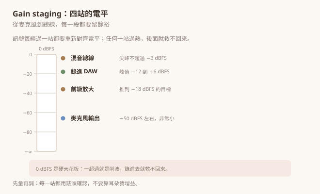
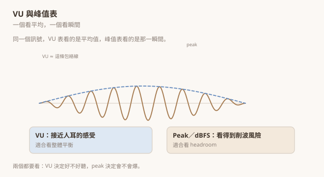
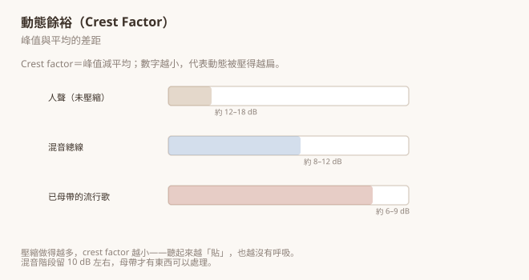

# **第 06 堂：Gain Staging：訊號增益階段與 Headroom 管理**

## 一、什麼是 Gain Staging？

Gain Staging（增益階段管理）是錄音與混音中最基本卻最常被忽略的核心觀念。它指的是在音訊訊號從源頭（麥克風、樂器 DI）一路通過前級、類比／數位轉換器、DAW 內的每一軌道、插入的每顆插件、aux send／return，最終抵達 master bus 的過程中，**在每一個環節控制訊號的電平大小**，確保訊號既不 clipping（削波），也不低到被噪聲淹沒。

想像一條水管系統：源頭的水壓（樂器輸出）經過第一道閥門（麥克風前級增益），再流經第二道閥門（DAW 軌道 fader）、第三道閥門（插件內部增益）、第四道閥門（aux send 電平）⋯⋯如果任意一道閥門開得太大，水就會噴出來（clipping）；開得太小，後面又得拼命加壓（boost），反而把水管裡原本的沙粒噪聲放得更大。Gain staging 的目的就是讓每一道閥門都處在最佳開度，讓水流（訊號）順暢、乾淨地流到終點。

在數位領域，gain staging 的意義又比類比時代更微妙。類比設備在過載時會產生諧波失真（harmonic distortion），有時是「好聽的 saturation」；但數位系統在 0 dBFS 以上就是毫無妥協的硬 clipping——方波、爆音、資訊永久丟失。因此數位 gain staging 的首要原則就是：**永遠不要讓訊號在類比數位轉換器或 DAW 內部超過 0 dBFS。**

## 二、類比 vs 數位：不同的 Headroom 哲學

### 類比時代的觀念

在類比盤帶與混音座時代，工程師習慣把 VU 表的 0 VU 對應到 +4 dBu 的 nominal level，而設備能承受的最大電平通常還有 +18 dBu 到 +24 dBu 的餘裕，這 14–20 dB 的空間就是 headroom。類比設備在超過 nominal level 之後會逐漸飽和，產生壓縮與諧波，但不會突然崩潰。工程師反而經常刻意 push 前級或 console channel 來取得溫暖的 saturation。

### 數位時代的觀念

數位錄音系統的 0 dBFS 就是天花板，一絲一毫都不能越過。24-bit 的動態範圍高達 144 dB，遠比類比介質寬廣，因此數位系統不需要像類比那樣「把訊號推到接近 0 VU 來避開噪聲」。相反地，我們應該在錄音時保留充足的數位 headroom，讓後續的混音處理有空間。

類比時代的「push it until it sounds good」到了數位時代必須轉變為「keep it clean until you intentionally want color」。如果你想要 saturation 或 distortion，請用專用的插件（例如 Decapitator、Saturn、Tape Emulation）來添加，而不是讓真實的前級或 AD converter 硬 clipping。

## 三、錄音階段的理想電平：-18 dBFS 到 -12 dBFS



### 為什麼不錄到 0 dBFS？

許多初學者錄音時拚命推前級增益，看到波形填滿整個畫面才安心，彷彿「不用白不用」。這是完全錯誤的觀念。24-bit 錄音的噪聲底（noise floor）大約在 -120 dBFS 左右，而你的麥克風前級與環境噪聲通常在 -60 dBFS 到 -50 dBFS 之間。即使你把訊號峰值只錄在 -18 dBFS，訊號與噪聲的差距（SNR）仍然有 30 dB 以上，完全足夠。

更重要的是，預留 headroom 有以下好處：

- **避免意外 clipping**：樂手演奏時突然用力、歌手嘶吼、打擊樂器的 transient，都可能讓瞬間峰值高出平均電平 10–20 dB。如果平均電平已經在 -6 dBFS，一個 transient 就直衝 0 dBFS 以上。
- **後續處理有空間**：當你加上 EQ boost、compressor makeup gain、saturation 插件時，訊號電平必然上升。如果原始錄音已經接近天花板，這些處理立刻造成 clipping。
- **保留 transient 完整性**：數位 clipping 會削平波形頂端，破壞打擊樂器的 punch 與細節。

### 實務建議

| 錄音類型 | 建議峰值電平（dBFS） | 建議平均電平（dBFS） |
|---------|---------------------|---------------------|
| 人聲 | -12 到 -6 | -18 到 -12 |
| 木吉他（fingerstyle） | -10 到 -6 | -18 到 -14 |
| 電吉他（clean DI） | -12 到 -6 | -20 到 -14 |
| 爵士鼓 overhead | -12 到 -6 | -20 到 -16 |
| 大鼓／小鼓 | -10 到 -6 | -18 到 -12 |
| 貝斯（DI） | -12 到 -6 | -18 到 -14 |
| 鋼琴 | -10 到 -6 | -18 到 -12 |

**口訣**：峰值別過 -6 dBFS，平均維持在 -18 dBFS 附近。這樣你就有 6 dB 以上的瞬間 headroom，以及 18 dB 的處理 headroom。

### 實際操作步驟

1. 請樂手以歌曲中最用力的段落演奏／演唱
2. 調整前級增益，讓 DAW 的 peak meter 最高落在 -12 dBFS 到 -6 dBFS 之間
3. 檢查整段錄音是否有任何瞬間超過 -3 dBFS（如果超過，調降 3–6 dB 再錄一次）
4. 確認 preamp 上的 clip LED 完全沒有亮起

## 四、為什麼錄音時保持低電平可以保留 Headroom？

Headroom 的字面意思是「頭頂空間」，指 nominal level 以上到 clipping 之間的緩衝區。在數位系統中，nominal level 通常訂在 -18 dBFS（對應類比的 0 VU / +4 dBu）。

當你錄音時將平均電平維持在 -18 dBFS，你就有 18 dB 的 headroom 讓瞬態峰值安全通過，而不會 clipping。對比之下，如果你把平均電平推到 -6 dBFS，headroom 只剩下 6 dB——一個稍強的鼓擊或嘶吼就能輕易突破天花板。

headroom 保留得越多，混音時的彈性就越大。你可以自由地添加飽和、壓縮、EQ boost，而不必擔心邊際效應導致失真。當混音接近完成時，最後再透過 master bus 的 makeup gain 或 limiter 把整體音量提升到發行標準（通常是 -14 LUFS 或 -12 LUFS 左右）。**先把音訊錄好錄乾淨，最後再「開大聲」**——這是專業工程師與業餘者最明顯的分水嶺。

## 五、插件內的 Gain Staging：Input / Output Trim

### 問題所在

許多現代插件（尤其是類比模擬類）內部有電路模擬，它們對 input level 非常敏感。舉例來說：

- **Compressor（1176、LA-2A、Distressor）**：input gain 決定了 compressor 的 threshold 與 gain reduction 量。如果 input 太弱，compressor 幾乎不做工；如果 input 太強，compressor 猛力壓縮，輸出 stage 也可能 saturation 過度。
- **Preamp / Console Emulation（Neve 1073、API 512、SSL G-Bus）**：input drive 控制 saturation 程度。過高的 input 雖然可能產生「好聽的 distortion」，但也會讓後續的處理失去控制。
- **Tape Emulation（Studer A800、Ampex ATR-102）**：input level 模擬 tape 的飽和曲線。太低沒有 tape 味，太高則 muddy 且失真。
- **EQ（Pultec、API 550、SSL E-Channel）**：boost 會增加電平，如果 input 已經很高，boost 後馬上 clip。

### 正確做法

每加入一個插件，請養成以下習慣：

1. **先設定 input trim**：確保進入插件的訊號電平落在插件的最佳 working range（通常對應 -18 dBFS 的 nominal level）。
2. **進行處理**：EQ boost、compression、saturation。
3. **檢查 output level**：處理後的輸出電平是否和輸入時大致相同？如果明顯變大或變小，用 output trim 或 makeup gain 調整回來。

這就是所謂的 **「unity gain staging」**——訊號經過每一顆插件後，整體 loudness 並未大幅改變，但音色已經被處理。這樣做的好處是：

- 避免 channel 累積 gain staging 誤差（每顆插件 +3 dB，十顆就 +30 dB）
- 讓你專注於音色改變，而非被 loudness 變化誤導（人耳天生偏好「比較大聲」的聲音）
- 保留後續 aux send、master bus 的 headroom

### 實用工具

- **Voxengo SPAN**：免費的頻譜分析儀，內建 peak / RMS / K-system meter，可以精確校準插件 input / output。
- **DAW 內建增益工具**：Pro Tools 的 Trim、Logic 的 Gain、Ableton Live 的 Utility，是調整 gain staging 最直接的工具。
- **LUFS Meter**：Youlean Loudness Meter 或 DAW 內建 loudness meter，幫助確認整體混音的 loudness 是否符合目標。

## 六、VU Meter 與 dBFS Meter：兩種不同的視角



### dBFS Meter（數位峰值表）

這是 DAW 中預設的 meter 類型，顯示的是**取樣點層級的瞬間峰值**。它的特性是反應極快，能捕捉到最短 1 sample 的 transient。這對於避免 clipping 至關重要——只要任何一個 sample 超過 0 dBFS，就產生了不可逆的 clipping。

然而，dBFS meter 的缺點也很明顯：它無法反映人耳感受到的 loudness。一個短暫的 hi-hat transient 可能在 dBFS meter 上顯示 -3 dBFS，聽起來卻遠比一個 -12 dBFS 的持續 bass note 小聲。如果只用 dBFS meter 來校準 gain staging，很容易讓平均電平過低，而讓 listener 覺得混音「沒力」。

### VU Meter（音量單位表）

VU meter 是類比時代的標準，它模擬了**人類耳朵對聲音強度的積分反應**。VU meter 的 ballistics（指針慣性）設計為 300ms 的 attack 和 300ms 的 release，因此它不顯示瞬間峰值，而是顯示一段時間內的平均電平。

在數位 DAW 中，VU meter 插件（如 Klanghelm VUMT、PSP VintageMeter 或 DAW 內建的 VU 模式）通常將 -18 dBFS 對應到 0 VU。這意味著：

- 0 VU = -18 dBFS（nominal level）
- 訊號偶爾跳到 +3 VU（約 -15 dBFS）是可接受的
- 持續超過 0 VU 太多表示電平過高

### 實務搭配使用

1. **錄音時主要看 dBFS peak meter**：確保沒有任何 sample 接近 0 dBFS，保留 headroom。
2. **混音時輔助看 VU meter**：調整軌道間的電平平衡時，VU meter 比 dBFS meter 更接近人耳的響度感知。
3. **利用 VU 校準插件 input**：將 VU meter 掛在插件之前，調整 input trim 直到 VU 表顯示 0 VU（即 -18 dBFS）。這表示訊號進入了插件的最佳 nominal range。

### K-System Metering（Bob Katz 提出）

這是一個融合了 peak 與 average 的 metering 系統，分為 K-20、K-14、K-12 三種刻度，分別對應不同動態範圍的混音目標。K-20 用於高動態範圍的古典／爵士錄音，K-12 用於 loudness 較高的流行音樂。K-system 的 0 dB 對應到目標 loudness，上方是 peak headroom，下方是動態範圍。

## 七、常見錯誤

### 錯誤一：每軌都錄到 -3 dBFS

如前所述，這會讓 headroom 蕩然無存。後續只要加一點 EQ boost 或 compressor makeup gain，整軌立刻 clipping。而且所有軌道疊加後 master bus 的電平會爆炸。

### 錯誤二：忽略噪聲底累積

每一軌的 preamp、錄音介面、插件都引入微量的噪聲。當 30 軌、50 軌疊加時，這些噪聲會累積，形成可聽聞的嘶聲（hiss）。如果每一軌的原始電平都太低，混音時又大幅 boost，噪聲會被放大得更明顯。因此：

- 錄音時不要過低（低於 -24 dBFS 平均電平可能太保守）
- 使用 noise gate 或 expander 來降低空白段落的噪聲
- 善用 mute 與 automation：沒有聲音的段落就讓軌道完全靜音

### 錯誤三：「反正最後有 limiter 撐著」

這是最危險的迷思。Limiter 的確能防止 master bus 超過 0 dBFS，但它無法修復已經在軌道或插件內部發生的 clipping。而且 limiter 本身也是處理器——過度依賴 limiter 會產生 pumping、失真、動態壓扁等副作用。**Gain staging 是預防醫學，limiter 是急救——不要拿急救當日常保健。**

### 錯誤四：插件 chain 中 gain 不斷累積

假設一軌吉他掛了四個插件：

- 原始錄音：-16 dBFS peak
- 插件一（EQ）：boost 3 dB → -13 dBFS
- 插件二（Compressor）：makeup gain 4 dB → -9 dBFS
- 插件三（Saturation）：output 增加 2 dB → -7 dBFS
- 插件四（Tape Emu）：output 增加 3 dB → -4 dBFS

到這一步，雖然單獨聽起來還沒 clip，但如果這軌是 master bus 中的一部分，累積到 bus 上後很快就超過 0 dBFS。更糟的是，每一級 plugins 的 internal headroom 也被壓縮了。

**解法**：每顆插件設定完後，用 output trim 把電平調回原始值。使用前面提到的 unity gain staging 原則。

### 錯誤五：不檢查 Aux / Send 的電平

Reverb 或 delay 的 aux send 如果電平過高，回傳到 bus 時也可能造成 clipping。而且多個軌道送到同一個 reverb aux，累積的電平會更高。記得：

- 每個軌道的 send level 維持在合理範圍（通常在 -12 dB 到 -inf 之間調整）
- Aux return 軌道本身也要有足夠 headroom
- 在 reverb / delay 插件內部降低 wet mix 而非在 return 軌上硬壓

### 錯誤六：### 錯誤六：忽略匯流 bus（summing bus）的電平

當你 solo 一軌時聽起來正常，但全部 play 時 master bus 卻爆了。這是因為各軌道的頻率與相位相關性，會讓總和電平遠高於「不相關訊號的功率和」（每翻倍僅 +3 dB），並趨近「算術和」（每翻倍 +6 dB，constructive interference）。所以即使每一軌都低於 -18 dBFS，30 軌疊加後 master bus 仍然可能到 -3 dBFS 甚至更高。混音過程中要定期檢查 master bus 的 peak 與 RMS 電平。

## 八、Gain Staging 實戰工作流程

以下是一份可以在任何 DAW 中套用的 step-by-step 工作流程：

### Step 1：錄音階段

1. 校準錄音介面的 preamp：使用前級上的 meter 或 DAW 的 peak meter，確保最高 peak 在 -12 dBFS 到 -6 dBFS 之間
2. 對於 DI 訊號（電吉他、貝斯），確認介面的 instrument input 沒有過載
3. 錄製 30 秒的測試段落，檢查整段的最大 peak
4. 如果 peak 超過 -3 dBFS，調降 preamp gain 3–6 dB 重錄

### Step 2：匯入與整理

1. 所有音訊 clips 進到 DAW 後，檢查 clip gain（clip gain / region gain）
2. 使用 normalize 功能將最大 peak 統一調整到 -18 dBFS（不是 normalise to 0 dBFS！）
3. 調整 clip gain 讓每個 region 的 average level 落在 -18 dBFS 附近

### Step 3：Mixing 階段——每軌的 Plugin Chain

對於每一軌的 plugin chain，遵循 GRET（Gain-Reduce-Equalize-Trim）：

```
Input → Trim Plugin（校準到 -18 dBFS / 0 VU）
      → EQ（調整頻率，注意 boost 的增益）
      → Compressor（設定 threshold、ratio、attack、release）
      → Trim / Makeup Gain（補償 compressor 造成的音量衰減）
      → Saturation / Effect（最後再加 tonal coloring）
      → Output Trim（確保輸出電平與輸入時接近）
```

每掛一個插件後，按下 bypass 比較處理前後的 loudness。如果 bypass 後反而更大聲或更小聲，調整 output trim 讓兩者 loudness 接近（**critical listening** 的關鍵習慣）。

### Step 4：Bus / Group 階段

1. 將同類樂器匯流到 subgroup bus（如 Drums Bus、Guitar Bus、Vocal Bus）
2. 在 bus 上也掛上必要的處理（bus compression、EQ），同樣遵守 unity gain 原則
3. 確認 bus 輸出的 peak 不要超過 -6 dBFS
4. 各 bus 再送到 master bus

### Step 5：Master Bus（2-bus）

1. 在 master bus 上放一個 metering plugin（如 SPAN 或 Youlean Loudness Meter）
2. 確認 master bus 的 peak 不超過 -3 dBFS（理想是 -6 dBFS 以下）
3. 檢查混音的 crest factor（peak - RMS 差值）：典型在 8–14 dB 之間
4. 在 mastering 階段才做 final loudness maximization，不要在 mixing 階段就推到底

### Step 6：輸出前檢查

- 每一軌的 peak 都沒有超過 -6 dBFS（solo 檢查）
- Master bus peak 在 -6 dBFS 到 -3 dBFS 之間
- Master bus RMS 約在 -24 dBFS 到 -18 dBFS（視曲風而定）
- 沒有任何 insert plugin 的 clip indicator 亮紅燈
- 沒有任何 aux return 的 peak 異常

## 九、進階觀念：Crest Factor 與 Dynamic Range



Crest factor = Peak level - RMS level（單位 dB）。它描述了一段音訊的動態豐富程度。

- 古典音樂：crest factor 約 14–20 dB，動態大、transient 豐富
- 流行音樂：crest factor 約 6–10 dB，壓縮較多、loudness 較高
- EDM：crest factor 約 4–8 dB，大量壓縮與 limiting

優良的 gain staging 讓你保留原始的 crest factor。許多新手在混音過程中不知不覺用插件把 crest factor 壓到很低（因為一直 boost 導致 RMS 上升），等到最後想「做大聲」時發現動態已經被壓扁了。

**核心原則**：先透過 gain staging 維持健康電平與動態範圍，再透過 compressor 和 limiter 有意識地控制動態——而不是被動地被 plugin 的電平變化牽著走。

## 十、總結

| 觀念 | 重點 |
|------|------|
| 錄音電平 | Peak -12 到 -6 dBFS，Average -18 dBFS 附近 |
| Unity Gain | 經過每顆插件後，輸出電平 ≈ 輸入電平 |
| Headroom | 保留 12–18 dB 的 headroom 作為緩衝 |
| Metering | dBFS 看 peak 防 clip，VU 看平均抓 balance |
| 噪聲管理 | 錄音恰到好處（不要過低），善用 gate 與 mute |
| Bus 管理 | 各 bus 保持 peak ≤ -6 dBFS，master bus 保持 ≤ -3 dBFS |
| Crest Factor | 檢查 peak-to-RMS 差距，保留原始動態 |

Gain staging 不是 glamorous 的技術——它不會讓你的混音瞬間變好聽。但它是一切的基礎。沒有正確的 gain staging，再好的 EQ 曲線、再昂貴的 compressor 插件、再精緻的 reverb，都會因為 clipping、噪聲累積或不必要的動態壓縮而失去效果。就像蓋房子要先打地基一樣，**把 gain staging 做對，你的混音之路就成功了一半。**

下次打開 DAW 時，試著用這堂課的方法重新審視每一軌的電平與 plugin chain。你會發現，當你不再被 clip light 嚇到、不再盲目追 loudness 時，混音變得前所未有的清晰與可控。
