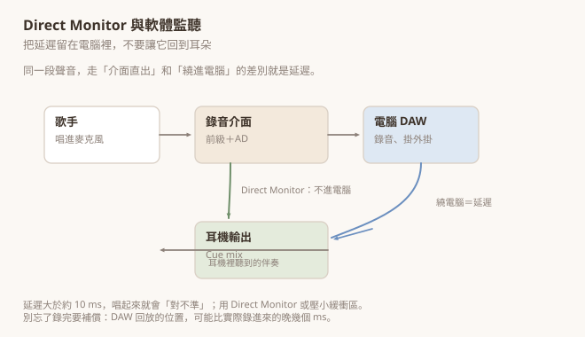
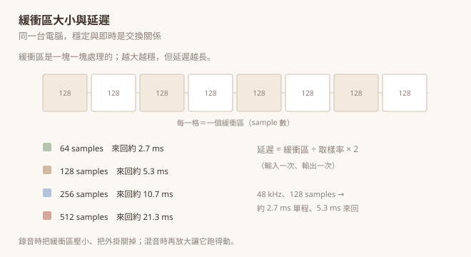
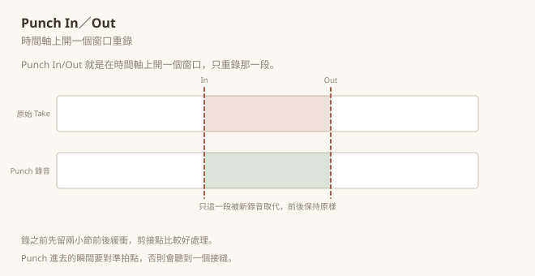

# **第 07 堂：多軌錄音：監聽設定與延遲消除技術**

## 一、多軌錄音的基本概念

多軌錄音（Multi-track Recording）是現代音樂製作的基石。與早期僅能錄製單一聲軌或立體聲的類比錄音不同，多軌錄音允許我們將每一件樂器、每一道人聲獨立錄製到各自的音軌上，後續再進行混音與編輯。這不僅帶來了極大的創作彈性，也讓聲音品質的精細控制成為可能。

在數位錄音工作站（DAW）中建立多軌錄音工作階段，首先需要根據樂器數量與錄音方式規劃音軌配置。典型的配置包含：節奏組（爵士鼓、貝斯）、和聲組（吉他、鍵盤）、旋律組（主唱、和聲、獨奏樂器）。每一組又可以細分為多個單聲道或立體聲軌道。對於鼓組錄音，通常會使用 4 到 12 支麥克風，每支麥克風對應一條獨立的音軌。在 DAW 中，我們需要事先為每一條音軌設定正確的輸入來源（Input），確保訊號路徑清晰明確。

建立工作階段時，取樣率（Sample Rate）與位元深度（Bit Depth）的選擇至關重要。一般錄音建議使用 48 kHz / 24-bit 或 96 kHz / 24-bit。較高的取樣率雖然增加檔案大小，但能提供更寬廣的頻率響應與更低的延遲表現。同時，應在專案一開始就設定好節奏與拍號，方便後續編輯時對齊網格。

## 二、Cue Mix：獨立耳機混音系統

| 監聽方式 | 延遲 | 聽到什麼 | 適用時機 |
|---|---|---|---|
| Direct Monitor | 幾乎為零 | 只有介面輸入的乾聲 | 錄音對拍 |
| 軟體監聽 | 一個緩衝區來回 | 含外掛處理後的聲音 | 需要聽效果時 |
| 混音器／Cue Mix | 幾乎為零 | 自訂比例的混音 | 多人同時錄 |

在錄音過程中，每位樂手都需要在耳機中聽到適合自己演奏的混音內容。例如，鼓手可能需要強烈的節拍點與穩定的節奏參考，而主唱則需要清晰聽見自己的聲音與伴奏的平衡。這就是 Cue Mix（提示混音／監聽混音）的核心功能。

### 建立 Cue Mix 的方法

1. **DAW 內建 Cue Mix 功能**：多數 DAW（如 Pro Tools、Logic Pro、Cubase、Reaper）都支援 Aux Send 與 Bus 路由。我們可以建立多組 Aux 軌道，分別對應不同樂手的耳機輸出。透過 Send 控制每條音軌傳送到各 Aux 的比例，每位樂手就能獲得量身定做的監聽混音。

2. **使用監聽控制器**：支援多組耳機輸出的音頻介面（如 Focusrite Clarett+、RME Babyface Pro、Antelope Audio Zen Go）搭配專屬的混音控制軟體，允許在 DAW 之外獨立建立 Cue Mix。這類硬體的低延遲直接監聽功能，能有效避免軟體路由帶來的延遲問題。

3. **外部監聽混音器**：對於較大型的錄音場合，可以使用獨立的監聽混音系統（如 Behringer P16、Aviom 或 Roland M-48），透過數位網路（如 Ultranet、AES50、Dante）將多組獨立混音傳送至每位樂手的個人監聽控制器。

### 實務建議

- 錄音前務必與每位樂手溝通他們在耳機中需要的內容。主唱通常需要大量自己的聲音、少量的樂器伴奏與適當的殘響（Reverb），而節奏組樂手則需要清晰的節拍器（Click）與彼此的節奏聲部。
- 在建立 Cue Mix 時，可以將節拍器（Click Track）獨立送出一軌，讓每位樂手自行決定節拍器音量。
- 避免將所有人聲或樂器的推前（Pre-fader）與推後（Post-fader）路由混淆。一般建議在錄音階段使用推前 Send，確保即使主推子變動也不會影響樂手的監聽平衡。

## 三、延遲的來源與影響

延遲（Latency）是多軌錄音中最令人頭痛的問題之一。它指的是聲音從輸入（麥克風拾音）到輸出（耳機播放）之間的時間差。即使只有幾毫秒的延遲，也足以讓樂手在演奏時感到明顯的不自然，進而影響節奏感與表現。

### 延遲的主要來源

1. **緩衝區大小（Buffer Size）**：DAW 處理音訊時，會將數據切割成一個個區塊進行運算。區塊越大（如 1024 samples），處理穩定性越高，但延遲也越大。區塊越小（如 32 或 64 samples），延遲越低，但對 CPU 的負擔也越重，容易出現爆音（Pop、Click、Dropout）。

2. **插件延遲（Plugin Latency）**：某些效果器插件（尤其是需要大量運算的類比模擬、動態處理、FFT 類插件）本身會引入額外的延遲。DAW 通常會自動進行延遲補償（Delay Compensation），但在錄音監聽階段，這些插件仍會造成明顯的延遲感。

3. **驅動程式問題**：音頻驅動程式的品質直接影響延遲表現。Windows 系統中，WDM 與 DirectSound 驅動的延遲通常很高（20-50 ms），不適合即時監聽。專業錄音皆使用 ASIO（Audio Stream Input/Output）驅動來獲得低延遲。

4. **類比數位轉換**：麥克風前級、AD/DA 轉換器本身的轉換時間雖然極短（通常在微秒級），但在訊號鏈中加入多台外部設備時，累積的延遲仍不可忽視。

## 四、直接監聽 vs 軟體監聽

這兩種監聽模式的選擇，直接影響錄音品質與樂手體驗。

### 軟體監聽（Software Monitoring）

聲音經由麥克風進入音頻介面，經 AD 轉換後傳送至 DAW，經過音軌上的效果器處理（如壓縮、EQ、殘響），然後再經 DA 轉換輸出到耳機。優點是樂手可以聽到「帶效果」的聲音；缺點是延遲較高（取決於 Buffer Size 與插件延遲），在 Buffer 設定不足夠低時會造成明顯的演奏延遲感。

### 直接監聽（Direct Monitoring）

聲音在音頻介面內部直接從輸入路由到輸出，完全不經過 DAW。優點是零延遲或極低延遲（僅 AD/DA 轉換的微秒級延遲），樂手感受到的是最真實、即時的聲音。缺點是無法監聽到 DAW 中的效果器處理，也無法聽到已錄製音軌的播放內容（除非搭配混音器進行混合監聽）。

### 混合監聽策略

現代錄音多採用混合策略：

- 使用音頻介面的直接監聽功能（或控制軟體中的零延遲監聽模式）讓樂手聽到乾淨的輸入訊號。
- 同時從 DAW 輸出已錄製音軌的播放（Playback）訊號，與直接監聽訊號在介面內部混合。
- 這樣既能享受直接監聽的低延遲，又能讓樂手聽到先前錄製好的伴奏軌道。

Cubase 的「Low Latency Monitoring」模式、Logic Pro 的「Low Latency Mode」、Reaper 的「Disable anticipative FX processing」等功能都是在 DAW 層面自動繞過高延遲插件，以降低監聽延遲的工具。

## 五、ASIO 驅動設定與緩衝區配置

### ASIO 驅動安裝與選擇

在 Windows 環境下，ASIO 是實現低延遲錄音的必備驅動。以下為常見的 ASIO 方案：

1. **廠商原生 ASIO 驅動**：使用專業音頻介面（如 RME、Focusrite、Universal Audio、MOTU）時，務必安裝官方提供的 ASIO 驅動。這些驅動經過優化，延遲表現最佳。

2. **ASIO4ALL**：這是一款通用 ASIO 驅動，適用於內建音效卡或沒有原生 ASIO 支援的設備。雖然延遲表現不如原生驅動，但仍然比 WDM 好上許多。注意，ASIO4ALL 需要獨占音頻設備，使用時無法同時播放其他音訊。

3. **WASAPI Exclusive Mode**：Windows 10/11 的 WASAPI 獨占模式在某些情況下也能達到接近 ASIO 的延遲表現，但穩定性仍不及原生 ASIO。

### 緩衝區設定指南

Buffer Size 的選擇是一門平衡藝術：

- **錄音階段**（需要即時監聽）：Buffer 設為 32、64 或 128 samples。若為 44.1 kHz，64 samples 對應約 1.45 ms 的延遲，這是大多數樂手可以接受的範圍。若 CPU 不夠強勁，可嘗試 128 samples（約 2.9 ms）。
- **混音與編輯階段**（無需即時監聽）：Buffer 設為 512 或 1024 samples。較大的緩衝區能讓 CPU 有更多時間處理複雜的混音與大量插件，減少爆音與系統不穩定。
- **多軌錄音時**：若同時錄製多個軌道（如鼓組錄音的 8-12 軌），每個音軌都需要獨立的 AD 轉換與數據流。此時必須使用較小的 Buffer，同時確保 CPU 足夠強大。較實際的做法是先用 64 samples 試錄，若出現爆音再逐步提高到 128 samples。

### 進階技巧

在 RME 介面中，可以透過 TotalMix FX 將直接監聽訊號與 DAW 回放訊號在硬體層面混合，並獨立控制延遲。而在 Universal Audio 的 Apollo 系列中，透過 Console 軟體與 UAD DSP 晶片，可以在零延遲下對輸入訊號即時施加 UAD 效果器（如壓縮器、殘響、類比模擬），同時將未處理的乾訊號錄製到 DAW——這被稱為「Unison」技術，是直接監聽與軟體監聽的理想折衷。

## 六、多軌錄音實戰：錄製多個 Take

### Take 管理策略

在同一個段落或一首歌曲中重複錄製多次演奏錄音，稱為「Take」（錄音版本）。DAW 提供多種方法管理 Take：

1. **Comping（合成最佳錄音）**：在 Logic Pro、Pro Tools、Cubase 中，可以將多個 Take 疊在同一條音軌上（Track Comping／Take Folder），錄音完成後為每個段落挑選最佳的 Take，合成一個完美的 Performance。例如，主唱第一段副歌用 Take 3、第二段副歌用 Take 5、橋段用 Take 2。

2. **Punch In/Out**：針對特定段落進行局部重錄。設定 Punch In（入點）與 Punch Out（出點），DAW 會在指定範圍內自動切換至錄音模式，其餘部分保留原演奏。這在修正小幅失誤時非常有效率。

3. **循環錄音（Cycle/Loop Recording）**：設定播放範圍後，DAW 會反覆循環該段落，每次錄製一個新的 Take。Logic Pro 的「Cycle Mode」與 Cubase 的「Cycle Record」是常見的實現方式，非常適合抓取即興演奏中的靈感片段。

### 實務提醒

- 錄製前先與樂手溝通每次 Take 的優缺點，避免盲目多次錄製造成樂手疲勞。有時第三個 Take 就已足夠完美，繼續錄製反而會流失能量。
- 保留每一次 Take 的原始錄音，不要急著刪除。有些看似不完美的 Take 可能在後製階段展現出意外的魅力（例如帶有情感瑕疵的 Vocal Take）。
- 使用顏色標籤與命名規則管理多個 Take 與音軌（如：Vox_Main_Take01、Vox_Dbl_Take02），避免後製時混淆。

## 七、錄音後的延遲補償

當我們完成錄音並進入混音階段時，所有的音軌都應該是完全對齊的。然而，在實際錄音過程中，可能因為監聽延遲、硬體路由延遲或 MIDI 設備的 Timing 問題，導致錄製的音軌與節拍網格之間存在微小的偏移。

### 手動校正

在 DAW 中放大波形檢視（Zoom to Sample Level），對比錄音波形與網格線。鼓組的 Attack 點（如大鼓的瞬態、小鼓的敲擊點）應該落在網格的拍點上。若發現偏移，可以直接拖曳音軌區塊進行位移校正。對於貝斯或節奏吉他，可以參考鼓組的 Timing 進行群組調整。

### DAW 延遲補償功能

- **Automatic Delay Compensation（ADC）**：多數現代 DAW（Pro Tools、Cubase、Logic Pro、Studio One）都具備 ADC 功能，會自動計算每一條音軌上的插件延遲，並補償整體 Timing。使用大量高延遲插件（如 Linear Phase EQ、Look-ahead Limiter）時，ADC 是維持相位正確的關鍵。
- **Recording Delay Offset**：在 DAW 的偏好設定中，可以設定錄音延遲偏移量。若發現錄製的音軌總是延遲（或超前）數毫秒，可以透過這個設定進行統一補償。部分音頻介面廠商會提供建議的偏移數值。

### 外接硬體的延遲補償

若使用外部類比效果器（透過 Insert 送回 DAW），AD/DA 轉換產生的延遲需要手動補償。測量方法：送一個脈衝訊號（Pulse/Click）經由 DAW 輸出至外部設備，再錄回 DAW，測量原始訊號與回錄訊號之間的時間差，即為補償數值。

## 八、現場樂團錄音實務技巧

### 事前準備

1. **麥克風配置規劃**：繪製鼓組與樂手的擺位圖，標記每支麥克風的型號與指向性。確認鼓組使用至少四支麥克風（大鼓、小鼓、Overheads x2），更理想的配置是八到十二支。

2. **訊號路徑測試**：錄音前逐一測試每一條導線、每一軌輸入，確認無雜音（Noise）、哼聲（Hum）或接地迴路（Ground Loop）問題。使用相位檢查工具（Phase Scope／Goniometer）確認立體聲對的相位一致。

3. **耳機監聽配置**：根據樂手人數準備對應的耳機與耳機分配器（Headphone Amplifier）。確認每位樂手的 Cue Mix 已預先設定完成，鼓手必須有穩定的節拍器。實際演出前給予樂手 5-10 分鐘的試聽時間調整他們的混音。

### 錄音中的注意事項

- 使用 Talkback 麥克風（對講麥克風）與樂手溝通。多數音頻介面與 DAW 都有 Talkback 功能，可將麥克風訊號送入耳機監聽系統，方便錄音師在控制室與樂手對話。
- 監控錄音電平（Recording Level）。確保 Peak Level 維持在 -6 dBFS 到 -3 dBFS 之間，留出足夠的 Headroom 避免削波（Clipping）。現代 24-bit 錄音有充足的動態範圍，不必追求過大的電平。
- 錄音進行中不要隨意調整 Buffer Size 或取樣率，以免造成 DAW 音訊引擎重置，導致瞬間中斷或爆音。
- 若發現某位樂手的 Cue Mix 需要調整，在段落之間進行，不要打斷正在進行的演奏。

### 錄音後的檢查

- 立即播放檢查錄音的相位一致性。將所有音軌同時播放，聆聽整體聲音是否自然。若感覺聲音空洞或薄弱的，可能是立體聲對或鼓組麥克風存在相位抵消問題。
- 使用節奏對齊工具（如 VocAlign、Melodyne，或 Cubase 的 Audio Alignment、Pro Tools 的 Beat Detective）對齊節奏不穩定的段落。但請謹慎使用——保留人性化的 Timing 微小變化有時反而是音樂的靈魂所在。

## 九、總結與學習路徑

多軌錄音是數位音樂製作的必修課，它涵蓋了訊號路由、監聽系統設計、延遲管理與錄音實務等面向。精通這些技術，能夠讓你在任何錄音環境中都能獲得乾淨、同步且高品質的錄音成果。

學習建議：
- 從單軌錄音開始熟悉 DAW 的基本操作與 ASIO 設定。
- 逐步嘗試兩軌（如吉他與人聲）的同步錄音，練習建立 Cue Mix。
- 挑戰小型樂團錄音（三至四位樂手），掌握耳機分配與即時混音調整。
- 深入研究各種監聽系統（Direct Monitoring、Low Latency Mode、外部 Cue Mix 系統）的實際延遲數據。

每一次的錄音實戰都是寶貴的經驗累積，正確的監聽設定與延遲管理將是你邁向專業錄音工程師的關鍵一步。
