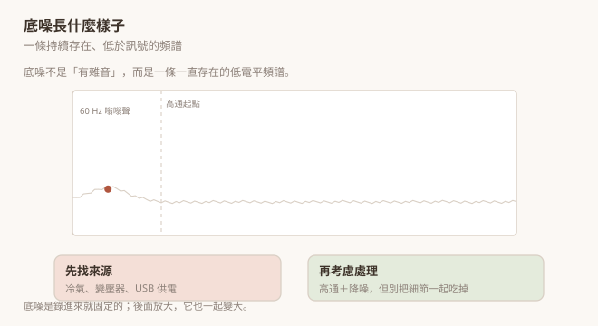
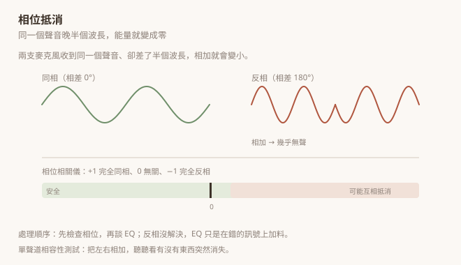

# **第 08 堂：錄音實戰：底噪排查與相位檢查**

錄音品質的好壞，除了取決於麥克風與前級的好壞之外，兩個經常被忽略的關鍵環節是**底噪（Noise Floor）** 與**相位（Phase）**。再昂貴的器材，若底噪過高或相位錯誤，錄出來的聲音依然無法使用。本堂將詳細說明如何辨識、量測與解決這兩大實戰問題。

## 什麼是底噪？為什麼它至關重要？

**底噪**指的是錄音設備在沒有訊號輸入時，系統本身產生的殘餘雜訊。想像你在完全安靜的房間裡錄音，波形圖上仍然有一條細微的「毛邊」——那就是底噪。

底噪的單位是 dB（分貝），通常用 **dBu** 或 **dBFS** 來標示。一般錄音介面的底噪規格約在 -100 dBu 至 -120 dBu 之間。底噪越低，動態範圍越大，錄出來的聲音就越乾淨。

底噪之所以重要，原因在於：

1. **壓縮時會被放大**——當你對人聲或樂器施加壓縮器時，底噪會在空隙中被明顯推高。
2. **限制後製空間**——高底噪的錄音無法大幅調高音量或進行激進的 EQ 處理。
3. **影響聽感清晰度**——累積的底噪會讓混音聽起來模糊、不聚焦。

一個實用的經驗法則：錄音時的底噪應該低於訊號峰值至少 50 dB，這樣在後製時才不會捉襟見肘。

## 常見底噪來源與對策

### 1. 電腦風扇與硬碟運轉聲

這是家庭工作室最常見的底噪來源。電腦風扇轉動產生的低頻嗡鳴（約 200–500 Hz 範圍）會透過空氣傳入麥克風。

**對策：**
- 錄音時將主機箱放在距離麥克風至少 2 公尺處，或放在另一個房間。
- 使用長麥克風線（XLR 線可達 10–15 公尺不損失訊號）。
- 考慮更換靜音風扇或使用被動散熱方案。
- 錄製人聲時，關閉不必要的背景應用程式以降低 CPU 負載，減少風扇加速。

### 2. 空調與 HVAC 系統

空調出風口的低頻轟鳴與氣流聲，經常被麥克風忠實收錄。

**對策：**
- 錄音前 15 分鐘關閉空調，讓房間安靜下來再開始錄製。
- 若無法關閉，調整出風口方向，避免直接吹向麥克風。
- 使用反射濾波器（Reflection Filter）同時阻隔來自後方的噪音。

### 3. 電源哼聲（50 Hz / 60 Hz Hum）

電源哼聲是錄音室最惱人的問題之一。不同地區的交流電頻率不同：台灣、日本東部、美國與加拿大使用 60 Hz；日本西部、歐洲與亞洲多數地區使用 50 Hz。這個頻率及其諧波（120 Hz、180 Hz、240 Hz...）會滲入音訊路徑。

**對策：**
- 使用**高通濾波器（High-Pass Filter）** 切除 80–100 Hz 以下的頻率。多數錄音介面與麥克風前級都內建此功能。
- 確認所有設備使用同一電源迴路，避免跨迴路接地。
- 使用**電源濾波器（Power Conditioner）** 或 **電源隔離變壓器**。

### 4. 接地迴路（Ground Loop）

當多台設備以不同路徑接地時，會形成接地迴路，產生 50/60 Hz 的低頻哼聲與高頻雜訊。

**如何辨識接地迴路：**
- 哼聲會隨著設備連接數量增加而變大。
- 拔掉某條訊號線時，哼聲立即消失。
- 哼聲中包含明顯的 60 Hz 與 120 Hz 成分。

**如何解決：**
- 使用**接地迴路隔離器（Ground Loop Isolator）**，安裝在音訊路徑中（如 DI Box 或專用隔離變壓器）。
- 所有設備插在同一個排插上，減少接地電位差。
- 若使用筆電錄音，**拔掉筆電的電源供應器**，改用電池供電——這是快速確認是否為接地迴路最簡單的方法。

### 5. 電磁干擾（EMI）

手機、Wi-Fi 路由器、螢光燈、調光器都會產生電磁干擾，被麥克風或導線拾取。

**對策：**
- 錄音時所有手機切換為飛航模式。
- XLR 線使用平衡式接線（Balanced），且避開與電源線平行走線。
- 避免將麥克風靠近電腦螢幕或電源變壓器。

## 雜訊閘（Noise Gate）與擴展器（Expander）

### 雜訊閘的基本運作

雜訊閘是一種自動靜音的處理器：當輸入音量低於設定的**閾值（Threshold）** 時，它會將訊號靜音或大幅衰減。這在錄音後期清理軌道非常有用。

**四個關鍵參數：**

| 參數 | 功能 | 典型設定 |
|------|------|----------|
| Threshold | 觸發閘門的音量門檻 | 低於訊號峰值 15–20 dB |
| Attack | 閘門開啟的速度 | 0.1–1 ms（快速開啟） |
| Release | 閘門關閉的速度 | 50–200 ms（依素材調整） |
| Range | 關閉時的衰減量 | 20–40 dB（完全靜音或部分衰減） |

### 延伸到 Expander 的應用

**擴展器（Expander）** 與雜訊閘原理相似，但更溫和。它不是完全靜音，而是對低於閾值的訊號施加比例衰減（如 2:1 或 3:1）。擴展器適合處理：

- 延音尾音太長的樂器
- 背景環境噪音較低但持續存在的錄音
- 鼓組的串音（Bleed）控制，在保留自然感的同時減少不必要的聲音

在 DAW 中，ReaGate（Reaper 內建）、FabFilter Pro-G、Waves NS1 都是優秀的工具。

## 高通濾波器（High-Pass Filter）的運用

高通濾波器是錄音中最被低估的工具。它允許高頻通過，並衰減低於截止頻率的訊號。

**實戰應用建議：**

| 音源類型 | 建議截止頻率 | 備註 |
|----------|-------------|------|
| 人聲（男） | 80–100 Hz | 避免切掉胸腔共鳴 |
| 人聲（女） | 100–120 Hz | 女性聲音基礎頻率較高 |
| 木吉他 | 80–110 Hz | 去除低頻機箱共鳴 |
| 電吉他 | 100–120 Hz | 混音中與大鼓分工 |
| 大鼓（Kick） | 30–50 Hz | 保留衝擊感 |
| 小鼓（Snare） | 80–100 Hz | 去除低頻串音 |
| Overhead 麥克風 | 80–120 Hz | 去除鈸下的低頻嗡嗡聲 |

**重要觀念**：高通濾波器應優先用在**錄音階段**，而非混音階段。在錄音時就將不必要的低頻切除，可以避免低頻資訊佔用寶貴的動態範圍，也能減少後製時才發現的問題。

## 相位問題：什麼是相位抵消？

相位（Phase）描述的是聲波的時間位置。當兩個相同的聲波疊加時：

- **同相（0°）**：波峰對波峰，波谷對波谷，振幅相加——音量變大。
- **反相（180°）**：波峰對波谷，互相抵消——音量變小或完全消失。
- **部分偏移（45°、90° 等）**：部分抵消，頻率響應出現梳狀濾波效應（Comb Filtering）。

### 相位抵消的聽感特徵

- 聲音聽起來「變薄」或「空洞」
- 低頻明顯消失
- 移動頭部位置時聲音變化很大
- 將兩軌 Monaural 設為 Mono 時，音量明顯下降

### 最容易出現相位問題的情境

1. **多麥克風錄製同一音源**——例如用兩支麥克風錄木吉他、用三支錄大鼓
2. **多支 Overhead 麥克風**——鼓組錄音中，左右 Overhead 距離不一致
3. **同時使用 DI 與麥克風**——例如 Bass 同時錄 DI 與音箱麥克風
4. **房間反射聲**——直接音與反射音抵達麥克風的時間不同

## 如何檢查與解決相位問題

### 1. 使用相位反轉按鈕（Phase Invert / Polarity Flip）

多數錄音介面與 DAW 的每個通道都有一個「⌀」按鈕。這並非真正的相位調整，而是**極性反轉**（將波形上下顛倒 180°）。

**實戰步驟：**

1. 播放同時錄製的兩軌聲音。
2. 點擊其中一軌的相位反轉按鈕。
3. 聽聽看：若反轉後低頻變得更飽滿、更紮實，表示原本兩軌是反相的。
4. 選擇聽起來更好、低頻更紮實的那個設定。

### 2. 時間微調（Nudging / Slide）

極性反轉只能處理 180° 的完全反相，無法處理因距離差異造成的時間延遲。這時需要**時間微調**。

**實戰步驟：**

1. 將兩軌波形對齊，放大到樣本層級（Sample Level）。
2. 找到同一音頭的起始點，微調其中一軌的時間位置（先後移動數毫秒）。
3. 一邊聽一邊調整，直到低頻聽起來最飽滿、最集中為止。

在 DAW 中，Reaper 的 `Alt+左右鍵`、Pro Tools 的 `nudge` 功能、Logic Pro 的 Flex Time（或直接拖曳片段起點）都可完成此操作。

### 3. 自動相位對齊工具

現代 DAW 與外掛提供了自動化方案：

- **Auto-Align（Sound Radix）**：業界標準，自動計算延遲時間並補償。
- **Vocalign Project 5**：不僅對齊節奏，也可對齊相位。
- **Reaper 內建 ReaDelay**：手動設定延遲時間來模擬距離補償。

### 4. 三比一法則（3:1 Rule）

這是一條經典的經驗法則，幫助減少多麥克風錄音的相位問題：

> 當使用兩支麥克風錄製同一音源時，第二支麥克風與第一支的距離，應至少是第一支麥克風與音源距離的三倍。

例如：第一支麥克風距離音源 10 公分，第二支至少應在 30 公分以外。這樣做能確保兩支麥克風收到的音量差異夠大，使相位抵消的影響降到最低。

## 相位關聯表（Phase Correlation Meter）

相位關聯表是混音必備的視覺工具。它顯示立體聲訊號的左右聲道之間的相位關係，數值範圍從 -1 到 +1：

| 數值 | 狀態 | 意義 |
|------|------|------|
| +1 | 完全同相 | 左右聲道完全相同（純 Mono） |
| 0 到 +1 | 良好立體聲 | 自然、適合廣播 |
| 0 | 不相關 | 左右聲道無關聯（如雙聲道獨立噪音） |
| 0 到 -1 | 反相 | 部分或完全反相——危險！ |
| -1 | 完全反相 | 左右聲道互相抵消 |

**使用建議：**

- 在 Master Bus 上掛一個相位關聯表（DAW 通常內建）。
- 混音過程中隨時觀察，確保關聯數值不低於 0。
- 若數值低於 0，檢查是哪個樂器造成的，逐一 Solo 各軌道來找出問題來源。
- 特別注意 Bass、Kick 等低頻樂器——它們最容易受到相位問題影響。

主要 DAW 的內建工具：Logic Pro 的 MultiMeter、Pro Tools 的 Correlation Meter、Reaper 的 JS: Stereo Field 或 JS: Goniometer。

## 多麥克風錄音實戰工作流程

以錄製一把**木吉他**使用兩支麥克風為例，完整相位檢查與底噪排查步驟：

### 第一步：環境準備

1. 關閉空調、拔掉手機充電器。
2. 確認所有設備插在同一個排插。
3. 試錄 10 秒環境音，檢查底噪是否可接受（應低於 -50 dBFS）。
4. 若聽到 60 Hz 哼聲，嘗試拔掉筆電電源轉為電池供電。

### 第二步：麥克風架設

1. 第一支麥克風指向第 12 琴格，距離 15 公分。
2. 第二支麥克風指向琴橋，距離 20–25 公分（兩支相距約 30 公分，未達三比一法則的 45 公分，靠下一節的相位檢查補償）。
3. 確認兩支麥克風的音量平衡。

### 第三步：設定高通濾波器

1. 兩軌都掛上 80 Hz 高通濾波器（錄音介面上或 DAW 中）。
2. 錄一段簡單的開放弦刷奏。

### 第四步：相位檢查

1. 切換到 Mono 監聽模式。
2. 點擊第二軌的相位反轉按鈕（⌀）。
3. 比較兩種設定：正常與反轉。低頻更飽滿、刷奏更集中的那個設定就是正確的。
4. 若在 Mono 下聲音聽起來不對，嘗試微調第二軌的時間位置（往後移動 0.1–0.5 ms 區間嘗試）。

### 第五步：正式錄音與記錄

1. 記錄下最終的相位設定與麥克風距離。
2. 正式錄製時監聽底噪，確認沒有新的噪音源出現（如手機通知聲）。
3. 錄製完畢後，檢查波形：若有明顯的非對稱切割或異常低頻，重新檢查相位。

### 第六步：後製清理

1. 對人聲或獨奏樂器軌道施加溫和的雜訊閘（Threshold 設在底噪之上 5 dB，Range 約 20 dB）。
2. 背景噪音較嚴重的軌道可使用擴展器（Ratio 2:1，Attack 慢一些以保留音頭）。
3. 最後在 Master Bus 上掛相位關聯表，確保整體混音的相位健康。

## 結語

底噪排查與相位檢查，是區分野蠻錄音與專業錄音的分水嶺。許多看似「聲音不對」的問題，追根究柢都來自這兩個環節。養成錄音前先檢查環境噪音、錄音後立即核對相位的習慣，能讓你的作品在混音階段省下大量修補時間。下一堂課，我們將進入混音的核心——EQ 與頻率平衡，學習如何讓每個樂器在頻譜中找到自己的位置。
