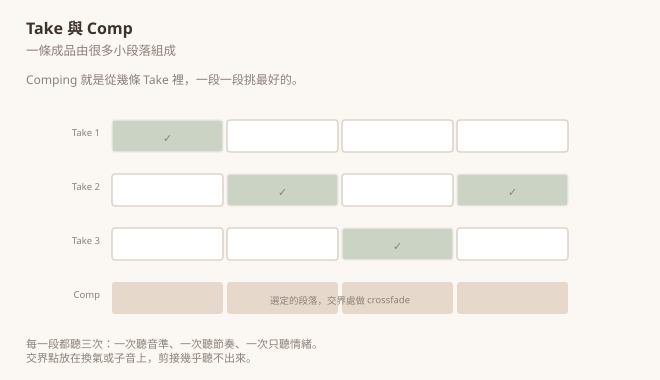
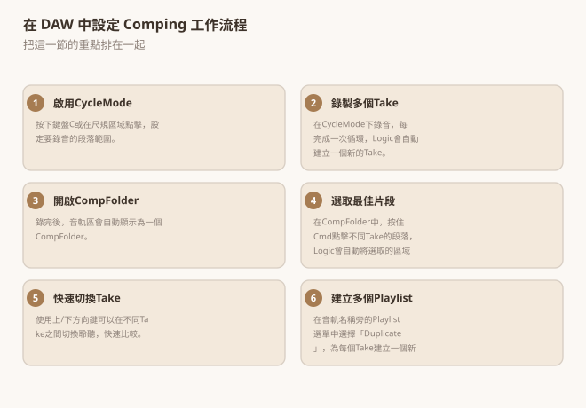
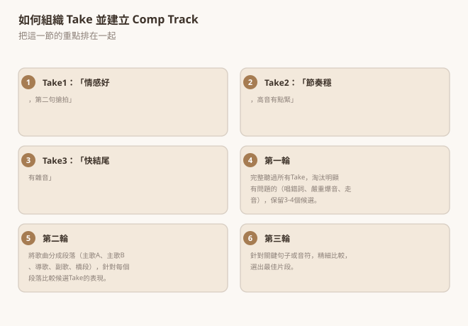
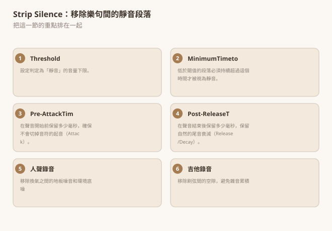
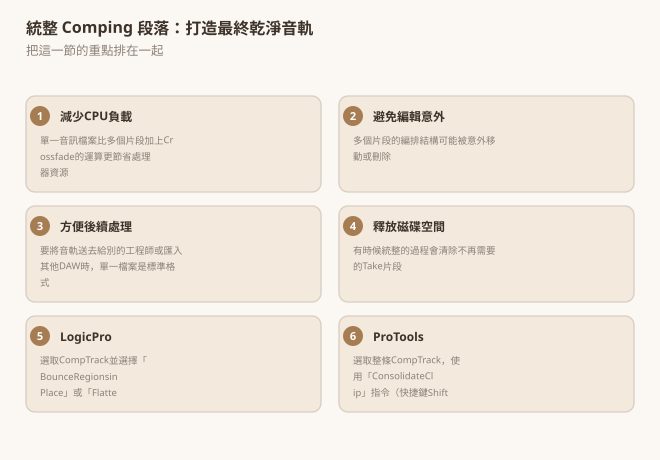
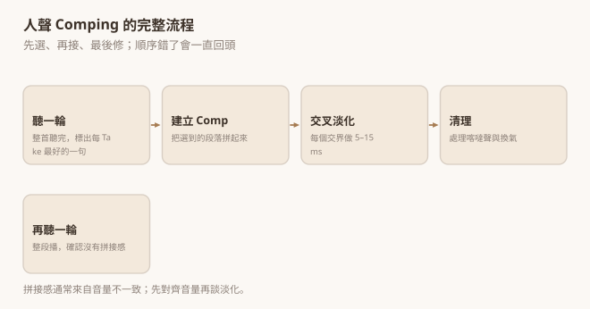

# **第 09 堂：音軌編輯：Comping 選取與交叉淡入淡出 (Crossfade)**

在現代數位音樂製作中，我們很少只錄一次就得到完美的演出。無論是歌手錄製主旋律、吉他手錄製獨奏、或是錄製任何需要情感表現的樂器，通常都會錄製多個「Take」（錄音版本），然後從中選出最好的片段組合成一條完美的音軌。這整個流程稱為 **Comping**（Comp 源自 Composite，意即「合成」）。而為了讓剪輯後的片段間聽起來平滑無縫，**Crossfade（交叉淡入淡出）** 是不可或缺的工具。本堂課將完整解析這兩個核心音軌編輯技巧，幫助你打造專業級的錄音作品。

---

## 什麼是 Comping？從多個 Take 中提煉最佳演出

Comping 的概念非常直觀：假設一位歌手錄了五次副歌，第一次感情飽滿但拍子有點拖，第二次拍子準確但尾音不夠長，第三次音準完美但情感平淡，第四次有一句唱錯歌詞，第五次整體不錯但結尾換氣聲太大。Comping 就是從這五次中，分別選出每一句、甚至每一個字最好的版本，拼湊成一條「夢幻音軌」。

這個做法的核心哲學是：**沒有任何一個 Take 是完美的，但每個 Take 都有它完美的瞬間**。與其逼迫表演者重複錄製直到身心俱疲，不如善用多次錄音累積的素材，透過後製選取達到最佳成果。

Comping 在以下場景特別重要：

- **人聲錄音**：主旋律、合聲、說唱段落
- **樂器獨奏**：吉他、貝斯、鍵盤、小提琴等
- **對話與配音**：Podcast、有聲書、廣告配音
- **現場演出多重錄音**：從不同角度或不同場次選取最佳片段

---

## 在 DAW 中設定 Comping 工作流程

各大 DAW 都有專為 Comping 設計的功能，以下分別介紹 Logic Pro 與 Pro Tools 這兩套主流軟體的做法。

### Logic Pro 的 Comp Folder（合成資料夾）

Logic Pro 的 Comping 流程是業界最直覺的之一：

1. **啟用 Cycle Mode（循環模式）**：按下鍵盤 `C` 或在尺規區域點擊，設定要錄音的段落範圍。
2. **錄製多個 Take**：在 Cycle Mode 下錄音，每完成一次循環，Logic 會自動建立一個新的 Take。
3. **開啟 Comp Folder**：錄完後，音軌區會自動顯示為一個 Comp Folder。點擊 Take Folder 標籤，展開所有 Take。
4. **選取最佳片段**：在 Comp Folder 中，按住 `Cmd` 點擊不同 Take 的段落，Logic 會自動將選取的區域組合成一條 Comp Track。每當你點擊不同 Take 的片段，上方的 Comp Track 就會即時更新。
5. **快速切換 Take**：使用 `上/下` 方向鍵可以在不同 Take 之間切換聆聽，快速比較。

Logic Pro 的 Comp Folder 有一個強大的功能：當你選取某個片段後，Logic 會在邊界處自動建立極短的淡入淡出（預設約 5ms），避免剪輯點產生爆音。

### Pro Tools 的 Playlist（播放清單）

Pro Tools 使用 Playlist 系統來管理多個 Take，做法略有不同：

1. **建立多個 Playlist**：在音軌名稱旁的 Playlist 選單中選擇「Duplicate」，為每個 Take 建立一個新的 Playlist。
2. **錄製各個 Take**：切換到不同的 Playlist，分別錄製每個 Take。
3. **從 Playlist 編排 Comp Track**：在一個全新的空白 Playlist（通常是命名為「COMP」的 Playlist）上，按住 `Ctrl`（Win）或 `Cmd`（Mac），使用 Selector Tool 圈選某個 Playlist 中的片段，然後貼上到 Comp Track。
4. **修剪與排列**：使用 Trim Tool 精確調整每個片段的起點與終點。

Pro Tools 的 Playlist 系統在管理大量 Take 時非常靈活，但不像 Logic Pro 有自動的 Comp Folder 視圖，需要手動剪貼。

### Ableton Live / Cubase / Studio One

- **Ableton Live**：使用 Session View 的 Launch 功能錄製多個 Clip，再拖到 Arrangement View 手動編排。沒有專屬的 Comp Folder，但搭配「Take Lanes」（Live 10 起）可以達到類似的效果。
- **Cubase**：使用「Lane Track」系統，類似 Pro Tools 的 Playlist，可以疊加顯示多個 Take，並用 Range Selection 工具選取後直接填入 Comp Track。
- **Studio One**：採用類似 Logic Pro 的 Comping 系統，稱作「Take Management」，錄音時自動建立 Take，可用畫筆工具直接在 Comp Track 上選取片段。

---

## 如何組織 Take 並建立 Comp Track

無論使用哪一套 DAW，組織 Take 的邏輯是共通的：

### 1. 為每個 Take 命名與標記

錄完後，立即為每個 Take 加上註解。例如：

- Take 1：「情感好，第二句搶拍」
- Take 2：「節奏穩，高音有點緊」
- Take 3：「快結尾有雜音」

這些註記在後續選取時極有幫助，特別是過了幾天再回來工作時。

### 2. 建立 Comping 策略

不要聽完整個 Take 就決定好壞。建議的策略是：

- **第一輪（快速篩選）**：完整聽過所有 Take，淘汰明顯有問題的（唱錯詞、嚴重爆音、走音），保留 3-4 個候選。
- **第二輪（分段比較）**：將歌曲分成段落（主歌 A、主歌 B、導歌、副歌、橋段），針對每個段落比較候選 Take 的表現。
- **第三輪（逐句選取）**：針對關鍵句子或音符，精細比較，選出最佳片段。

### 3. 建立 Comp Track

將選出的片段逐段排列在一條新的音軌上（或直接在 Comp Folder 中完成）。注意事項：

- 片段之間保留一點重疊區域，方便後續做 Crossfade
- 確保從前一個片段切換到下一個片段時，音量、音色不會突然改變
- 暫時不要調整音量自動化，先專注於選取內容

---

## 聆聽的關鍵：從情感、節奏與音準三個面向評選

選取 Take 時，不要只聽技巧，要從三個面向綜合評分：

### 情感（Emotion）—— 最優先

聽眾感受到的是情感，不是音準。一個有瑕疵但充滿情感的演出，遠比一個完美但平淡無奇的演出更有感染力。問自己：

- 這個段落有唱出歌詞應有的情緒嗎？
- 語氣是否有起伏？還是從頭到尾同一種力道？
- 有沒有特別觸動你的瞬間？

### 節奏（Timing）—— 次優先

節奏感影響整首歌的律動：

- 音符是否落在拍點上？有無不自然的搶拍或拖拍？
- 如果是樂器獨奏，樂句的呼吸感是否自然？
- 注意：輕微的節奏偏移有時可以透過量化（Quantize）修正，但情感無法靠後製添加。

### 音準（Pitch）—— 可修正

音準問題是最容易後製處理的：

- 使用 Auto-Tune、Melodyne 等工具可以修正音準
- 但過度修正會產生「機械感」（俗稱 Auto-Tune 顫音）
- 如果一個 Take 情感完美、節奏精準，但只有一兩個音不準，優先選這個 Take，再用修音工具修正那幾個音

**黃金法則**：永遠選擇情感最好的 Take，技術問題可以後製，情感無法複製。

---

## 交叉淡入淡出（Crossfade）的基礎概念

選取好片段、排列到 Comp Track 之後，接下來的工作是讓這些片段之間的過渡聽起來平滑。這就是 Crossfade 的任務。

### 為什麼需要 Crossfade？

當兩個音訊片段在時間軸上相鄰時，可能會出現以下問題：

- **音量跳躍**：前後段落的音量不同，在接點處產生突然的起伏
- **波形不連續**：波形在接點處被切斷，產生高頻爆音（Click/Pop）
- **相位不連續**：兩個片段的頻率內容無法自然銜接

Crossfade 的做法是：在兩個片段的交界處，讓第一個片段的音量逐漸降低（Fade Out），同時讓第二個片段的音量逐漸升高（Fade In），兩者的重疊區域形成平滑的交叉過渡。

### 基本操作

在所有 DAW 中，Crossfade 的基本操作都非常相似：

1. 使用 Selector Tool（游標工具）選取兩個片段重疊的部分
2. 依 DAW 操作：Logic Pro 沒有預設快捷鍵，選取重疊區域後從 Edit ▸ Crossfade 建立（或拖曳片段邊界的 Fade 手柄）；Pro Tools 選取跨兩段的區域後按 `Cmd + F`／`Ctrl + F` 開啟 Fade 對話框；Cubase 選取重疊的兩段後按 `X`，或從 Edit ▸ Create Crossfade 執行。
3. DAW 會自動在選取區域建立一個 Crossfade

也可以手動調整：將游標移到片段左上角或右上角，會出現 Fade 手柄，拖曳即可建立淡入或淡出曲線。兩邊的曲線交叉處就是 Crossfade。

---

## 交叉淡入淡出的類型：Equal Power vs Equal Gain

Crossfade 並非只有一種數學曲線，不同的曲線類型會影響聽感。最常見的兩種是 Equal Power 與 Equal Gain：

### Equal Power Crossfade（等功率交叉淡入淡出）

**曲線特性**：中央點處，兩個片段的音量各自約為 -3dB，相加後幾乎等於原始音量（0dB）。

**聽感效果**：在中央點聽起來音量是平穩的，不會有凹陷感。非常適合**聲音持續性高**的素材，例如人聲、弦樂、合成器 Pad。

**適用場景**：

- 人聲取句的銜接
- 持續音或長音的交界
- 吉他延音尾段

### Equal Gain Crossfade（等增益交叉淡入淡出）

**曲線特性**：中央點處，兩個片段的音量各自約為 -6dB，相加後總音量低於原始音量，中央會有一個微小的「凹陷」。

**聽感效果**：中央處音量稍微降低，但過渡更加「乾淨」，切口更明顯。非常適合**節奏性強**的素材。

**適用場景**：

- 鼓組與打擊樂器
- 節奏吉他刷弦
- 快速的音符過門

### 預設曲線長度

- **標準 Crossfade**：10ms – 50ms，適用於大部分情況
- **短 Crossfade**：1ms – 5ms，僅用於消除 Click/Pop，不產生真正的淡出淡入感
- **長 Crossfade**：100ms – 500ms，用於較長時間的過渡，如段落之間的銜接

### 實戰建議

- 不確定該用哪一種時，先用 Equal Power，因為它是「安全牌」，在大多數素材上聽起來都自然
- 在同等長度的情況下，比較 Equal Power 與 Equal Gain 的效果，選擇聽起來更自然的那一個
- 對於人聲 Comping，通常使用 10ms-30ms 的 Equal Power Crossfade

---

## 手動編輯 Crossfade：打造無縫銜接

雖然 DAW 可以自動建立 Crossfade，但要達到專業水準，手動調整是必要的。

### 調整 Fade 曲線

每個 DAW 都允許你拖曳 Fade 手柄來改變曲線形狀：

- **凸曲線（Convex）**：音量下降／上升較慢。適合聲音尾部自然衰減的素材。
- **凹曲線（Concave）**：音量下降／上升較快。適合需要快速切換的節奏素材。
- **線性曲線（Linear）**：音量等比例變化。最中性的選擇，適合作為起點。

### 調整重疊長度

重疊長度的選擇取決於素材的性質：

- **短重疊（1-10ms）**：只夠消除 Click/Pop，幾乎聽不到過渡。適合節奏緊湊的段落。
- **中等重疊（10-30ms）**：最常用的範圍，能消除音量跳躍又不至於讓過渡太明顯。
- **長重疊（50ms+）**：用於明顯的過渡效果。注意：太長的 Crossfade 可能導致兩個片段的聲音同時存在，產生模糊感或相位問題。

### 視覺輔助

- 觀察波形圖：兩邊片段的波形在 Crossfade 區域內應該自然銜接，不要有明顯的波形大小跳變
- 使用頻譜分析儀：確保在過渡區域沒有不自然的頻率突變
- 聆聽時關閉視覺，只用耳朵判斷：有時候看起來完美的 Crossfade 聽起來有問題，反之亦然

---

## 處理剪輯邊界的 Click 與 Pop

Click 和 Pop（爆音、啵聲）是剪輯音訊時最常見的問題，通常由以下原因造成：

### Click 成因

1. **波形被零點以外切斷**：音訊波形在非零點處被截斷，產生瞬間的波形不連續（step discontinuity），激發出寬頻能量，聽起來就是一個 Click。
2. **相位不連續**：兩個片段的波形在接點處的相位相差太大。
3. **數位削波**：片段邊界處原本就有超過 0dBFS 的瞬間峰值。

### 解決方案

- **最簡單的方法**：在任何剪輯點上建立一個 1-3ms 的微小 Crossfade。這幾乎可以消除所有因波形截斷產生的 Click，而且過渡短到人耳幾乎無法察覺。
- **進階方法**：放大波形到樣本層級（Sample Level），在剪輯點附近找到波形的零點交叉處（Zero Crossing），將剪輯點精確對齊到這些零點上。這樣即使不做 Crossfade，也不會產生 Click。
- **針對殘留 Click**：如果做完 Crossfade 後仍有 Click，使用 Clip Gain（片段增益）將該處的音量降低 3-6dB，或在該處畫一個極短的音量自動化 Dip（下降約 -6dB，長度約 5ms）。

### 預防勝於治療

- 在錄音階段就避免 Clipping（削波），錄製時保留 6dB 的 Headroom
- 錄製前確認麥克風沒有接觸不良的問題
- 使用好的麥克風前級和線材，減少底噪

---

## Strip Silence：移除樂句間的靜音段落

在完成 Comping 和 Crossfade 後，你可能會發現音軌中有很多不需要的空白或小音量噪音區域。Strip Silence 功能可以自動幫你移除這些區域。

### 什麼是 Strip Silence？

Strip Silence 是一種自動化工具，會掃描選取的音訊片段，找出低於特定音量閾值的段落（也就是「靜音」或「近乎靜音」的區域），然後將這些段落從音軌中切除，或設定為自動靜音（Mute）。

### 參數設定

以 Logic Pro 為例，Strip Silence（功能表 > Functions > Strip Silence）中有四個主要參數：

1. **Threshold（門檻值）**：設定判定為「靜音」的音量下限。設定太低會保留所有噪音，設定太高會切掉尾音和弱音。
2. **Minimum Time to Accept as Silence（最小靜音時間）**：低於閾值的段落必須持續超過這個時間才被視為靜音。建議設定在 50ms-200ms 之間，避免切掉音符之間的極短停頓。
3. **Pre-Attack Time（前置時間）**：在聲音開始前保留多少毫秒，確保不會切掉音符的起音（Attack）。
4. **Post-Release Time（後置時間）**：在聲音結束後保留多少毫秒，保留自然的尾音衰減（Release/Decay）。

### 使用時機

- **人聲錄音**：移除換氣之間的地板噪音和環境底噪
- **吉他錄音**：移除刷弦間的空隙，避免雜音累積
- **口白／Podcast**：快速剪掉所有空白段落，讓說話節奏更緊湊
- **多軌錄音後的清理**：在混音前先對每條音軌做 Strip Silence，減少不必要的噪音混入混音總線

### 注意事項

- Strip Silence 後一定要緊接 Crossfade 處理，因為切除後產生的邊界就是 Click 的來源
- 不要太激進（門檻設定過高），否則會將音符的自然尾音也切掉

---

## 統整 Comping 段落：打造最終乾淨音軌

完成以上所有步驟後，最後的工作是將 Comped 的片段**統整（Consolidate/Flatten/Bounce in Place）** 為一條完整的、連續的音訊檔案。

### 為什麼需要統整？

1. **減少 CPU 負載**：單一音訊檔案比多個片段加上 Crossfade 的運算更節省處理器資源
2. **避免編輯意外**：多個片段的編排結構可能被意外移動或刪除
3. **方便後續處理**：要將音軌送去給別的工程師或匯入其他 DAW 時，單一檔案是標準格式
4. **釋放磁碟空間**：有時候統整的過程會清除不再需要的 Take 片段

### 統整方式

- **Logic Pro**：選取 Comp Track 並選擇「Bounce Regions in Place」或「Flatten」。也可以先 Merge 再 Consolidate。
- **Pro Tools**：選取整條 Comp Track，使用「Consolidate Clip」指令（快捷鍵 `Shift + Alt + 3` 在 Mac，`Shift + Ctrl + 3` 在 Windows）。或使用「Bounce to Disk」匯出為獨立檔案。
- **Cubase**：選取 Comp Track 後，從 Audio 選單選擇 Bounce Selection。
- **Ableton Live**：選取 Comp Track 後，右鍵選擇「Consolidate」（快捷鍵 `Ctrl/Cmd + J`）。

### 統整後檢查

統整完成後，再次播放整條音軌，檢查：

1. 所有 Crossfade 是否聽起來平滑
2. 有無殘留的 Click 或 Pop
3. 音量是否前後一致
4. 整體的音樂性是否自然流暢

如果有問題，回頭重新調整 Comping 選取或 Crossfade 設定，然後再次統整。

---

## 實戰綜合案例：人聲 Comping 完整流程

以下是一個完整的人聲 Comping 實戰流程，整合了本課所有技巧：

**步驟 1：錄製**
歌手錄製了 6 個完整的副歌 Take。錄製時使用 Cycle Mode，確保每個 Take 的起點相同，方便後續對齊。

**步驟 2：第一輪篩選**
快速聽過 6 個 Take，發現 Take 4 在前段有一個明顯的爆音，Take 6 整體氣息不穩。淘汰這兩個，保留 Take 1、2、3、5。

**步驟 3：逐句選取**
將副歌分成 4 個樂句，逐句比較剩下的 4 個 Take：

| 樂句 | 選取 Take | 原因 |
|------|-----------|------|
| 第一句 | Take 2 | 情感飽滿，音準精確 |
| 第二句 | Take 5 | 雖然音準略偏一點，但語氣最自然（承諾用 Melodyne 修正）|
| 第三句 | Take 1 | 節奏抓得最準，和其他樂器對得最緊 |
| 第四句 | Take 2 | 尾音處理最美，有適當的顫音 |

**步驟 4：建立 Comp Track**
在 Comp Folder 中點選對應的 Take 片段，形成完整的 Comp Track。

**步驟 5：Crossfade 處理**
在各個選取邊界處建立 15ms 的 Equal Power Crossfade。逐一檢查每個過渡點，調整其中一個邊界的曲線為微凸曲線，因為前一句的尾音持續較長。

**步驟 6：Strip Silence**
執行 Strip Silence，Threshold 設定為 -45dB，Minimum Silence Time 為 80ms。這樣洗掉了換氣之間的細微地板噪音。

**步驟 7：再次檢查 Crossfade**
Strip Silence 後的新邊界同樣需要 Crossfade。遍歷所有新產生的邊界，快速補上 5ms 的短 Crossfade。

**步驟 8：統整**
執行 Bounce in Place（或 Consolidate），將 Comp Track 輸出為一條完整的音訊檔案，命名為「副歌_COMP_FINAL.wav」。

**步驟 9：驗收**
從頭到尾完整播放一次，確認銜接流暢、無雜音、情感一致，然後將原始 Take 檔案歸檔（保留備份，以防日後需要重新 Comping）。

---

## 小結

Comping 與 Crossfade 是音軌編輯中最重要也最常用的兩個技巧。Comping 教導我們如何在多次錄音中找出最珍貴的演出瞬間，而 Crossfade 則是讓這些瞬間能夠平滑銜接、不留痕跡的技術基礎。

從錄製多個 Take、組織與評選、建立 Comp Track、到最後的 Crossfade 與統整，每一步都需要練習與耐心。建議初學者先從短段落（例如一首歌的副歌）開始練習 Comping，熟悉操作後再擴展到整首歌。隨著經驗累積，你會越來越快判斷哪些 Take 值得保留、哪些該淘汰，以及如何用最少的 Crossfade 達到最自然的聽感。

下一堂課，我們將進入**音高與時間校正**的世界，學習如何使用 Melodyne 與 Elastic Audio 來修正演唱與演奏的細微瑕疵。
