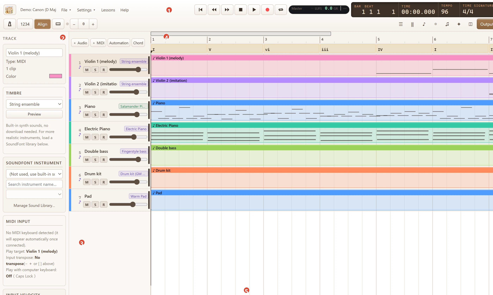
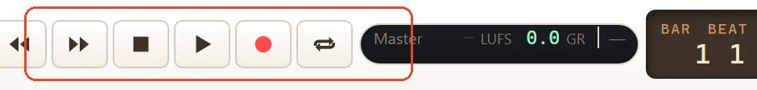

# Lesson 1: Get to Know the Software: Five Areas and the Path of the Sound

## Why look at the map first

Most DAWs (digital audio workstations) look much the same on screen, because they all answer the same question: **"Where is the sound right now, and where is it going?"** Think that question through first and every button afterwards has a place in your head, instead of being something to memorise.

## The five areas of the screen



1. **Top control bar**: File (New Project / Open / Save / Import), the transport controls, bars and time, tempo (BPM) and time signature, the metronome and Align, then on the right the toggles for each panel and **Export**.
2. **Inspector on the left**: the track that is currently selected — name, instrument, insert effects, Send, transpose and chords.
3. **Arrangement area in the middle**: the timeline. At the top is the **ruler** (bars and beats); below the ruler you can open the **chord track**; below that are the **clips** of each track (audio draws a waveform, MIDI draws notes).
4. **Bottom and floating panels**: the Mixer (X), the Piano roll (P) and Master **take up the bottom of the layout** (only one at a time, and each one squeezes the arrangement area); the auto-accompaniment keyboard and the effect windows are the floating ones, and the arrangement area comes back when you close them.
5. **Status bar at the bottom**: audio engine status, input level meter, microphone selection, record latency compensation.

## The path the sound takes

```
microphone → audio interface → (digital) a track in the DAW
  → insert effects (pitch correction, EQ, compression…)
  → fader and pan → Send to a bus
  → mastering → speakers / headphones
```

There are two important ideas on this path:

- **Every station changes the sound**, and the order matters: pitch correction first, then EQ, then compression, and reverb last.
- **Volume adds up.** Four tracks each pushed a little and the master output clips. Lesson 14 comes back to this for compression, and lesson 18 for the mixer.

## Three things about this software



- **It runs in the browser**: nothing to install, which also means you need a reasonably new Chrome or Edge.
- **The sound never leaves your computer**: the page's security policy forbids connections to other sites, so audio files, recordings and projects stay on this machine only.
- **Projects are auto-saved** in the browser; to take one with you or back it up, use File → Save to download a `.zyproj`.

## Try it now

1. Open the software and move the mouse over each button in the top row to read its tooltip (it appears after a one-second pause).
2. Press **Space** to play, and press it again to stop.
3. Press **X** to open the Mixer and press it again to close it; press **P** to open the Piano roll.

<div class="daw-tip">
<b>The demo project for this course</b>: add <code>?demo=1</code> to the end of the URL (for example <code>/tools/daw/?demo=1</code>) and it loads the demo piece "Canon (D Major, Strings)": 24 bars at 96 BPM, with the harmony and bass taken from Pachelbel's <i>Canon in D</i> (around 1680, now in the public domain) — the "Canon progression" D–A–Bm–F#m–G–D–G–A that everyone reaches for when practising arranging. The seven tracks are Violin 1 (lead melody), Violin 2 (an imitating voice entering two bars later), Piano, Electric Piano, Double Bass, Drums and Pad; the melodic rhythm and the orchestration are original, no protected arrangement or lyric has been transcribed, and you are free to use it.</div>
