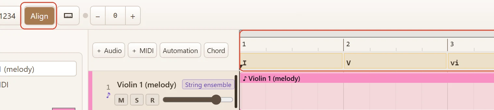

# Lesson 3: Interface Logic and Shortcuts: Why the Buttons Are Grouped This Way

## Why there has to be a grouping logic

Once there are too many buttons you can't find any of them. This software's rule is: **the left side handles "files and settings", the middle handles "time and playback", the right side handles "what you can see"**.

| Position | Contents | When you use it |
|---|---|---|
| Top left | File ▾, Settings ▾, Lessons, Help | Opening a project; device, MIDI, sound library and colour scheme all live under Settings |
| Centre | Go to start, rewind, advance, stop, play, record, loop | Any time |
| Centre right | Master status (LUFS / GR), bar and time, BPM, time signature | Watching during playback |
| Right | Metronome, lead-in, Align, keyboard playing, MIDI transpose | Before recording |
| Far right | Inspector, Mixer, Piano roll, Master, Album, Export | Switching workspace |

**Why make File a menu?** Because new / open / save get pressed a few times a day but took up three slots; folded into a menu, the play and record buttons you press all the time can be bigger.

## The reasoning behind the panels

The Mixer, the Piano roll and Master are all panels that **take up the bottom area**, and only one opens at a time. The reason: when mixing you need to see the tracks, and when editing MIDI you also need to see the tracks; if each one opened its own window the screen would be covered at once.

The effect panels, by contrast, are **floating windows**, and you can have several open at the same time — because while adjusting EQ you usually want to watch the compressor's gain reduction too.

## Shortcuts you use most

| Key | Action | | Key | Action |
|---|---|---|---|---|
| Space | Play / stop | | X | Mixer |
| R | Record | | P | Piano roll |
| C | Loop | | I | Inspector |
| G | Align to grid | | A | Automation |
| Ctrl+S | Save | | Ctrl+Z | Undo |
| Ctrl+T | Split clip | | Del | Delete clip |
| Enter | Go to start |
| Backspace / Delete | Delete the selected clip | | Shift+M | Master |

When you are typing in a text box, shortcuts step aside automatically — you don't have to press Esc first.

## How it works: why Align (Snap) is on by default

The ear is far less forgiving of **rhythm** than of pitch: a 10-millisecond error is audible, while a 10-cent pitch error is barely noticeable. So when editing, clips snap to the grid by default, which avoids the illusion of a dragged beat after a twitchy hand. To fine-tune, hold Shift while dragging and snapping is temporarily off.

## Try it now

1. Press X, P and I once each, and see which position each panel takes and what changes when you close it.
2. Hold Shift while dragging a clip, and feel the difference between "snapping" and "not snapping".
