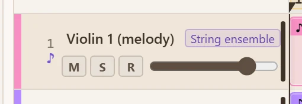

# Lesson 4: Tracks: What Actually Makes an Audio Track Different from a MIDI Track

## Two kinds of track, two sources of sound

| | Audio track (waveform) | MIDI track (♪) |
|---|---|---|
| What it stores | Sound that is already recorded or imported | Notes: pitch, timing, length, velocity |
| Change the instrument | No (the sound is fixed) | Yes, at any time |
| Change the tempo | It stretches (time stretching) | Follows the bars, the most natural |
| Change the pitch | Has to be recalculated (clip pitch shift) | Edit the notes directly |
| Typical use | Vocals, acoustic guitar, real drums | Piano, strings, synths, drum machines |

In one sentence: **an audio track is a "result", a MIDI track is an "instruction"**. An instruction can be replayed on another instrument; a result can only be processed.

## The buttons in the track header

- **M (Mute)**: this track makes no sound.
- **S (Solo)**: you hear only the tracks with S pressed (there can be several). Note that solo is "global" and affects the other tracks.
- **R (standby)**: tells the software "record into this one". On an audio track you also have to turn on **I (input monitoring)** to hear yourself.
- **Fader**: this track's volume (dB).
- **Colour block**: clicking it only selects the track; to change the colour, right-click the **track header → Change color**.

## How it works: 0 dB on the fader is not "loudest"

The `0.0` on the fader is a **reference point**, not a ceiling. Push it up and the track gets louder, pull it down and it attenuates. What actually decides whether something clips is the total of all the tracks added together:

- 32 tracks (the project limit) all pushed to 0 dB and the master output will certainly clip.
- The professional habit is to leave room on every track (a vocal peaks at about −6 dB), so the master has something to work with.

dB is a logarithmic unit: **+6 dB is about twice the amplitude**, −6 dB about half. So "just pushing it a little" is often already a lot louder.

## How it works: pan

Left-right position is distributed "equal power": sitting in the centre, each side gets about −3 dB rather than half each. That way, when you move a sound from the centre to the left, **the total volume doesn't seem to jump up and down**.

## Try it now

1. Add a MIDI track, click a few notes into the Piano roll, then in the Inspector change the instrument from "Grand piano" to "String ensemble" — the same string of notes, a completely different sound.
2. Push one track's fader to +6 and watch whether the master output's peak meter starts to turn red.
