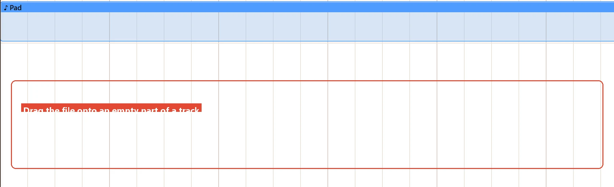

# Lesson 5: Importing Audio: Sample Rate, Bit Depth, and Basic Clip Handling

## How to import

1. Drag the audio file **straight onto an empty spot in an audio track**, or use File → Import audio.
2. The clip goes where you drop it; drop it on an empty stretch of timeline and the software picks an audio track for it.
3. One audio file is one **clip**. You can split it, drag it, fade it in and out, but the original file is not touched.

WAV, MP3, FLAC, OGG and M4A are supported. **AIFF is not** — this uses the browser's built-in decoder, and in testing Chrome cannot decode AIFF (convert to WAV first). MP3 and M4A are compressed formats: once imported, the audio quality is fixed and cannot be restored.

## A clip's three times

Every clip has three time values; mix them up and things never line up:

- **Start**: where it sits on the timeline.
- **Duration**: how long it occupies.
- **Offset**: which second of the original audio file it starts playing from.

So "dragging the clip to the right" changes the start; "dragging the right edge" changes the duration; "trimming off the beginning" changes the offset and the start.

## How it works: sample rate and bit depth

- **A sample rate of 44.1 kHz** is the CD standard; **48 kHz** is the standard for video and most audio interfaces. Both are enough, but **it is best to keep one project consistent**.
- When you import a file at a different sample rate, the software converts it on the fly. It sounds fine, but repeated conversions leave very small errors.
- **Bit depth**: inside, the project is 32-bit float (the Web Audio buffers are float, and saving is 32-bit lossless too). Only when you **export a finished file** do you choose 16/24-bit, and dither can be added.

## Common mistakes

- **The clip doesn't line up with the beat**: first check that the project BPM matches the audio file's original BPM, then turn on Align and drag it to a bar line.
- **It clips after import**: the file itself may already be recorded at 0 dBFS. Select the clip and pull "Volume dB" down 3–6 dB in the Inspector.
- **You dropped it on a MIDI track**: **dropping it on a MIDI track doesn't break anything** — the software moves it to the first empty audio track for you (and creates one if there isn't one).

## Try it now

Import a song, cut out the chorus (Ctrl+T splits at the playhead), drag it to bar 1, and add a 0.5-second fade-in.
