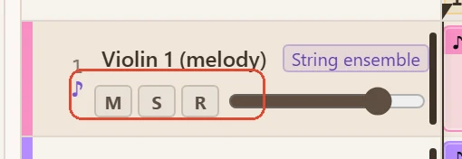

# Lesson 6: Your First Recording: Input, Monitoring, and the Buffer

## Four things before you record

1. **Choose the input**: the microphone menu in the status bar at the bottom left (or Settings ▾ → Audio device). The first time, the browser asks for microphone permission.
2. **Press R to arm**: this tells the software which audio track to record into.
3. **Press I for monitoring**: only with I turned on can you hear yourself right now; without it you still record, you just can't hear it.
4. **Wear headphones**: monitoring through speakers puts the backing track back into the microphone, and it comes out as echo.

## How it works: why there is latency

The browser does not drive the sound card directly; the sound goes through a **buffer** first. A small chunk of what comes in is stored, and only handed to the program once it has built up. A bigger buffer is more stable but adds latency.

At 48 kHz, for example:

| Buffer | One-way latency |
|---|---|
| 64 samples | about 1.3 ms |
| 128 samples | about 2.7 ms |
| 256 samples | about 5.3 ms |
| 512 samples | about 10.7 ms |

Add the conversion latency of the interface itself, and in practice a total of about **10–20 ms** still feels comfortable for "singing while listening"; past 30 ms it clearly feels like "the sound is half a beat behind".

## How to set it

- While recording: set the buffer to "**Low latency**" in the device settings.
- While mixing: change it back to "Balanced" or "Stable", so the computer has room to run a lot of effects.
- The buffer only takes effect after you refresh the page; the project is auto-saved.

## Common mistakes

- **Nothing gets recorded**: nine times out of ten you didn't press R, or the wrong microphone is selected. Check whether the input level meter in the status bar moves.
- **Echo from the speakers**: you are monitoring through speakers. Wear headphones.
- **Clipping**: the microphone gain is too high. Let the loudest moment land between −12 and −6 dB.

## Try it now

Record 8 bars: count 1234 (the "1234" lead-in at the top left), sing or play along with the metronome, and press Space to listen back when you're done.
