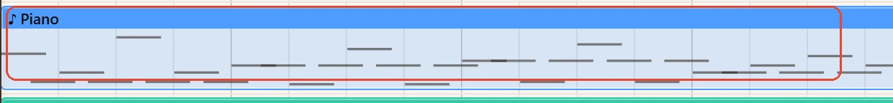

# Lesson 8: Editing Clips: Split, Drag, Fades, and Align

## Four basic moves

| Move | How | What it changes |
|---|---|---|
| Move | Drag the body of the clip | Start (its position in time) |
| Trim | Drag the left or right edge | Duration |
| Split | Put the playhead in place, Ctrl+T | One clip becomes two |
| Delete | Select, then Del | The clip disappears (Ctrl+Z brings it back) |

The clip also has a right-click menu: **Pitch shift** (recalculates the pitch, length unchanged), **Duplicate**, **Separate vocals / accompaniment**.

## How it works: why every cut needs a fade

The waveform is usually not exactly 0 at the cut point. Cut straight through and at that instant the waveform jumps from some value to 0, and the speaker goes "pop" — that is a **click**, and in the spectrum it is noise across the whole band. There are two ways out:

1. Give every cut a **5–15 ms fade**. Note that **the software does not add one when you split**; you have to pull the fade triangle in the corner of the clip yourself. Only clips made by **recording** come with a 5 ms fade already.
2. When two pieces have to join, let them **overlap by 10–30 ms with a crossfade**. This matters especially when splicing different takes: the two pieces differ in phase and in timbre, and a hard join always leaves a mark.

## Align (Snap)

On by default, so clips stick to the grid (from 1 bar down to 1/16, depending on the zoom). To ignore snapping for a moment, press **G** to turn Align off (Shift+drag is add to / remove from the selection, not a way to turn snapping off).

**Why align?** The ear is sensitive to timing differences of 10 ms and up. Hand dragging is often off by 20–50 ms, which sounds like "this person is singing carelessly". Align first, then fine-tune.

## Common mistakes

- **Dragging a clip onto another track**: while dragging, watch the colour of the track under the mouse.
- **Cutting out the breaths**: a singer's breathing is part of the emotion; don't delete all of it — keep some and lower the level.
- **Trimming made the original audio disappear**: it didn't. Trimming only changes "the range you can see"; the original file is still in the project.

## Try it now

Cut the demo project's lead vocal clip into three, drag the middle piece half a beat later, then turn Align back on and drag it home — hear the difference between "off the beat" and "aligned".
