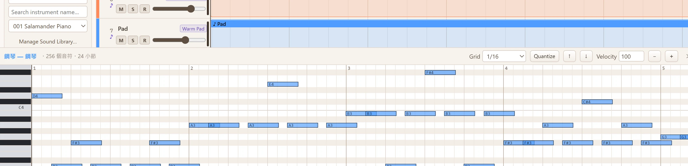

# Lesson 9: MIDI and the Piano roll: Writing Music With Instructions

## A note has only four things

| Parameter | What it means | Typical range |
|---|---|---|
| Pitch | which note (MIDI pitch number) | C-1 to G9 |
| Start | when it begins (in beats) | snapped to the grid |
| Length | how long it sounds | 0.25–8 beats |
| Velocity | how hard it is played (0–127) | 60–110 |

**Length is counted in beats, not seconds**, so when you change the BPM the notes follow the bars instead of bunching up. That is MIDI's biggest advantage.

## How to work the Piano roll

- **Click empty space**: add a note (it keeps the length you set last time).
- **Drag a note**: up and down changes the pitch, left and right changes the timing; **drag its right edge** to change the length.
- **Select several**: drag out a selection box, or hold Shift and click.
- **Quantize**: snap the selected notes to the grid you choose (1/4, 1/8, 1/16, 1/32, or 1/8 and 1/16 triplets). Use it when your playing is not tidy enough, but **do not quantize everything to 100%** — you lose the human feel.
- **Velocity**: there is a velocity curve below the roll; drag on it to draw a crescendo or a diminuendo.
- **Pedal lane**: a sustain pedal (CC64) plugged into a MIDI keyboard gets recorded here. Note length records how long the key was held down; the pedal is a separate layer.

## How it works: why MIDI often sounds fake

Every note on a real instrument is different: the velocity, the attack time and the tail length all vary a little. MIDI's default is **perfectly even**, so it sounds like a machine. Three ways to improve it straight away:

1. **Don't leave every velocity at 100**: lead melody 90–105, accompaniment 70–90.
2. **Offset the attack times by 5–15 ms**: do not start all three notes of a chord at exactly the same moment.
3. **Don't make every length the same**: let some notes overlap slightly (legato) and let others break off.

## Try it now

Write a four-bar chord progression in the Piano roll (one chord per bar, three notes each), then nudge the three notes of each chord slightly apart in time and listen to the difference.
