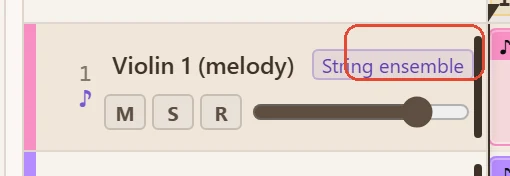

# Lesson 10: Timbres: the Built-in Synth and SoundFont

## Two sources of timbre

**Built-in sounds**: timbres the software calculates in code (piano, strings, bass, drums…). The advantage is that they are ready the moment you open the project, and they take up no space.

**SoundFont (.sf2)**: a sampled-instrument library format in which the notes are **a real instrument recorded one note at a time**. It sounds more realistic, but you have to download it yourself, and the files are bigger (tens to hundreds of MB).

## Using a SoundFont

1. In the top row, **Settings ▾ → Sound library** → download a few free `.sf2` files from the list (GeneralUser GS, for example).
2. Drag the file into the SoundFont library window, or press **Choose .sf2 from computer…**.
3. What you load is stored in this browser (IndexedDB), so you do not have to pick it again next time.
4. Go to the MIDI track's Inspector and open the **Instrument** menu: the "SoundFont: …" group is there.

> The browser only reads files you downloaded yourself; it never fetches timbres from the network.

## How it works: why sampled sounds are more real

A real instrument's sound carries a lot of **irregular detail**: the attack of every note, its resonance, tiny differences in intonation. A synth approaches that detail with a mathematical model; sampling plays a recording straight back.

But sampling has weaknesses too: **the same note played twice sounds identical** (it sounds like a machine gun), and across the range it is played back at a different speed, so higher notes get shorter and lower notes get longer. That is why professional sample libraries record several **velocity layers** and **loop points** for every note.

## What to choose

| What you need | What to use |
|---|---|
| Fast arranging, trying out chords | built-in sounds |
| Piano, strings, bass that have to sound real | SoundFont |
| Electronic, synth, pads | built-in (a synth is what they are for) |
| Drum kits | the built-in GM kit is enough; for better, a SoundFont drum kit |

## Try it now

Play the same MIDI melody once with the built-in piano and once with the SoundFont piano, and listen for the difference in the **attack** — that is where "real or not" shows up most clearly.
