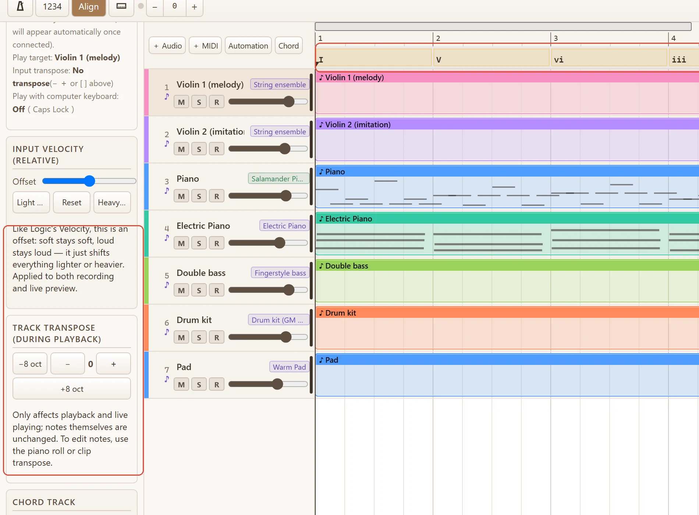

# Lesson 11: The Chord track: A Whole Song's Harmony at a Glance

## Why there is a chord track

The two questions that come up most while arranging and mixing are **"what chord is this"** and **"what note goes with it"**. The chord track draws the answers on the timeline, so every feature that needs harmony information (pitch correction, harmony, auto-accompaniment) can refer to it directly.

## Detecting the chords

1. Pick the track that **best represents the harmony** (a piano, guitar or bass MIDI track is the most accurate; an audio track works too, but the result is blurrier).
2. Inspector → Chord track → choose a resolution (every beat / every half beat / every two beats / every bar) → **Detect chords on this track**.
3. The program analyses the pitch content of each time cell, guesses the key, then uses a smoothing rule in which **changing chord costs something** to join the scattered guesses into runs.

## Three ways to display it

| Display | What it looks like | Who it suits |
|---|---|---|
| Note names | C, Am, F, G7 | people who already read chord symbols |
| Roman numerals | I, vi, IV, V7 | people who want to see functional harmony |
| Movable do (numbered notation) | 1, 6m, 4, 5⁷ | people who only know C major and want to apply it fast |

All three show **the same chord**. Am in C major is vi, and it is also 6m.

## Editing

Click a block on the chord track and a menu opens: change the chord quality (major, minor, dominant 7th, major 7th, minor 7th, sus4, diminished triad), change the root, split it in half, merge it with the next one, delete. Click an empty spot and you add a chord in that bar.

## Applying it elsewhere

- **Apply to harmony**: set the Harmony plugin to **By chord**, and the harmony notes only land on chord tones, so you are least likely to sing something dissonant.
- **Apply to pitch correction**: set the key and scale of the vocal pitch correction to the key the program guessed.

## How it works: why Roman numerals beat note names

The same progression is `C–Am–F–G` in C major and `G–Em–C–D` in G major — completely different note names, but **the Roman numerals are `I–vi–IV–V` in both**. Roman numerals describe function, so they are clearer when you change key, transpose, or talk to another musician.

## Try it now

Detect the chords in the demo project once, switch to **Roman numerals** and look at the Canon progression: `I–V–vi–iii–IV–I–IV–V` (D–A–Bm–F#m–G–D–G–A), then hum the bass along with it.
