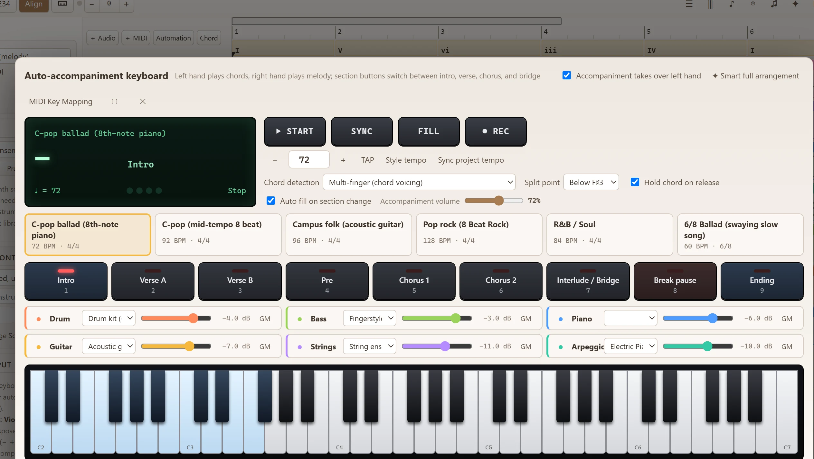

# Lesson 12: The Auto-Accompaniment Keyboard: A Whole Band on Your Own

## What it does

The logic of an arranger keyboard is this: **you look after the chords and the sections, and the machine does the rest.** Press C and it plays six parts — drums, bass, piano, guitar, strings and arpeggio — and every style has its own rhythm patterns.

Those six parts are really six MIDI tracks in the project (named "Accomp-…"), so once you have recorded them you can edit them in the Piano roll, add effects in the Mixer, and swap in SoundFont instruments.

## Using it

1. Choose a **style** (Mandopop ballad, pop rock, R&B, 6/8 ballad…); the tempo switches to the suggested value.
2. Press **START** (or **SYNC**: it only starts when your left hand presses the first chord, which is the most natural way to fall in with a band).
3. **Play chords with your left hand** (the split point is F♯3 and below by default). There are three chord-detection modes: multi-finger, one-finger, and whole keyboard.
4. **Change section**: intro, verse A/B, pre-chorus, chorus 1/2, interlude, break, outro. The change takes effect **on the next bar line**; a button flashing yellow means it is queued.
5. **Fills**: press FILL, or press the current section again.

## How it works: why a section change waits for the next bar

Section boundaries in music almost always fall on a bar line. If the change happened the instant you pressed, you would get the awkward result of half a bar of verse and half a bar of chorus. Queueing it to the next bar is what keeps every switch clean.

## Volume and clipping

Six parts sounding at once easily add up past 0 dBFS. That is exactly what **Accompaniment volume** on the panel is for (72% by default): if you hear clipping, turn it down. It works by scaling down the **velocity** going into the synth, so once you record to MIDI, the velocities you capture are the ones you were hearing.

## Try it now

Play `C–Am–F–G` in the Mandopop ballad style, switch to chorus 1, then press FILL; then press ● REC to record the whole passage as a MIDI clip, and open the Piano roll to see what each of the six tracks wrote.
