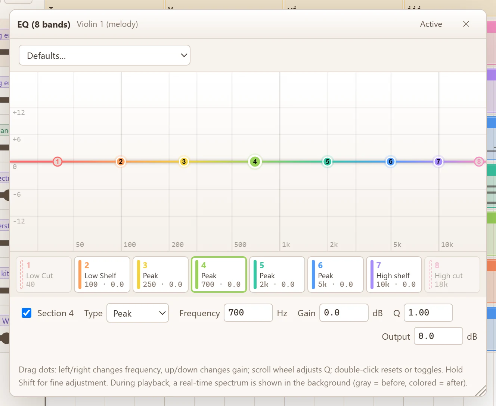

# Lesson 13: EQ: Frequency, Q and Phase

## What EQ changes

EQ changes **how loud each frequency is**. It does not create sound; it only redistributes frequencies that are already there. Each band of the eight-band parametric EQ has three controls:

| Parameter | What it means |
|---|---|
| Frequency | which part of the spectrum you are working on (Hz) |
| Gain | how many dB you add or take away |
| Q | how narrow the affected range is (high Q = narrow, like a scalpel; low Q = wide, like a big brush) |

There are also two slope types: **low cut (high-pass)** removes everything below a frequency, and **high cut (low-pass)** removes everything above it.

## Three practical rules

1. **Cut first, then think about boosting.** When something "is not bright enough", first check whether too much low end is covering the highs.
2. **A low cut is almost always the first step.** Below 80–100 Hz on a vocal, below 80 Hz on a guitar, below 300 Hz on cymbals is usually unusable noise.
3. **Boost wide (low Q), cut narrow (high Q).** Boosting easily turns harsh; cutting has to be precise.

## How it works: phase

Every filter changes phase, especially where Q is high: on both sides of a dip in the frequency response, the phase rotates. You may not hear it as "a phase problem", but **heavy boosting** makes a sound thin and unnatural. That is why "EQ by subtraction" sounds better.

## Common mistakes

- **Boosting 3 kHz on every track**: the whole mix ends up crowded at 3 kHz. Somebody has to move over.
- **Setting the low cut too high**: a male vocal's low notes and the bass's fundamental get chopped off and the sound goes thin.
- **Using EQ to fix clipping**: a peak above 0 dBFS is an amplitude problem, not a frequency problem; use compression or pull the fader down.

## Try it now

On the demo project's lead vocal: low cut at 90 Hz, −2 dB at 250 Hz (to take out the mud), +1.5 dB at 3 kHz (for diction), and toggle the EQ on and off while it plays to compare.
