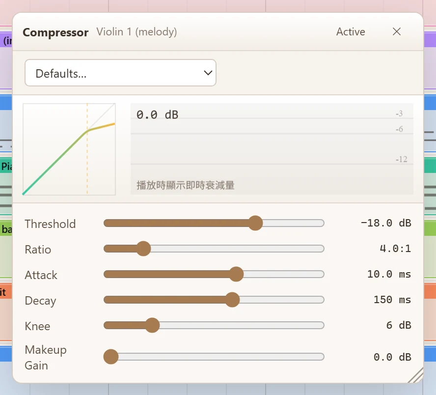

# Lesson 14: The Compressor: Threshold, Ratio, and Why It Still Clips

## A compressor does exactly one thing

**Turn down whatever is above the threshold.** That is all it does. Every parameter describes "how much" and "how fast":

| Parameter | Meaning | Typical value |
|---|---|---|
| Threshold | compression only starts above this level | −18 dB |
| Ratio | how many times the excess is reduced | 3:1 to 4:1 |
| Attack | how quickly it starts compressing | 5–30 ms |
| Release | how quickly it recovers afterwards | 80–250 ms |
| Knee | how smooth the corner is | 4–8 dB |

## Attack and release decide the character

- **Fast attack**: the "click" of the drum gets squashed and the sound goes soft and flat.
- **Slow attack**: let the attack go past first and compress only the tail behind it — the drum hits harder.
- **Release too fast**: the sound "pumps", as if it were gasping for breath.
- **Release too slow**: the level has not recovered where it should have, and the whole thing turns stiff.

## How it works: why more compression is not more volume

Compression turns the loud parts down, so the whole thing sounds flatter. To get back to the original volume you need **makeup gain** to push everything back up. The result: **the quiet parts have got louder** and the dynamic range has shrunk.

That is exactly where "compression makes a sound more powerful" comes from — but it has a price: **the transients get shaved off**. The impact of a drum, the snap of a strummed guitar, the diction of a vocal all live in the attack. Compress too much and the sound becomes a shapeless mush.

## Why it still clips

A compressor is not a limiter. A ratio of 3:1 means "anything 3 dB over leaves 1 dB" — **the output still goes above the threshold**. To keep peaks below 0 dBFS you still need one of these:

- pull the fader down, or
- the Limiter on the Master (lesson 20).

## Try it now

Put a compressor on the drum track: threshold −18, ratio 3, attack 20 ms, release 80 ms, then change the attack to 1 ms and listen to the drums go from "punchy" to "flat".
