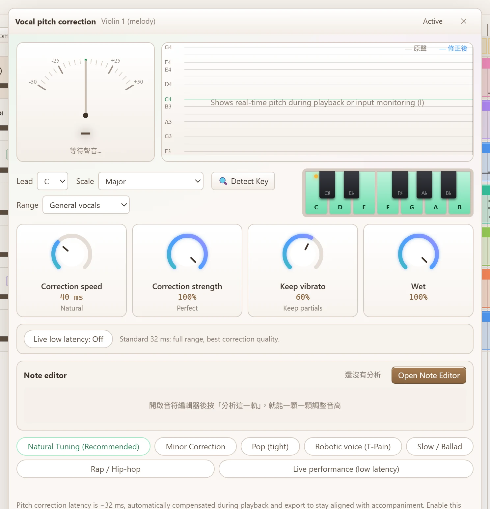

# Lesson 15: Vocal Pitch Correction: Cents, Correction Speed and Live Mode

## What pitch correction corrects

One semitone is divided into **100 cents**. The ear only starts to hear a deviation at about **5–10 cents**, so correcting to 0 cents is both unnecessary and often bad to listen to.

| Deviation | How it sounds | Correct it? |
|---|---|---|
| ±5 cents | almost inaudible | no |
| ±10–15 cents | sounds a little odd on its own | depends on the style |
| ±20–30 cents | clearly out of tune | yes |
| 30 cents and above | very uncomfortable | definitely |

## The four knobs

- **Correction strength**: 100% pulls the note all the way to the scale note; 70% pulls only part of the way (and keeps the human feel).
- **Correction speed (Retune)**: the smaller the number, the faster it jumps. **0–5 ms is the robot voice (the T-Pain effect)**; 20–50 ms is natural correction.
- **Keep vibrato**: corrects only the centre of the pitch and lets the vibrato carry on. Turn it down and the vibrato gets flattened out.

## Note editing

Press **🎼 Open the note editor** → **Analyze this track**, and the program cuts the recording into individual notes and draws them as a Piano roll. You can:

- drag to change pitch and timing, drag the right edge to change length
- select notes and set pitch and strength with the sliders
- force a particular note to a pitch outside the scale (a blues flat fifth, say)

Edited notes **override the scale rules**, so when you want to sing a blues note on purpose, this is what you use.

## Live mode: 16 ms

Pitch correction has to analyse a short stretch of pitch before it can decide, and that causes a fixed latency. Standard mode is 32 ms (full range, the best quality); **live mode is 16 ms**, at the cost of a lowest note of only 100 Hz. Use live mode for streaming and rehearsals, and switch back to standard for the real mix.

## How it works: where the character comes from

A real singer's intonation is not a straight line; it **keeps swinging around the target note** (vibrato). If pitch correction flattens the swing as well, the voice loses its life. So good correction **moves the centre line only and keeps the swing** — which is also why **Keep vibrato** is usually set to 60–80%.

## Try it now

The demo project puts Vocal pitch correction on the violin lead (pitch correction is not only for voices). Pull Correction speed from 0 to 120 ms and listen to the same long note go from "snapping into tune at once" to "sliding slowly into tune"; to practise on a real voice, record a line yourself and apply the same settings.
