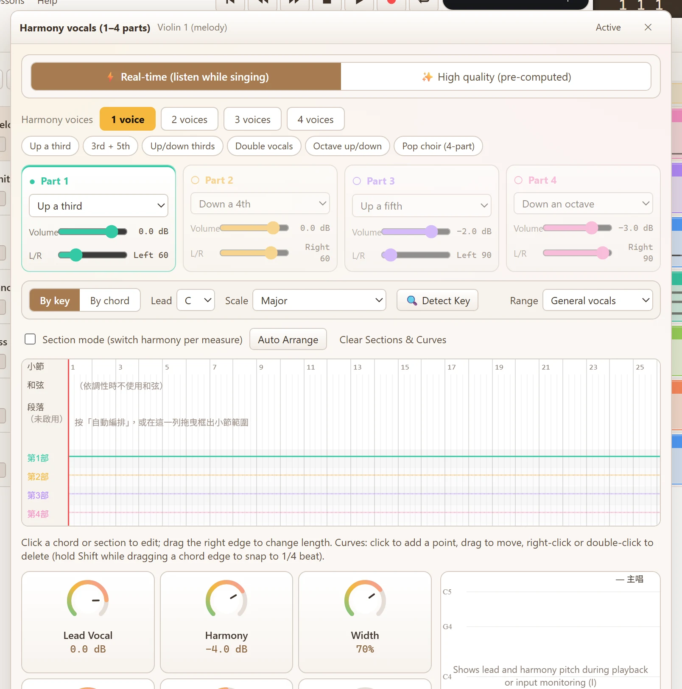

# Lesson 16: Vocal Harmony: Three or Four Parts from One Lead

## Harmony is not copy, paste and transpose

Copy the lead vocal, move the copy up three semitones, and it sounds like two cats fighting, because that note may not be in the chord. Real harmony has to **land on the chord tones of the moment**, so it has to know what chord is playing.

This software offers two sources:

| Source | How it picks the pitch | When to use it |
|---|---|---|
| By key | walks up or down the scale | when there is no chord data yet, or the harmony has to be free |
| By chord | lands on the chord tones of the moment | when there is a chord track (the safest) |

## Using it

1. Add **Harmony** to the lead track (after the vocal pitch correction, before the EQ).
2. Choose the number of parts (1–4); each part can be set to an interval (third above, fourth below, fifth above, octave below…), a level and a left/right position.
3. Set the harmony source to **By chord**, then press **🎹 Chords** or apply the **chord track** result directly.
4. **Humanize** gives each part a tiny difference in pitch and timing — perfectly even harmony sounds like a synth.

## How it works: why thirds and sixths are the most used

In a major or minor scale, thirds and sixths decide a chord's quality (major or minor), so they reinforce the harmony best and are the least likely to hit a dissonant note. Fourths and fifths are emptier, and are usually kept for the powerful sections.

## How it works: why harmony has to be quiet

Harmony is a **side dish**. The lead is what the listener is paying attention to; the harmony only wraps around it. In practice harmony sits 4–8 dB below the lead and is spread a little left and right, so it sounds like a group of people rather than two people singing the same line.

## Try it now

Add a Harmony to the demo project's lead track, one part a third above, By chord; then pull the harmony level from −4 dB to −12 dB and listen to the difference between "wrapping it up" and "stealing the scene".
