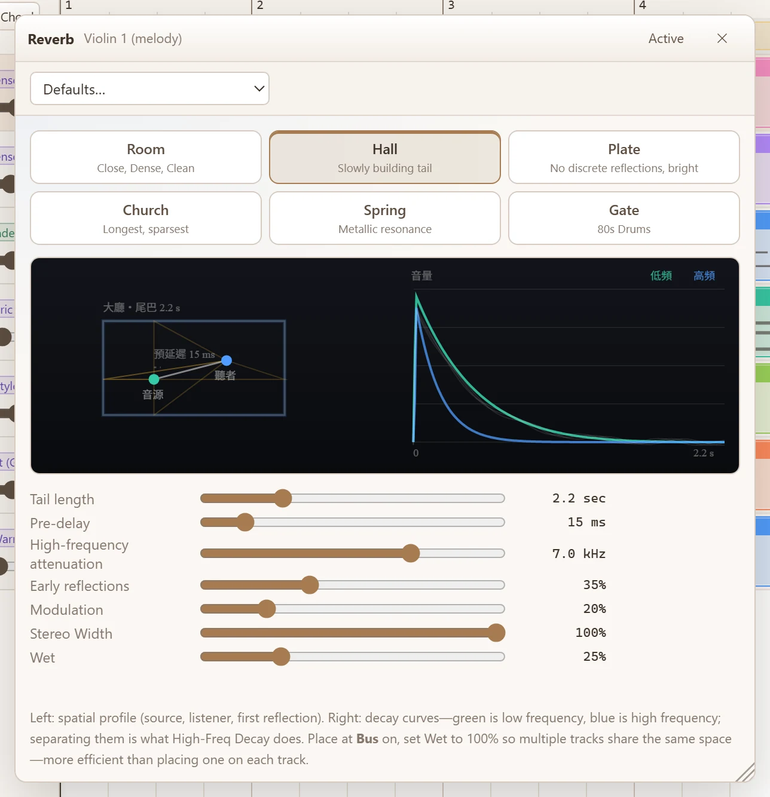

# Lesson 17: Space: Reverb, Delay and Stereo Width

## Three tools, three kinds of space

| Tool | How it sounds | Main parameters |
|---|---|---|
| Reverb | Like being in the same room | Space type, tail length, pre-delay, high-frequency attenuation |
| Delay | One or more echoes | Time (follows the BPM), feedback, bouncing left and right |
| Stereo width | The sound gets wider | Mode (Haas / phase decorrelation / M-S), width, keep low frequencies in mono |

## The two key numbers for reverb

- **Pre-delay**: how long after the dry sound the reverb starts. Too short and the diction blurs; 20–40 ms is the usual setting for a vocal.
- **Tail length**: short (0.5–1 s) means a small room, long (3 s and up) means a hall or a church. **Longer is not better** — the longer the tail, the more the notes that follow get covered by the reverb in front of them.

## How it works: why "share one space"

If you hang a separate reverb on every track, it sounds like each instrument is playing in **a different room**. The professional way is to put the reverb on a **bus** and send several tracks into it — every instrument shares the same space, and only then does it sound like one performance.

## How it works: stereo width and mono compatibility

The simplest way to widen a sound is to make the left and right channels slightly different. But watch out: **when both speakers play at once, if the left and right are out of phase, the middle seems to disappear.**

The width effect in this software is designed like this: the side signal is summed **in opposite polarity** across left and right, so the width disappears in mono monitoring and the original sound stays intact. On a car stereo or a phone speaker (mono), nothing goes wrong.

## Common mistakes

- **Too much reverb**: it sounds "distant" and fake. A dry/wet of 15–25% is plenty for a vocal.
- **Delay that does not follow the beat**: the echoes land where they should not. Set the time to a 1/8 or 1/4 note.
- **The low end widens too**: the kick and the bass lose their centre of gravity. Turn on "Keep low frequencies in mono".

## Try it now

Send the vocal to the Bus A reverb (send at −14 dB), then change the reverb space from "Room" to "Hall" and listen to how the mood of the same line changes.
